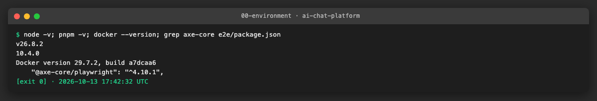
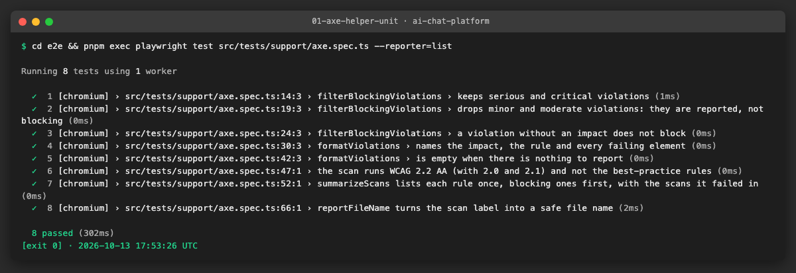
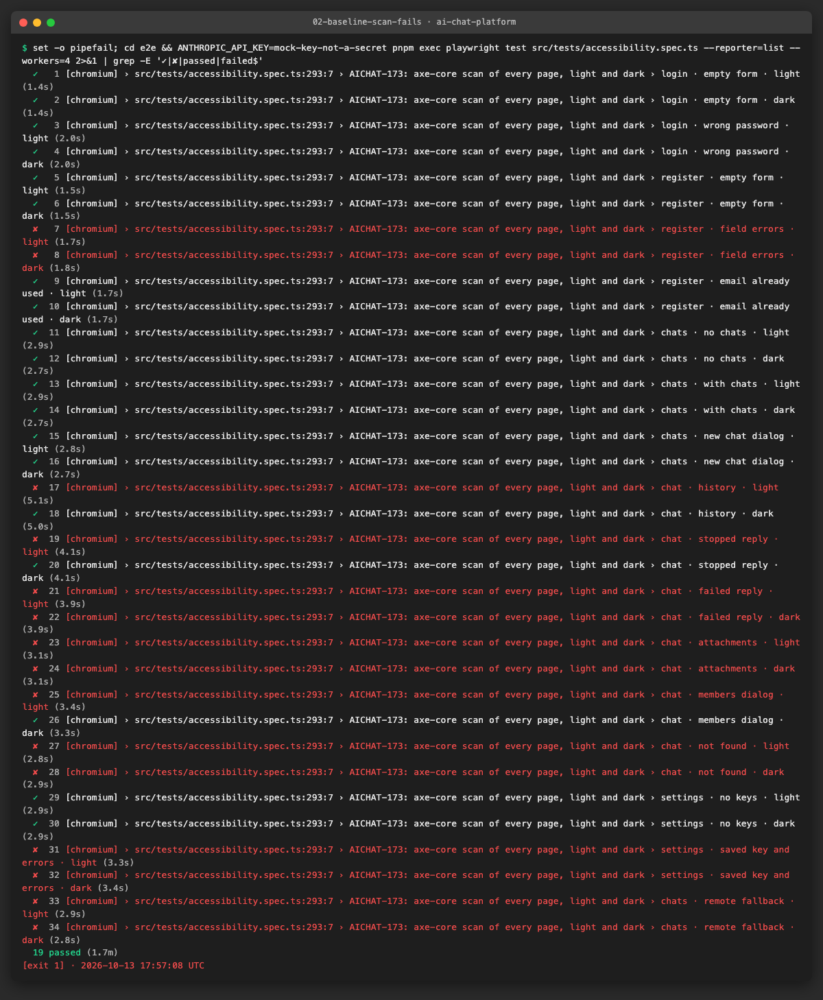
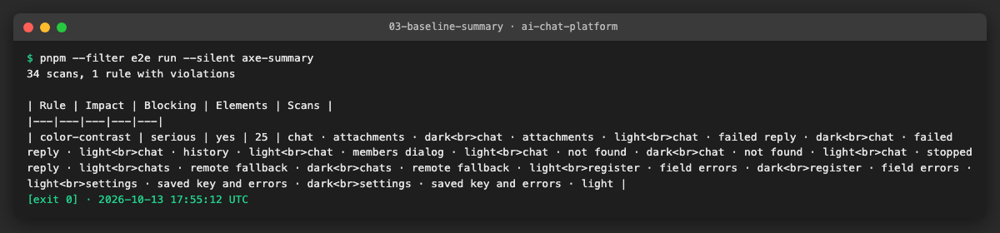
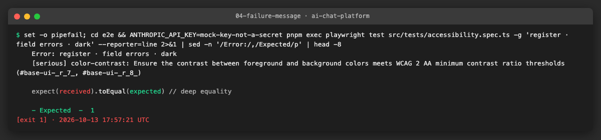

# AICHAT-10 · Accessibility testing: work log

| Field | Value |
|---|---|
| Epic | [AICHAT-10](https://ipca-grupo11.atlassian.net/browse/AICHAT-10) |
| Analysis | [README.md](README.md) |
| Owner | João Vieira |
| Branch | `test/AICHAT-10-accessibility` |
| Started / finished | 2026-10-13 / … |
| Pull requests | … |
| Status | In Progress |

## 1. DoR review

Date: 2026-10-13

| DoR item | Status | Question asked | Decision | Decided by |
|---|---|---|---|---|
| Owner assigned | Met | — | João Vieira | — |
| Scope and tooling agreed | Met | What counts as a failing result? | axe-core through `@axe-core/playwright`, rules tagged `wcag2a`, `wcag2aa`, `wcag21a`, `wcag21aa`, `wcag22aa`. Impacts `serious` and `critical` fail the test; `moderate` and `minor` are kept in the JSON report only | João Vieira |
| Target environment available | Met | — | Compose stack with the `llm` profile (`pnpm mock:up`); `e2e.yml` runs the Playwright suite on every pull request | — |
| Pages and themes to check listed | Met | Which pages, states and themes? | The full matrix of README §4.2, each state in light and dark (see US1) | João Vieira |
| `@axe-core/playwright` installed | Met | — | `^4.10.1` in `e2e/package.json` | — |
| Streaming reply | Decided | How to scan a reply that changes every few ms? | Scan after the stream ends; the live region itself is checked in US4 | João Vieira |
| vitest-axe spike (US5) | Decided | Run the spike or not? | Close as covered by AICHAT-18-US5 (`mfe-chat`, `mfe-settings`) and add the missing checks to `packages/ui` (Button, Input, Dialog, Alert, Select) | João Vieira |

Blockers: none.

Finding at the start: the analysis (README §4.1) points at `e2e/src/a11y/axe-helper.ts`, but that file, its unit tests and
the e2e fixtures were removed on 2026-10-04 in commit `5eb6221` ("chore: remove generated tests"). The dependency stayed,
so no page of the application was scanned for accessibility. US2 restores the helper.

## 2. Environment



| Tool | Version | Install |
|---|---|---|
| macOS | 27.0 | — |
| Node | 24.21.0 | `nvm use` (`.nvmrc`) |
| pnpm | 12.6.0 | `corepack enable` |
| Docker | see evidence | Docker Desktop |
| `@axe-core/playwright` | 4.10.x | `e2e/package.json` |
| Playwright | 1.63.0 | `pnpm --filter e2e exec playwright install chromium` |

## 3. Steps

### US1 · List the pages, states and themes to audit ([AICHAT-172](https://ipca-grupo11.atlassian.net/browse/AICHAT-172))

**What and why.** An automated scan only covers what it renders. axe-core checks the DOM that exists at the moment it runs:
an error message that is not on screen, a closed dialog or a failed reply that was never produced are not checked. So we
listed every UI state worth scanning, and how a test reaches it, before writing the scan.

**Standard and blocking impacts.** Target: **WCAG 2.2 level AA**. axe-core gives each violation an impact (`minor`,
`moderate`, `serious`, `critical`). `serious` and `critical` block the merge; the others are reported in the JSON
attached to the test. axe-core keeps `critical` for a small group of rules (for example a form field without a label), so
blocking only on `critical` would let missing contrast (`serious`) through.

**Themes.** The shell keeps the user's choice in `localStorage["theme"]` and applies it as the `dark` class on `<html>`
(`apps/shell/src/shared/theme/theme.ts`). Every state is scanned twice: with `theme = light` and with `theme = dark`, set
before the page loads. The test checks the class on `<html>` before scanning, so a "dark" run can never scan the light
page by mistake. Colour contrast is the rule most likely to differ between the two.

**Matrix (17 states × 2 themes = 34 scans).**

| # | Route | State | How the test reaches it |
|---|---|---|---|
| 1 | `/login` | empty form | open the page signed out |
| 2 | `/login` | wrong password | submit a registered email with a wrong password → `login-error` alert |
| 3 | `/register` | empty form | open the page signed out |
| 4 | `/register` | field errors | submit an invalid email and a short password → `email-error`, `password-error` |
| 5 | `/register` | server error | submit an email that already exists → `register-error` alert (409) |
| 6 | `/chats` | no chats | new account |
| 7 | `/chats` | with chats | two chats created through the API |
| 8 | `/chats` | "New chat" dialog open | click `new-chat` |
| 9 | `/chats/:id` | history (reply finished) | send a message, wait until `generating` is gone |
| 10 | `/chats/:id` | stopped reply | `@long` model, click Stop → "Stopped" label |
| 11 | `/chats/:id` | failed reply | `@error-500` model → `message-error-title` |
| 12 | `/chats/:id` | attachments | a pending file in the composer and a sent message with a file |
| 13 | `/chats/:id` | members dialog open | click "Share" |
| 14 | `/chats/:id` | chat not found | open a random id → `chat-error-heading` |
| 15 | `/settings` | no keys | new account |
| 16 | `/settings` | key saved, empty key error, connection test failed | save an Anthropic key; save an empty OpenAI key; test an invalid OpenAI key |
| 17 | `/chats` | remote fallback | `failRemote(page, "mfeChat", "abort")` (AICHAT-8) → `RemoteFallback` alert |

States of the analysis draft that are not in the matrix:

| State | Why |
|---|---|
| Streaming (while tokens arrive) | Decision in §1: the text changes every few milliseconds, so the scan runs after the stream ends (rows 9 and 10). The live region (`role="status"`) is checked in US4 |
| Queued messages | `MessageList` filters `status = queued` out and no component renders the queue (`selectQueuedMessages` is exported but not used). There is nothing on screen to scan |
| Settings "add/test key dialog" | There is no dialog: keys are added and tested in an inline form, covered by rows 15 and 16 |
| Fallback of `mfeAuth` and `mfeSettings` | The shell renders the same `RemoteFallback` component for every remote; one scan covers the markup |

**How to repeat it manually.**

1. Open `apps/shell/src/shared/theme/theme.ts` and confirm the `theme` key and the `dark` class.
2. In the running app (http://localhost:8000), open the console and run `localStorage.setItem("theme", "dark"); location.reload()`.
3. Expected: the page is dark and `document.documentElement.classList.contains("dark")` returns `true`.

**Result.** Matrix agreed with the owner on 2026-10-13 (decision in §1). It is the input of US2: the scan iterates over
these 17 rows.

**Problems and fixes.** None.

### US2 · axe-core scan of every page in light and dark theme ([AICHAT-173](https://ipca-grupo11.atlassian.net/browse/AICHAT-173))

**What and why.** A Playwright test opens each state of the US1 matrix in a real browser against the whole stack,
stores the theme before the page loads, checks the `dark` class on `<html>` and runs axe-core on the page. axe-core reads
the rendered DOM and the computed styles: names of buttons and fields, roles, ARIA attributes, heading order and the
contrast between each text and the colour behind it.

The helper named in the analysis (`e2e/src/a11y/axe-helper.ts`) had been removed in `5eb6221`, so we wrote it again in
`e2e/src/tests/support/` next to the other test helpers, with three changes:

| Change | Why |
|---|---|
| `withTags(wcag2a … wcag22aa)` | Without tags axe also runs its "best-practice" rules, which are not part of WCAG 2.2 AA (decision in §1) |
| Waits for finite CSS animations before scanning | Dialogs fade in; axe measures contrast with the opacity of that moment, so a half-visible dialog gives false results |
| Saves the full result as JSON (`e2e/axe-report/<label>.json`) and attaches it to the test | The `moderate` and `minor` findings, and the rules that passed, stay visible on a green run |

**Files.**
- `e2e/src/tests/support/axe.ts` (new): `assertNoCriticalA11yViolations(page, testInfo, label)`, the impact filter, the
  message format, the JSON report and `summarizeScans` (Markdown table of a set of reports).
- `e2e/src/tests/support/axe.spec.ts` (new): 8 Node-only tests of those decisions (no browser, no stack).
- `e2e/src/tests/accessibility.spec.ts` (new): the 17 states × 2 themes = 34 tests.
- `e2e/src/support/axe-summary-cli.ts` (new) and the `axe-summary` script in `e2e/package.json`: prints the table.
- `.github/workflows/e2e.yml`: the table goes to the job summary and `e2e/axe-report` is uploaded as the `axe-report`
  artifact on every run (`if: always()`). The spec is in `e2e/src/tests`, so the existing "Run Playwright E2E suite" step
  runs it and a violation fails the `e2e` job.
- `e2e/.gitignore`: `axe-report/`.

**How to run.**

```sh
pnpm mock:up
cd e2e
pnpm exec playwright test src/tests/support/axe.spec.ts                                   # helper only, no stack
ANTHROPIC_API_KEY=mock-key-not-a-secret pnpm exec playwright test src/tests/accessibility.spec.ts   # ~2 min, 34 scans
pnpm run --silent axe-summary                                                             # table of the last run
```

**How to repeat it manually.**

1. Run one state: `pnpm exec playwright test src/tests/accessibility.spec.ts -g "register · field errors · dark"`.
2. Open `e2e/axe-report/register-field-errors-dark.json`: `violations` has the failing rules, each `nodes[].any[0].data`
   has the two colours and the ratio; `passes` lists the rules that were checked and passed.
3. In the browser: install the axe DevTools extension, open http://localhost:8000/register in dark theme, submit an
   invalid email and run "Scan all of my page": the same `color-contrast` finding appears.

**Result.** The helper's own tests pass (8/8):



First run of the scan (baseline, before any fix): **19 passed, 15 failed**, exit code 1. Every failure is the same rule,
`color-contrast` (impact `serious`), on 25 elements. No missing names, labels or roles were found.





A failing scan names the state, the impact, the rule and the elements:



**Problems and fixes.**
- **Attachment upload returns 404.** The client posts to `/chats/:chatId/attachments`; conversation-service only has
  `/chats/:chatId/messages/:messageId/attachments`. It is the cause of the 9 `attach-file.spec.ts` failures recorded in
  AICHAT-8 and is already tracked as [AICHAT-255](https://ipca-grupo11.atlassian.net/browse/AICHAT-255) (found by the
  contract tests). Decision of the owner: the "attachments" state scans what can be reached today (a file rejected by
  type and a file rejected by the server, both with their error alert); the "sent message with a file" state is added
  when AICHAT-255 is fixed. AICHAT-255 is linked to AICHAT-173.
- **The members dialog is named "Members", not "Chat members".** `DialogContent` gets `aria-label="Chat members"`, but
  the dialog library also sets `aria-labelledby` to the `<h2>`, and `aria-labelledby` wins in the accessible name
  computation. The name is correct; the test now looks for "Members". The `aria-label` has no effect.
- **What the WCAG tags leave out.** axe's `aria-dialog-name` and `region` rules are tagged `best-practice`, so they are
  outside the agreed scope. The keyboard and screen-reader checks of US4 cover the dialogs by hand.
