# AICHAT-10 · Accessibility testing: work log

| Field | Value |
|---|---|
| Epic | [AICHAT-10](https://ipca-grupo11.atlassian.net/browse/AICHAT-10) |
| Analysis | [README.md](README.md) |
| Owner | João Vieira |
| Branch | `test/AICHAT-10-accessibility` |
| Started / finished | 2026-10-13 / 2026-10-13 |
| Pull requests | … |
| Status | Review |

## 1. DoR review

Date: 2026-10-13

| DoR item | Status | Question asked | Decision | Decided by |
|---|---|---|---|---|
| Owner assigned | Met | — | João Vieira | — |
| Scope and tooling agreed | Met | What counts as a failing result? | axe-core through `@axe-core/playwright`, rules tagged `wcag2a`, `wcag2aa`, `wcag21a`, `wcag21aa`, `wcag22aa`. Impacts `serious` and `critical` fail the test; `moderate` and `minor` are kept in the JSON report only | João Vieira |
| Target environment available | Met | — | Compose stack with the `llm` profile (`pnpm mock:up`); `e2e.yml` runs the Playwright suite on every pull request | — |
| Pages and themes to check listed | Met | Which pages, states and themes? | The full matrix of README §4.2, each state in light and dark (see US1) | João Vieira |
| `@axe-core/playwright` installed | Met | — | `^4.10.1` in `e2e/package.json` | — |
| Streaming reply | Decided | How to scan a reply that changes every few ms? | Scan after the stream ends; the live region itself is checked in US4 | João Vieira |
| vitest-axe spike (US5) | Decided | Run the spike or not? | Close as covered by AICHAT-18-US5 (`mfe-chat`, `mfe-settings`) and add the missing checks to `packages/ui` (Button, Input, Dialog, Alert, Select) | João Vieira |

Blockers: none.

Finding at the start: the analysis (README §4.1) points at `e2e/src/a11y/axe-helper.ts`, but that file, its unit tests and
the e2e fixtures were removed on 2026-10-04 in commit `5eb6221`, together with other e2e specs. The dependency stayed,
so no page of the application was scanned for accessibility. US2 restores the helper.

## 2. Environment


| Tool | Version | Install |
|---|---|---|
| macOS | 27.0 | — |
| Node | 26.8 (evidence) / 26.10 (shell) | `nvm use`; Node 24.21 of `.nvmrc` is not installed on this machine |
| pnpm | 10.4 (evidence) / 12.6 (shell) | `corepack enable` |
| Docker | 29.7.2 | Docker Desktop |
| `@axe-core/playwright` | 4.10.x | `e2e/package.json` |
| Playwright | 1.63.0 | `pnpm --filter e2e exec playwright install chromium` |

## 3. Steps

### US1 · List the pages, states and themes to audit ([AICHAT-172](https://ipca-grupo11.atlassian.net/browse/AICHAT-172))

**What and why.** An automated scan only covers what it renders. axe-core checks the DOM that exists at the moment it runs:
an error message that is not on screen, a closed dialog or a failed reply that was never produced are not checked. So we
listed every UI state worth scanning, and how a test reaches it, before writing the scan.

**Standard and blocking impacts.** Target: **WCAG 2.2 level AA**. axe-core gives each violation an impact (`minor`,
`moderate`, `serious`, `critical`). `serious` and `critical` block the merge; the others are reported in the JSON
attached to the test. axe-core keeps `critical` for a small group of rules (for example a form field without a label), so
blocking only on `critical` would let missing contrast (`serious`) through.

**Themes.** The shell keeps the user's choice in `localStorage["theme"]` and applies it as the `dark` class on `<html>`
(`apps/shell/src/shared/theme/theme.ts`). Every state is scanned twice: with `theme = light` and with `theme = dark`, set
before the page loads. The test checks the class on `<html>` before scanning, so a "dark" run can never scan the light
page by mistake. Colour contrast is the rule most likely to differ between the two.

**Matrix (17 states × 2 themes = 34 scans).**

| # | Route | State | How the test reaches it |
|---|---|---|---|
| 1 | `/login` | empty form | open the page signed out |
| 2 | `/login` | wrong password | submit a registered email with a wrong password → `login-error` alert |
| 3 | `/register` | empty form | open the page signed out |
| 4 | `/register` | field errors | submit an invalid email and a short password → `email-error`, `password-error` |
| 5 | `/register` | server error | submit an email that already exists → `register-error` alert (409) |
| 6 | `/chats` | no chats | new account |
| 7 | `/chats` | with chats | two chats created through the API |
| 8 | `/chats` | "New chat" dialog open | click `new-chat` |
| 9 | `/chats/:id` | history (reply finished) | send a message, wait until `generating` is gone |
| 10 | `/chats/:id` | stopped reply | `@long` model, click Stop → "Stopped" label |
| 11 | `/chats/:id` | failed reply | `@error-500` model → `message-error-title` |
| 12 | `/chats/:id` | attachments | a pending file in the composer and a sent message with a file |
| 13 | `/chats/:id` | members dialog open | click "Share" |
| 14 | `/chats/:id` | chat not found | open a random id → `chat-error-heading` |
| 15 | `/settings` | no keys | new account |
| 16 | `/settings` | key saved, empty key error, connection test failed | save an Anthropic key; save an empty OpenAI key; test an invalid OpenAI key |
| 17 | `/chats` | remote fallback | `failRemote(page, "mfeChat", "abort")` (AICHAT-8) → `RemoteFallback` alert |

States of the analysis draft that are not in the matrix:

| State | Why |
|---|---|
| Streaming (while tokens arrive) | Decision in §1: the text changes every few milliseconds, so the scan runs after the stream ends (rows 9 and 10). The live region (`role="status"`) is checked in US4 |
| Queued messages | `MessageList` filters `status = queued` out and no component renders the queue (`selectQueuedMessages` is exported but not used). There is nothing on screen to scan |
| Settings "add/test key dialog" | There is no dialog: keys are added and tested in an inline form, covered by rows 15 and 16 |
| Fallback of `mfeAuth` and `mfeSettings` | The shell renders the same `RemoteFallback` component for every remote; one scan covers the markup |

**How to repeat it manually.**

1. Open `apps/shell/src/shared/theme/theme.ts` and confirm the `theme` key and the `dark` class.
2. In the running app (http://localhost:8000), open the console and run `localStorage.setItem("theme", "dark"); location.reload()`.
3. Expected: the page is dark and `document.documentElement.classList.contains("dark")` returns `true`.

**Result.** Matrix agreed with the owner on 2026-10-13 (decision in §1). It is the input of US2: the scan iterates over
these 17 rows.

**Problems and fixes.** None.

### US2 · axe-core scan of every page in light and dark theme ([AICHAT-173](https://ipca-grupo11.atlassian.net/browse/AICHAT-173))

**What and why.** A Playwright test opens each state of the US1 matrix in a real browser against the whole stack,
stores the theme before the page loads, checks the `dark` class on `<html>` and runs axe-core on the page. axe-core reads
the rendered DOM and the computed styles: names of buttons and fields, roles, ARIA attributes, heading order and the
contrast between each text and the colour behind it.

The helper named in the analysis (`e2e/src/a11y/axe-helper.ts`) had been removed in `5eb6221`, so we wrote it again in
`e2e/src/tests/support/` next to the other test helpers, with three changes:

| Change | Why |
|---|---|
| `withTags(wcag2a … wcag22aa)` | Without tags axe also runs its "best-practice" rules, which are not part of WCAG 2.2 AA (decision in §1) |
| Waits for finite CSS animations before scanning | Dialogs fade in; axe measures contrast with the opacity of that moment, so a half-visible dialog gives false results |
| Saves the full result as JSON (`e2e/axe-report/<label>.json`) and attaches it to the test | The `moderate` and `minor` findings, and the rules that passed, stay visible on a green run |

**Files.**
- `e2e/src/tests/support/axe.ts` (new): `assertNoCriticalA11yViolations(page, testInfo, label)`, the impact filter, the
  message format, the JSON report and `summarizeScans` (Markdown table of a set of reports).
- `e2e/src/tests/support/axe.spec.ts` (new): 8 Node-only tests of those decisions (no browser, no stack).
- `e2e/src/tests/accessibility.spec.ts` (new): the 17 states × 2 themes = 34 tests.
- `e2e/src/tests/support/axe-summary-cli.ts` (new, with `axe-summary-cli.spec.ts`) and the `axe-summary` script in
  `e2e/package.json`: prints the table.
- `.github/workflows/e2e.yml`: the table goes to the job summary and `e2e/axe-report` is uploaded as the `axe-report`
  artifact on every run (`if: always()`). The spec is in `e2e/src/tests`, so the existing "Run Playwright E2E suite" step
  runs it and a violation fails the `e2e` job.
- `e2e/.gitignore`: `axe-report/`.

**How to run.**

```sh
pnpm mock:up
cd e2e
pnpm exec playwright test src/tests/support/axe.spec.ts                                   # helper only, no stack
ANTHROPIC_API_KEY=mock-key-not-a-secret pnpm exec playwright test src/tests/accessibility.spec.ts   # ~2 min, 34 scans
pnpm run --silent axe-summary                                                             # table of the last run
```

**How to repeat it manually.**

1. Run one state: `pnpm exec playwright test src/tests/accessibility.spec.ts -g "register · field errors · dark"`.
2. Open `e2e/axe-report/register-field-errors-dark.json`: `violations` has the failing rules, each `nodes[].any[0].data`
   has the two colours and the ratio; `passes` lists the rules that were checked and passed.
3. In the browser: install the axe DevTools extension, open http://localhost:8000/register in dark theme, submit an
   invalid email and run "Scan all of my page": the same `color-contrast` finding appears.

**Result.** The helper's own tests pass (8/8):


First run of the scan (baseline, before any fix): **19 passed, 15 failed**, exit code 1. Every failure is the same rule,
`color-contrast` (impact `serious`), on 25 elements. No missing names, labels or roles were found.


A failing scan names the state, the impact, the rule and the elements:


**Problems and fixes.**
- **Attachment upload returns 404.** The client posts to `/chats/:chatId/attachments`; conversation-service only has
  `/chats/:chatId/messages/:messageId/attachments`. It is the cause of the 9 `attach-file.spec.ts` failures recorded in
  AICHAT-8 and is already tracked as [AICHAT-255](https://ipca-grupo11.atlassian.net/browse/AICHAT-255) (found by the
  contract tests). Decision of the owner: the "attachments" state scans what can be reached today (a file rejected by
  type and a file rejected by the server, both with their error alert); the "sent message with a file" state is added
  when AICHAT-255 is fixed. AICHAT-255 is linked to AICHAT-173.
- **The members dialog is named "Members", not "Chat members".** `DialogContent` gets `aria-label="Chat members"`, but
  the dialog library also sets `aria-labelledby` to the `<h2>`, and `aria-labelledby` wins in the accessible name
  computation. The name is correct; the test now looks for "Members". The `aria-label` has no effect.
- **What the WCAG tags leave out.** axe's `aria-dialog-name` and `region` rules are tagged `best-practice`, so they are
  outside the agreed scope. The keyboard and screen-reader checks of US4 cover the dialogs by hand.

### US3 · Fix the accessibility violations found by the scan ([AICHAT-174](https://ipca-grupo11.atlassian.net/browse/AICHAT-174))

**What and why.** The baseline had one rule failing, `color-contrast`, on 25 elements in 15 scans. Grouping the
elements by colour pair (instead of by page) showed that every one of them came from three design tokens of
`packages/ui`, so the fix is in the tokens and not in 15 pages.

**Triage (baseline of US2).**

| Rule | Impact | Page · state | Theme | Colours (ratio, needs 4.5:1) | Source | Owner |
|---|---|---|---|---|---|---|
| color-contrast | serious | register · field errors; chat · failed reply, not found; chats · remote fallback; settings · errors | light | `#ef4444` on `#ffffff` (3.76) | `--destructive` as text (`FormField` error, `Alert` destructive) | `packages/ui` |
| color-contrast | serious | the same five states | dark | `#7f1d1d` on `#0e0e11` (1.92) | `--destructive` as text | `packages/ui` |
| color-contrast | serious | chat · attachments (error in the list) | light / dark | `#ef4444` on `#fafafa` (3.60) / `#7f1d1d` on `#18181b` (1.76) | `--destructive` as text | `packages/ui` |
| color-contrast | serious | settings · saved key ("Configured" badge) | light / dark | `#fafafa` on `#21c45d` (2.20) / on `#1a9948` (3.53) | `--success-foreground` on `--success` (`Badge`) | `packages/ui` |
| color-contrast | serious | chat · history, stopped, failed, attachments, members (selected chat row, model name) | light | `#71717a` on `#f4f4f5` (4.39) | `--muted-foreground` on `--muted` | `packages/ui` |

No rule was disabled and no selector was excluded, so no follow-up issue for a waiver is needed.

**Why one value per token was not enough.** `--destructive` and `--success` have two jobs: they are the **text** colour
of `Alert` and of the field errors (drawn on the page or card), and the **background** of `Button`, `Badge` and `Toast`
(with `--*-foreground` text on top). In the dark theme the old red was dark, which works as a background under white text
but not as text on a dark page. The new dark values are a light red and a light green, and the text drawn on them
(`--*-foreground`) is now dark.

| Token | Light (before → after) | Dark (before → after) |
|---|---|---|
| `--destructive` | `0 84.2% 60.2%` (`#ef4444`) → `0 73.7% 41.8%` (`#b91c1c`) | `0 62.8% 30.6%` (`#7f1d1d`) → `0 91% 71%` (`#f87272`) |
| `--destructive-foreground` | unchanged (`#fafafa`) | `#fafafa` → `240 10% 3.9%` (dark) |
| `--success` | `142 71% 45%` (`#21c45d`) → `142 72% 29%` (`#157f3c`) | `142 71% 35%` → `142 69% 58%` (`#4ade80`) |
| `--success-foreground` | unchanged | `#fafafa` → `240 10% 3.9%` (dark) |
| `--muted-foreground` | `240 3.8% 46.1%` (`#71717a`) → `240 3.8% 43%` (`#696972`) | unchanged (already 4.5:1) |

**A check at the source.** The browser scan only sees the states it opens. We added a test to
`packages/ui/src/design-tokens.test.ts` that reads `globals.css`, converts every token from HSL to RGB and computes the
WCAG contrast ratio of the 11 text/surface pairs the components use, in both themes (22 cases). It was written first and
failed with the old tokens (**9 failures**, the same ratios axe reported), then passed with the new ones. It also found
a pair the scan never reached: white text on the destructive button, 3.61:1 in the light theme, because no scanned state
shows a destructive button.

**Files.**
- `packages/ui/src/styles/globals.css`: the five token values above, with a comment.
- `packages/ui/src/design-tokens.test.ts`: the contrast test (22 cases, milliseconds, no browser).

**How to run.**

```sh
cd packages/ui && pnpm exec vitest run src/design-tokens.test.ts                 # token contrast, no stack
pnpm mock:up                                                                     # rebuild the images with the new tokens
cd e2e && ANTHROPIC_API_KEY=mock-key-not-a-secret pnpm exec playwright test src/tests/accessibility.spec.ts
```

**How to repeat it manually.**

1. Change `--destructive` in the `.dark` block back to `0 62.8% 30.6%` and run the token test: 2 dark cases fail with
   `dark --destructive on --background is 1.99:1`.
2. Open http://localhost:8000/register in the dark theme and submit an invalid email: the error text is readable
   (screenshots below). With the browser's DevTools, inspect the error and look at "Contrast" in the colour picker.

**Result.** Token test: 9 failed before, 25 passed after.

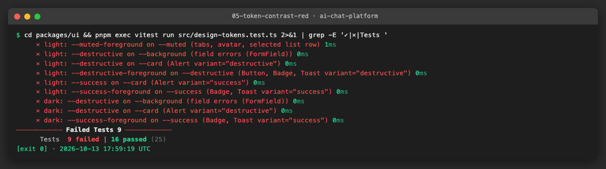

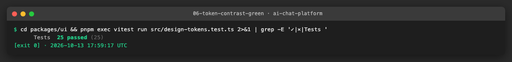

Scan after rebuilding the images: **34 passed**, and the reports have **no violation of any impact** (not only no
blocking one).

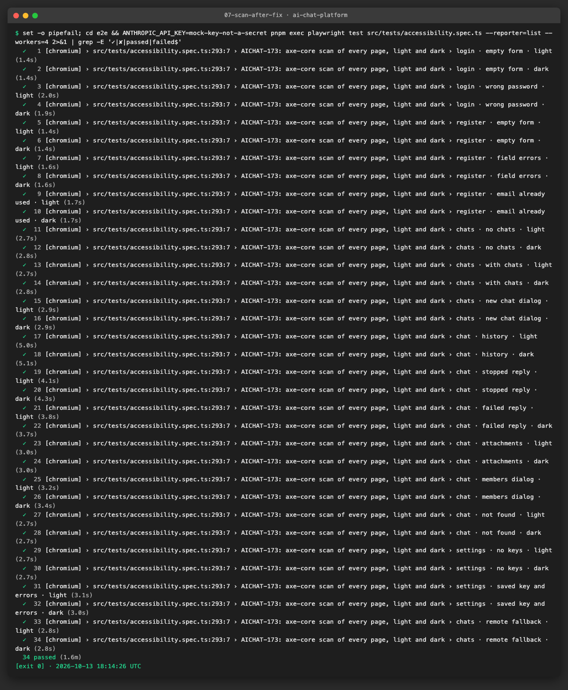

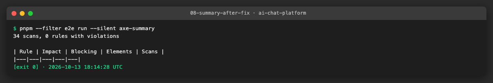

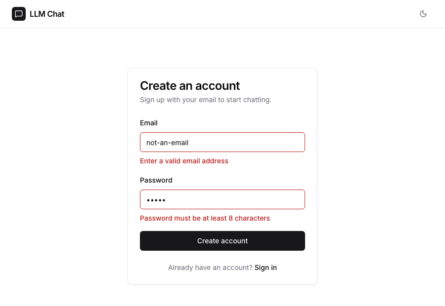

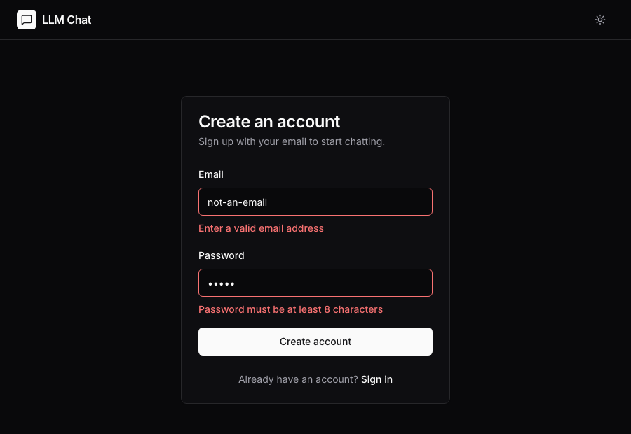

**Problems and fixes.**
- `pnpm mock:up` ends with exit code 1 because the one-shot `ollama-pull` container exits; every other container is
  healthy. The images are rebuilt, so the result is not affected.
- `workspace-config:test` fails on this branch and on its base (`test/AICHAT-8-remote-failure-fallback`) with the same
  10 source files without a unit test (e2e support files and the OpenAPI/contract files of the services) and the
  coverage guard missing `e2e`. None of them comes from this epic; the one new file of the epic (`axe-summary-cli.ts`)
  has its own test.

### US4 · Keyboard navigation, focus and live-region checks ([AICHAT-175](https://ipca-grupo11.atlassian.net/browse/AICHAT-175))

**What and why.** axe-core checks what is in the DOM; it cannot press keys or listen to a screen reader. This story
drives the main flows with the keyboard only and checks the contract a screen reader relies on.

| Check | How the test does it |
|---|---|
| Reachable with the keyboard | `tabTo(locator)` presses Tab (or Shift+Tab) until the element has the focus and fails after 40 presses: present on the page is not enough, it has to be in the Tab order |
| Usable with the keyboard | inside the flows there is no `click()`: typing, Tab, Enter and Escape only (login, register, create chat, send, Stop) |
| Focus trap in dialogs | after Enter on the trigger the focus moves into the dialog; 15 Tab / Shift+Tab presses never leave it; Escape closes it and the focus is back on the trigger |
| Visible focus ring | every element reached with Tab on the chat page has an outline or a ring (Tailwind draws `ring-*` as `box-shadow`), light and dark |
| Live region | `Generating…` has `role="status"` (polite); the reply is announced once, at the end |

**The live-region defect.** The message list is `role="log" aria-live="polite"`, and the reply is written into it token
by token. A screen reader announces every change of a polite live region, so it would read the reply from the start
again after every chunk. The test records what would be announced: a `MutationObserver` in the page stores the reply text
each time it changes **while the region is not `aria-busy`** (assistive technologies hold back the changes of a busy
region and read them when it stops being busy). Before the fix the same reply was recorded **400 times** (2, 9, 12 …
2089 characters). The fix is one attribute: `aria-busy` on the log while a message has `status = "streaming"`. After it,
the reply is recorded once, with its final text. `Generating…` still tells the user that something is running.

**Files.**
- `e2e/src/tests/keyboard-and-live-region.spec.ts` (new): 11 tests (login and register in both themes, create chat and
  send, Stop, two dialogs, focus ring in both themes, live region).
- `apps/mfe-chat/src/features/chat-view/components/MessageList.tsx`: `aria-busy={replyStreaming}` on the log.
- `apps/mfe-chat/src/features/chat-view/components/MessageList.test.tsx`: the same contract at component level.

**How to run.**

```sh
cd apps/mfe-chat && pnpm exec vitest run src/features/chat-view/components/MessageList.test.tsx   # no stack
pnpm mock:up
cd e2e && ANTHROPIC_API_KEY=mock-key-not-a-secret pnpm exec playwright test src/tests/keyboard-and-live-region.spec.ts
```

**How to repeat it manually.**

1. Open http://localhost:8000/login, put the mouse away and press Tab: the focus goes through the nav bar to Email,
   Password and "Sign in", each with a visible ring. Type the credentials and press Enter.
2. On /chats press Tab to "New chat", Enter, type a title, Enter. In a chat, Tab to the message field, type, Enter. While
   a long reply is written, Shift+Tab to "Stop" and press Enter.
3. Open "Share" with Enter, press Tab many times: the focus never leaves the dialog. Escape: the focus is on "Share".
4. Screen reader (VoiceOver: Cmd+F5 on macOS): send a message. You hear "Generating…" and, at the end, the reply once.
   Without the fix (remove `aria-busy` in `MessageList.tsx`) VoiceOver starts reading the reply again on every update.

**Result.** Component test: red without the attribute, green with it.

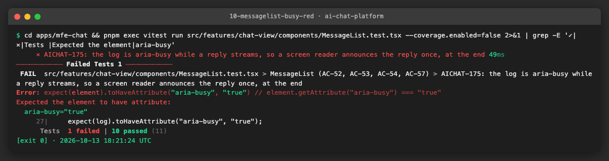

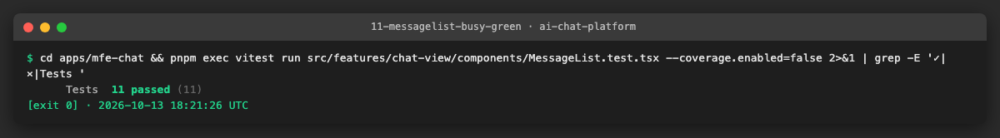

E2E before the fix: the live-region test fails with `announced 400 times`. The "new chat dialog" failure in this run is
a timing problem of the test, fixed afterwards (see Problems and fixes), not a defect of the application.

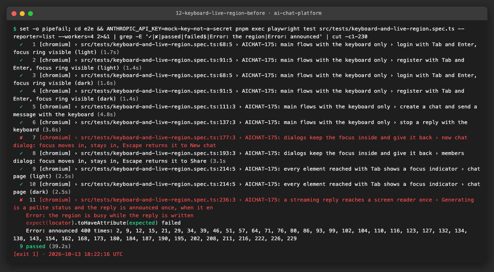

E2E after the fix: 11 passed. The keyboard tests also passed 40 times in a row (`--repeat-each=4`, 4 workers).

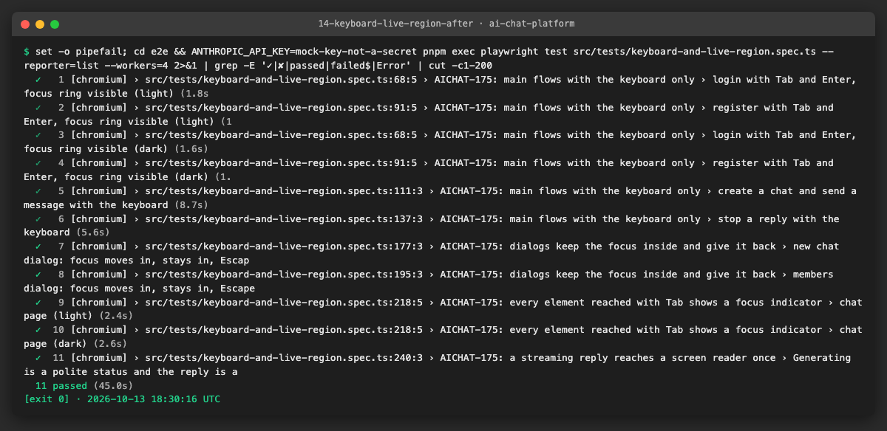

Focus ring on "Share" reached with Tab:

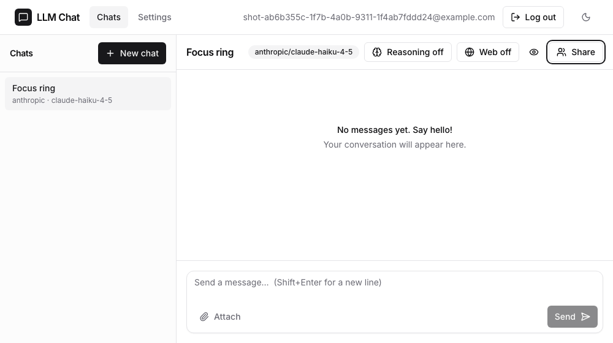

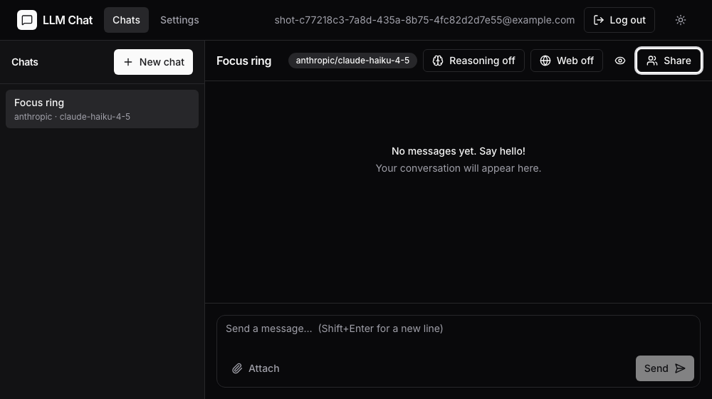

**Problems and fixes.**
- **Focus "left" the dialog in the first run.** At the edges of a modal, Base UI puts invisible focus guards
  (`data-base-ui-focus-guard`). Shift+Tab on the first field lands on a guard, which moves the focus to the last button
  a moment later. We printed the focused element right after the key press and 300 ms later: guard first, "Close" after.
  The trap works; the test now waits (`expect.poll`) until the focus settles on an element that is not a guard. The
  initial focus inside the dialog is also set a moment after it opens, which made the same check flaky under 4 workers.
- **Register ends on /login, not /chats.** That is the behaviour of the application (`registration.spec.ts` expects
  it); the test was wrong.
- **Settings dialog in the criteria.** Settings has no dialog (keys are an inline form); the two dialogs of the
  application, "New chat" and "Members", are tested.

### US5 · Spike: component-level a11y checks with vitest-axe ([AICHAT-176](https://ipca-grupo11.atlassian.net/browse/AICHAT-176))

**What and why.** Decision in §1: no separate spike, because AICHAT-18-US5 had already adopted `vitest-axe` in `mfe-chat`
and `mfe-settings`. The shared components of `packages/ui` had no check, so we added the same helper there and one axe
check per component. The decision and a comparison of the three levels (component, tokens, page) are in
[README.md §9](README.md#9-decision-component-level-checks-with-vitest-axe-us5-aichat-176).

**Files.**
- `packages/ui/src/test/a11y.ts` (new): `expectNoA11yViolations`; `color-contrast` and `region` off, with the reason.
- `packages/ui/src/test/setup.ts`: registers the `toHaveNoViolations` matcher.
- `packages/ui/src/components/{button,input,alert,dialog,select}/*.test.tsx`: one check each over the component's
  states; Dialog and Select are scanned open (their popup renders in a portal, so the scan covers `document.body`).
- `packages/ui/package.json`, `pnpm-lock.yaml`: `vitest-axe` `^0.1.0` (the version the MFEs already use).

**How to run.**

```sh
cd packages/ui && pnpm exec vitest run src/components --reporter=verbose -t AICHAT-176
```

**How to repeat it manually.** Remove `aria-label="Close pane"` from the icon button in the Button check and run the
command: the test fails with `Buttons must have discernible text (button-name)`. The second Button test does exactly this
on purpose and expects the failure.

**Result.** 6 checks, all passing; the negative case fails as it should.

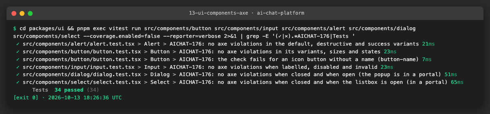

**Problems and fixes.**
- **The open Select failed with `region`.** That rule asks for all content to be inside landmarks (`<main>`, …). A
  component rendered alone has no page around it, so any popup in a portal fails it. It says nothing about the
  component; it is turned off in the component helper with the reason, and pages are scanned with their landmarks in
  the e2e suite.
- **The local pnpm rewrote the lockfile.** Adding the dependency with pnpm 12 also removed every `libc:` line of
  `pnpm-lock.yaml`. We restored the file and added only the three lines of the new importer entry;
  `pnpm install --frozen-lockfile` accepts it.

## 4. How to run everything

```sh
# no stack
cd packages/ui && pnpm exec vitest run src/design-tokens.test.ts src/components     # token contrast + axe per component
cd apps/mfe-chat && pnpm exec vitest run src/features/chat-view/components/MessageList.test.tsx
cd e2e && pnpm exec playwright test src/tests/support/axe                           # axe helper and summary CLI

# with the stack (images built from this branch)
pnpm mock:up
cd e2e && ANTHROPIC_API_KEY=mock-key-not-a-secret pnpm exec playwright test \
  src/tests/accessibility.spec.ts src/tests/keyboard-and-live-region.spec.ts       # ~2.5 min
cd e2e && pnpm run --silent axe-summary                                             # table of the last scan
```

The same commands are in `TESTING.md` and `e2e/README.md`.

## 5. Results

| Metric | Before | After |
|---|---|---|
| Pages/states scanned with axe-core | 0 (helper removed in `5eb6221`) | 17 states × 2 themes = 34 scans on every pull request |
| Scans with a serious/critical violation | 15 of 34 | 0 of 34 |
| Elements failing `color-contrast` | 25 | 0 (and no violation of any impact) |
| Worst contrast | 1.76:1 (dark error text) | ≥ 4.5:1 for every text token pair, both themes (token test) |
| Announcements of one streaming reply (screen reader) | 400 | 1 |
| Keyboard flows tested (login, register, create, send, Stop) | 0 | 5, plus 2 dialogs and the focus ring in both themes |
| `packages/ui` components with an axe check | 0 | 5 (Button, Input, Alert, Dialog, Select) |
| Full e2e suite as in CI (`CI=true`, 2 workers, 1 retry) | AICHAT-8: 104 passed, 9 failed | 159 passed, 1 skipped, 9 failed (the same 9 `attach-file.spec.ts` tests, AICHAT-255) |

## 6. DoD check

| DoD item | Met | Evidence |
|---|---|---|
| Tests run in CI and pass on `main` | The specs are in `e2e/src/tests`, run by `e2e.yml` on every pull request; green locally. Pass on `main` after the merge | [07](evidence/07-scan-after-fix.png), [14](evidence/14-keyboard-live-region-after.png), [16](evidence/16-full-e2e-suite.png) |
| Failure blocks the merge | A violation fails the `e2e` job (shown by the baseline run, exit code 1). Making `e2e` a required check is a repository setting (noted in `e2e.yml`) | [02](evidence/02-baseline-scan-fails.png), [04](evidence/04-failure-message.png) |
| Run instructions added | `TESTING.md` (Accessibility section), `e2e/README.md`, §4 | — |
| axe-core runs on every page, light and dark | 17 states × 2 themes; the theme is checked on `<html>` before each scan | [07](evidence/07-scan-after-fix.png) |
| Zero serious/critical violations | 34/34 scans, no violation of any impact | [08](evidence/08-summary-after-fix.png) |

**Full suite.** Run as in CI: **159 passed, 1 skipped, 9 failed**. The 9 failures (each shown twice because of the
retry) are the `attach-file.spec.ts` tests that need a working upload: the 404 of AICHAT-255, already recorded in AICHAT-8.
No spec of this epic fails and no other spec changed result.

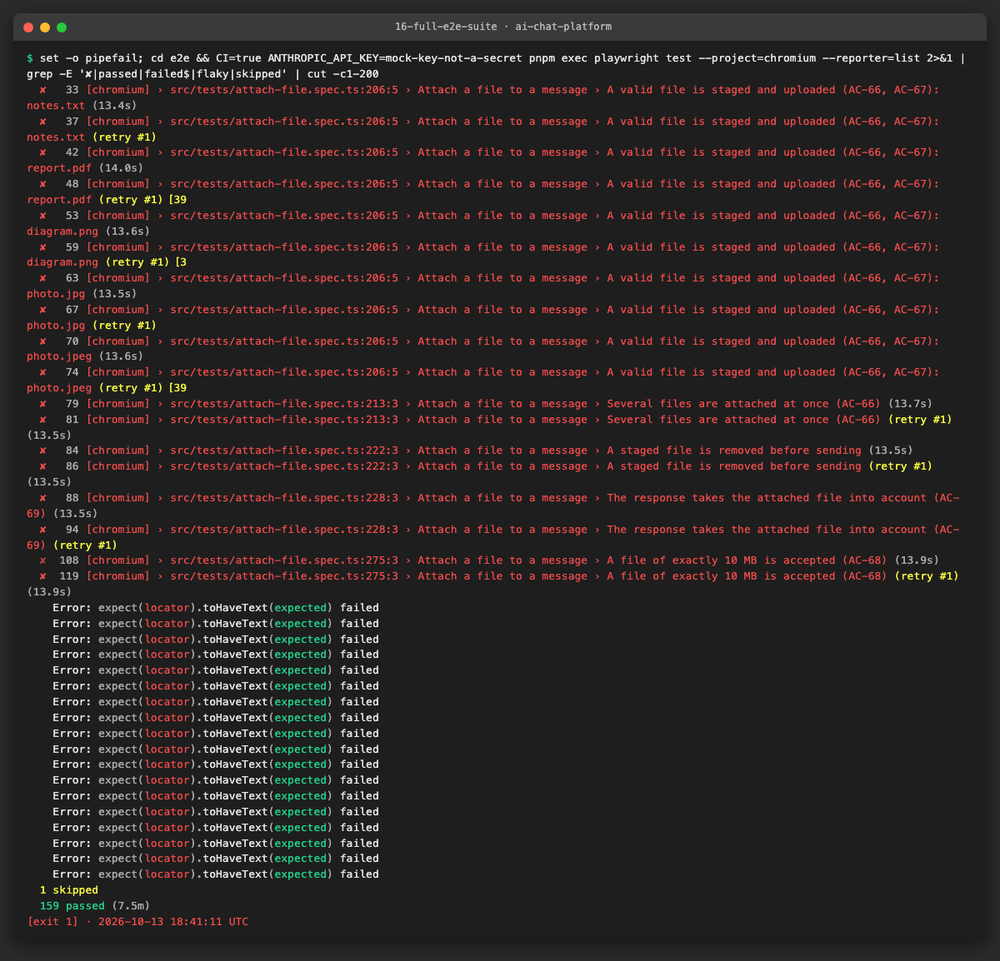

**Gates.** `nx run-many -t lint typecheck test` passes for `ui`, `mfe-chat` and `e2e`. Left as on the base branch, none
from this epic: the workspace guards `source-files.test.ts` (the same 10 files without a unit test) and
`coverage-guard.test.ts` (`e2e` not found), and `pnpm sast`'s one ERROR, the fixed test password in
`e2e/src/tests/support/auth.ts`. SAST reports nothing in the files this epic changed. `gitleaks` is not installed on
this machine; the secret scan runs in CI (`security.yml`).

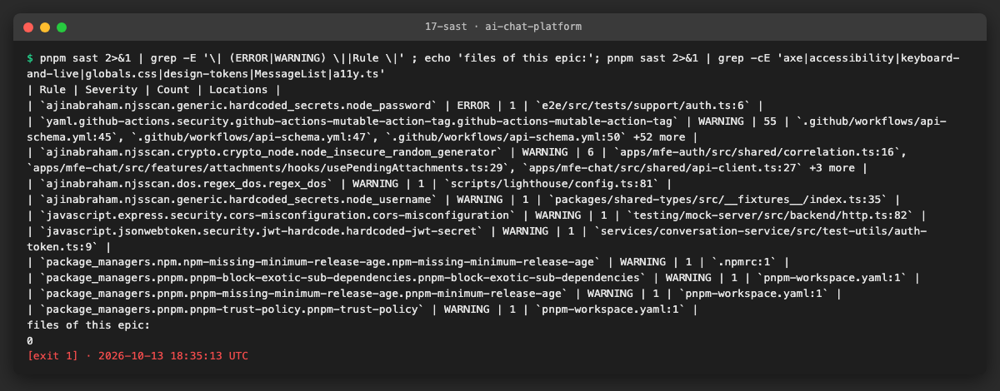

## 7. Notes for the report

**What was found**
- The repository had the axe-core dependency, but the helper and every spec using it had been removed (`5eb6221`), so
  no page was ever scanned.
- The first scan found one rule, `color-contrast`, on 25 elements in 15 of the 34 scans. All of them came from three
  design tokens: `--destructive` used as text (1.92:1 in dark), the green badge (2.20:1) and `--muted-foreground` on
  `--muted` (4.39:1). The dark red was a background colour used as a text colour.
- The token contrast test also found a pair that no scanned page showed: white on the destructive button, 3.61:1.
- A streaming reply was written into a polite live region token by token: a screen reader would have announced it
  400 times. axe-core cannot see this, because each state of the DOM is valid on its own.
- Attachment upload returns 404 (AICHAT-255, found earlier by the contract tests), so the "sent message with a file"
  state cannot be scanned yet.

**What was fixed / waived**
- Fixed at the source: five token values in `packages/ui` (light and dark), and `aria-busy` on the message log.
- No axe rule disabled and no selector excluded in the page scans. In the component checks, `color-contrast` (jsdom has
  no layout) and `region` (page-level rule) are off, with the reason in the helper.

**Open items**
- Visual regression (AICHAT-19): the integration branch has 18 screenshot baselines and `visual.yml`, which this branch
  does not contain. The token change alters the light muted text, the success badge and the error colours, so the
  baselines that show them must be updated (`visual:update`) and reviewed when this branch is merged there.
- Extend the "chat · attachments" state to a sent message with a file when AICHAT-255 is fixed.
- Make `e2e` a required status check in the branch protection of `main` (repository setting).

**Lessons learned**
- Group violations by cause (colour pair, component) before fixing: 25 elements were 3 token values.
- Check at three levels: tokens (fast, exhaustive pairs), components (jsdom, no contrast) and pages (real browser,
  only the states that are opened). Each one found something the others did not.
- An automated scan checks a snapshot of the DOM; keyboard use and announcements over time need their own tests.
- Write the test first and see it fail: the token test failed with exactly the ratios axe reported, and the live-region
  test measured the problem (400) before the one-line fix.
- Accessibility libraries move focus asynchronously (focus guards, initial focus); assertions about focus must wait for
  it to settle, or they fail randomly under load.
