# AICHAT-11 · Consumer-driven contract testing: work log

| Field | Value |
|---|---|
| Epic | [AICHAT-11](https://ipca-grupo11.atlassian.net/browse/AICHAT-11) |
| Analysis | [README.md](README.md) |
| Owner | João Vieira |
| Branch | `test/AICHAT-11-contract-testing` (built on `test/AICHAT-15-stream-cancellation`, which has the Stop fix) |
| Started / finished | 2026-10-08 / 2026-10-08 |
| Pull requests | not opened yet (commits are local; pushed by the owner) |
| Status | Review |

## 1. DoR review

Date: 2026-10-08

| DoR item | Status | Question asked | Decision | Decided by |
|---|---|---|---|---|
| Owner assigned | Met | — | João Vieira | — |
| Scope and tooling agreed | Met | How are the contract tests built? | Pact JS V3 (`PactV3`) consumer tests in Vitest that drive the real client code; provider verification with the Pact `Verifier` against the Express app started in-process with in-memory fakes | João Vieira |
| Target environment available | Met | — | CI only. No running stack, no Docker, no database | — |
| `packages/pact-config` set up | Met | — | Exists (`pact.config.ts`, `matchers.ts`, unit-tested). No app or service uses it yet | — |
| Consumer/provider pairs listed | Met | Which pairs are in scope? | All 7 pairs found in the code (table below). SSE (`GET /chats/:chatId/stream`) is out of scope for Pact | João Vieira |

Decisions:

| Topic | Decision |
|---|---|
| Pairs | The README draft plus three pairs found in the code: mfe-settings → conversation-service (test connection), mfe-chat → auth-service (`GET /auth/me`) and auth-service → conversation-service (`POST /internal/erasures`, `POST /internal/sessions/:userId/stop`) |
| Pact sharing | CI artifacts inside one workflow run: the consumer job uploads `pacts/`, the provider jobs download it. No Pact Broker |
| Stop route | Already fixed by AICHAT-199 (the client calls `POST /chats/:chatId/stop`). The pact uses the fixed client. As "before" evidence we point the client at the old path once and show provider verification failing. The AICHAT-179 criterion in Jira is updated to reference AICHAT-199 |

Blockers: none.

## 2. Environment

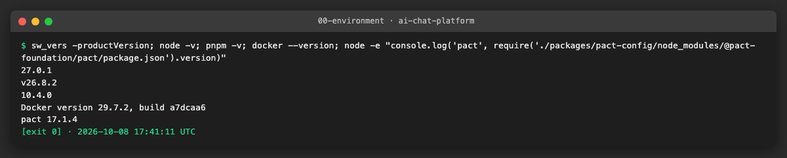

| Tool | Version | Install |
|---|---|---|
| macOS | 27.0.1 | — |
| Node | v26.8.2 locally (CI uses Node 24 from `.nvmrc`) | nvm |
| pnpm | 10.4.0 (pinned in `package.json`) | `pnpm install --frozen-lockfile` |
| `@pact-foundation/pact` | 17.1.4 | dev dependency of each consumer and provider |
| Vitest | 5.0.1 | workspace dev dependency |

## 3. Steps

### US1 · List consumer/provider pairs and agree how pacts are shared ([AICHAT-177](https://ipca-grupo11.atlassian.net/browse/AICHAT-177))

**What and why.** A contract test only protects the calls it knows about. Before writing any pact we listed every HTTP
call from the real client code (not from the analysis draft) and compared each one with the routes the providers really
mount. The draft table missed three pairs, and the comparison found two calls that no provider route answers.

**Files.**
- `docs/AICHAT-11/WORKLOG.md` (this section): pairs, sharing decision, baseline.

**Consumer/provider pairs.** Paths as the provider sees them (the shell proxies `/auth/*` to auth-service and `/api/*`
to conversation-service).

| # | Consumer | Client file(s) | Provider | Calls |
|---|---|---|---|---|
| 1 | mfe-auth | `features/register/api/register.ts`, `features/login/api/{login,session}.ts`, `shared/api-client.ts` | auth-service | `POST /auth/register`, `POST /auth/login`, `POST /auth/logout`, `POST /auth/refresh`, `GET /auth/me` |
| 2 | shell | `features/auth-guard/api/useSession.ts`, `shared/layout/AppShellLayout.tsx`, `shared/http/apiClient.ts` | auth-service | `GET /auth/me`, `POST /auth/logout` (the draft listed `/refresh`; the shell never calls it) |
| 3 | mfe-settings | `features/api-keys/api/auth.ts` | auth-service | `GET /auth/me` |
| 4 | mfe-chat | `shared/auth.ts` | auth-service | `GET /auth/me` (missing from the draft) |
| 5 | mfe-chat | `features/chat-list/api/chats.ts` | conversation-service | `GET /chats`, `POST /chats`, `GET /chats/:id`, `PATCH /chats/:id`, `DELETE /chats/:id` |
| | | `features/chat-members/api/members.ts` | | `GET /chats/:id/members`, `POST /chats/:id/members`, `DELETE /chats/:id/members/:email`, `DELETE /chats/:id/membership` |
| | | `features/chat-view/api/messages.ts` | | `GET /chats/:id/messages`, `POST /chats/:id/messages`, `PATCH /chats/:id/messages/:messageId` (edit), `DELETE /chats/:id/messages/:messageId` (cancel), `POST /chats/:id/messages/:messageId/retry`, `POST /chats/:id/stop` |
| | | `features/attachments/api/useUploadAttachment.ts` | | `POST /chats/:id/attachments` (multipart) — **no such route, AICHAT-255** |
| 6 | mfe-settings | `features/api-keys/api/testConnection.ts` | conversation-service | `POST /providers/:provider/test-connection` — **no such route, AICHAT-256** (missing from the draft) |
| 7 | auth-service | `shared/erasure-client.ts`, `shared/reply-stop-client.ts` | conversation-service | `POST /internal/erasures`, `POST /internal/sessions/:userId/stop` (service token; missing from the draft) |

Out of scope: `GET /chats/:id/stream` (SSE is a long-lived event stream, not request/response; its events are checked by
AICHAT-12-US6) and `DELETE /auth/me` (no frontend calls it yet; it is covered by auth-service's integration tests).

**Defects found while listing.** Both follow the pattern of the Stop bug (AICHAT-199): the frontend test doubles copy the
client path, so the tests pass while the real call gets 404.

| Jira | Client calls | Provider has |
|---|---|---|
| [AICHAT-255](https://ipca-grupo11.atlassian.net/browse/AICHAT-255) | `POST /chats/:id/attachments`, before the message exists, then sends `attachmentIds` | only `POST /chats/:id/messages/:messageId/attachments`; `attachmentIds` is accepted on send but never read |
| [AICHAT-256](https://ipca-grupo11.atlassian.net/browse/AICHAT-256) | `POST /providers/:provider/test-connection` | no `/providers` route at all (only the mock server answers it) |

Decision: the pacts describe what the client really sends. Provider verification keeps these interactions in an explicit
known-failure list keyed by the bug, and the verifier fails if one of them starts passing, so the list cannot go stale
once a bug is fixed.

**How pacts are shared.** CI artifacts inside one workflow run: the consumer job writes `pacts/*.json` and uploads them;
the provider jobs download them and verify. No Pact Broker: everything lives in one repository and one pipeline, so the
broker's versioning and `can-i-deploy` would add an account and secrets without adding protection.

**Baseline.** `packages/pact-config` exists (shared `PACT_DIR`, naming helpers and matchers, unit-tested), but it is the
only package depending on `@pact-foundation/pact`, and no pact file exists.

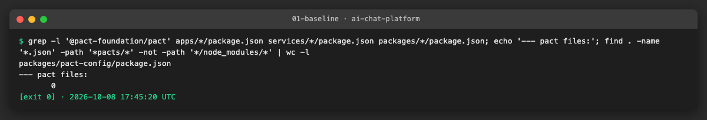

**How to repeat it manually.**

1. List the client calls: `grep -rnE "apiClient\.(get|post|patch|delete)|apiFetch|fetch\(" apps/*/src --include='*.ts' | grep -v test`.
2. List the provider routes: `grep -rnE "router\.(get|post|patch|delete)\(" services/*/src --include='*.ts' | grep -v spec`
   and the mount points (`app.use("/chats", …)`) in `services/conversation-service/src/app.ts` and `services/auth-service/src/main.ts`.
3. Expected: every client call has a matching route, except the two rows in the defects table.

**Problems and fixes.** `consumerName()` in `pact-config` always adds the `mfe-` prefix, which is wrong for the shell and
for auth-service as a consumer. Those two pacts pass their names directly.

### US2 · Consumer pacts: mfe-auth, shell and mfe-settings to auth-service ([AICHAT-178](https://ipca-grupo11.atlassian.net/browse/AICHAT-178))

**What and why.** Each frontend that calls auth-service now writes down, in a pact file, exactly which requests it sends
and which parts of the responses it relies on. The tests call the real client functions (`features/*/api/*.ts`,
`shared/auth.ts`); only the network underneath is the Pact mock server, which answers declared requests and rejects any
other. mfe-chat's `GET /auth/me` (pair 4 of US1) is included because its provider is auth-service.

**How a consumer test works.**

1. `newConsumerPact("mfe-auth", "auth-service")` creates the Pact for one pair; the file is `pacts/mfe-auth-auth-service.json`
   at the repository root, whichever app runs the test (`pactDir()`).
2. Each test declares one interaction: provider state (`given`), description, the exact request, and the response
   with **matchers**: `like("user-1")` means "any string", so the provider is not tied to the example values.
3. `runWithMockServer(pact, () => fetchMe())` starts the mock server, points the global `fetch` at it (the clients use
   relative URLs, as in the browser) and runs the real function.
4. The test asserts what the client does with the answer (returns the user, throws `ApiError` 401 with the server's
   message, `fetchSession` returns `null` on 401).
5. Pact checks that every declared request arrived exactly as declared, and only then writes the interaction.

Cookies are not part of the contract: the browser adds them, and auth-service's verifier adds valid ones for each
provider state (US4). The correlation id is required in both directions (`correlationHeaderMatcher()`), error bodies use
`errorResponseMatcher()` / `fieldErrorsMatcher()`.

**Files.**
- `packages/pact-config/consumer.ts` (new): `pactDir`, `newConsumerPact`, `removePacts`, `routeFetchTo`, `runWithMockServer`; unit tests in `consumer.spec.ts`.
- `apps/{mfe-auth,shell,mfe-settings,mfe-chat}/vitest.pact.config.ts` + `vitest.pact.setup.ts` (new): Node environment, no MSW, one file at a time, old pact files removed at start.
- `apps/*/vite.config.ts`: the normal test run excludes `*.pact.spec.ts`.
- `apps/*/project.json`: new Nx target `pact:consumer`.
- `apps/mfe-auth/src/features/{login,register}/api/*.pact.spec.ts` (new): 10 interactions.
- `apps/shell/src/features/auth-guard/api/auth.pact.spec.ts` (new), `logout.ts` (new, logout moved out of `AppShellLayout`), `useSession.ts` (`fetchSession` exported).
- `apps/mfe-settings/src/features/api-keys/api/auth.pact.spec.ts`, `apps/mfe-chat/src/shared/auth.pact.spec.ts` (new).
- `apps/mfe-auth/src/shared/api-client.ts`: reads the real error envelope (defect below); 16 MSW doubles in mfe-auth's specs now answer with that envelope.
- `.gitignore`: `pacts/` (written by the consumer tests, shared as a CI artifact).

**How to run.**

```sh
pnpm exec nx run-many -t pact:consumer -p mfe-auth shell mfe-settings mfe-chat
ls pacts/   # mfe-auth-auth-service.json, shell-auth-service.json, mfe-settings-…, mfe-chat-…
```

**How to repeat it manually.**

1. Run the command above; expected: every test passes and four `*-auth-service.json` files appear in `pacts/`.
2. Open `pacts/mfe-auth-auth-service.json`: each interaction has `providerStates`, `request`, `response` and
   `matchingRules` (`"match": "type"` for every `like`).
3. Break the client: change `"/auth/login"` to `"/auth/signin"` in `apps/mfe-auth/src/features/login/api/login.ts` and
   run `pnpm exec nx run mfe-auth:pact:consumer`. Expected: the two login tests fail with "request was not expected" /
   "expected but not received". Restore the line.

**Result.** 17 interactions in 4 pact files, using 4 provider states that auth-service has to support:
`a user exists` (`email`, `password`), `a user is logged in` (`email`), `a user has a valid refresh token` (`email`),
`no user exists with the email` (`email`), `no user is logged in`.

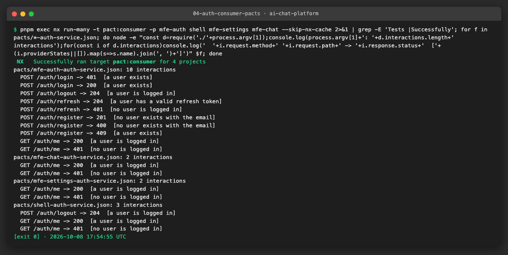

A broken path fails the consumer test:

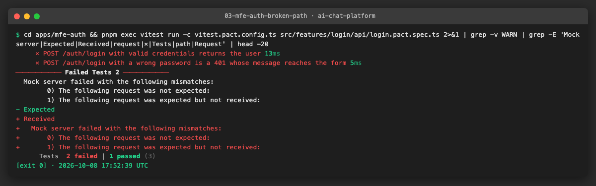

**Defect found: the server's error message never reached the user.** auth-service answers every error with
`{ "error": { "code": "INVALID_CREDENTIALS", "message": "Invalid email or password" } }`. mfe-auth's `extractErrorMessage`
only read `error` when it was a **string** or a top-level `message`, shapes the server never sends, so the forms showed the
HTTP status text ("Unauthorized", or "Request failed" over HTTP/2 where there is no status text). The 16 MSW doubles in
mfe-auth's tests had been written with those same wrong shapes, so every test passed. The pact test, whose mock answers
with the shared error envelope, failed first:

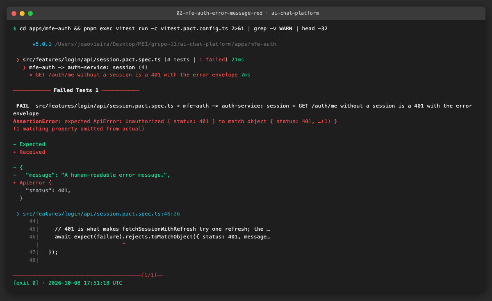

The client now reads `error.message`, and the doubles use the real envelope. The shell and mfe-chat do not show the
server's message (they use their own text), so they were not affected.

**Problems and fixes.**
- Pact writes an interaction only when the test callback **resolves**. Clients that throw on a 401 made Pact drop every
  error interaction silently (the first run wrote 5 of 10). `runWithMockServer` now captures the client's outcome inside
  the callback and replays it afterwards; a unit test covers it.
- Vitest loads `vitest.*.config.ts` with plain Node, which cannot resolve pact-config's `.js` imports of `.ts` sources.
  The cleanup moved to a `globalSetup` file, which Vitest transforms.
- `PACT_LOG_LEVEL` allows `fatal`, which `PactV3` does not accept; `newConsumerPact` maps it to `error`.
- `consumerName()` forces the `mfe-` prefix; `newConsumerPact` takes the names as given (`shell`, `auth-service`).

### US3 · Consumer pacts: mfe-chat to conversation-service ([AICHAT-179](https://ipca-grupo11.atlassian.net/browse/AICHAT-179))

**What and why.** Every conversation-service call of mfe-chat now has a pact: chats (list, create, get, rename, delete),
members (list, invite, remove, leave), messages (list, send, edit, cancel, retry, stop) and the attachment upload. The
two other consumers of conversation-service found in US1 are in this story too, because the same provider verifies them
(US5): mfe-settings (test connection) and auth-service (the two internal routes).

**Changes needed to drive the real client code.**
- mfe-chat's requests lived inside React Query hooks, which need a DOM to run, and under jsdom Node's `fetch` sends a
  `FormData` as the text `[object FormData]`, so the upload could not be tested there. Each request is now a plain
  exported function (`fetchChats`, `createChat`, `stopReply`, `uploadAttachment`, …) that its hook calls; the hooks behave
  as before (385 unit tests unchanged and green). The pact tests call the functions in plain Node.
- The shell's `/api` proxy removes the prefix, so the tests route `/api/chats/…` to the mock server as `/chats/…`
  (`runWithMockServer(…, { stripPrefix: "/api" })`). mfe-settings is built with `VITE_CONVERSATION_SERVICE_URL=/api`,
  and its pact config sets the same value.
- Bodies contain only the fields mfe-chat reads (`shared/types.ts`), in `src/test/pact.ts`. Pact accepts extra fields
  in a response, so conversation-service can add fields without breaking this contract, but not remove or rename these.

**Notable interactions.**

| Interaction | What the contract pins |
|---|---|
| `POST /chats/:id/messages` | The `X-Llm-Api-Key` header must be present (any value, `term(".+")`): the browser holds the key, the server only borrows it |
| `POST /chats/:id/stop` | The **fixed** Stop route from AICHAT-199 and `{ stopped: boolean }` |
| `POST /chats/:id/attachments` | Multipart, part `file`, `text/plain`, from the fixture `src/test/fixtures/notes.txt`. The boundary is random, so Pact matches `Content-Type` with a regex and the part by content type. No such route on the provider: AICHAT-255 |
| `POST /providers/:provider/test-connection` | 200 with `{ success: true }` or `{ success: false, message }` (shape taken from the mock server, the only implementation). No such route: AICHAT-256 |
| `POST /internal/erasures` | Service token matched by form (`Bearer .+`), never by value. The client only reads the status, so the pact requires no body |
| `POST /internal/sessions/:userId/stop` | `{ stopped: <number> }`, the count the logout code reads |

**Files.**
- `apps/mfe-chat/src/features/{chat-list,chat-members,chat-view,attachments}/api/*.pact.spec.ts` (new), `src/test/pact.ts` (shared matchers), `src/test/fixtures/notes.txt`.
- `apps/mfe-chat/src/features/*/api/*.ts`: request functions extracted from the hooks.
- `apps/mfe-chat/src/shared/api-client.ts`: reads the real error envelope (defect below); 19 MSW doubles corrected.
- `apps/mfe-settings/src/features/api-keys/api/testConnection.pact.spec.ts` (new).
- `services/auth-service/src/shared/internal-clients.pact.spec.ts`, `vitest.pact.config.ts`, `vitest.pact.setup.ts` (new); `pact:consumer` target.
- `packages/pact-config`: `boolean` matcher re-exported.

**How to run.**

```sh
pnpm exec nx run-many -t pact:consumer -p mfe-chat mfe-settings auth-service
```

**How to repeat it manually.**

1. Run the command above. Expected: all tests pass; `pacts/mfe-chat-conversation-service.json` (18 interactions),
   `mfe-settings-conversation-service.json` (2), `auth-service-conversation-service.json` (2).
2. Open the mfe-chat pact and find "a multipart upload of a text file": the body is the multipart text, and
   `matchingRules` holds the boundary regex and `"match": "contentType"` for the part `file`.
3. Change `stopReply` in `apps/mfe-chat/src/features/chat-view/api/messages.ts` back to the old path
   (`/chats/${chatId}/messages/x/stop`) and run `pnpm exec nx run mfe-chat:pact:consumer`: the consumer test still passes,
   because the consumer side only checks that the client and the pact agree. The failure appears when the provider
   verifies the pact (US5, "before" evidence). Restore the line.

**Result.** 22 interactions in 3 pact files. Together with US2, every pair of US1 has a pact.

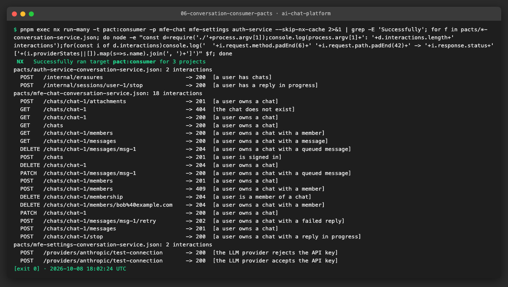

**Defect found: same error-envelope bug in mfe-chat.** conversation-service sends `{ error: { code, message } }`;
mfe-chat's client read `message` and `code` from the top level, so `ApiError` carried the status text and no code. The
pact for `GET /chats/:id` → 404 failed first:

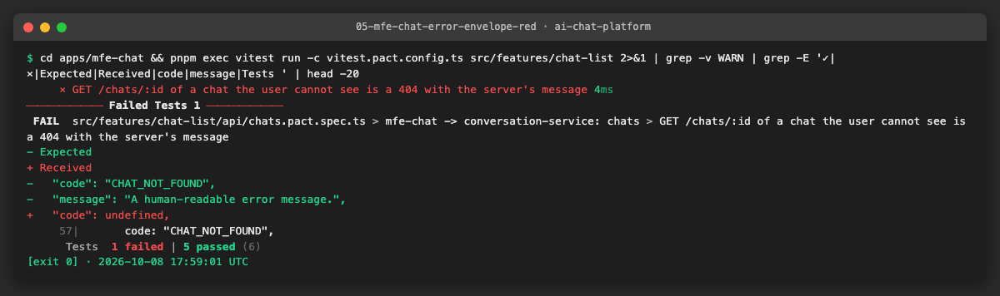

Visible effect before the fix: the members dialog never showed the server's reason (for example "That user is already a
member of this chat"), and the attachment error of AC-71 showed "Unprocessable Entity" instead of the server's sentence.
The client now reads `error.message` and `error.code`. 19 doubles in mfe-chat's tests used the flat shape, and three used
codes the server never sends (`user_not_found`, `chat_not_found`, `unsupported_type`); they now use the envelope and real
codes (`ALREADY_A_MEMBER`, `CHAT_NOT_FOUND`, `ATTACHMENT_UPLOAD_ERROR`).

**Problems and fixes.**
- The jsdom `FormData` problem above, solved by testing the request functions in Node.
- Sending and retrying read the API key from `sessionStorage`, which plain Node does not have; the test stubs it with a
  fixed key so the header is part of the contract.
- mfe-settings' `extractErrorMessage` has the same flat-shape reading. It is left as is: the route does not exist yet
  (AICHAT-256), so there is no error contract to follow; noted on that bug.

### US4 · Provider verification: auth-service ([AICHAT-180](https://ipca-grupo11.atlassian.net/browse/AICHAT-180))

**What and why.** The consumer tests only prove that each client agrees with its pact. This story closes the loop: the
Pact `Verifier` reads every `*-auth-service.json`, replays each request against the **real** auth-service app and compares
the real response with what the consumer declared (status, headers, body with its matchers). A change in auth-service
that would break any frontend now fails here, and the failure names the consumer that would break.

**How the verifier works.**

1. `pactFilesFor("auth-service")` collects the four pact files and fails if there are none (an empty verification
   would pass without checking anything).
2. One HTTP server on a random port forwards every request to "the current app". The app is `createApp()` with the
   in-memory Prisma fake (`buildTestApp`): no database, no Docker.
3. Before each interaction the Verifier calls the **state handler** for its `given(...)`. Each handler builds a fresh
   app and prepares it through the public API, the way a user would:

   | Provider state | Setup | Cookie sent |
   |---|---|---|
   | `no user is logged in`, `no user exists with the email` | fresh app | none |
   | `a user exists` (`email`, `password`) | `POST /auth/register` | none |
   | `a user is logged in` (`email`) | register + `POST /auth/login` | `access_token` and `refresh_token` |
   | `a user has a valid refresh token` (`email`) | register + login | `refresh_token` |

4. The cookies are not in the pacts (the browser adds them). A `requestFilter`, which runs on every replayed request,
   adds the cookie the state chose.
5. `verifyProvider()` rejects if any interaction does not match, so the Vitest test fails.

**Files.**
- `services/auth-service/src/contract/provider.verify.spec.ts` (new): the verifier and its state handlers.
- `services/auth-service/vitest.verify.config.ts` (new), Nx target `pact:verify`; the normal test run excludes `*.verify.spec.ts`.
- `packages/pact-config/provider.ts` (new): `pactFilesFor` and `splitKnownFailures` (used by US5), with unit tests.

**How to run.**

```sh
pnpm exec nx run-many -t pact:consumer          # writes pacts/ (US2, US3)
pnpm exec nx run auth-service:pact:verify
```

**How to repeat it manually.**

1. Run the two commands. Expected: "Verifying a pact between mfe-auth and auth-service" (and shell, mfe-settings,
   mfe-chat); every interaction shows `has status code … (OK)` and `has a matching body (OK)`.
2. Break the provider: in `services/auth-service/src/features/session/api.ts`, in the `GET /me` handler, rename `id`
   to `userId` in the JSON. Run `pnpm exec nx run auth-service:pact:verify`. Expected: "There were 4 pact failures",
   one per consumer that reads `/auth/me`, each "Actual map is missing the following keys: id". Restore the line.
3. Delete `pacts/` and run the verifier: it fails with "no pact files for auth-service … run the consumer tests first".

**Result.** All 17 interactions of the 4 consumers verify against the real app.

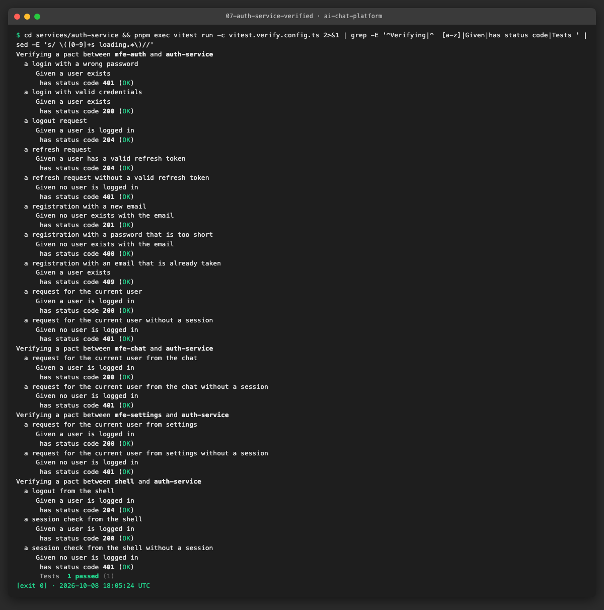

Renaming one field in `GET /auth/me` breaks four consumers, and the verifier names each of them:

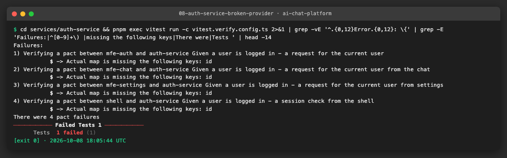

**Problems and fixes.** None in the verification itself: every interaction passed on the first run, because the
consumer side had already been aligned with the real error envelope in US2. The states use the public API rather than
seeding the fake directly, so they keep working if the storage changes.

### US5 · Provider verification: conversation-service ([AICHAT-181](https://ipca-grupo11.atlassian.net/browse/AICHAT-181))

**What and why.** Same idea as US4 for the service with the most consumers: the Pact `Verifier` replays the 22
interactions of mfe-chat, mfe-settings and auth-service against the real conversation-service app (`createApp`) wired
to the in-memory fakes of `src/test-utils/`. It also proves, on the provider side, that the Stop fix of AICHAT-199 is
right, and keeps the two defects found in US1 visible without blocking every merge.

**Provider states.** Each state builds a fresh `buildTestApp()` and seeds it with the ids the pacts use (`chat-1`,
`msg-1`) through the fakes' `seed()`. Every request is made as `user-1`.

| State | Setup |
|---|---|
| `a user is signed in`, `the chat does not exist` | empty app |
| `a user owns a chat` / `a user has chats` | chat-1 owned by user-1 |
| `a user owns a chat with a member` | + member `bob@example.com` |
| `a user is a member of a chat` | chat-1 owned by `owner-2`, user-1 invited (**member** access) |
| `a user owns a chat with a message` | + user message msg-1 |
| `a user owns a chat with a queued message` | a reply is running, msg-1 waits in the queue behind it (edit/cancel only work on queued messages) |
| `a user owns a chat with a failed reply` | + assistant msg-1 with status `failed` (retry) |
| `a user owns a chat with a reply in progress` / `a user has a reply in progress` | a reply is submitted to the queue; the fake processor never finishes, so it runs until stopped |

Owner, member and non-member access are all exercised: owner states, the member state (leave), and `the chat does not
exist`, which is what a non-member gets (404, the service never reveals that a chat exists).

**Credentials.** As in US4 they are not in the pacts. The `requestFilter` sends the test app's service token on
`/internal/*` and a signed test JWT (`tokenFor("user-1")`) as the `access_token` cookie on every other route.

**Known failures.** `KNOWN_FAILURES` lists the interactions of AICHAT-255 (upload) and AICHAT-256 (two connection
tests). `splitKnownFailures` (pact-config) writes one copy of the pacts without them, which must verify, and one file
per known failure, which must **still fail**. When a bug is fixed, its check turns red with "this interaction now passes:
remove it from KNOWN_FAILURES", so the list cannot go stale.

**Files.**
- `services/conversation-service/src/contract/provider.verify.spec.ts` (new): verifier, states, known failures.
- `services/conversation-service/vitest.verify.config.ts` (new), Nx target `pact:verify`; the normal test run excludes `*.verify.spec.ts`.

**How to run.**

```sh
pnpm exec nx run-many -t pact:consumer
pnpm exec nx run conversation-service:pact:verify
```

**How to repeat it manually.**

1. Run the two commands. Expected: 4 tests pass: "verifies every interaction except the known failures" and three
   "still fails AICHAT-25x" checks.
2. Bring back the Stop path from before AICHAT-199: in `apps/mfe-chat/src/features/chat-view/api/messages.ts` change
   `` `/chats/${chatId}/stop` `` to `` `/chats/${chatId}/messages/msg-1/stop` `` and the same path in
   `messages.pact.spec.ts`. Run both commands again. Expected: the consumer run passes (the client agrees with its own
   pact), the verifier fails on "a request to stop the reply in progress": the old path is answered with 404 and the
   error envelope, so the expected `stopped` is missing. Restore both files.

**Result.** 19 interactions verify; the 3 known failures fail as expected.

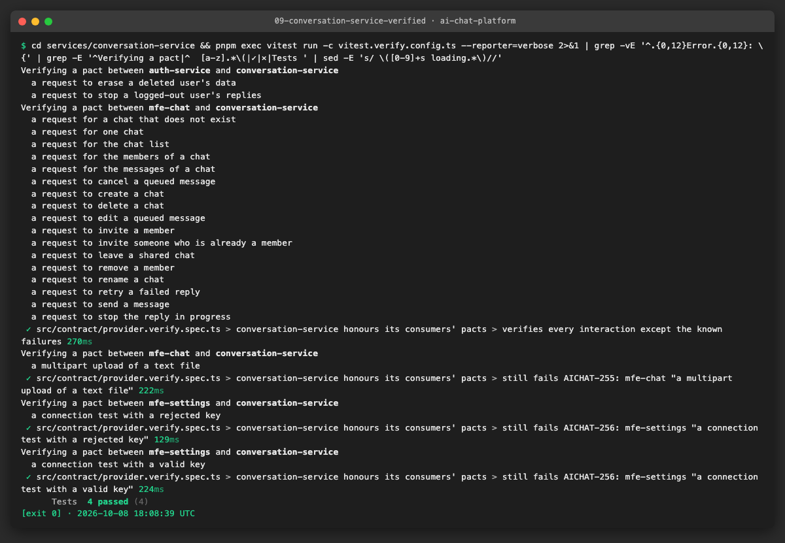

"Before" evidence for the Stop defect: with the old client path, the consumer tests still pass, and only provider
verification catches it. This is the check that was missing when AICHAT-199 was found:

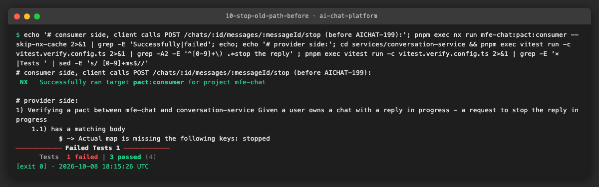

**Problems and fixes.**
- The pacts use fixed ids while the fakes generate UUIDs. The fakes already had `seed()`, so the states insert records
  with the pact ids. (Pact's provider-state injection, `fromProviderState`, would let the provider choose the ids
  instead; not needed here.)
- edit/cancel need a message that is **queued**, not just saved: the state starts a reply first so msg-1 waits behind it.

### US6 · Contract tests in CI with a merge gate ([AICHAT-182](https://ipca-grupo11.atlassian.net/browse/AICHAT-182))

**What and why.** The contracts only protect `main` if they run on every pull request and a failure blocks the merge.
Two jobs were added to `.github/workflows/ci.yml`, which already runs on every pull request:

| Job | What it does |
|---|---|
| `contracts-consumer` | `nx run-many -t pact:consumer --skip-nx-cache` for the five consumers, then uploads `pacts/` as the artifact `pacts` (`if-no-files-found: error`) |
| `contracts-provider` (matrix: auth-service, conversation-service) | `needs: contracts-consumer`; downloads the artifact of **the same run** and runs `nx run <provider>:pact:verify --skip-nx-cache` |

Choices:
- **All consumers and both providers on every pull request**, not `nx affected`. A contract links two projects that the
  Nx graph does not connect (mfe-chat does not import conversation-service), so "affected" could skip the side that
  breaks. The whole set takes about a minute.
- **`--skip-nx-cache`**: a cache hit replays the log but does not write the pact files the next job needs.
- **No Pact Broker** (US1): the pacts never leave the run, so there are no secrets to manage.
- The jobs are plain steps without `continue-on-error`, so a mismatch fails the workflow. Marking them as **required
  checks** is a branch-protection setting of the GitHub repository; it has to be enabled by a repository admin for
  `contracts (consumer pacts)`, `contracts (verify auth-service)` and `contracts (verify conversation-service)`.

**Guards.**
- `e2e/src/ci/contracts-workflow.spec.ts` (new) checks the wiring: consumer job uploads, provider job needs it,
  downloads the same artifact, verifies both services, no broker, no `continue-on-error`. Written first: 3 of 5 failed
  before the jobs existed.
- `packages/workspace-config/src/ci.test.ts` pins the list of CI jobs; it failed as intended when the jobs were added
  and now lists them.
- The unit-test guard (`source-files.test.ts`) flagged the shell's new `logout.ts`; it now has `logout.test.ts`.

**Files.**
- `.github/workflows/ci.yml`: jobs `contracts-consumer`, `contracts-provider`.
- `e2e/src/ci/contracts-workflow.spec.ts` (new), `packages/workspace-config/src/ci.test.ts`.
- `apps/shell/src/features/auth-guard/api/logout.test.ts` (new).
- `packages/pact-config/README.md`: how the pieces fit, how to run, how to add a contract, how to read a failure.
- `TESTING.md`: section "Contract tests (AICHAT-11)".

**How to run (the CI sequence, locally).**

```sh
rm -rf pacts
pnpm exec nx run-many -t pact:consumer --skip-nx-cache
pnpm exec nx run auth-service:pact:verify --skip-nx-cache
pnpm exec nx run conversation-service:pact:verify --skip-nx-cache
```

**How to repeat it manually.**

1. Run the four commands. Expected: 7 files in `pacts/`, then both verifications pass.
2. Skip the first two commands after `rm -rf pacts`: the verifier fails with "no pact files … run the consumer tests
   first", which is what the provider job would do if the artifact were missing.
3. `cd e2e && pnpm exec vitest run src/ci/contracts-workflow.spec.ts`: 5 tests pass.

**Result.** The local CI sequence runs end to end:

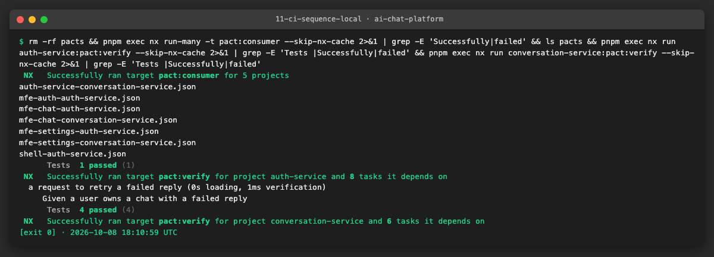

The failing side of the gate is shown by the provider evidence of US4 (a changed response breaks four consumers) and US5
(the pre-AICHAT-199 Stop path).

**Problems and fixes.** None in the workflow. Locally, `testing/mock-server/src/faults/faults.spec.ts` fails one test on
Node 26 and passes on Node 22 (and in CI, which uses Node 24); it is unrelated to this epic, which does not change the
mock server.

## 4. How to run everything

```sh
# unit and component tests of every project touched (pact specs excluded from these runs)
pnpm exec nx run-many -t lint typecheck test -p pact-config mfe-auth shell mfe-settings mfe-chat auth-service conversation-service workspace-config
# consumer pacts, then provider verification (the CI order)
pnpm exec nx run-many -t pact:consumer --skip-nx-cache
pnpm exec nx run-many -t pact:verify --skip-nx-cache
# the CI wiring guard
cd e2e && pnpm exec vitest run src/ci/contracts-workflow.spec.ts
```

## 5. Results

| Metric | Before | After |
|---|---|---|
| Consumer/provider pairs with a pact | 0 of 7 | 7 of 7 |
| Pact interactions | 0 | 39 (17 auth-service, 22 conversation-service) |
| Interactions verified against the real provider | 0 | 36 pass, 3 known failures that must keep failing (AICHAT-255, AICHAT-256) |
| Contract jobs in CI | none | `contracts-consumer` → `contracts-provider` (2 services), every pull request |
| Defects found | — | 4: error message lost in mfe-auth (fixed), error code and message lost in mfe-chat (fixed), attachment upload route (AICHAT-255), test-connection route (AICHAT-256) |
| Test doubles that answered with shapes the server never sends | not known | 35 corrected (16 mfe-auth, 19 mfe-chat) |

## 6. DoD check

| DoD item | Met | Evidence |
|---|---|---|
| Tests run in CI and pass on `main` | Partly: jobs added and green locally in CI order; passing on `main` after the pull request is merged | [11-ci-sequence-local](evidence/11-ci-sequence-local.png) |
| Failure blocks the merge | ✅ the jobs fail the workflow on any mismatch; making them required checks is a repository setting (see US6) | [08](evidence/08-auth-service-broken-provider.png), [10](evidence/10-stop-old-path-before.png) |
| Run instructions added to the project README or `docs/` | ✅ | `packages/pact-config/README.md`, `TESTING.md` |
| Every MFE → service REST call has a pact | ✅ every call of the 4 MFEs (plus the service-to-service calls); SSE out of scope | [04](evidence/04-auth-consumer-pacts.png), [06](evidence/06-conversation-consumer-pacts.png) |
| Provider verification runs in CI | ✅ `contracts-provider` | [07](evidence/07-auth-service-verified.png), [09](evidence/09-conversation-service-verified.png) |

## 7. Notes for the report

- **What was found.** Contract testing found four defects in an application whose unit, component and E2E tests were
  all green: two calls to routes that do not exist (attachment upload, test connection) and two clients that discarded
  the server's error message. Together with the Stop bug of AICHAT-15, every one of them had the same cause: the
  frontend test doubles were written from the client's point of view, so they agreed with the client instead of the
  server.
- **What was fixed / waived.** The two error-envelope defects were fixed in the clients and 35 doubles were corrected.
  The two missing routes are product work, raised as AICHAT-255 and AICHAT-256 and kept visible as known failures that
  must keep failing until fixed.
- **Proof that the checks bite.** Renaming one field of `GET /auth/me` fails verification for four consumers by name;
  the pre-AICHAT-199 Stop path passes the consumer side and fails provider verification with 404, which is the check
  that was missing when that bug shipped.
- **Lessons learned.**
  - A test double only proves something if it behaves like the real component; a pact is a double the provider must
    confirm.
  - Pact writes an interaction only when the test callback resolves; clients that throw on error statuses need the
    outcome captured inside (`runWithMockServer`).
  - Requests hidden inside React hooks are hard to contract-test; plain request functions called by the hooks are easier
    to test and to read.
  - A contract links projects the build graph does not, so contract jobs should not be limited to "affected" projects.
