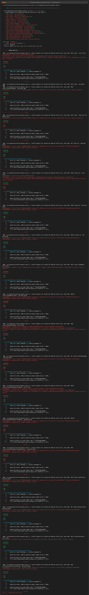
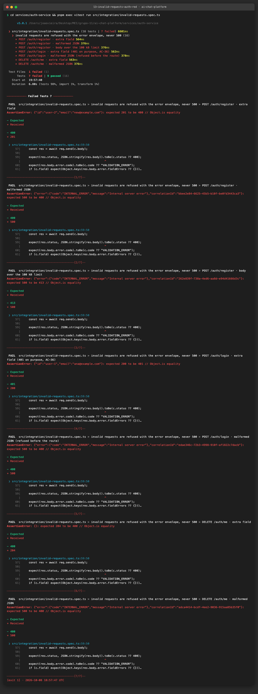
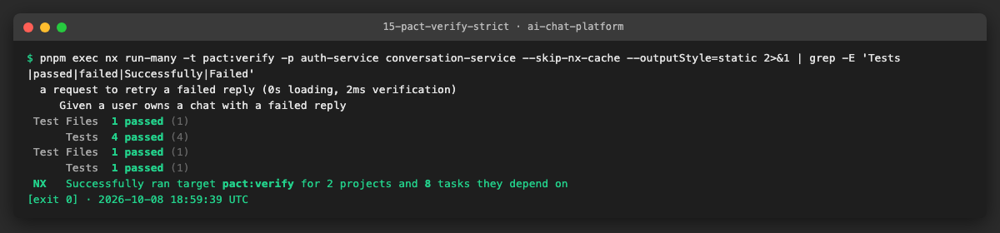
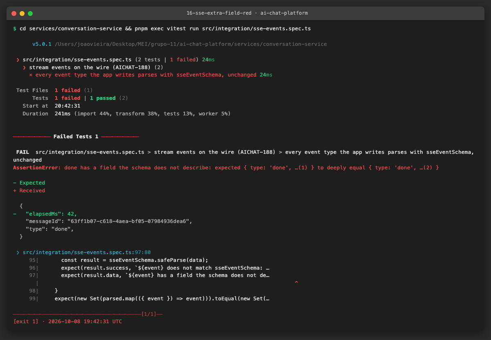
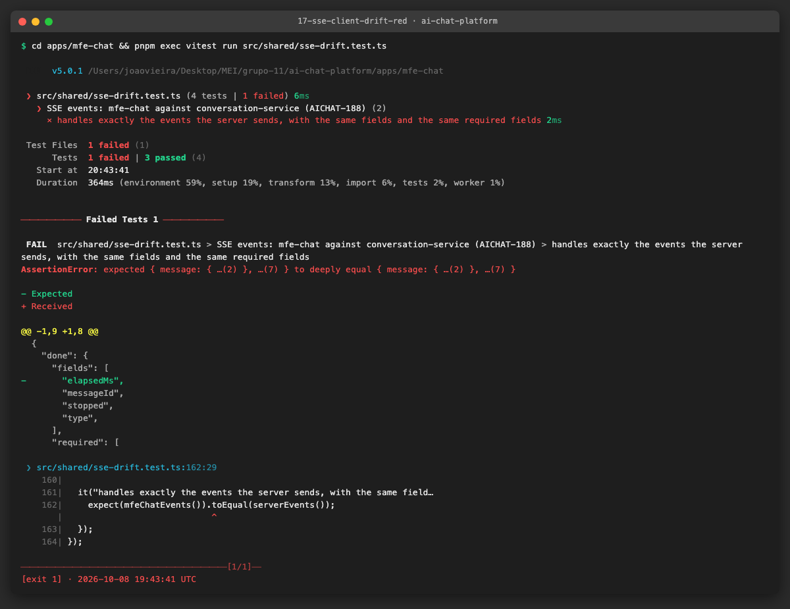
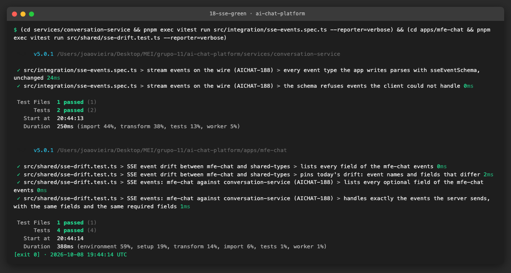
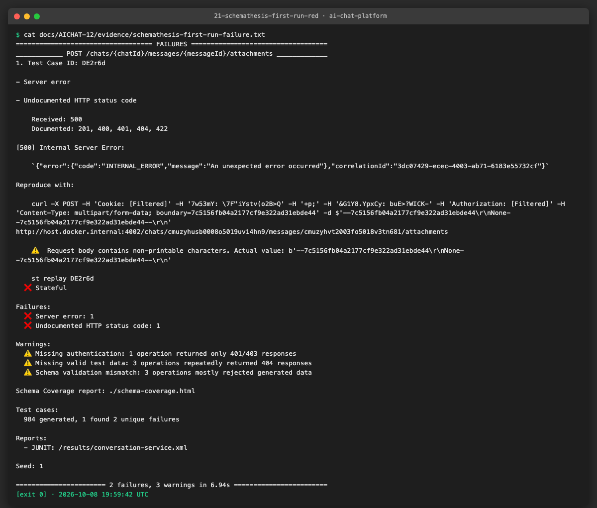
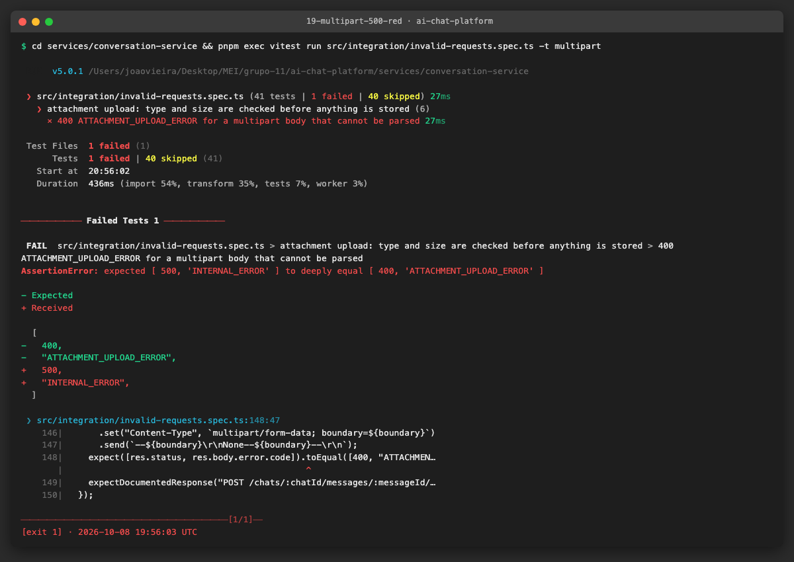
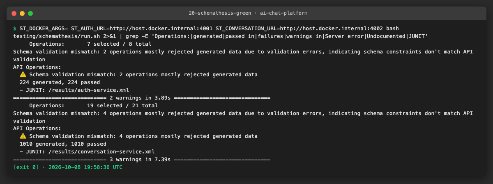

# AICHAT-12 · API schema validation testing: work log

| Field | Value |
|---|---|
| Epic | [AICHAT-12](https://ipca-grupo11.atlassian.net/browse/AICHAT-12) |
| Analysis | [README.md](README.md) |
| Owner | João Vieira |
| Branch | `test/AICHAT-12-api-schema-validation` (built on `test/AICHAT-11-contract-testing`) |
| Started / finished | 2026-10-08 / 2026-10-08 |
| Pull requests | not opened yet (commits are local; pushed by the owner) |
| Status | Review |

## 1. DoR review

Date: 2026-10-08

| DoR item | Status | Question asked | Decision | Decided by |
|---|---|---|---|---|
| Owner assigned | Met | — | João Vieira | — |
| Scope and tooling agreed | Met | Zod → OpenAPI generator, supertest per route, Schemathesis Docker image? | Agreed as written | João Vieira |
| Target environment available | Met | — | Unit and integration level: in-process app with in-memory fakes (no Docker). Schemathesis: the compose stack with the mock LLM (`pnpm mock:up`), in CI | — |
| Shared Zod schemas cover every route | Not met → decided in US1 | Where does the single source of truth live? | Keep each service's `src/shared/contracts` and feature `schema.ts` files as the source; register them in an OpenAPI registry. The drift with `packages/shared-types` is documented and guarded, not moved | João Vieira |

Decisions:

| Topic | Decision |
|---|---|
| OpenAPI generator | `@asteasolutions/zod-to-openapi` 9.1.0 (peer `zod ^4`), `OpenApiGeneratorV31` → OpenAPI 3.1 |
| Rate limit in CI | New env var `RATE_LIMIT_MAX` on auth-service (default 300, production unchanged); the CI stack raises it so Schemathesis is not throttled. A seeded test user's cookie is passed to Schemathesis |
| Unknown fields in a request body (asked after US1) | Rejected with 400: request body schemas become strict (`z.strictObject`), and the spec says `additionalProperties: false` |
| `POST /auth/login` with an invalid body (asked after US1) | Stays 401 `INVALID_CREDENTIALS` (AC-36: never say which field was wrong); documented as the one exception to "400 with field errors" |

Blockers: none.

## 2. Environment


| Tool | Version | Install |
|---|---|---|
| macOS | 27.0.1 | — |
| Node | v26.8.2 locally (CI uses Node 24 from `.nvmrc`) | nvm |
| pnpm | 10.4.0 (pinned in `package.json`) | `pnpm install --frozen-lockfile` |
| Docker | 29.7.2 | Docker Desktop |
| Zod | 4.6.5 (services), 3.24.1 (`apps/mfe-chat`) | workspace dependency |
| Vitest | 5.0.1 | workspace dev dependency |

## 3. Steps

### US1 · Route-to-schema inventory and a single source of truth ([AICHAT-183](https://ipca-grupo11.atlassian.net/browse/AICHAT-183))

**What and why.** "Every route is validated" only means something with a complete list of routes. We did not copy
the list from the analysis: both services already have a guard (`src/integration/route-inventory.spec.ts`, AICHAT-131)
that reads the routes from the running Express app with `listRoutes(app)`. That list is the inventory below. It has
**8** auth-service routes and **21** conversation-service routes; the analysis listed 5 + 16 and missed `DELETE /auth/me`,
`/health`, `/metrics` and the two `/internal` routes. For each route we wrote down the schema that parses the request
today and the schema (if any) that describes the response.


**auth-service** (contracts in `src/shared/contracts/{auth,http}.ts`)

| Route | Auth | Request schema | Response (success) | Response schema today |
|---|---|---|---|---|
| `GET /health` | — | — | 200 `{ status: "ok" }` | none |
| `GET /metrics` | — | — | 200 Prometheus text | n/a (not JSON) |
| `POST /auth/register` | — | `registerRequestSchema` | 201 `{ id, email }` | none (`authResponseSchema` describes `{ user: { id, email, createdAt } }`, which no route returns) |
| `POST /auth/login` | — | `loginRequestSchema` (invalid body → 401, on purpose: AC-36) | 200 `{ id, email }` + `Set-Cookie` | none |
| `POST /auth/refresh` | refresh cookie | — | 204 + `Set-Cookie` | n/a (no body) |
| `POST /auth/logout` | refresh cookie (optional) | — | 204, cookies cleared | n/a |
| `GET /auth/me` | access cookie | — | 200 `{ id, email }` | none |
| `DELETE /auth/me` | access cookie | `deleteAccountRequestSchema` | 204, cookies cleared | n/a |

**conversation-service** (contracts in `src/shared/contracts/{chat,http}.ts`, request bodies in `features/*/schema.ts`)

| Route | Auth | Request schema | Response (success) | Response schema today |
|---|---|---|---|---|
| `GET /health` | — | — | 200 `{ status: "ok" }` | none |
| `GET /metrics` | — | — | 200 Prometheus text | n/a |
| `GET /chats` | user JWT | — | 200 `{ chats: ChatDto[] }` | `chatDtoSchema` (no wrapper) |
| `POST /chats` | user JWT | `createChatSchema` | 201 `{ chat }` | `chatDtoSchema` |
| `GET /chats/:id` | user JWT | `chatIdParamsSchema` | 200 `{ chat }` | `chatDtoSchema` |
| `PATCH /chats/:id` | user JWT (owner) | `chatIdParamsSchema`, `updateChatSchema` | 200 `{ chat }` | `chatDtoSchema` |
| `DELETE /chats/:id` | user JWT (owner) | `chatIdParamsSchema` | 204 | n/a |
| `GET /chats/:id/members` | user JWT | `chatIdParamsSchema` | 200 `{ members: ChatMemberDto[] }` | `chatMemberDtoSchema` |
| `POST /chats/:id/members` | user JWT (owner) | `chatIdParamsSchema`, `addMemberSchema` | 201 `{ member }` | `chatMemberDtoSchema` |
| `DELETE /chats/:id/members/:email` | user JWT (owner) | `memberParamsSchema` | 204 | n/a |
| `DELETE /chats/:id/membership` | user JWT (member) | `chatIdParamsSchema` | 204 | n/a |
| `GET /chats/:chatId/messages` | user JWT | `chatParamsSchema` | 200 `{ messages: MessageDto[] }` | `messageDtoSchema` |
| `POST /chats/:chatId/messages` | user JWT + optional `X-Llm-Api-Key` | `chatParamsSchema`, `sendMessageSchema` | 201 `{ message }` | `messageDtoSchema` |
| `PATCH /chats/:chatId/messages/:messageId` | user JWT | `messageParamsSchema`, `editMessageSchema` | 200 `{ message }` | `messageDtoSchema` |
| `DELETE /chats/:chatId/messages/:messageId` | user JWT | `messageParamsSchema` | 204 | n/a |
| `POST /chats/:chatId/messages/:messageId/retry` | user JWT + optional `X-Llm-Api-Key` | `messageParamsSchema` | 202 `{ message }` | `messageDtoSchema` |
| `POST /chats/:chatId/stop` | user JWT | `chatParamsSchema` | 200 `{ stopped: boolean }` | none |
| `GET /chats/:chatId/stream` | user JWT | inline `paramsSchema` | 200 `text/event-stream` | `Sse*EventSchema` per event (US6) |
| `POST /chats/:chatId/messages/:messageId/attachments` | user JWT | `attachmentParamsSchema` + multipart `file` | 201 `{ attachment }` | `attachmentDtoSchema` |
| `POST /internal/erasures` | service token | `eraseUserSchema` | 200 `{ erased: { chats, memberships, messages, files } }` | none |
| `POST /internal/sessions/:userId/stop` | service token | inline `paramsSchema` | 200 `{ stopped: number }` | none |

Every error, in both services, uses the same envelope, `errorResponseSchema`:
`{ error: { code, message, fieldErrors? }, correlationId? }`. The two copies are identical.

**What the inventory found.**

1. **Responses are not described.** No route has a schema for its whole response body. The DTOs exist (`chatDtoSchema`,
   `messageDtoSchema`, …), but not the `{ chat }`, `{ messages }` wrappers, and five responses have no schema at all
   (`/health`, `{ stopped: boolean }`, `{ stopped: number }`, `{ erased }`, and auth's `{ id, email }`).
2. **auth-service's response schema is wrong.** `authResponseSchema` (`{ user: { id, email, createdAt } }`) is used only
   by its own unit test; register, login and `GET /me` return `{ id, email }`. The AICHAT-11 pacts
   (`pacts/mfe-auth-auth-service.json`) already lock `{ id, email }` in, so the schema is what has to change, not the API.
3. **Request schemas are not strict.** `z.object()` drops unknown keys without an error, so a body with an extra field
   is accepted today. US4 decides what to do with it.
4. **Login answers 401, not 400, for an invalid body.** That is on purpose (AC-36: never say which field was wrong);
   US4 treats it as an exception to "400 with field errors".

**Drift with `packages/shared-types`.** The analysis said only mfe-settings uses shared-types. That is no longer true:
mfe-chat and conversation-service depend on it too, but **only for `api-keys` and `model-capabilities`**. Neither
service imports its API DTOs from there. We compared every pair of schemas as JSON Schema (`z.toJSONSchema`):

| Schema | auth-service / conversation-service vs shared-types |
|---|---|
| Register, login, user profile, error envelope, add member | identical |
| Create / update chat body | service caps `model` at 200 characters |
| Send / edit message body | service caps `content` at 32 000 characters and `attachmentIds` at 10 |
| `ChatDto`, `ChatMemberDto` | service has `ownerEmail`; shared-types requires ISO date-times and title length |
| `MessageDto` | **incompatible**: different `status` values (`sent` vs `complete`/`canceled`), `attachments` objects vs `attachmentIds`, no `authorId`, `authorEmail`, `error`, `stopped` in shared-types |
| `AttachmentDto` | **incompatible**: shared-types has `ownerId`, `storedPath`, `extractedTextStatus`; the service has `filename`, `kind` |
| SSE events | shared-types has no `started` and no `message` event (handled in US6, with the AICHAT-20 guard) |

The shared-types chat DTOs describe an early design; the services describe what the API really sends.

**Decision (source of truth).** Each service's `src/shared/contracts` and feature `schema.ts` files are the single
source of truth for its API. US2 registers them in an OpenAPI registry and adds the missing response schemas there.
`packages/shared-types` is not the source for the HTTP API; its chat DTOs are left as they are, and the drift is pinned
by a test so it cannot change silently. Decided by João Vieira (epic owner) in the DoR review; the service owners
review it in the pull request.

| Owner | Responsibility |
|---|---|
| auth-service team | `services/auth-service/src/shared/contracts` and the generated auth spec |
| conversation-service team | `services/conversation-service/src/shared/contracts`, `features/*/schema.ts` and its spec |
| platform team | `packages/shared-types`: aligning or removing the stale chat DTOs is a follow-up, outside this epic |

**Files.**
- `services/conversation-service/src/shared/contracts/shared-types-drift.spec.ts` (new): for nine pairs of schemas,
  lists the fields that differ between the service and `@app/shared-types` and compares the list with `KNOWN_DRIFT`.
- `docs/AICHAT-12/WORKLOG.md` (this section): inventory, drift and decision.

**How to run.**

```sh
cd services/conversation-service && pnpm exec vitest run src/shared/contracts/shared-types-drift.spec.ts --reporter=verbose
```

**How to repeat it manually.**

1. Open `services/conversation-service/src/shared/contracts/chat.ts` and comment out `stopped: z.boolean(),` in
   `messageDtoSchema`.
2. Run the command above.
3. Expected output: `MessageDto matches the recorded drift` fails; the diff shows `"stopped: only in service"` missing.
   Restore the line.

**Result.** The guard passes with the recorded drift and fails as soon as a DTO changes on either side.


**Problems and fixes.** The first comparison script ran as CommonJS and failed on top-level `await`; we moved the
comparison into a Vitest test inside conversation-service, which already depends on `@app/shared-types`, so it runs
in CI with no extra tool. auth-service does not depend on shared-types, so its three request schemas were compared once
(identical) and are not guarded.

### US2 · Generate an OpenAPI spec for both services from the Zod schemas ([AICHAT-184](https://ipca-grupo11.atlassian.net/browse/AICHAT-184))

**What and why.** Schemathesis (US5) and ZAP need an OpenAPI file, and a spec written by hand goes stale the day a route
changes. We generate the spec from the **same Zod schemas the routes use to parse requests**, so the spec cannot
describe a body the code does not accept. Each service has a `src/openapi/document.ts` that registers its routes with
`@asteasolutions/zod-to-openapi` and builds an OpenAPI 3.1 document; the result is committed as
`services/<service>/openapi.json` (auth-service 8 operations, conversation-service 21).

The spec covers, for each route:

- the path parameters, the JSON body (or the multipart `file` for attachments) and the optional `X-Llm-Api-Key` header;
- the success response, with the response schemas US1 found missing (`src/shared/contracts/responses.ts`: `{ chat }`,
  `{ messages }`, `{ stopped }`, `{ erased }`, auth's `{ id, email }`, …), the `X-Correlation-Id` header and, for
  login/refresh/logout/delete, `Set-Cookie`;
- **only the error statuses the route can really return** (taken from the `HttpError`s in the code), each with the
  shared `ErrorResponse` envelope. A **500 is never documented**: it is always a bug, so Schemathesis and the US3 tests
  must treat it as a failure, not as an expected answer;
- the security of each route: `cookieAuth` (`access_token` cookie) or `bearerAuth` on the chat routes, `refreshCookie`
  on refresh/logout, `serviceToken` on `/internal/*`, and an explicit `security: []` on the public routes.

`openapi.spec.ts` (one per service) checks four things:

| Test | What breaks it |
|---|---|
| the committed `openapi.json` matches the schemas | a schema or route changed and nobody ran `pnpm openapi:generate` |
| every route the app registers is documented, and nothing else | a new route without a spec entry, or a removed route still documented (compared with `listRoutes(app)` from US1) |
| the security of every route | a chat route documented as public, or an internal route with the user cookie |
| every 4xx/5xx is `ErrorResponse`, and no 500 is documented | an error response with another body |

The stale check uses Vitest's `toMatchFileSnapshot("../../openapi.json")`: the file is a snapshot. In CI a mismatch
fails; locally `pnpm openapi:generate` (the same test with `-u`) rewrites it.

**Files.**
- `services/*/src/openapi/document.ts` (new): the registry of every route; `services/*/src/openapi/openapi.spec.ts` (new): the four checks.
- `services/*/openapi.json` (new, generated): the specs.
- `services/*/src/shared/contracts/responses.ts` (new): response body schemas.
- `services/conversation-service/src/features/messages/internal-routes.ts`: `sessionParamsSchema` exported, so the spec uses the route's own schema.
- `services/*/package.json`: `@asteasolutions/zod-to-openapi` 9.1.0 and the `openapi:generate` script.

**How to run.**

```sh
cd services/conversation-service && pnpm exec vitest run src/openapi/openapi.spec.ts --reporter=verbose
cd services/conversation-service && pnpm openapi:generate      # after changing a schema or a route
pnpm dlx --package=@redocly/cli@2.50.0 redocly lint services/conversation-service/openapi.json --extends=recommended
```

**How to repeat it manually.**

1. In `services/conversation-service/src/shared/contracts/chat.ts`, add a field to `chatDtoSchema`, e.g. `pinned: z.boolean(),`.
2. Run `pnpm exec vitest run src/openapi/openapi.spec.ts` in that folder.
3. Expected output: `the committed openapi.json matches the schemas` fails and the diff shows the new `pinned`
   property. Run `pnpm openapi:generate` and the test passes; `git diff openapi.json` shows the change. Remove the field
   and regenerate again.

**Result.** Both specs are generated, pass the four checks and are valid OpenAPI 3.1 for Redocly's `recommended`
rules (0 errors). The warnings left are expected: `/health` and `/metrics` have no 4xx, there is no licence (private
project) and the server URL is localhost.


**Problems and fixes.**
- `registry.register("Chat", chatDtoSchema)` failed with `zodSchema.openapi is not a function` even after
  `extendZodWithOpenApi(z)`. In Zod 4.6 a schema does not inherit from `ZodType.prototype`: each instance gets a copy of
  the methods when it is created, and the contract schemas are created at import time, before the extension runs. We
  record the name on the existing instance instead, through the library's exported `zodToOpenAPIRegistry`
  (`named("Chat", chatDtoSchema)` in `document.ts`). It needs no import order and leaves the contract files untouched.
- The first Redocly run gave 2 errors: `/health` and `/metrics` had no `security`, which reads as "forgot to protect".
  They are public on purpose, so they now say `security: []`. We also added an `operationId` to every route
  (Schemathesis names its findings by it).
- `tsc` refused the inferred return type (TS2883, it comes from `openapi3-ts`, not a direct dependency); the function
  is now annotated with `ReturnType<OpenApiGeneratorV31["generateDocument"]>`.
- The DAST file `testing/zap/openapi.yaml` is replaced in US5, where the compose stack runs and ZAP 2.17 can be checked
  against the generated OpenAPI 3.1 file.

### US3 · Response bodies of every route validated against their schema ([AICHAT-185](https://ipca-grupo11.atlassian.net/browse/AICHAT-185))

**What and why.** US2 describes what each route returns; this story proves the code really returns it. We did not
write a second list of schemas for the tests: `document.ts` now exposes `routeConfigs()`, the list of routes the spec
is built from, and the tests read the same list. For every route and status it holds the Zod schema of the body, so
the spec and the tests cannot disagree.

`test-utils/documented-response.ts` (one per service) checks a real response against that list:

1. **The status must be documented for the route.** A 500, or a 400 on a route that cannot return one, fails with
   `answered 500, which the spec does not document` and the body.
2. **The body must match its schema, with no unknown field at any depth.** `schema.parse(body)` must succeed *and*
   return exactly `body`. `z.object` silently drops keys it does not know, at every level, so any extra field (also
   inside an array of chats) makes the parsed copy differ from the original. This gives a strict check of the whole
   tree without changing the schemas.
3. **Errors use the envelope.** Every 4xx is documented with `ErrorResponse`, has an `X-Correlation-Id` header, and
   `body.correlationId` equals that header.
4. **No body where none is documented** (204) and the documented content type (`text/plain` for `/metrics`,
   `text/event-stream` for the stream; its events are checked in US6).

`integration/response-schemas.spec.ts` (one per service) calls every route through the real app with in-memory fakes:
the success case and each error status we can provoke (401, 400, 403, 404, 409, 422, and on auth-service 429, 502,
503). Its last test, `every route's success response was checked against its schema`, fails if a route in the list
has a success response that no test checked; with the route-inventory check of US2 this means a new route cannot be
added without a schema and a response test.

**Finding: the rate limiter answered 429 in plain text.** When a client goes over a limit, `express-rate-limit`
answers by default with `text/html` "Too many requests, please try again later." instead of the error envelope; a
frontend reading `body.error.message` gets nothing. The app-wide limiter also ran before the correlation id was set,
so its 429 had no `X-Correlation-Id`. We fixed both: `shared/rate-limit.ts` (`rateLimitedHandler`) answers
`{ error: { code: "RATE_LIMITED", ... }, correlationId }` for both limiters, and the correlation middleware now runs
first. The spec documents 429 on every auth-service route. The limit itself comes from the new `RATE_LIMIT_MAX`
setting (default 300, unchanged; US5 raises it on the CI stack), which also lets the test reach the limit with 1.

**Files.**
- `services/*/src/openapi/document.ts`: routes moved into `routeConfigs()` (the generated spec is byte-for-byte the same).
- `services/*/src/test-utils/documented-response.ts` (new): the checker.
- `services/*/src/integration/response-schemas.spec.ts` (new): 15 tests on conversation-service, 11 on auth-service.
- `services/auth-service/src/shared/rate-limit.ts` (new), `src/main.ts`, `src/features/account/api.ts`,
  `src/shared/env.ts`, `.env.example`, `src/test-utils/build-test-app.ts`: 429 envelope and `RATE_LIMIT_MAX`.
- `services/auth-service/openapi.json`: regenerated with the 429 responses.

**How to run.**

```sh
cd services/conversation-service && pnpm exec vitest run src/integration/response-schemas.spec.ts --reporter=verbose
cd services/auth-service && pnpm exec vitest run src/integration/response-schemas.spec.ts --reporter=verbose
```

**How to repeat it manually.** Three ways to break it (restore the file after each one):

| Change | Expected failure |
|---|---|
| In `chats/service.ts`, add `internalNote: "debug",` to the object `toChatDto` returns | `GET /chats 200 body has fields the schema does not describe` |
| In `chats/controller.ts`, throw `new Error("database is down")` at the start of `get` | `GET /chats/:id answered 500, which the spec does not document` |
| In `response-schemas.spec.ts`, delete the `check(...)` of the successful `POST /chats/:chatId/stop` | `expected [ 'POST /chats/:chatId/stop 200' ] to deeply equal []` |

**Result.** 26 tests, all routes and 40+ responses checked; the three changes above each fail the suite.


**Problems and fixes.** `tsc` rejected `content["application/json"].schema` because the library types a media entry as
"schema or `$ref`"; the checker narrows it with `"schema" in jsonMedia`. With `deletionsPerHour: 0` the deletion
limiter never fires (0 means "no limit" in `express-rate-limit`), so the 429 test uses a limit of 1 and two requests.

### US4 · Invalid requests rejected with 400 and field errors ([AICHAT-186](https://ipca-grupo11.atlassian.net/browse/AICHAT-186))

**What and why.** Bad input must be refused with the error envelope and never reach the services as a 500. We wrote
the negative table first (`src/integration/invalid-requests.spec.ts`, 40 rows on conversation-service, 16 on
auth-service: missing field, wrong type, value not allowed, too long, extra field, malformed JSON, body over 100 kB,
undecodable path parameter, upload type/size) and ran it before changing any code.

**Findings (red before the fix).** 19 rows failed on conversation-service and 7 on auth-service:

| Request | Before | After |
|---|---|---|
| Malformed JSON body | 500 (conversation-service also without `correlationId`) | 400 `INVALID_JSON` |
| Body over the 100 kB limit | 500 | 413 `PAYLOAD_TOO_LARGE` |
| Path parameter that cannot be decoded (`%E0%A4%A`) | 500 | 400 `BAD_REQUEST` |
| Unknown field in a body | accepted, silently dropped | 400, `fieldErrors: { <field>: ["Unknown field"] }` (login: 401, AC-36) |

**Fixes.** Request body schemas are `z.strictObject` (spec: `additionalProperties: false`). Both error handlers map
the 4xx errors Express and its body parser raise before a route runs, and `toFieldErrors` reports an unknown key under
its own name (Zod puts it on the parent object). conversation-service sets the correlation id before parsing the body.
The spec documents 400 on routes with parameters or a body and 413 on JSON-body routes. Two AICHAT-23 tests had pinned
the malformed-JSON 500 ("pinned: should be 400"); they now assert the 400. All consumer pacts still verify against the
strict services, so no frontend sends an unknown field.

**How to run.**

```sh
cd services/conversation-service && pnpm exec vitest run src/integration/invalid-requests.spec.ts --reporter=verbose
cd services/auth-service && pnpm exec vitest run src/integration/invalid-requests.spec.ts --reporter=verbose
pnpm exec nx run-many -t pact:verify -p auth-service conversation-service --skip-nx-cache
```

**How to repeat it manually.** Revert `z.strictObject` to `z.object` in `features/chats/schema.ts`: the "extra field"
rows fail with status 201.

**Result.**







### US6 · SSE events validated against the shared event schema ([AICHAT-188](https://ipca-grupo11.atlassian.net/browse/AICHAT-188))

**What and why.** The stream (`GET /chats/:chatId/stream`) is not JSON request/response, so US3 only checked its status
and content type. The events have three definitions: the one conversation-service sends, mfe-chat's `SSEEvent`, and
shared-types. AICHAT-20 already pins the drift between mfe-chat and shared-types (`apps/mfe-chat/src/shared/sse-drift.test.ts`,
`docs/AICHAT-20/SSE-DRIFT.md`); nothing compared the client with what the **server really sends**. We extended that
work instead of writing a second guard.

1. **One runtime schema for the stream.** `sseEventSchema` (`shared/contracts/chat.ts`) is a discriminated union of the
   eight events on `type`. A compile-time check (`sseEventTypeMatchesSchema`) keeps the existing `SseEvent` type and the
   schema identical, and the OpenAPI spec now publishes this same schema as `SseEvent`.
2. **Server: every event, from the real code, on the wire.** `integration/sse-events.spec.ts` runs the real app, queue
   and processor; only the LLM is scripted. Reply 1 streams reasoning, a web fetch (`fetching` then `done`) and text and
   waits, so message 2 is `queued`; reply 2 fails (`error` with `retryable`); reply 3 is stopped (`done` with
   `stopped: true`). Every published event goes through `writeSseEvent`, the function the stream route uses, and each
   frame is parsed back: it must be `event: <type>\ndata: <JSON>\n\n`, the event line must equal the JSON's `type`, the
   JSON must parse with `sseEventSchema` without an unknown field, and all eight types must appear.
3. **Client: mfe-chat against the server.** `sse-drift.test.ts` gains a block that reads `SseEvent` from the committed
   `services/conversation-service/openapi.json` (no service code is imported into the frontend) and compares, per
   event, the field names and the required fields with mfe-chat's `SSEEvent`. The field lists are checked against the
   TypeScript type at compile time (the AICHAT-20 technique, extended to optional fields). This comparison must be exact.
   `apps/mfe-chat/project.json` declares the spec as a test input and conversation-service as an implicit dependency, so
   Nx re-runs the test (cache and `affected`) when the server's events change.

**Files.**
- `services/conversation-service/src/shared/contracts/chat.ts`: `sseEventSchema` and the type check.
- `services/conversation-service/src/openapi/document.ts`: uses `sseEventSchema` (the spec is unchanged).
- `services/conversation-service/src/integration/sse-events.spec.ts` (new).
- `apps/mfe-chat/src/shared/sse-drift.test.ts`, `apps/mfe-chat/project.json`.
- `docs/AICHAT-20/SSE-DRIFT.md`: a section pointing to this extension.

**How to run.**

```sh
cd services/conversation-service && pnpm exec vitest run src/integration/sse-events.spec.ts --reporter=verbose
cd apps/mfe-chat && pnpm exec vitest run src/shared/sse-drift.test.ts --reporter=verbose
```

**How to repeat it manually.**

1. Server: in `features/messages/processor.ts`, add `...{ elapsedMs: 42 }` to the object of the `done` event. The stream
   test fails with `done has a field the schema does not describe`.
2. Client: in `shared/contracts/chat.ts`, add `elapsedMs: z.number().optional(),` to `sseDoneEventSchema` and run
   `pnpm openapi:generate`. The server tests still pass (the field is optional), but the mfe-chat test fails: the
   server can now send a field the client does not know. Restore both files and regenerate.

**Result.** Both checks pass today: the server sends exactly what mfe-chat handles. The shared-types drift stays pinned
by AICHAT-20 (it is the odd one out; its fix is the ticket proposed in `SSE-DRIFT.md`).







**Problems and fixes.** In mfe-chat's jsdom environment `import.meta.url` is not a `file:` URL, so the test reads the
spec relative to the working directory (`apps/mfe-chat`, where the Nx target runs it).

### US5 · Schemathesis run against the OpenAPI spec in CI ([AICHAT-187](https://ipca-grupo11.atlassian.net/browse/AICHAT-187))

**What and why.** Our tests only send the inputs we thought of. Schemathesis reads the spec and generates hundreds of
requests per route (valid ones, invalid ones, odd strings, odd headers, sequences that follow the links between
routes) and checks every answer. We run the pinned `schemathesis/schemathesis:4.28.0` image against the real compose
stack (`pnpm mock:up`: real services and Postgres, mock LLM), one run per service with its own `openapi.json`. The
services are published on `localhost:4001`/`4002`, the same URLs as the specs' `servers`.

- **Checks:** `not_a_server_error` (no 5xx), `status_code_conformance` (only documented statuses),
  `response_schema_conformance` (bodies match the spec).
- **Signed in:** `scripts/schemathesis/session.ts` reuses the DAST helper (`signInSeededUser`): it registers a throw-away
  user, seeds three chats and prints its access-token cookie; `run.sh` masks it in the CI log and sends it on every request.
- **Left out on purpose:** `deleteAccount` (would delete the signed-in user mid-run), `eraseUser` (deletes data,
  service token only; covered by the integration tests) and `streamChat` (server-sent events never end).
- **Rate limit:** `compose.yaml` passes `RATE_LIMIT_MAX` (default 300) to auth-service; the workflow sets 100 000 so the
  ~1 200 requests are not answered 429 halfway.
- **CI:** `.github/workflows/api-schema.yml`, job `schemathesis`, on every pull request and on pushes to the integration
  branch and `main`. A failed check fails the job; the JUnit reports (`schemathesis-results/*.xml`) are uploaded even
  then; the stack is always torn down. Branch protection is not available on this repository (HTTP 403), so, as for
  DAST, the team rule in the workflow header is: do not merge while `api-schema / schemathesis` is red.
  `e2e/src/ci/schemathesis-workflow.spec.ts` checks these properties.

**Finding (first run): a malformed upload answered 500.** Schemathesis sent a multipart body whose part had no headers;
busboy (the parser inside multer) throws a plain `Error("Malformed part header")`, which the error handler did not know.
We reproduced it in-process first (a new row in `invalid-requests.spec.ts`, red), then fixed it in
`attachments/routes.ts`: any error raised while the multipart body is read becomes `400 ATTACHMENT_UPLOAD_ERROR`
(multer's own errors keep their handling). After rebuilding the service image the whole run is green.

**Triage of the warnings** (reported, not failures):

| Warning | Why it is expected |
|---|---|
| auth-service: "schema validation mismatch" on register/login | login answers 401 to any bad body on purpose (AC-36); register rejects most generated emails/passwords |
| auth-service/conversation-service: "authentication failed" on refresh / `POST /internal/sessions/{userId}/stop` | refresh needs the refresh cookie and the internal route the service token; only the access token is sent. Both answer documented 401s |
| conversation-service: "missing test data" (404) on message edit/cancel/leave | generated ids rarely exist; the success paths are covered by the US3 suite |

**ZAP API scan now uses the generated specs.** `scripts/dast/zap-spec.ts` joins the two service specs as the browser
sees them through the shell (`/auth/...`, `/api/chats/...`), leaving out `DELETE /auth/me`, `/internal/*`, the stream,
`/health` and `/metrics`, and writes `testing/zap/openapi.json`; `scripts/dast/zap-spec.test.ts` fails when it is stale.
The hand-written `testing/zap/openapi.yaml` is deleted, `testing/zap/run.sh` and `dast.yml` point to the JSON file and
`e2e/src/ci/dast-workflow.spec.ts` reads it (still green: the same 21 operations).

**Files.**
- `testing/schemathesis/run.sh`, `scripts/schemathesis/session.ts` (new): the runner and the session.
- `.github/workflows/api-schema.yml`, `e2e/src/ci/schemathesis-workflow.spec.ts` (new): the job and its checks.
- `compose.yaml`: `RATE_LIMIT_MAX`. `.gitignore`: `schemathesis-results/`.
- `services/conversation-service/src/features/attachments/routes.ts`: malformed multipart → 400; new row in `invalid-requests.spec.ts`.
- `scripts/dast/zap-spec.ts`, `scripts/dast/zap-spec.test.ts`, `testing/zap/openapi.json` (new); `testing/zap/openapi.yaml` (deleted);
  `testing/zap/run.sh`, `.github/workflows/dast.yml`, `e2e/src/ci/dast-workflow.spec.ts`.

**How to run.**

```sh
RATE_LIMIT_MAX=100000 pnpm mock:up
bash testing/schemathesis/run.sh            # Linux / CI
# Docker Desktop on macOS: the container reaches the host through host.docker.internal
ST_DOCKER_ARGS= ST_AUTH_URL=http://host.docker.internal:4001 ST_CONVERSATION_URL=http://host.docker.internal:4002 \
  bash testing/schemathesis/run.sh
node scripts/dast/zap-spec.ts               # after a service spec changes
```

**How to repeat it manually.** Remove `readFile(...)` around `upload.single("file")` in `attachments/routes.ts`,
rebuild the service (`docker compose --profile llm up -d --build --no-deps conversation-service` with
`COMPOSE_FILE=compose.yaml:compose.mock.yaml`) and run the script: the run fails with `Server error` on
`POST /chats/{chatId}/messages/{messageId}/attachments` and prints a `curl` command that reproduces it.

**Result.** auth-service 224 and conversation-service 1 010 generated cases, all checks pass; JUnit reports written.







**Problems and fixes.**
- `run.sh` failed on macOS's bash 3.2 with `docker_args[@]: unbound variable` when the array is empty (`set -u`); it
  now uses `${docker_args[@]+"${docker_args[@]}"}`.
- `pnpm mock:up` exited 1 locally although every service was healthy: `docker compose up --wait` counts the one-shot
  `ollama-pull` container (exit 0) as a failure. It comes from the Ollama restore, not from this epic; the job's
  bounded health poll is what decides. Reported to the team.
- Not verified locally: that ZAP 2.17 imports the OpenAPI 3.1 file. The weekly `api-scan` job (or a manual
  `workflow_dispatch`) is the first run; if ZAP refuses 3.1, `zap-spec.ts` can emit 3.0 with the library's
  `OpenApiGeneratorV3`.
- `gitleaks` is not installed on the development machine; CI runs it on the pull request.

## 4. How to run everything

```sh
# no Docker: drift guard, spec checks, response schemas, invalid requests, stream events, client/server events
pnpm exec nx run-many -t test -p auth-service conversation-service mfe-chat
pnpm exec nx run-many -t pact:verify -p auth-service conversation-service --skip-nx-cache   # strict bodies vs the frontends
node --test scripts/dast/zap-spec.test.ts
cd e2e && pnpm exec vitest run src/ci/schemathesis-workflow.spec.ts src/ci/dast-workflow.spec.ts
# Docker: Schemathesis against the stack
RATE_LIMIT_MAX=100000 pnpm mock:up && bash testing/schemathesis/run.sh; pnpm mock:down
```

## 5. Results

| Metric | Before | After |
|---|---|---|
| Routes with a documented request and response schema | 0 of 29 (no spec in the repo) | 29 of 29, in two generated OpenAPI 3.1 files |
| Routes whose responses are checked against a schema in tests | 0 | 29 (26 tests, 40+ responses) |
| Negative request cases | scattered | 57 table rows (41 conversation-service, 16 auth-service) |
| Stream event types parsed from the wire | 0 of 8 | 8 of 8; mfe-chat compared with the server's events |
| Generated requests per CI run (Schemathesis) | 0 | about 1 230 (224 auth-service, 1 010 conversation-service) |
| Ways a client could get a 500 for its own bad input | 5 found | 0 known |

## 6. DoD check

| DoD item | Met | Evidence |
|---|---|---|
| Tests run in CI and pass on `main` | Partly: they run in CI (unit/integration in `ci.yml`, Schemathesis in `api-schema.yml`) and pass on this branch; `main` after the merge | [green suites](evidence/11-response-schemas-green.png), [Schemathesis](evidence/20-schemathesis-green.png) |
| Failure blocks the merge | ✅ the jobs fail on any failed check; "required check" is a team rule (branch protection unavailable, HTTP 403), as for DAST | `.github/workflows/api-schema.yml` header, `e2e/src/ci/schemathesis-workflow.spec.ts` |
| Run instructions added to the project README or `docs/` | ✅ | `TESTING.md` (AICHAT-12 section), section 4 above |
| Request and response of every route validated against the schemas | ✅ | US3, US4, US6 |
| Schemathesis run against the OpenAPI spec | ✅ | [first run](evidence/21-schemathesis-first-run-red.png), [green](evidence/20-schemathesis-green.png) |

## 7. Notes for the report

- **What was found.** No API spec existed; no response had a schema; auth's only response schema described a shape no
  route returns. Five ways to get a 500 with a bad request: malformed JSON, an oversized body, an undecodable path
  parameter, a malformed multipart upload (found by Schemathesis), and a rate-limit 429 sent as `text/html`. Unknown
  fields in request bodies were silently accepted. `packages/shared-types` holds chat DTOs that no longer match the API.
- **What was fixed.** All of the above: 400/413/429 with the error envelope and the correlation id, strict request
  bodies (the frontends' pacts still verify), and the generated specs replace the hand-written ZAP file.
- **What was recorded, not fixed.** The shared-types drift (pinned by tests; aligning it is the platform team's
  follow-up). ZAP's acceptance of OpenAPI 3.1 is confirmed on the first scheduled run. `pnpm mock:up` exits 1 because
  of the one-shot `ollama-pull` container (reported).
- **Lessons learned.** A test that passes the first time proves nothing until it has been seen failing: every check in
  this epic was broken on purpose once. Tests that read the same route table as the spec cannot disagree with it.
  Fuzzing found in seconds the one input none of our 57 hand-written negative cases tried.
