# AICHAT-12 · API schema validation testing: work log

| Field | Value |
|---|---|
| Epic | [AICHAT-12](https://ipca-grupo11.atlassian.net/browse/AICHAT-12) |
| Analysis | [README.md](README.md) |
| Owner | João Vieira |
| Branch | `test/AICHAT-12-api-schema-validation` (built on `test/AICHAT-11-contract-testing`) |
| Started / finished | 2026-10-08 / … |
| Pull requests | not opened yet (commits are local; pushed by the owner) |
| Status | In Progress |

## 1. DoR review

Date: 2026-10-08

| DoR item | Status | Question asked | Decision | Decided by |
|---|---|---|---|---|
| Owner assigned | Met | — | João Vieira | — |
| Scope and tooling agreed | Met | Zod → OpenAPI generator, supertest per route, Schemathesis Docker image? | Agreed as written | João Vieira |
| Target environment available | Met | — | Unit and integration level: in-process app with in-memory fakes (no Docker). Schemathesis: the compose stack with the mock LLM (`pnpm mock:up`), in CI | — |
| Shared Zod schemas cover every route | Not met → decided in US1 | Where does the single source of truth live? | Keep each service's `src/shared/contracts` and feature `schema.ts` files as the source; register them in an OpenAPI registry. The drift with `packages/shared-types` is documented and guarded, not moved | João Vieira |

Decisions:

| Topic | Decision |
|---|---|
| OpenAPI generator | `@asteasolutions/zod-to-openapi` 9.1.0 (peer `zod ^4`), `OpenApiGeneratorV31` → OpenAPI 3.1 |
| Rate limit in CI | New env var `RATE_LIMIT_MAX` on auth-service (default 300, production unchanged); the CI stack raises it so Schemathesis is not throttled. A seeded test user's cookie is passed to Schemathesis |
| Unknown fields in a request body (asked after US1) | Rejected with 400: request body schemas become strict (`z.strictObject`), and the spec says `additionalProperties: false` |
| `POST /auth/login` with an invalid body (asked after US1) | Stays 401 `INVALID_CREDENTIALS` (AC-36: never say which field was wrong); documented as the one exception to "400 with field errors" |

Blockers: none.

## 2. Environment

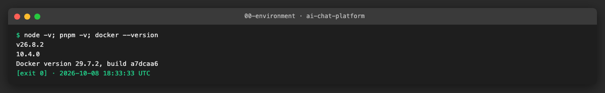

| Tool | Version | Install |
|---|---|---|
| macOS | 27.0.1 | — |
| Node | v26.8.2 locally (CI uses Node 24 from `.nvmrc`) | nvm |
| pnpm | 10.4.0 (pinned in `package.json`) | `pnpm install --frozen-lockfile` |
| Docker | 29.7.2 | Docker Desktop |
| Zod | 4.6.5 (services), 3.24.1 (`apps/mfe-chat`) | workspace dependency |
| Vitest | 5.0.1 | workspace dev dependency |

## 3. Steps

### US1 · Route-to-schema inventory and a single source of truth ([AICHAT-183](https://ipca-grupo11.atlassian.net/browse/AICHAT-183))

**What and why.** "Every route is validated" only means something with a complete list of routes. We did not copy
the list from the analysis: both services already have a guard (`src/integration/route-inventory.spec.ts`, AICHAT-131)
that reads the routes from the running Express app with `listRoutes(app)`. That list is the inventory below. It has
**8** auth-service routes and **21** conversation-service routes; the analysis listed 5 + 16 and missed `DELETE /auth/me`,
`/health`, `/metrics` and the two `/internal` routes. For each route we wrote down the schema that parses the request
today and the schema (if any) that describes the response.

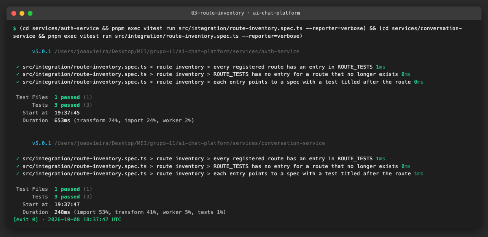

**auth-service** (contracts in `src/shared/contracts/{auth,http}.ts`)

| Route | Auth | Request schema | Response (success) | Response schema today |
|---|---|---|---|---|
| `GET /health` | — | — | 200 `{ status: "ok" }` | none |
| `GET /metrics` | — | — | 200 Prometheus text | n/a (not JSON) |
| `POST /auth/register` | — | `registerRequestSchema` | 201 `{ id, email }` | none (`authResponseSchema` describes `{ user: { id, email, createdAt } }`, which no route returns) |
| `POST /auth/login` | — | `loginRequestSchema` (invalid body → 401, on purpose: AC-36) | 200 `{ id, email }` + `Set-Cookie` | none |
| `POST /auth/refresh` | refresh cookie | — | 204 + `Set-Cookie` | n/a (no body) |
| `POST /auth/logout` | refresh cookie (optional) | — | 204, cookies cleared | n/a |
| `GET /auth/me` | access cookie | — | 200 `{ id, email }` | none |
| `DELETE /auth/me` | access cookie | `deleteAccountRequestSchema` | 204, cookies cleared | n/a |

**conversation-service** (contracts in `src/shared/contracts/{chat,http}.ts`, request bodies in `features/*/schema.ts`)

| Route | Auth | Request schema | Response (success) | Response schema today |
|---|---|---|---|---|
| `GET /health` | — | — | 200 `{ status: "ok" }` | none |
| `GET /metrics` | — | — | 200 Prometheus text | n/a |
| `GET /chats` | user JWT | — | 200 `{ chats: ChatDto[] }` | `chatDtoSchema` (no wrapper) |
| `POST /chats` | user JWT | `createChatSchema` | 201 `{ chat }` | `chatDtoSchema` |
| `GET /chats/:id` | user JWT | `chatIdParamsSchema` | 200 `{ chat }` | `chatDtoSchema` |
| `PATCH /chats/:id` | user JWT (owner) | `chatIdParamsSchema`, `updateChatSchema` | 200 `{ chat }` | `chatDtoSchema` |
| `DELETE /chats/:id` | user JWT (owner) | `chatIdParamsSchema` | 204 | n/a |
| `GET /chats/:id/members` | user JWT | `chatIdParamsSchema` | 200 `{ members: ChatMemberDto[] }` | `chatMemberDtoSchema` |
| `POST /chats/:id/members` | user JWT (owner) | `chatIdParamsSchema`, `addMemberSchema` | 201 `{ member }` | `chatMemberDtoSchema` |
| `DELETE /chats/:id/members/:email` | user JWT (owner) | `memberParamsSchema` | 204 | n/a |
| `DELETE /chats/:id/membership` | user JWT (member) | `chatIdParamsSchema` | 204 | n/a |
| `GET /chats/:chatId/messages` | user JWT | `chatParamsSchema` | 200 `{ messages: MessageDto[] }` | `messageDtoSchema` |
| `POST /chats/:chatId/messages` | user JWT + optional `X-Llm-Api-Key` | `chatParamsSchema`, `sendMessageSchema` | 201 `{ message }` | `messageDtoSchema` |
| `PATCH /chats/:chatId/messages/:messageId` | user JWT | `messageParamsSchema`, `editMessageSchema` | 200 `{ message }` | `messageDtoSchema` |
| `DELETE /chats/:chatId/messages/:messageId` | user JWT | `messageParamsSchema` | 204 | n/a |
| `POST /chats/:chatId/messages/:messageId/retry` | user JWT + optional `X-Llm-Api-Key` | `messageParamsSchema` | 202 `{ message }` | `messageDtoSchema` |
| `POST /chats/:chatId/stop` | user JWT | `chatParamsSchema` | 200 `{ stopped: boolean }` | none |
| `GET /chats/:chatId/stream` | user JWT | inline `paramsSchema` | 200 `text/event-stream` | `Sse*EventSchema` per event (US6) |
| `POST /chats/:chatId/messages/:messageId/attachments` | user JWT | `attachmentParamsSchema` + multipart `file` | 201 `{ attachment }` | `attachmentDtoSchema` |
| `POST /internal/erasures` | service token | `eraseUserSchema` | 200 `{ erased: { chats, memberships, messages, files } }` | none |
| `POST /internal/sessions/:userId/stop` | service token | inline `paramsSchema` | 200 `{ stopped: number }` | none |

Every error, in both services, uses the same envelope, `errorResponseSchema`:
`{ error: { code, message, fieldErrors? }, correlationId? }`. The two copies are identical.

**What the inventory found.**

1. **Responses are not described.** No route has a schema for its whole response body. The DTOs exist (`chatDtoSchema`,
   `messageDtoSchema`, …), but not the `{ chat }`, `{ messages }` wrappers, and five responses have no schema at all
   (`/health`, `{ stopped: boolean }`, `{ stopped: number }`, `{ erased }`, and auth's `{ id, email }`).
2. **auth-service's response schema is wrong.** `authResponseSchema` (`{ user: { id, email, createdAt } }`) is used only
   by its own unit test; register, login and `GET /me` return `{ id, email }`. The AICHAT-11 pacts
   (`pacts/mfe-auth-auth-service.json`) already lock `{ id, email }` in, so the schema is what has to change, not the API.
3. **Request schemas are not strict.** `z.object()` drops unknown keys without an error, so a body with an extra field
   is accepted today. US4 decides what to do with it.
4. **Login answers 401, not 400, for an invalid body.** That is on purpose (AC-36: never say which field was wrong);
   US4 treats it as an exception to "400 with field errors".

**Drift with `packages/shared-types`.** The analysis said only mfe-settings uses shared-types. That is no longer true:
mfe-chat and conversation-service depend on it too, but **only for `api-keys` and `model-capabilities`**. Neither
service imports its API DTOs from there. We compared every pair of schemas as JSON Schema (`z.toJSONSchema`):

| Schema | auth-service / conversation-service vs shared-types |
|---|---|
| Register, login, user profile, error envelope, add member | identical |
| Create / update chat body | service caps `model` at 200 characters |
| Send / edit message body | service caps `content` at 32 000 characters and `attachmentIds` at 10 |
| `ChatDto`, `ChatMemberDto` | service has `ownerEmail`; shared-types requires ISO date-times and title length |
| `MessageDto` | **incompatible**: different `status` values (`sent` vs `complete`/`canceled`), `attachments` objects vs `attachmentIds`, no `authorId`, `authorEmail`, `error`, `stopped` in shared-types |
| `AttachmentDto` | **incompatible**: shared-types has `ownerId`, `storedPath`, `extractedTextStatus`; the service has `filename`, `kind` |
| SSE events | shared-types has no `started` and no `message` event (handled in US6, with the AICHAT-20 guard) |

The shared-types chat DTOs describe an early design; the services describe what the API really sends.

**Decision (source of truth).** Each service's `src/shared/contracts` and feature `schema.ts` files are the single
source of truth for its API. US2 registers them in an OpenAPI registry and adds the missing response schemas there.
`packages/shared-types` is not the source for the HTTP API; its chat DTOs are left as they are, and the drift is pinned
by a test so it cannot change silently. Decided by João Vieira (epic owner) in the DoR review; the service owners
review it in the pull request.

| Owner | Responsibility |
|---|---|
| auth-service team | `services/auth-service/src/shared/contracts` and the generated auth spec |
| conversation-service team | `services/conversation-service/src/shared/contracts`, `features/*/schema.ts` and its spec |
| platform team | `packages/shared-types`: aligning or removing the stale chat DTOs is a follow-up, outside this epic |

**Files.**
- `services/conversation-service/src/shared/contracts/shared-types-drift.spec.ts` (new): for nine pairs of schemas,
  lists the fields that differ between the service and `@app/shared-types` and compares the list with `KNOWN_DRIFT`.
- `docs/AICHAT-12/WORKLOG.md` (this section): inventory, drift and decision.

**How to run.**

```sh
cd services/conversation-service && pnpm exec vitest run src/shared/contracts/shared-types-drift.spec.ts --reporter=verbose
```

**How to repeat it manually.**

1. Open `services/conversation-service/src/shared/contracts/chat.ts` and comment out `stopped: z.boolean(),` in
   `messageDtoSchema`.
2. Run the command above.
3. Expected output: `MessageDto matches the recorded drift` fails; the diff shows `"stopped: only in service"` missing.
   Restore the line.

**Result.** The guard passes with the recorded drift and fails as soon as a DTO changes on either side.

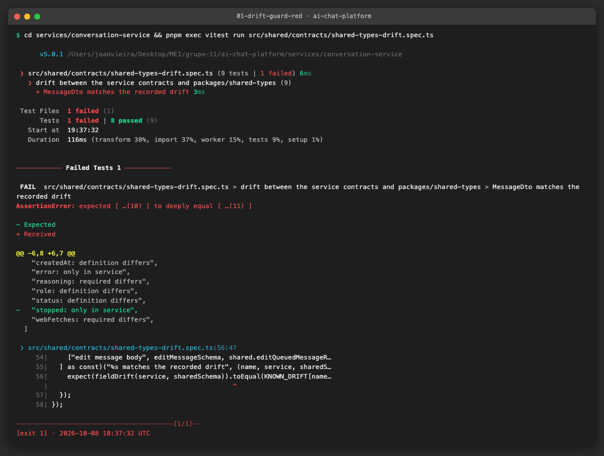

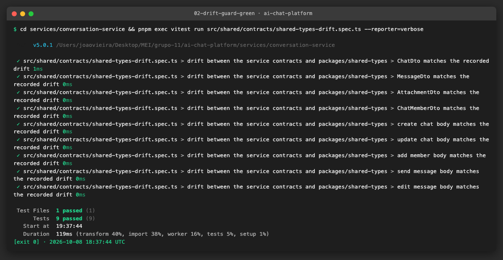

**Problems and fixes.** The first comparison script ran as CommonJS and failed on top-level `await`; we moved the
comparison into a Vitest test inside conversation-service, which already depends on `@app/shared-types`, so it runs
in CI with no extra tool. auth-service does not depend on shared-types, so its three request schemas were compared once
(identical) and are not guarded.

### US2 · Generate an OpenAPI spec for both services from the Zod schemas ([AICHAT-184](https://ipca-grupo11.atlassian.net/browse/AICHAT-184))

**What and why.** Schemathesis (US5) and ZAP need an OpenAPI file, and a spec written by hand goes stale the day a route
changes. We generate the spec from the **same Zod schemas the routes use to parse requests**, so the spec cannot
describe a body the code does not accept. Each service has a `src/openapi/document.ts` that registers its routes with
`@asteasolutions/zod-to-openapi` and builds an OpenAPI 3.1 document; the result is committed as
`services/<service>/openapi.json` (auth-service 8 operations, conversation-service 21).

The spec covers, for each route:

- the path parameters, the JSON body (or the multipart `file` for attachments) and the optional `X-Llm-Api-Key` header;
- the success response, with the response schemas US1 found missing (`src/shared/contracts/responses.ts`: `{ chat }`,
  `{ messages }`, `{ stopped }`, `{ erased }`, auth's `{ id, email }`, …), the `X-Correlation-Id` header and, for
  login/refresh/logout/delete, `Set-Cookie`;
- **only the error statuses the route can really return** (taken from the `HttpError`s in the code), each with the
  shared `ErrorResponse` envelope. A **500 is never documented**: it is always a bug, so Schemathesis and the US3 tests
  must treat it as a failure, not as an expected answer;
- the security of each route: `cookieAuth` (`access_token` cookie) or `bearerAuth` on the chat routes, `refreshCookie`
  on refresh/logout, `serviceToken` on `/internal/*`, and an explicit `security: []` on the public routes.

`openapi.spec.ts` (one per service) checks four things:

| Test | What breaks it |
|---|---|
| the committed `openapi.json` matches the schemas | a schema or route changed and nobody ran `pnpm openapi:generate` |
| every route the app registers is documented, and nothing else | a new route without a spec entry, or a removed route still documented (compared with `listRoutes(app)` from US1) |
| the security of every route | a chat route documented as public, or an internal route with the user cookie |
| every 4xx/5xx is `ErrorResponse`, and no 500 is documented | an error response with another body |

The stale check uses Vitest's `toMatchFileSnapshot("../../openapi.json")`: the file is a snapshot. In CI a mismatch
fails; locally `pnpm openapi:generate` (the same test with `-u`) rewrites it.

**Files.**
- `services/*/src/openapi/document.ts` (new): the registry of every route; `services/*/src/openapi/openapi.spec.ts` (new): the four checks.
- `services/*/openapi.json` (new, generated): the specs.
- `services/*/src/shared/contracts/responses.ts` (new): response body schemas.
- `services/conversation-service/src/features/messages/internal-routes.ts`: `sessionParamsSchema` exported, so the spec uses the route's own schema.
- `services/*/package.json`: `@asteasolutions/zod-to-openapi` 9.1.0 and the `openapi:generate` script.

**How to run.**

```sh
cd services/conversation-service && pnpm exec vitest run src/openapi/openapi.spec.ts --reporter=verbose
cd services/conversation-service && pnpm openapi:generate      # after changing a schema or a route
pnpm dlx --package=@redocly/cli@2.50.0 redocly lint services/conversation-service/openapi.json --extends=recommended
```

**How to repeat it manually.**

1. In `services/conversation-service/src/shared/contracts/chat.ts`, add a field to `chatDtoSchema`, e.g. `pinned: z.boolean(),`.
2. Run `pnpm exec vitest run src/openapi/openapi.spec.ts` in that folder.
3. Expected output: `the committed openapi.json matches the schemas` fails and the diff shows the new `pinned`
   property. Run `pnpm openapi:generate` and the test passes; `git diff openapi.json` shows the change. Remove the field
   and regenerate again.

**Result.** Both specs are generated, pass the four checks and are valid OpenAPI 3.1 for Redocly's `recommended`
rules (0 errors). The warnings left are expected: `/health` and `/metrics` have no 4xx, there is no licence (private
project) and the server URL is localhost.

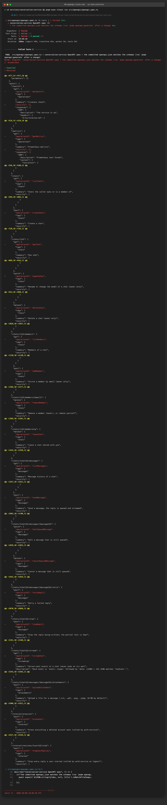

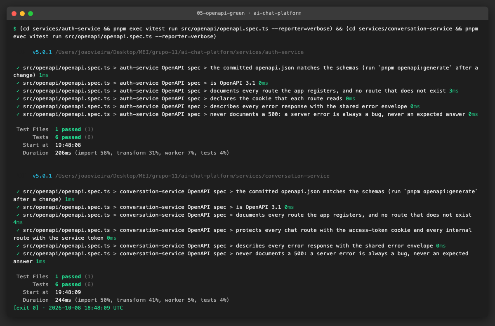

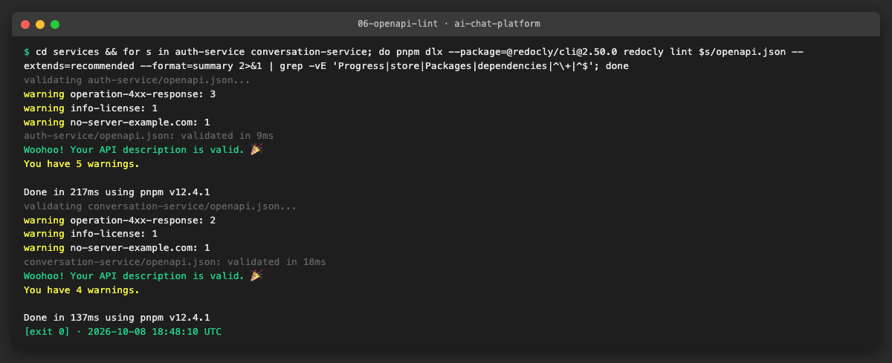

**Problems and fixes.**
- `registry.register("Chat", chatDtoSchema)` failed with `zodSchema.openapi is not a function` even after
  `extendZodWithOpenApi(z)`. In Zod 4.6 a schema does not inherit from `ZodType.prototype`: each instance gets a copy of
  the methods when it is created, and the contract schemas are created at import time, before the extension runs. We
  record the name on the existing instance instead, through the library's exported `zodToOpenAPIRegistry`
  (`named("Chat", chatDtoSchema)` in `document.ts`). It needs no import order and leaves the contract files untouched.
- The first Redocly run gave 2 errors: `/health` and `/metrics` had no `security`, which reads as "forgot to protect".
  They are public on purpose, so they now say `security: []`. We also added an `operationId` to every route
  (Schemathesis names its findings by it).
- `tsc` refused the inferred return type (TS2883, it comes from `openapi3-ts`, not a direct dependency); the function
  is now annotated with `ReturnType<OpenApiGeneratorV31["generateDocument"]>`.
- The DAST file `testing/zap/openapi.yaml` is replaced in US5, where the compose stack runs and ZAP 2.17 can be checked
  against the generated OpenAPI 3.1 file.

### US3 · Response bodies of every route validated against their schema ([AICHAT-185](https://ipca-grupo11.atlassian.net/browse/AICHAT-185))

**What and why.** US2 describes what each route returns; this story proves the code really returns it. We did not
write a second list of schemas for the tests: `document.ts` now exposes `routeConfigs()`, the list of routes the spec
is built from, and the tests read the same list. For every route and status it holds the Zod schema of the body, so
the spec and the tests cannot disagree.

`test-utils/documented-response.ts` (one per service) checks a real response against that list:

1. **The status must be documented for the route.** A 500, or a 400 on a route that cannot return one, fails with
   `answered 500, which the spec does not document` and the body.
2. **The body must match its schema, with no unknown field at any depth.** `schema.parse(body)` must succeed *and*
   return exactly `body`. `z.object` silently drops keys it does not know, at every level, so any extra field (also
   inside an array of chats) makes the parsed copy differ from the original. This gives a strict check of the whole
   tree without changing the schemas.
3. **Errors use the envelope.** Every 4xx is documented with `ErrorResponse`, has an `X-Correlation-Id` header, and
   `body.correlationId` equals that header.
4. **No body where none is documented** (204) and the documented content type (`text/plain` for `/metrics`,
   `text/event-stream` for the stream; its events are checked in US6).

`integration/response-schemas.spec.ts` (one per service) calls every route through the real app with in-memory fakes:
the success case and each error status we can provoke (401, 400, 403, 404, 409, 422, and on auth-service 429, 502,
503). Its last test, `every route's success response was checked against its schema`, fails if a route in the list
has a success response that no test checked; with the route-inventory check of US2 this means a new route cannot be
added without a schema and a response test.

**Finding: the rate limiter answered 429 in plain text.** When a client goes over a limit, `express-rate-limit`
answers by default with `text/html` "Too many requests, please try again later." instead of the error envelope; a
frontend reading `body.error.message` gets nothing. The app-wide limiter also ran before the correlation id was set,
so its 429 had no `X-Correlation-Id`. We fixed both: `shared/rate-limit.ts` (`rateLimitedHandler`) answers
`{ error: { code: "RATE_LIMITED", ... }, correlationId }` for both limiters, and the correlation middleware now runs
first. The spec documents 429 on every auth-service route. The limit itself comes from the new `RATE_LIMIT_MAX`
setting (default 300, unchanged; US5 raises it on the CI stack), which also lets the test reach the limit with 1.

**Files.**
- `services/*/src/openapi/document.ts`: routes moved into `routeConfigs()` (the generated spec is byte-for-byte the same).
- `services/*/src/test-utils/documented-response.ts` (new): the checker.
- `services/*/src/integration/response-schemas.spec.ts` (new): 15 tests on conversation-service, 11 on auth-service.
- `services/auth-service/src/shared/rate-limit.ts` (new), `src/main.ts`, `src/features/account/api.ts`,
  `src/shared/env.ts`, `.env.example`, `src/test-utils/build-test-app.ts`: 429 envelope and `RATE_LIMIT_MAX`.
- `services/auth-service/openapi.json`: regenerated with the 429 responses.

**How to run.**

```sh
cd services/conversation-service && pnpm exec vitest run src/integration/response-schemas.spec.ts --reporter=verbose
cd services/auth-service && pnpm exec vitest run src/integration/response-schemas.spec.ts --reporter=verbose
```

**How to repeat it manually.** Three ways to break it (restore the file after each one):

| Change | Expected failure |
|---|---|
| In `chats/service.ts`, add `internalNote: "debug",` to the object `toChatDto` returns | `GET /chats 200 body has fields the schema does not describe` |
| In `chats/controller.ts`, throw `new Error("database is down")` at the start of `get` | `GET /chats/:id answered 500, which the spec does not document` |
| In `response-schemas.spec.ts`, delete the `check(...)` of the successful `POST /chats/:chatId/stop` | `expected [ 'POST /chats/:chatId/stop 200' ] to deeply equal []` |

**Result.** 26 tests, all routes and 40+ responses checked; the three changes above each fail the suite.

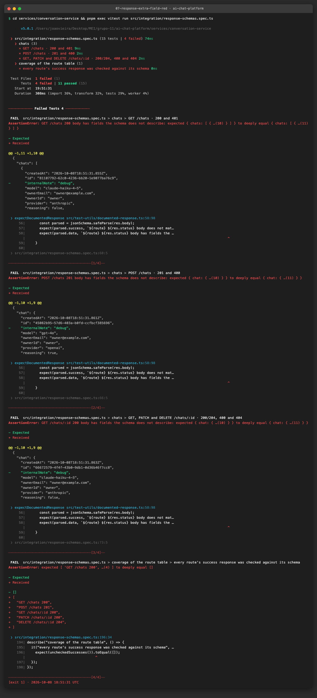

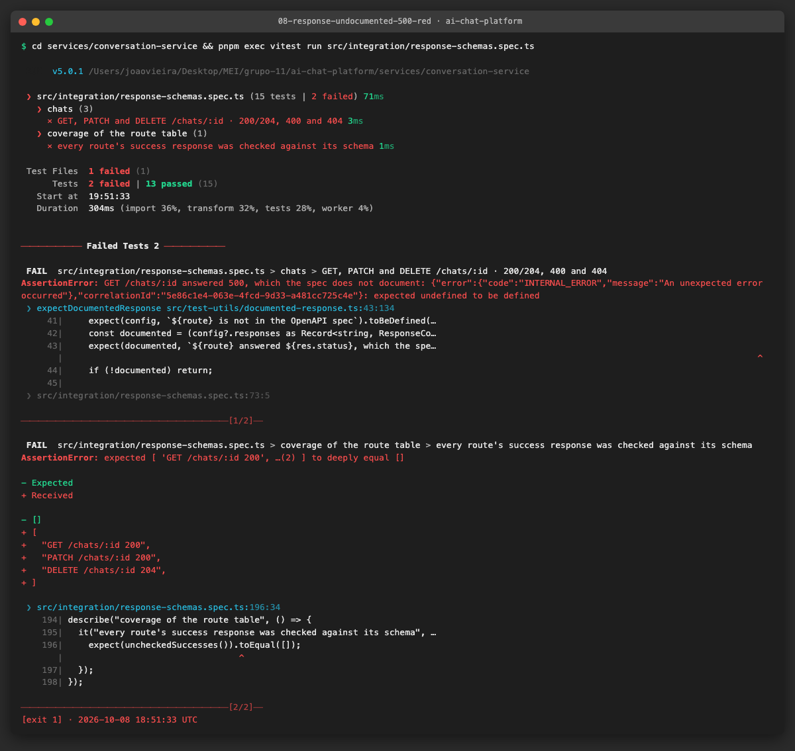

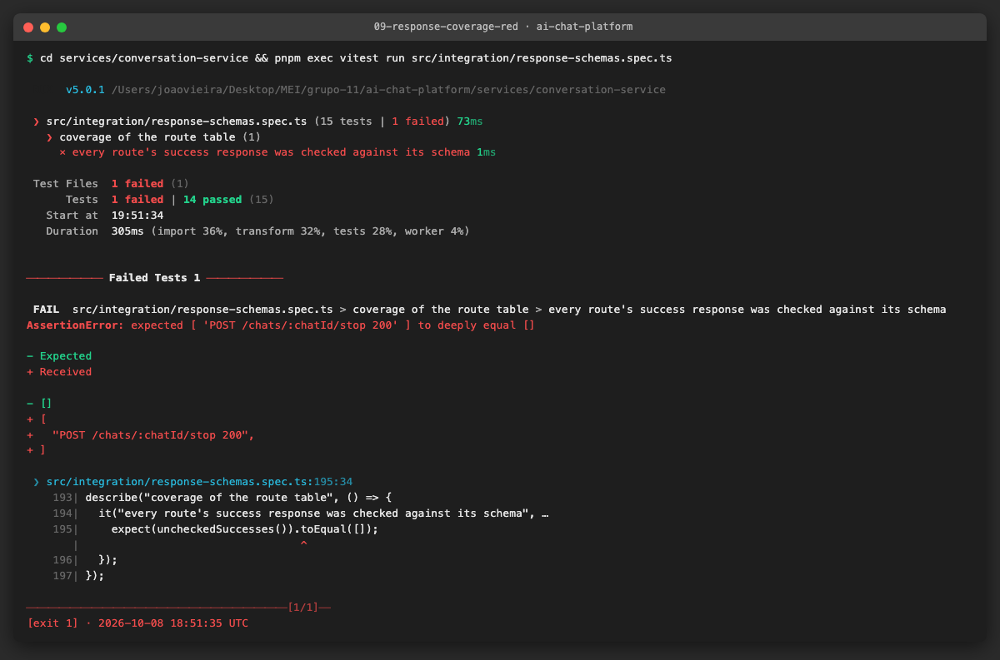

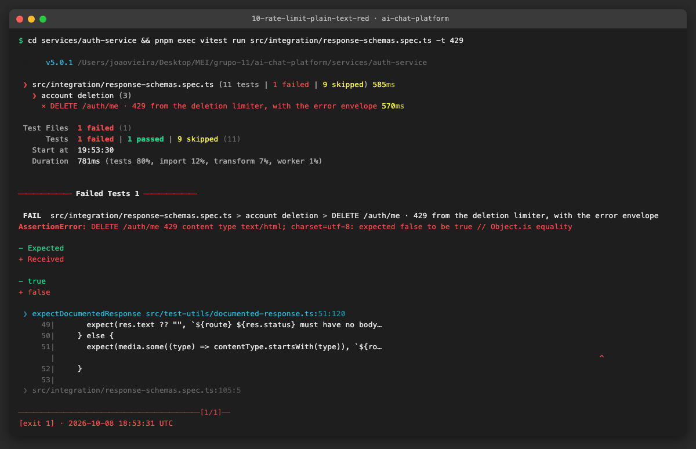

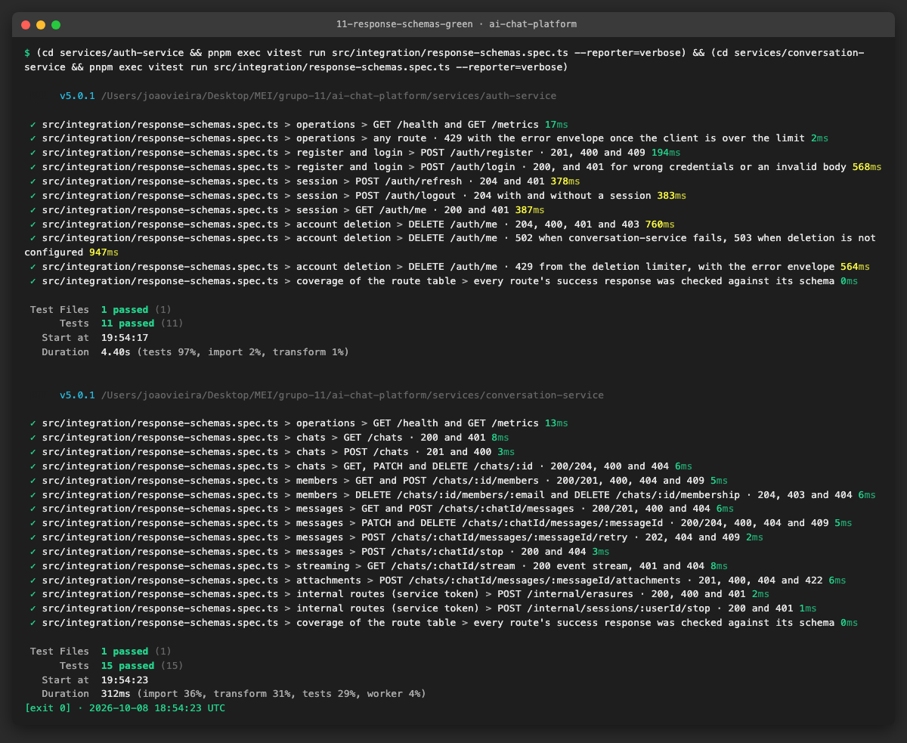

**Problems and fixes.** `tsc` rejected `content["application/json"].schema` because the library types a media entry as
"schema or `$ref`"; the checker narrows it with `"schema" in jsonMedia`. With `deletionsPerHour: 0` the deletion
limiter never fires (0 means "no limit" in `express-rate-limit`), so the 429 test uses a limit of 1 and two requests.

## 4. How to run everything

```sh
# filled in at the end of the epic
```

## 5. Results

| Metric | Before | After |
|---|---|---|

## 6. DoD check

| DoD item | Met | Evidence |
|---|---|---|

## 7. Notes for the report
