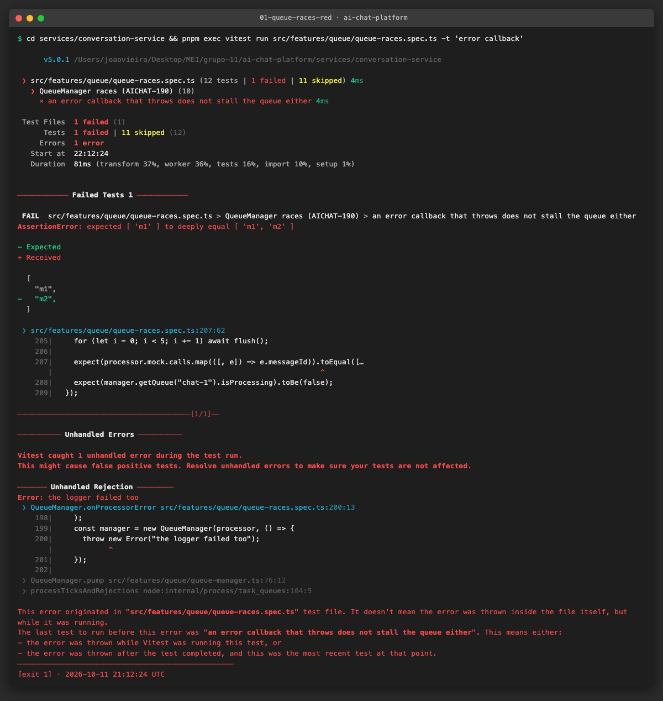
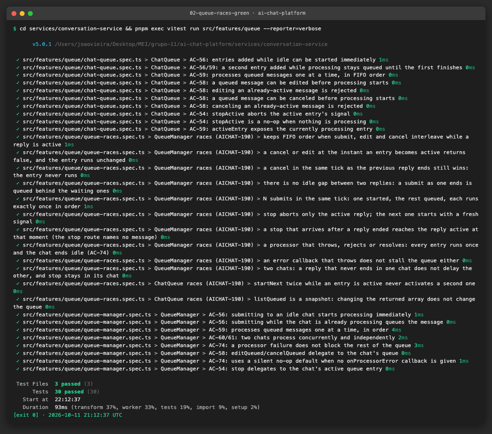
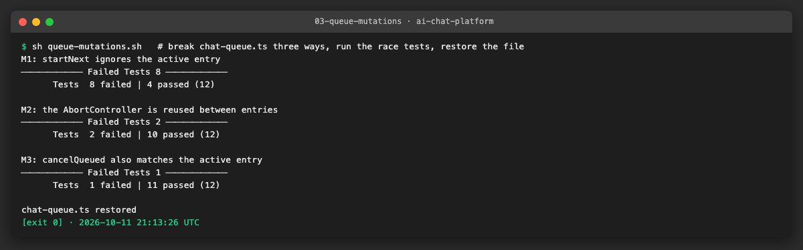
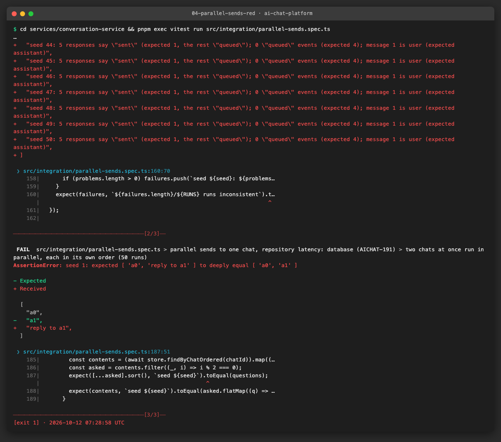
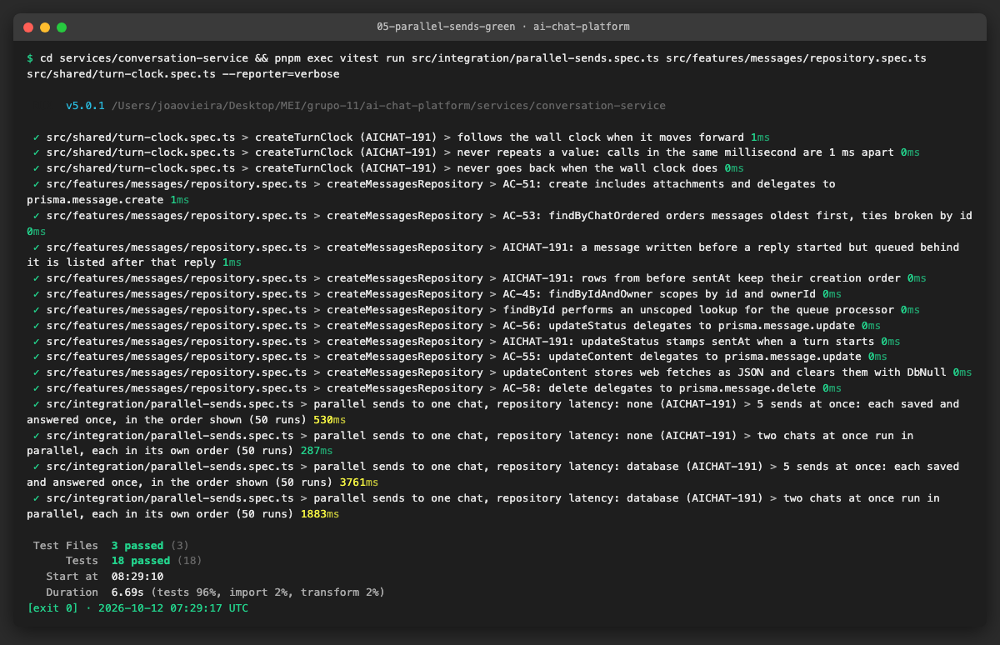
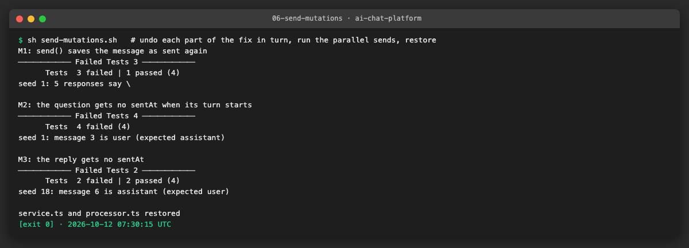

# AICHAT-13 · Concurrency testing: work log

| Field | Value |
|---|---|
| Epic | [AICHAT-13](https://ipca-grupo11.atlassian.net/browse/AICHAT-13) |
| Analysis | [README.md](README.md) |
| Owner | João Vieira |
| Branch | `test/AICHAT-13-concurrency` (built on `test/AICHAT-9-sse-reconnection`, PR #34 not merged yet) |
| Started / finished | 2026-10-11 / … |
| Pull requests | … |
| Status | In Progress |

## 1. DoR review

Date: 2026-10-11

| DoR item | Status | Question asked | Decision | Decided by |
|---|---|---|---|---|
| Owner assigned | Met | — | João Vieira | — |
| Scope and tooling agreed | Met | Deferred promises (unit), supertest + `Promise.all` against the real app (service), two Playwright browser contexts against the mock LLM (E2E)? | Agreed as written | João Vieira |
| Target environment available | Met | — | Local and CI. The E2E story runs against the mock stack of AICHAT-144 (`pnpm mock:up`) | João Vieira |
| Expected result defined | Met | What should happen in each concurrent scenario? | Today's design: per-chat FIFO queue, 409 once a message is active. Table in US1 | João Vieira |

Decisions:

| Topic | Decision |
|---|---|
| Retry while another reply is streaming | **Queued**: the retry waits its turn in the FIFO queue, like a new message (today's behaviour, no API change) |
| Double-click on Send | **UI guard only**: the composer prevents the second submit. Two `POST /messages` on the server are two messages (no idempotency key) |
| More than one conversation-service replica | **Out of scope**: the queue is in memory, so per-chat order is only guaranteed with one instance (the VM runs one). Recorded as a known limit |
| Races found while reading the code (see below) | **Fix them test-first**: write the failing race test, apply the smallest fix, show red → green |

Races found during the DoR review, by reading `features/messages/service.ts` and `features/queue/*`:

1. **Two sends at the same time.** `send()` decides "idle or busy" *before* `await repo.create(...)`. Two requests can
   both see "idle", so the second message is saved as `sent` while the queue actually holds it as queued: it gets no
   `queued` event and it is part of the LLM history of the first reply.
2. **Two retries at the same time.** `retry()` reads "status is `failed`", awaits, then resets the message. Both requests
   pass the check, so the same reply is queued and generated twice.
3. **Edit as the message starts.** `editQueued()` writes `status: "queued"` *after* an await. If the message started in
   between, the processor has already set it to `sent`; the edit sets it back to `queued` for good, and later replies
   leave it out of their history (the processor skips queued messages).

Blockers: none.

## 2. Environment

| Tool | Version | Install |
|---|---|---|
| macOS | 27.0 | — |
| Node | v26.10.0 locally (CI uses Node 24 from `.nvmrc`) | nvm |
| pnpm | 10.4.0 (pinned in `package.json`) | `pnpm install --frozen-lockfile` |
| Vitest | 5.0.1 | workspace dev dependency |
| Docker | … | Docker Desktop |
| Playwright | … | workspace dev dependency |

## 3. Steps

### US1 · Define the expected result for each concurrent scenario ([AICHAT-189](https://ipca-grupo11.atlassian.net/browse/AICHAT-189))

**What and why.** A concurrency test can only fail if we know what "right" is. We listed every scenario where two
operations on the same chat can overlap and wrote down the expected result, based on the current design: one FIFO
`ChatQueue` per chat inside `QueueManager` (`submit` returns `started` or `queued`), one active reply per chat, and
409 for an edit or cancel once a message has become active.

How the design works today:

- `POST /chats/:chatId/messages` saves the user message, then `QueueManager.submit` adds it to the chat's queue. If the
  chat was idle the reply starts at once; otherwise the message waits (`queued`) and the client gets a `queued` event.
- When a reply ends (finished, stopped or failed), the queue starts the next message. A processor that throws never
  blocks the queue (AC-74).
- Only a message that is still waiting can be edited or cancelled. Once it is active, only `POST /chats/:chatId/stop`
  can end it.
- The database is the source of truth: the processor builds the LLM history from the saved messages and skips the ones
  that are `queued` or `failed`. The text held in the queue entry is not used to build the history.

| # | Scenario | Expected result | Tested in |
|---|---|---|---|
| S1 | Two (or N) sends to one chat at the same time | Every message is saved once, in arrival order. The first is `sent` and starts a reply; the others are saved as `queued` (response, SSE event and database agree) and get their replies one at a time, in the same order. End state: N user + N assistant messages, no duplicates, no gaps | US2, US3 |
| S2 | Double-click on Send | One message. The composer ignores the second submit while the first is in flight. The server has no idempotency key: two requests that do reach it are two messages | US5 |
| S3 | Retry of a failed reply while another reply is streaming | The retry is queued and runs after the active reply. The failed message is reused in place; no new message is created | US4 |
| S4 | Two retries of the same failed reply at the same time | Exactly one is accepted (200). The other gets 409 `MESSAGE_NOT_RETRYABLE`. One reply is generated | US4 |
| S5 | Edit of a queued message at the moment it starts | Either the edit wins (200, the reply is built from the new text) or the start wins (409 `MESSAGE_NOT_EDITABLE`, the reply uses the old text). Never both, and the message never stays `queued` after its reply | US4 |
| S6 | Cancel of a queued message at the moment it starts | Either the cancel wins (204, the message is deleted and never processed) or the start wins (409 `MESSAGE_NOT_CANCELABLE`, it is processed normally). Never both | US2, US4 |
| S7 | Stop while other messages are queued | Only the active reply is aborted; the queued messages then run in order | US2 |
| S8 | Two members of a shared chat send at the same time | Same as S1. Both members see each message once and in the same order | US5 |
| S9 | Two chats at the same time | Independent: both replies run in parallel; neither waits for the other | US2, US3 |
| S10 | A reply fails or the processor throws | The queue moves on to the next message (AC-74) | US2 |

**Known limit (single instance).** The queues live in memory, inside one conversation-service process. With two or more
replicas behind a load balancer, two sends to the same chat could land on different instances and run in parallel, so
the order above is only guaranteed with one instance. The VM runs one instance. Supporting more would need a shared queue
or a database lock, which is outside this epic.

**Problems and fixes.** Reading the code against this table showed that S1, S4 and S5 do not hold today (see §1, races
found). The fixes are part of US2–US4, each with a test that fails before the fix.

### US2 · Race-condition unit tests for ChatQueue and QueueManager ([AICHAT-190](https://ipca-grupo11.atlassian.net/browse/AICHAT-190))

**What and why.** The existing specs drive the queue one step at a time. Race bugs only show up when operations
overlap, and they usually show up rarely, which makes them flaky. To make every interleaving deterministic, the new
spec uses **deferred promises**: the fake processor returns a promise whose `resolve`/`reject` the test holds, so the
test decides the exact moment each reply ends. A second hook (`onStart`) runs at the exact instant an entry becomes
active, which is how we hit "cancel at the moment it starts" precisely instead of hoping a timer lands there.

**Files.**
- `services/conversation-service/src/features/queue/queue-races.spec.ts` (new): 12 race cases.
- `services/conversation-service/src/features/queue/queue-manager.ts`: the error callback is guarded (see Problems and fixes).

| Test | Scenario (US1) | What it proves |
|---|---|---|
| FIFO with submit, edit and cancel interleaved | S1, S6 | Survivors run once, in order, with the edited text; cancelled entries never run |
| Cancel/edit at the instant an entry becomes active | S5, S6 | Both return `false` and the entry runs with its original text |
| Cancel in the same tick as the previous reply ends | S6 | The decision point is `startNext`: before it the cancel wins and the entry never runs |
| No idle gap between two replies | S1 | When a reply ends the next one starts in the same step, so a new submit is queued behind the waiting ones, never ahead |
| N = 20 submits in the same tick | S1 | Exactly one `started`, nineteen `queued`, each runs once, in order |
| Stop aborts only the active reply | S7 | The queued entry is untouched and later starts with a fresh, non-aborted signal |
| A late stop | S7 | Documents current behaviour: the stop route names no message, so a stop that arrives after a reply ended aborts the reply active at that moment |
| Processor throws, rejects or resolves | S10 | Every entry runs once and the chat ends idle (AC-74) |
| Error callback that throws | S10 | The queue still moves on (failed before the fix) |
| Two chats | S9 | A reply that never ends in one chat does not delay the other; stop stays in its chat |
| `startNext` twice while active | S1 | Never two active entries |
| `listQueued` is a snapshot | — | Callers cannot change the queue through the returned array |

**How to run.**

```sh
cd services/conversation-service && pnpm exec vitest run src/features/queue --reporter=verbose
```

**How to repeat it manually.** Break the queue on purpose and check that the race tests notice, then restore it:

1. In `chat-queue.ts`, delete `if (this.active) return null;` in `startNext`. Run the command above: 8 tests fail
   (two entries can be active at once).
2. Restore it. Replace `this.abortController = new AbortController();` with `this.abortController ??= new AbortController();`
   and delete `this.abortController = null;` in `finishActive`: the two stop tests fail (the next reply would start already aborted).
3. Restore it. In `cancelQueued`, return `this.active?.messageId === messageId` instead of `false`: the "instant it becomes
   active" test fails.
4. `git diff` must be empty for `chat-queue.ts` at the end.

**Result.** 30 tests in the queue folder pass (18 existing + 12 new). The error-callback test failed first, with two
symptoms: the next entry never ran (`expected ['m1'] to deeply equal ['m1', 'm2']`) and Vitest reported an
**unhandled rejection**. The three deliberate mutations are each caught.







**Problems and fixes.**
- **The last guard could stop the queue.** In `QueueManager.pump`, the call that moves on to the next entry comes after
  the `try/catch/finally`. If `onProcessorError` itself threw, the error left `pump`, the next entry was never started and,
  because `pump` runs with `void`, the error became an unhandled rejection (by default Node.js stops the process on one).
  In the app the callback only logs, so this is unlikely, but the guard is there for the unexpected. The callback call is
  now wrapped in its own `try/catch`.
- **A late stop.** `POST /chats/:chatId/stop` names no message, so a stop that reaches the server just after a reply
  ended aborts the next queued reply. We kept this behaviour (changing it would change the API that AICHAT-11 and AICHAT-12
  lock) and recorded it in a test, so a future change is a conscious one.

### US3 · Parallel sends to one chat: no duplicate or lost messages ([AICHAT-191](https://ipca-grupo11.atlassian.net/browse/AICHAT-191))

**What and why.** US2 tests the queue alone. Here the whole service runs: real Express app, routes, `MessagesService`,
queue and message processor, with the in-memory repositories and a scripted LLM that answers `reply to <question>`
and records the history it was given. N = 5 messages are sent to one chat with `Promise.all` and the final state is
checked against the US1 rules.

The in-memory repository answers every call at once, which hides races: a race needs another request to run in the
gap between a read and a write, and a real database call is that gap. Each scenario therefore runs twice, once as is and
once with `withLatency`, which wraps the repository so every call waits 0–2 ms before and after, like a database
round trip. The delays come from a **seeded** random generator: run 37 always gets the same delays, so a failing seed can
be replayed. Every scenario runs 50 times (seeds 1–50).

**Files.**
- `services/conversation-service/src/integration/parallel-sends.spec.ts` (new): the scenarios below.
- `services/conversation-service/src/test-utils/with-latency.ts` (new): `withLatency` and `seededRandom`.
- `services/conversation-service/src/shared/turn-clock.ts` and `.spec.ts` (new): a clock whose readings always increase.
- `services/conversation-service/prisma/schema.prisma`: new nullable column `Message.sentAt`.
- `services/conversation-service/src/features/messages/service.ts`, `processor.ts`: the fixes (see Problems and fixes).
- `services/conversation-service/src/test-utils/fake-messages-repository.ts`: `sentAt`, the same order as the real
  repository, ids that grow with creation order (like the database's `cuid()`).

| Check, per run | Rule (US1) |
|---|---|
| Every response is 201; exactly one says `sent`, the others `queued`; N−1 `queued` events | S1: first started, rest queued |
| 2N messages stored, every question exactly once, all `sent` at the end | No duplicates, no losses |
| Stored order is question, reply, question, reply…, each reply right after its own question | Order shown = order answered |
| The message answered first is the first one shown | Arrival order |
| Reply k was given exactly the k questions and k−1 replies shown before it | The model never sees a question that is still waiting |
| Two chats: both first replies are running at the same time; each chat ends question, reply, question, reply | S9: chats are independent |

**How to run.**

```sh
cd services/conversation-service && pnpm exec vitest run src/integration/parallel-sends.spec.ts --reporter=verbose
```

**How to repeat it manually.**

1. Run the command above: 4 tests (2 scenarios × 2 latency profiles), each 50 runs, about 7 s in total.
2. To see the defects, put the fix aside and run the same test on the old code:
   `git stash push -- services/conversation-service/src/features/messages/service.ts services/conversation-service/src/features/messages/processor.ts services/conversation-service/src/test-utils/fake-messages-repository.ts`,
   run it (3 of 4 fail, 50/50 runs), then `git stash pop`.
3. Expected output after the fix: `Tests 4 passed (4)`.

**Result.** Before the fix, 50 of 50 runs broke the rules in both latency profiles. After the fix, 10 consecutive runs of
the file (2,000 scenarios) passed. Undoing each part of the fix on its own is caught: the "sent" save fails 3 of 4 tests,
the missing `sentAt` on the question fails 4 of 4, the missing `sentAt` on the reply fails only on seed 18 (the reply and
the question fall in the same millisecond), which is why one run is not enough.







**Problems and fixes.**
- **Two sends read "idle" at once (race 1).** `send()` decided "sent or queued" before `await repo.create(...)`. Fixed: the
  message is always saved as `queued`; whether it starts is decided by `QueueManager.submit` after the save, and the
  response and the `queued` event follow what `submit` returned. Only the processor writes `sent`, when the reply starts.
- **Questions listed before the replies that came before them.** The history (screen and model) was ordered by
  `createdAt`. Five questions sent at once were all created before the first reply existed, so the model got
  `q0 q1 q2 q3 q4 r0 r1 …`: several questions in a row and, from the third reply on, a history ending with an assistant
  message, which a provider treats as the start of its own answer (the scripted model answered `reply to reply to q1`).
  The chat screen shows queued messages in a separate panel and adds them to the conversation when they start, so the
  agreed rule is "a message takes its place when its turn starts". Fixed with an additive column `sentAt`: the processor
  stamps the question, then its reply, when the turn starts; the history is ordered by `sentAt ?? createdAt`, then
  `createdAt`, then `id`. Older rows have no `sentAt` and keep their order. `sentAt` stays inside the service: the API
  already returns messages in this order and the chat screen keeps the order it receives, so no contract changes.
- **Two turns in the same millisecond.** `sentAt` comes from `turnClock`, which always moves forward (at least 1 ms per
  reading), so every stamp is unique. This holds for one instance, the setup recorded in US1.
- **Ties in the database.** `ORDER BY createdAt` alone leaves rows with the same millisecond in no defined order. The query
  now also orders by `id` (`cuid()` grows with creation time).
- **Two test problems found on the way.** (1) With the instant repository a reply sometimes finished before the fifth
  request arrived, so that request rightly started: the replies now wait until all N sends have been answered, so the N
  requests really overlap. (2) About one run in ten failed with `POST /chats` answering 404: supertest opened a server per
  request on all addresses and sometimes got a port that another local program (an editor helper) held on `127.0.0.1`,
  so the request reached that program. Each run now uses one server bound to `127.0.0.1`.
