# AICHAT-144 · Mock server: work log

| Field | Value |
|---|---|
| Epic | [AICHAT-144](https://ipca-grupo11.atlassian.net/browse/AICHAT-144) |
| Analysis | [README.md](README.md) |
| Owner | Jean-Pierre Carvalho |
| Branch | `test/AICHAT-144-mock-server` |
| Started / finished | 2026-10-03 / … |
| Pull requests | #… |
| Status | In Progress |

## 1. DoR review

Date: 2026-10-03

| DoR item | Status | Question asked | Decision | Decided by |
|---|---|---|---|---|
| Owner assigned | Met | — | Jean-Pierre Carvalho | — |
| Scope agreed | Met | Which mocks are in scope (README §5)? | LLM providers (Anthropic, OpenAI), auth-service and conversation-service APIs, MFE remotes and the telemetry sink | Owner |
| Tooling agreed | Met | Stack and location? | Node + Express, one process with one router per mock, Nx project `testing/mock-server`, Docker image, compose profiles | Owner |
| Target environment available | Met | Where does it run? | Locally (Docker compose profiles) and in GitHub Actions | Owner |
| App change for LLM base URLs | Met | May the provider registry read `ANTHROPIC_BASE_URL` / `OPENAI_BASE_URL`? | Yes, defaults unchanged, one commit (plan decision D3) | Owner |
| Stateful backend flows | Met | Which conversation-service flows keep state? | Chats and messages in memory (send, stream, edit, cancel, retry); settings, attachments and members are canned seed data | Owner |
| E2E in CI (AICHAT-153) | Met | How far do we go with the failing e2e workflow? | Make the chat flows pass against the mock; the other failing specs stay with AICHAT-4/5 | Owner |

Blockers: none

## 2. Environment

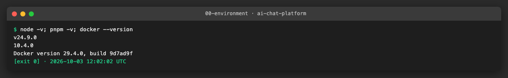

| Tool | Version | Install |
|---|---|---|
| macOS | 26.3 (Darwin 25.3.0) | — |
| Node | `node -v` → v24.9.0 | project engines |
| pnpm | `pnpm -v` → 10.4.0 | `corepack enable` |
| Docker | `docker --version` → Docker version 29.4.0 | Docker Desktop |
| Express | 4.22.3 (`^4.22.3`, same as auth-service; see `testing/mock-server/package.json`) | `pnpm install` |

## 3. Steps

### US1 · Make LLM provider base URLs configurable by env ([AICHAT-43](https://ipca-grupo11.atlassian.net/browse/AICHAT-43))

**What and why.** Both LLM adapters already accept a `baseUrl`, but `createProviderRegistry()` built them with no configuration, so the URLs were fixed to the real APIs. The registry now reads `ANTHROPIC_BASE_URL` and `OPENAI_BASE_URL` (declared in `shared/env.ts`, validated as URLs). When the variables are not set the defaults stay `https://api.anthropic.com` and `https://api.openai.com`. This is the only change to application code in this epic; it lets the services call the mock server instead of a paid API.

**Files.**
- `services/conversation-service/src/shared/env.ts`: two new variables with the real API hosts as defaults.
- `services/conversation-service/src/features/llm-adapters/registry.ts`: `createProviderRegistry(source = process.env)` passes the base URLs to the adapters.
- `services/conversation-service/src/features/llm-adapters/registry.spec.ts`: unit tests for the defaults and for each variable.
- `services/conversation-service/.env.example`: documents the two variables.

**How to run.**

```sh
pnpm exec nx test conversation-service
```

**How to repeat it manually.**

1. Start conversation-service with `ANTHROPIC_BASE_URL=http://localhost:4010/anthropic` (or `OPENAI_BASE_URL=http://localhost:4010/openai`).
2. Send a message in a chat that uses that provider.
3. Expected output: the request goes to the URL you set (`/v1/messages` or `/v1/chat/completions` under it). Without the variables it goes to the real API as before.

**Result.** The registry test stubs `fetch`, sends one message through each adapter and checks the URL that was called: the defaults without variables, the custom host with each variable, and an error for a value that is not a URL.

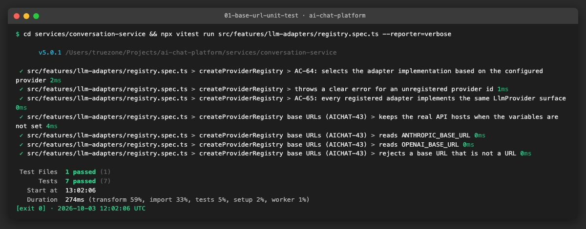

**Problems and fixes.** The adapters keep `baseUrl` private, so the test checks the URL seen by a stubbed `fetch` instead of reading the field.

### US2 · Mock server project, admin endpoints and Docker image ([AICHAT-60](https://ipca-grupo11.atlassian.net/browse/AICHAT-60))

**What and why.** `testing/mock-server` is a new Nx project (Node and Express, TypeScript) that will stand in for the LLM providers and the backend services in tests. This story builds the frame the other stories fill: one Express app, one router per mock (`anthropic`, `openai`, `auth`, `conversation`, `remotes`, `collect`, empty for now), a small registry so each mock lives in its own file, and a scenario registry shown by `/__admin/scenarios` (empty until a story registers scenarios). Runs are repeatable: a seeded generator (`SEED`) drives every random choice. Tuning comes from the environment: `LATENCY_MS` delays every mock response, `ERROR_RATE` fails that share of requests with a 500, and `TTFT_MS`, `TOKEN_INTERVAL_MS`, `TOKENS` are read into the config for the LLM mocks. The admin endpoints are never delayed or failed.

How a mock is added: create `src/routers/<name>.router.ts` that exports a `MockModule` (`name`, `mountPath`, optional `scenarios`, `createRouter(ctx)`) and add one import line and one list entry in `src/routers/index.ts`. `ctx.onReset(hook)` clears a mock's state on `/__admin/reset`.

**Files.**
- `testing/mock-server/project.json`, `package.json`, `tsconfig.json`, `eslint.config.js`, `vitest.config.ts` (new): lint, typecheck, test (with the shared `coveragePreset`, thresholds 80) and build targets.
- `testing/mock-server/src/app.ts`, `main.ts`, `config.ts`, `prng.ts`, `middleware.ts`, `registry.ts` (new): the app, env parsing, seeded generator, latency and error middleware, mock and scenario registries.
- `testing/mock-server/src/routers/*.router.ts`, `index.ts` (new): the six mock routers and the list of mounted mocks.
- `testing/mock-server/src/admin/admin.router.ts` (new): the `/__admin` endpoints.
- `testing/mock-server/scripts/build.mjs` (new): bundles the server into one file with esbuild.
- `testing/mock-server/Dockerfile`, `.env.example` (new): multi-stage image running as a non-root user; documented variables.
- `.dockerignore`, `pnpm-workspace.yaml`, `packages/workspace-config/src/coverage-guard.js`: the project is part of the workspace, sent to the Docker build, and checked by the coverage guard test.

**How to run.**

```sh
pnpm exec nx run-many -t lint typecheck test build -p mock-server
pnpm exec nx serve mock-server              # listens on http://localhost:4010
docker build -f testing/mock-server/Dockerfile -t ai-chat-mock-server . && docker run --rm -p 4010:4010 ai-chat-mock-server
```

**How to repeat it manually.**

1. Start the server with `pnpm exec nx serve mock-server` (or the Docker commands above).
2. Run `curl localhost:4010/__admin/health`, `curl localhost:4010/__admin/scenarios` and `curl -X POST localhost:4010/__admin/reset`.
3. Expected output: `{"status":"ok"}`, `{"scenarios":[]}` and `{"status":"reset"}`. Any other path answers 404 with `{"error":{"code":"not_mocked",...}}`.

**Result.** Lint, typecheck, build and the tests pass, coverage is above 80% on all four metrics, the admin endpoints answer as expected, and the image builds, starts as user `app` and reports `healthy`.

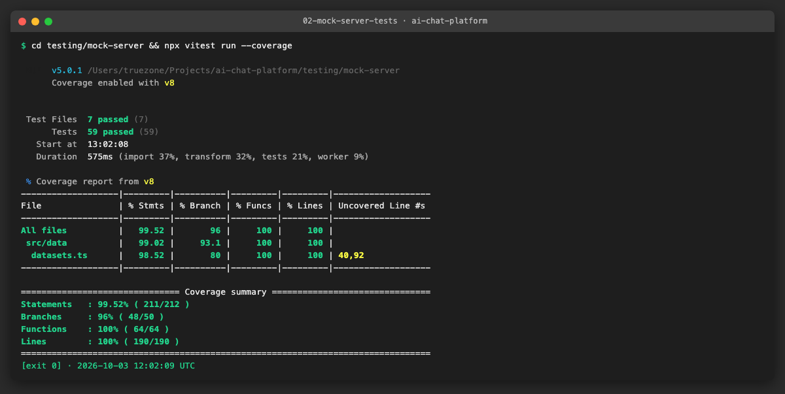

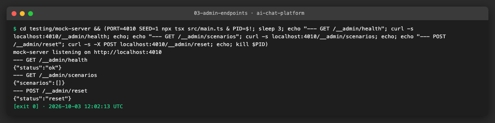

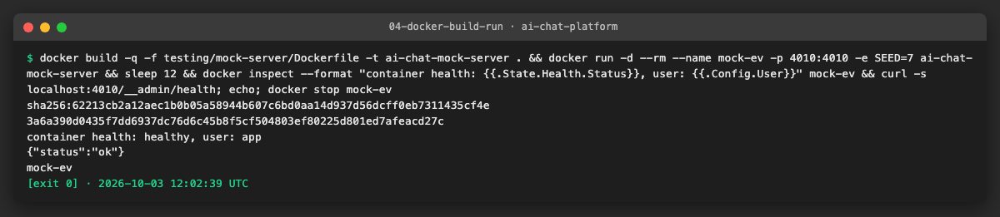

**Problems and fixes.** `@app/shared-types` is TypeScript source with extensionless imports, so the server cannot be compiled with `tsc` and run on plain Node. The build bundles everything with esbuild into `dist/main.cjs`; the image only needs Node and that file. The `.dockerignore` excluded the whole `testing` folder, so it now lets `testing/mock-server` through. The coverage guard test lists the projects by folder, so `testing/mock-server` was added to it.

### US3 · Mock data: named seed datasets and data factories ([AICHAT-160](https://ipca-grupo11.atlassian.net/browse/AICHAT-160))

**What and why.** The mocks need believable data that tests can also build on their own. `createFactories(seed)` returns factories for users, chats, members, messages (plain, assistant, with reasoning text, and with web fetch parts), attachments and provider keys. Every object has the shape of `@app/shared-types` (the tests check it against the zod schemas) and the same seed gives the same ids, text and dates. Six datasets use them: `empty`, `default` (two users, chats with a reasoning answer and a web fetch answer, provider keys), `many-chats` (220 chats), `long-conversation` (one chat, 500 messages), `shared-chats` (chats with four members) and `attachments` (one file of each allowed type). A dataset is loaded with `POST /__admin/seed/<dataset>` or with `MOCK_DATASET` at start-up, and `/__admin/reset` goes back to `MOCK_DATASET`. `GET /__admin/data` returns the loaded records. The package entry `src/data/index.ts` (`@platform/mock-server`) has no server code, so Vitest and Playwright import the same factories.

**Files.**
- `testing/mock-server/src/data/factories.ts`, `datasets.ts`, `types.ts`, `index.ts` (new): factories, datasets, record types and the package entry.
- `testing/mock-server/src/data/*.spec.ts` (new): schema, determinism and size checks for every dataset.
- `testing/mock-server/src/admin/admin.router.ts`, `app.ts`, `registry.ts`: the data store (`ctx.store`) and the seed and data endpoints.

**How to run.**

```sh
pnpm exec nx test mock-server
curl -X POST localhost:4010/__admin/seed/many-chats      # with the server running
```

**How to repeat it manually.**

1. Start the server (`pnpm exec nx serve mock-server`), or with `MOCK_DATASET=default`.
2. Seed each dataset with `curl -X POST localhost:4010/__admin/seed/<name>`.
3. Expected output: a JSON body with the dataset name and the number of records, for example `many-chats` with 220 chats and `long-conversation` with 500 messages. An unknown name answers 404 and lists the valid names. In a test: `import { createFactories, buildDataset } from "@platform/mock-server"`.

**Result.** The counts match the acceptance criteria for every dataset.

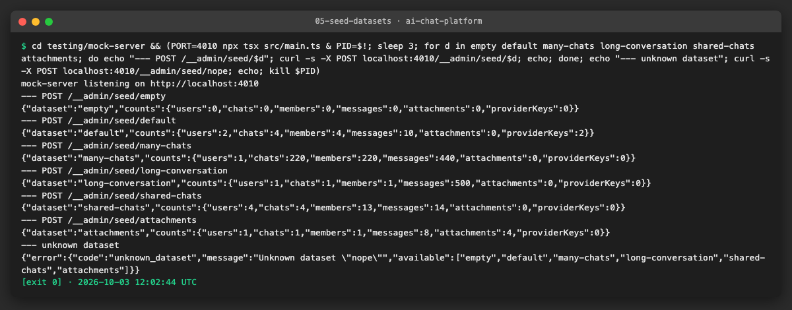

**Problems and fixes.** The shared member type has no chat id, so the dataset type adds one (`MockMember`). The shared provider key record keeps only the last four characters, so `MockProviderKey` adds a fake `apiKey` and the user id for the mock. We confirmed once that a Playwright test can import the package entry and build a 220-chat dataset, then removed the temporary spec because the `e2e` project does not use the package yet.

### US4 · LLM mock: Anthropic Messages API streaming ([AICHAT-145](https://ipca-grupo11.atlassian.net/browse/AICHAT-145))

**What and why.** `POST /anthropic/v1/messages` now answers like the real Messages API, so conversation-service can stream from the mock instead of a paid account. With `"stream": true` it sends the full event sequence: `message_start`, `content_block_start`, a `ping`, one `content_block_delta` per token, `content_block_stop`, `message_delta` (with the stop reason and the output tokens) and `message_stop`. Without `stream` it returns the whole message as JSON. The text is paced by `TTFT_MS` (first token) and `TOKEN_INTERVAL_MS` (each next token), and its length is `TOKENS`.

Scenarios of this story (chosen with the `X-Mock-Scenario` header, see US6): `ok`, `long` (ten times `TOKENS`), `thinking` (a `thinking` block with `thinking_delta` and `signature_delta` before the text), `web-fetch` (a text block, a `server_tool_use` block named `web_fetch` with `input_json_delta`, a `web_fetch_tool_result` block, then the answer), `pause-turn` (stops with `pause_turn` after the web fetch; when the request already ends with an assistant turn, which is how the adapter resumes, it answers with plain text and `end_turn`) and `max-tokens` (stop reason `max_tokens`).

The shared logic lives in `src/llm/` and not in the router, so the backend mock can reuse it:

```ts
// src/llm/stream.ts
streamScenarioText(
  scenario: string,                       // "ok", "long", "max-tokens", ...
  ctx: Pick<MockContext, "config">,       // TTFT_MS, TOKEN_INTERVAL_MS, TOKENS and SEED are read from here
  options?: { signal?: AbortSignal },
): AsyncGenerator<string, void>           // one text token per step, already paced
```

It throws `UnknownScenarioError` for a name that is not a text scenario.

**Files.**
- `testing/mock-server/src/llm/text.ts`, `pacer.ts`, `scenarios.ts`, `stream.ts` (new): seeded text, pacing, the scenario table and `streamScenarioText`.
- `testing/mock-server/src/llm/anthropic.ts`, `sse.ts`, `select.ts` (new): the content blocks and SSE frames of a reply, SSE helpers, scenario selection.
- `testing/mock-server/src/routers/anthropic.router.ts`: the route.
- `testing/mock-server/src/llm/stream.spec.ts`, `src/routers/anthropic.router.spec.ts` (new) and `src/app.spec.ts`: tests.

**How to run.**

```sh
pnpm exec nx test mock-server
PORT=4110 pnpm exec nx serve mock-server
```

**How to repeat it manually.**

1. Start the server as above.
2. Run `curl -N localhost:4110/anthropic/v1/messages -H content-type:application/json -d '{"model":"claude-sonnet-4-5","max_tokens":100,"stream":true,"messages":[{"role":"user","content":"hi"}]}'`.
3. Add `-H 'X-Mock-Scenario: thinking'`, `web-fetch` or `pause-turn` to see the other blocks; leave out `"stream":true` for the JSON message.
4. Expected output: the events listed above, one every `TOKEN_INTERVAL_MS`, ending with `message_stop`.

**Result.** The plain stream has the full event sequence and ends with `end_turn`. The `thinking` stream has the thinking block and its signature before the text. The `web-fetch` stream has the tool call, its result and the answer, and `pause-turn` ends with `pause_turn`. The non-streaming call returns the message as JSON.

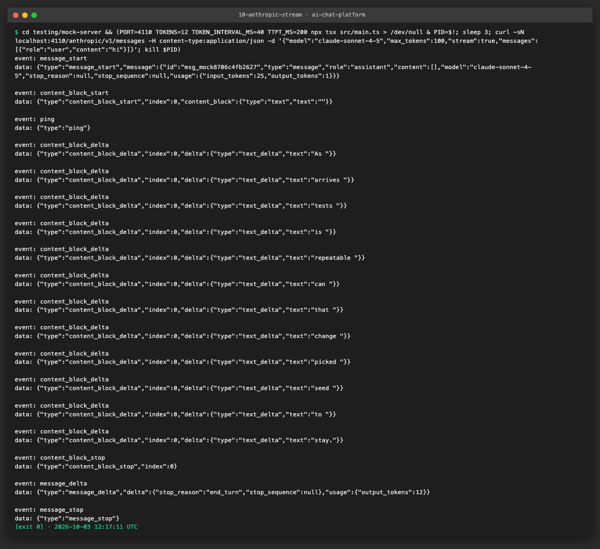

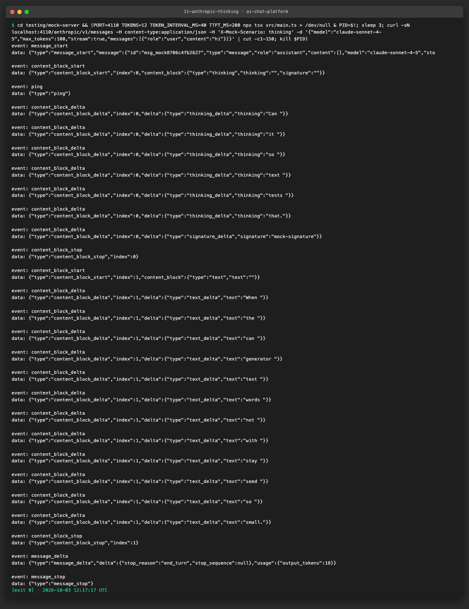

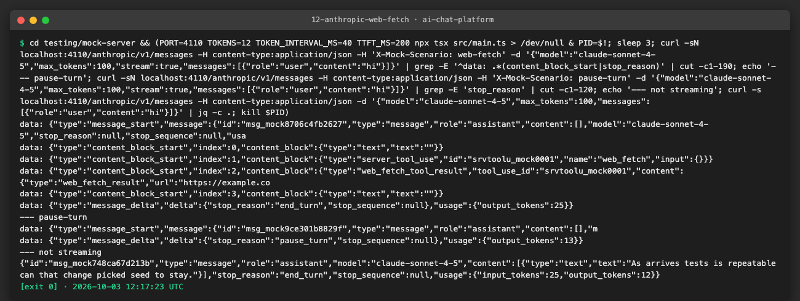

**Problems and fixes.** Random choices come from the seeded generator, but a generator that is shared by all requests would give a different text to each one, so the answer text is generated from `SEED` and the scenario name instead (see US6). The existing admin test expected an empty scenario list, so it now builds the app without mocks.

### US5 · LLM mock: OpenAI Chat Completions streaming ([AICHAT-146](https://ipca-grupo11.atlassian.net/browse/AICHAT-146))

**What and why.** `POST /openai/v1/chat/completions` streams `chat.completion.chunk` objects: a first chunk with the `assistant` role, one chunk per token, a last chunk with an empty `delta` and `finish_reason`, and the `data: [DONE]` line. `stream_options.include_usage` adds the usage chunk. Without `stream` the route returns a `chat.completion` object. The scenarios `ok`, `long` and `max-tokens` exist for this provider; `max-tokens` ends with `finish_reason: "length"`. The thinking and web fetch scenarios are Anthropic only, so OpenAI answers 400 for them.

**Files.**
- `testing/mock-server/src/llm/openai.ts` (new): reply, chunks and the non-streaming object.
- `testing/mock-server/src/routers/openai.router.ts`: the route.
- `testing/mock-server/src/routers/openai.router.spec.ts` (new): tests.

**How to run.**

```sh
pnpm exec nx test mock-server
```

**How to repeat it manually.**

1. Start the server (`PORT=4110 pnpm exec nx serve mock-server`).
2. Run `curl -N localhost:4110/openai/v1/chat/completions -H content-type:application/json -d '{"model":"gpt-4o","stream":true,"messages":[{"role":"user","content":"hi"}]}'`.
3. Add `-H 'X-Mock-Scenario: max-tokens'` for the `length` stop.
4. Expected output: the chunks, then a chunk with `"finish_reason":"stop"` (or `"length"`), then `data: [DONE]`.

**Result.** Both streams end with the finish chunk and `[DONE]`; the `max-tokens` stream finishes with `length`.

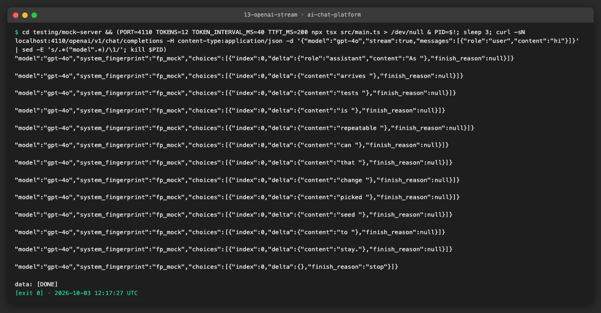

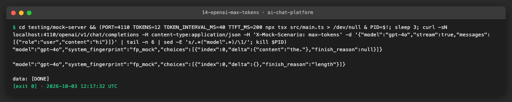

**Problems and fixes.** None. The real OpenAI adapter in conversation-service reads both mocks without changes: a throw-away script ran `AnthropicProvider` and `OpenAiProvider` against the running mock for the plain, thinking, web fetch, pause-turn, error and drop scenarios, and each gave the expected chunks or error (the contract tests story will make this a real test).

### US6 · LLM mock: per-request scenario selection ([AICHAT-147](https://ipca-grupo11.atlassian.net/browse/AICHAT-147))

**What and why.** A request picks its scenario in one of two ways: the `X-Mock-Scenario` header, or a suffix on the model name after `@` (`claude-sonnet-4-5@thinking`, `gpt-4o@max-tokens`), which is handy because the adapters only let us set the model. The header wins over the suffix, no choice means `ok`, and the model is echoed back without the suffix. A name that does not exist answers 400 and lists the names that do. Every mock registers its scenarios, and `GET /__admin/scenarios` lists them with a description. The text of an answer depends only on `SEED` and the scenario, so the same `SEED` gives the same answer on every request, and another `SEED` gives another one.

**Files.**
- `testing/mock-server/src/llm/select.ts`: header and suffix selection, list of names for the error message.
- `testing/mock-server/src/routers/anthropic.router.ts`, `openai.router.ts`: use the selection.
- `testing/mock-server/src/llm/scenarios.spec.ts` (new): tests for selection, the admin list and `SEED`.

**How to run.**

```sh
pnpm exec nx test mock-server
SEED=42 PORT=4110 pnpm exec nx serve mock-server
```

**How to repeat it manually.**

1. Start the server.
2. Run `curl -s localhost:4110/__admin/scenarios`.
3. Run `curl -s localhost:4110/openai/v1/chat/completions -H content-type:application/json -d '{"model":"gpt-4o@max-tokens","messages":[]}'` and the same call three times without the suffix.
4. Expected output: the list of scenarios per mock; `finish_reason` `length` for the suffix; the same text three times.

**Result.** The list shows the scenarios of both mocks, the suffix gives the `length` stop, and the three calls return the same text.

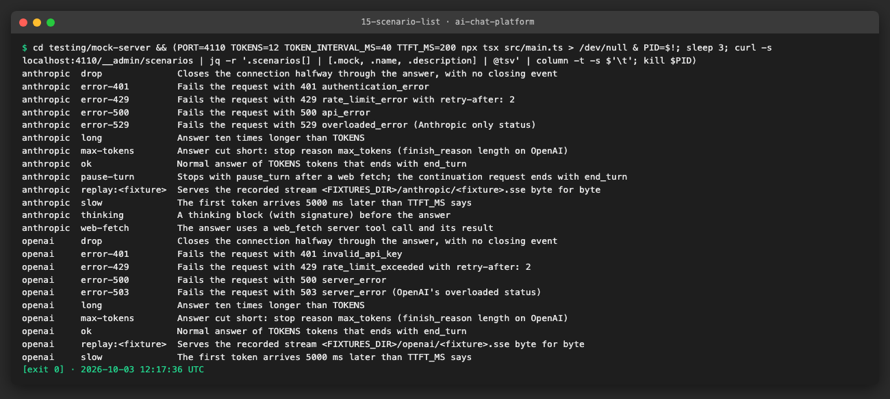

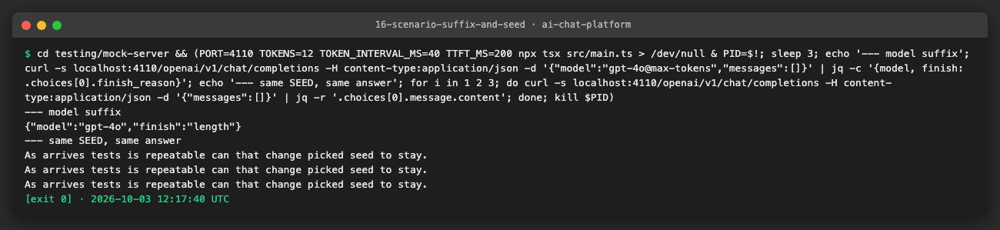

**Problems and fixes.** Our first idea was to draw the text from the shared `ctx.rng`, but that generator moves on with every request, so the second call would have differed from the first. The text now comes from its own generator started from `SEED` and the scenario name; `ctx.rng` still makes the message and request ids, and `/__admin/reset` brings it back to the start.

### US7 · LLM mock: provider errors and broken streams ([AICHAT-148](https://ipca-grupo11.atlassian.net/browse/AICHAT-148))

**What and why.** Error scenarios answer before any stream starts, with the status, headers and body each provider uses. Anthropic: `error-401` (`authentication_error`), `error-429` (`rate_limit_error`, with `retry-after`), `error-500` (`api_error`) and `error-529` (`overloaded_error`), with `request_id` in the body and the `request-id` header. OpenAI: `error-401` (`invalid_api_key`), `error-429` (`rate_limit_exceeded`, with `retry-after`), `error-500` (`server_error`) and `error-503`, because OpenAI never answers 529 and signals overload with 503. The bodies follow the AICHAT-25 recordings. `retry-after` is 2 seconds so a retry test stays fast. `drop` sends half of the answer and then closes the connection with no closing event (no `message_stop`, no `[DONE]`), also for requests without `stream`. `slow` waits 5 seconds longer than `TTFT_MS` before the first token and then goes at the normal pace.

**Files.**
- `testing/mock-server/src/llm/errors.ts` (new): the error table, bodies and headers.
- `testing/mock-server/src/llm/scenarios.ts`, `anthropic.ts`, `openai.ts`, `stream.ts`, `sse.ts`: `drop` and `slow` in the plan, the replies and `streamScenarioText`.
- `testing/mock-server/src/routers/anthropic.router.ts`, `openai.router.ts`: error answers, drop and delay.
- `testing/mock-server/src/llm/faults.spec.ts` (new): tests.

**How to run.**

```sh
pnpm exec nx test mock-server
```

**How to repeat it manually.**

1. Start the server.
2. Run `curl -si localhost:4110/anthropic/v1/messages -H content-type:application/json -H 'X-Mock-Scenario: error-429' -d '{"messages":[]}'`; repeat with `error-401`, `error-500` and `error-529`.
3. Run the streaming call with `X-Mock-Scenario: drop` and check `echo ${PIPESTATUS[0]}`.
4. Time the first line of a stream with and without `X-Mock-Scenario: slow`.
5. Expected output: the status and body of each error, `retry-after: 2` on the 429; curl exit code 18 for `drop`; about 0.3 s against about 5.3 s for `slow`.

**Result.** The 429 carries `retry-after`, and the other errors have the provider body. The dropped stream stops after half of the tokens and curl reports a partial transfer (exit code 18). The first token takes 0.29 s in the normal case and 5.26 s with `slow`.

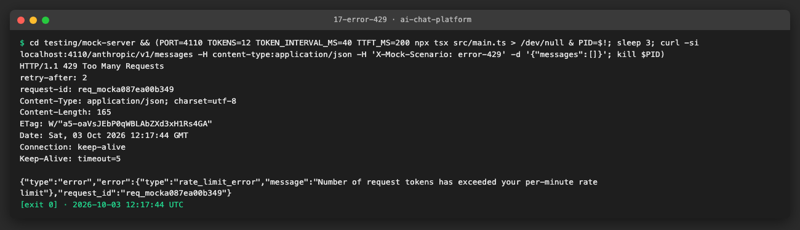

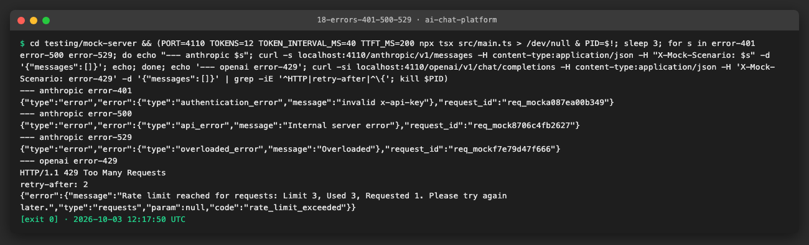

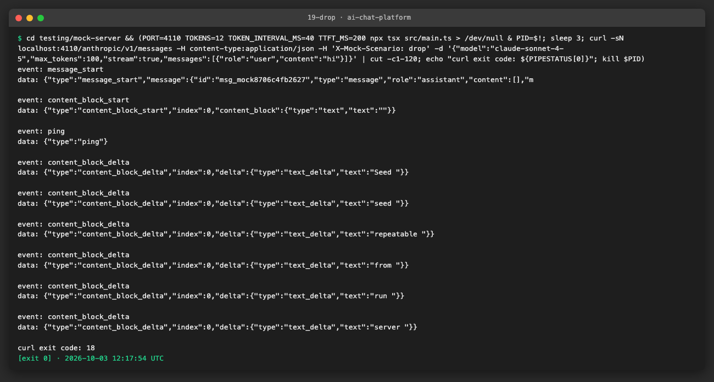

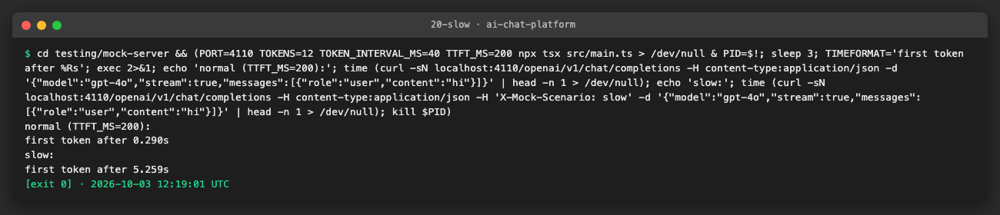

**Problems and fixes.** The first version of `drop` called `res.destroy()` right after writing the last token, and the client sometimes received nothing at all because the data was still waiting in the socket. The mock now waits for the last write to be flushed and then closes the connection. The delay of `slow` is tested on the token generator with fake timers; doing the same over a real socket is not reliable, so the router only gets the check by hand (evidence above).

### US8 · LLM mock: replay recorded provider streams ([AICHAT-149](https://ipca-grupo11.atlassian.net/browse/AICHAT-149))

**What and why.** The scenario `replay:<fixture>` (header or model suffix) serves a stream recorded in AICHAT-25 byte for byte: `replay:thinking` on the Anthropic route sends `anthropic/thinking.sse`, and `replay:reasoning` on the OpenAI route sends `openai/reasoning.sse`. That includes the recordings that break halfway (`overloaded-midstream`, `error-midstream`). The file is cut into its SSE frames and sent with the usual pacing, and the frames put together are exactly the bytes of the file (the read uses latin1 so bytes that are not UTF-8 survive). The fixtures are not copied into the mock project: the folder is `FIXTURES_DIR`, or by default `services/conversation-service/src/test-utils/fixtures/llm` found from the repo root (the folder with `pnpm-workspace.yaml`). The Dockerfile copies that folder to `/app/fixtures` and sets `FIXTURES_DIR` to it. A fixture that does not exist answers 404 in the provider error shape, with the name and the list of fixtures that exist. Names with a slash or `..` are never read from disk.

**Files.**
- `testing/mock-server/src/llm/replay.ts`, `serve-replay.ts` (new): folder lookup, fixture read, frame splitting, the response.
- `testing/mock-server/src/config.ts`, `.env.example`: `FIXTURES_DIR`.
- `testing/mock-server/src/routers/anthropic.router.ts`, `openai.router.ts`: handle `replay:` first.
- `testing/mock-server/Dockerfile`: copies the fixtures into the image.
- `testing/mock-server/src/llm/replay.spec.ts` (new): byte-for-byte checks of 11 recordings, 404, path tricks, `FIXTURES_DIR`.

**How to run.**

```sh
pnpm exec nx run-many -t lint typecheck test build -p mock-server conversation-service
```

**How to repeat it manually.**

1. Start the server (`PORT=4110 pnpm exec nx serve mock-server`).
2. Run `curl -sN localhost:4110/anthropic/v1/messages -H content-type:application/json -H 'X-Mock-Scenario: replay:thinking' -d '{"messages":[]}' > out.sse`.
3. Run `cmp out.sse services/conversation-service/src/test-utils/fixtures/llm/anthropic/thinking.sse`.
4. Repeat with `replay:nope`.
5. Expected output: `cmp` prints nothing (identical files); the unknown fixture answers 404 with the list of fixtures.

**Result.** `cmp` finds no difference for the three recordings tried, including the one that ends with an error event. The missing fixture gives a 404 that says what is available. Lint, typecheck, tests (coverage above 80% on all four metrics) and build pass for mock-server and conversation-service.

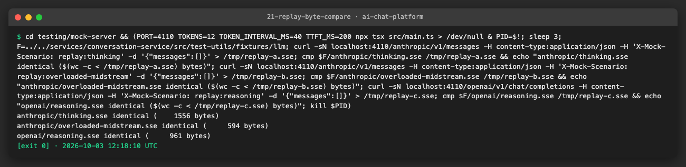

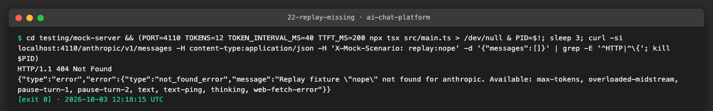

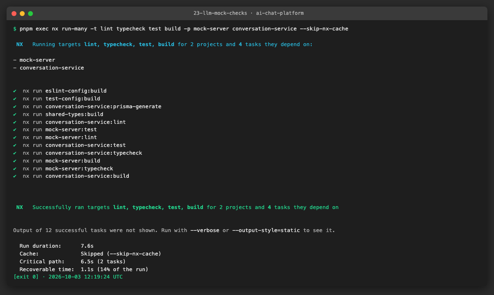

**Problems and fixes.** The adapters resume a `pause_turn` by sending the request again, but a recording is a fixed file, so `replay:pause-turn-1` ends the turn paused; the second half is served by asking for `replay:pause-turn-2`. The image was built again and `replay:text` answered from `/app/fixtures` inside the container.

### US9 · auth-service API mock ([AICHAT-155](https://ipca-grupo11.atlassian.net/browse/AICHAT-155))

**What and why.** The `auth` mock answers the four calls the apps make to auth-service, plus `refresh` (the login app calls it too): `POST /auth/register`, `POST /auth/login`, `POST /auth/logout`, `GET /auth/me` and `POST /auth/refresh`. The mount path is `/auth`, the same path the shell proxy and the apps use, so a frontend only needs the mock's host. The session is kept in two cookies with the same names and attributes as the real service (`access_token` on `/`, 15 minutes, and `refresh_token` on `/auth`, 7 days; both `HttpOnly` and `SameSite=Lax`). The value is an opaque id instead of a JWT, and the conversation mock reads the same sessions, so one login works for both. Users come from the loaded dataset (`default` has `alice@mock.test` and `bob@mock.test`, password `Mock-pass-1234`; `empty` has none, so register first). A user registered through the mock is added to the dataset and disappears on `/__admin/reset`.

The responses follow the real routes in `services/auth-service`: register answers `201 {id, email}` (no cookie), login `200 {id, email}` with the cookies, logout `204` and cleared cookies, me `200 {id, email}`. Errors have the shared body `{error: {code, message, fieldErrors?}, correlationId}`: `VALIDATION_ERROR` (400, field errors from the shared password policy), `EMAIL_TAKEN` (409), `INVALID_CREDENTIALS` (401, the same answer for an unknown email, a wrong password or a bad body), `UNAUTHENTICATED` (401) and `INVALID_REFRESH_TOKEN` (401). The request schemas are the ones from `@app/shared-types`, so the mock and the apps cannot drift apart.

**Files.**
- `testing/mock-server/src/routers/auth.router.ts`: the routes and the cookie handling.
- `testing/mock-server/src/auth/sessions.ts`: open sessions, shared with the conversation mock.
- `testing/mock-server/src/backend/http.ts`: error body, correlation id, cookie parsing and CORS (with credentials) shared by both backend mocks.
- `testing/mock-server/src/routers/auth.router.spec.ts`: tests; the responses are parsed with the zod schemas of `@app/shared-types` (`auth.userProfileSchema`, `http.errorResponseSchema`).

**How to run.**

```sh
pnpm exec nx test mock-server
MOCK_DATASET=default pnpm exec nx serve mock-server     # http://localhost:4010
```

**How to repeat it manually.**

1. Start the server as above.
2. Register, log in with a cookie jar and read the session:
   `curl -c jar -X POST localhost:4010/auth/login -H 'content-type: application/json' -d '{"email":"alice@mock.test","password":"Mock-pass-1234"}'`, then `curl -b jar localhost:4010/auth/me`.
3. Expected output: `{"id":"user_00001","email":"alice@mock.test"}` for both, two `Set-Cookie` headers on login, `204` on `POST /auth/logout` and `401 UNAUTHENTICATED` on `/auth/me` afterwards. A weak password on register gives `400 VALIDATION_ERROR` with `fieldErrors.password`.

**Result.** The curl flow below goes through register (201), a validation error, a duplicate email (409), a wrong password (401), login with cookies, `me`, logout and `me` again (401). The test run is in the US11 section.

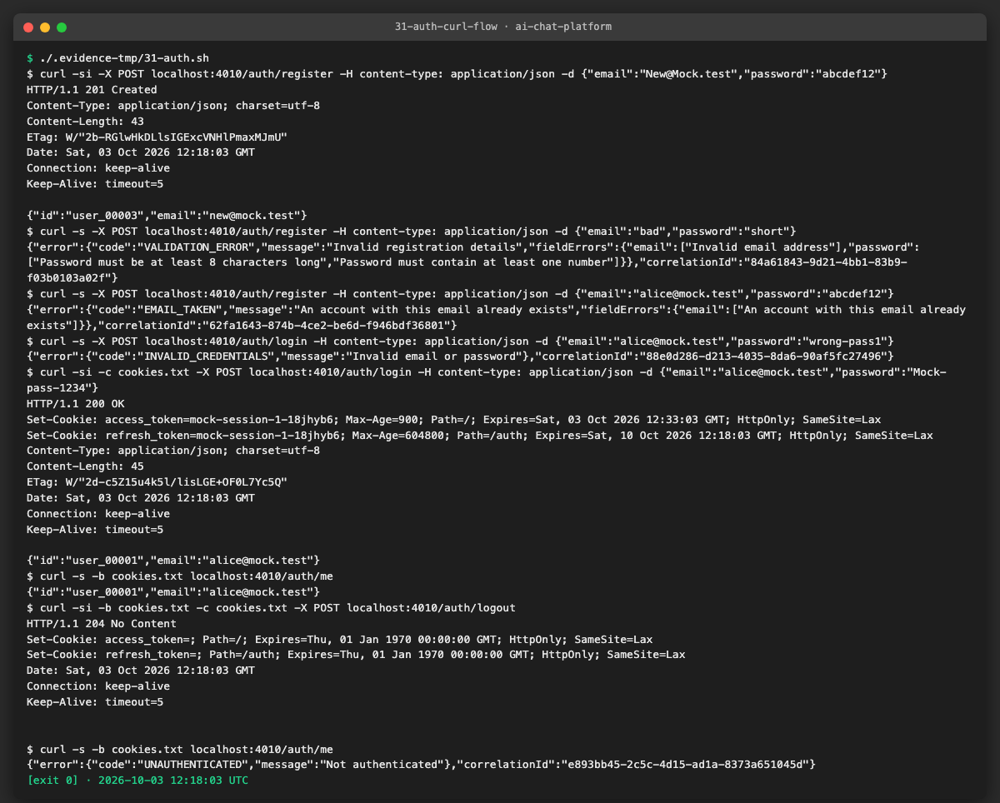

**Problems and fixes.** The real service signs a JWT and keeps hashed refresh tokens in the database; the mock keeps a map of open sessions in memory, which is enough because the apps never read the token. Logout in the real service only revokes the refresh token; the mock closes the whole session, so `me` fails right after logout, which is what the apps expect.

### US10 · conversation-service API mock, with the chat SSE stream ([AICHAT-156](https://ipca-grupo11.atlassian.net/browse/AICHAT-156))

**What and why.** The `conversation` mock is mounted on `/api`, the base path of the chat and settings apps (the shell proxy removes `/api` before the real service sees `/chats`, so the mock keeps it). Every call needs the session of the auth mock (cookie `access_token` or a Bearer header, as in the real service) and answers `401 UNAUTHENTICATED` otherwise. Chats and messages are stateful in memory and live in the loaded dataset, so `/__admin/seed/<dataset>` and `/__admin/reset` replace them; members, attachments and the provider key test are answered from the seed data.

| Area | Routes (all under `/api`) |
|---|---|
| Chats | `GET /chats`, `POST /chats`, `GET\|PATCH\|DELETE /chats/:id` |
| Members | `GET\|POST /chats/:id/members`, `DELETE /chats/:id/members/:email`, `DELETE /chats/:id/membership` |
| Messages | `GET\|POST /chats/:chatId/messages`, `PATCH\|DELETE /chats/:chatId/messages/:messageId` (edit, cancel), `POST .../:messageId/retry`, `POST /chats/:chatId/stop` and `POST .../:messageId/stop` |
| Stream | `GET /chats/:chatId/stream` (Server-Sent Events) |
| Attachments | `POST /chats/:chatId/messages/:messageId/attachments`, `POST /chats/:chatId/attachments` (multipart, `attachmentIds` links them to the next message) |
| Provider keys | `POST /providers/:provider/test-connection` (key in `X-Llm-Api-Key`: any key works, `invalid...` is rejected, none gives a failure message) |

Sending a message answers `201` with the user message, then the chat answers like the real queue: one answer at a time, a message sent while another streams is `queued` and can be edited (`PATCH`) or canceled (`DELETE`, `204`) until it starts (`409 MESSAGE_NOT_EDITABLE` / `MESSAGE_NOT_CANCELABLE` after that), `stop` ends the streaming answer and keeps the text so far, and a failed answer is retried with `POST .../retry` (`202`, `409 MESSAGE_NOT_RETRYABLE` for any other message). The stream sends the events of the real service as `event: <type>` and `data: {...}`: `message`, `queued`, `started`, `token`, `reasoning`, `web_fetch`, `done` (with `stopped`) and `error` (with `retryable`). Chats with reasoning or web fetch turned on also send those events. Chats are visible to their owner and to invited members; anything else is `404 CHAT_NOT_FOUND`. Timing comes from `TTFT_MS`, `TOKEN_INTERVAL_MS` and `TOKENS`.

The text of an answer comes from `src/conversation/answer-text.ts` (`answerText(scenario, ctx)` returns the tokens, seeded by `SEED`). It is a small local stand-in until the LLM scenarios exist; the scenario is chosen with `X-Mock-Scenario` on the send or retry request: `ok` (default), `long` (five times as long) and `error` (fails after two tokens, so the message ends as `failed` and can be retried).

**Files.**
- `testing/mock-server/src/routers/conversation.router.ts`: all the routes.
- `testing/mock-server/src/conversation/engine.ts`: the per-chat queue, the streaming of an answer, stop and reset.
- `testing/mock-server/src/conversation/records.ts`: access rules, id generation and the mapping from the dataset records to the service's DTOs.
- `testing/mock-server/src/conversation/contract.ts`: request schemas and response DTO schemas of the real service.
- `testing/mock-server/src/conversation/answer-text.ts`: the answer text adapter.
- `testing/mock-server/src/routers/conversation.router.spec.ts`: tests, including a real SSE connection.

**How to run.**

```sh
pnpm exec nx test mock-server
MOCK_DATASET=default TTFT_MS=100 TOKEN_INTERVAL_MS=40 pnpm exec nx serve mock-server
```

**How to repeat it manually.**

1. Start the server, log in with a cookie jar (`curl -c jar -X POST localhost:4010/auth/login -H 'content-type: application/json' -d '{"email":"alice@mock.test","password":"Mock-pass-1234"}'`).
2. Create a chat: `curl -b jar -X POST localhost:4010/api/chats -H 'content-type: application/json' -d '{"title":"Mock demo","provider":"anthropic","model":"claude-sonnet-5-5"}'`.
3. In a second terminal open the stream, `curl -N -b jar localhost:4010/api/chats/chat_00005/stream`, and send `curl -b jar -X POST localhost:4010/api/chats/chat_00005/messages -H 'content-type: application/json' -d '{"content":"Hello mock"}'`.
4. Expected output: `201` with the message, and on the stream `message`, `started`, one `token` event per word and `done`. For the queue send three messages quickly (`TTFT_MS=600` makes it easy), then edit and cancel the waiting ones; send with `-H 'X-Mock-Scenario: error'` and call `.../retry` on the failed answer.

**Result.** The first capture shows the stream while a message is sent: `message`, `started`, ten `token` events and `done`, and the saved history. The second shows the queue: the second message is edited, the third canceled, editing a message that already started is refused (409), an answer fails with the `error` scenario and the retry completes it.

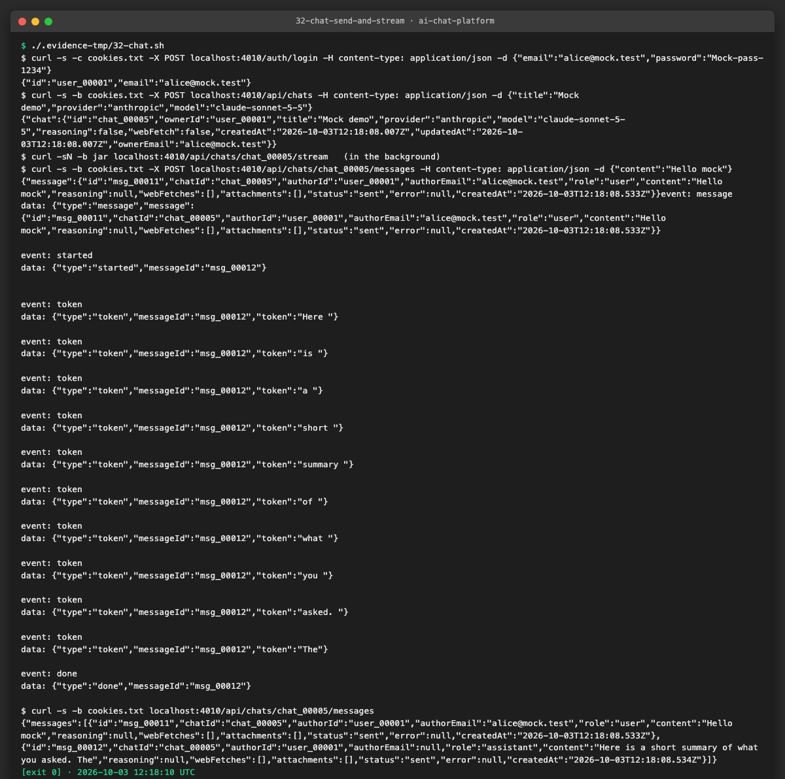

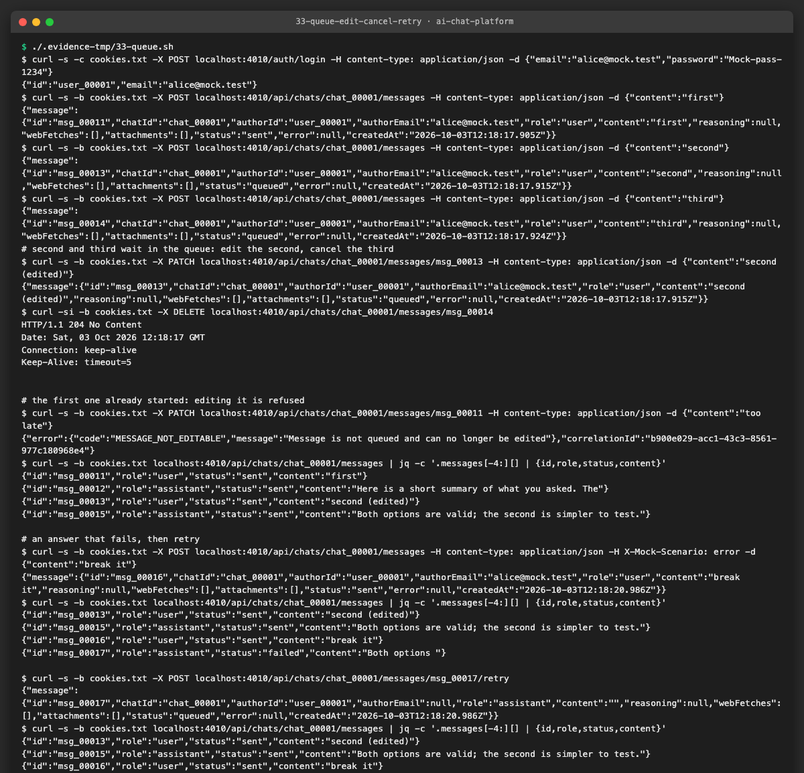

**Problems and fixes.** The records in `@app/shared-types` do not have the shape the service sends: the service adds author fields to messages, uses the status `sent` (the shared type says `complete`), sends attachments as objects and has the events `message` and `started`. The mock keeps the shared records in the dataset and maps them to the service's DTOs when it answers. Chat, member and error responses are checked against the shared schemas in the tests; the message, attachment and event DTOs are checked against schemas copied from `services/conversation-service/src/shared/contracts/chat.ts` (`contract.ts`). The chat app calls two paths that the service does not have (`POST /chats/:id/messages/:id/stop` and `POST /chats/:id/attachments`); the mock accepts both next to the real ones so the app works against it. Ids of canceled messages are never reused. The settings app's connection test (`/providers/:provider/test-connection`) is not implemented in the real service yet, so its answer is canned.

### US11 · Fault injection for the backend mocks ([AICHAT-157](https://ipca-grupo11.atlassian.net/browse/AICHAT-157))

**What and why.** Both backend mocks can fail on demand, so the apps' error paths can be tested. Four faults exist: `session-expired` (`401 UNAUTHENTICATED`; the auth mock also clears the session cookies), `error-500` (`500 INTERNAL_ERROR` with the message of the real service), `slow` (the answer is held back 3 s, or `delayMs` of the fault) and `stream-drop` (the chat stream is cut after three events, without ending the response). There are two ways to choose one. The header `X-Mock-Scenario: <fault>` applies to that request only. `POST /__admin/faults` with `{"route": "GET /auth/me", "scenario": "session-expired", "times": 1}` sets it per route for tests that cannot add headers (a browser): `route` is `METHOD /path` where the method can be `*`, `:name` stands for one path segment and a trailing `*` for the rest (`GET /api/chats/:id/stream`, `* /api/*`), and the optional `times` limits it to that many requests ("401 on the next call"). `GET /__admin/faults` lists what is set (and the valid names), `DELETE /__admin/faults` clears everything (`?route=...` clears one) and `/__admin/reset` clears them too. A faulted response carries the header `X-Mock-Fault`. A header value that is not a fault name (for example the answer scenario `error`) is ignored by the fault layer. The faults are listed by `/__admin/scenarios` under `auth` and `conversation`.

**Files.**
- `testing/mock-server/src/faults/faults.ts`: the fault store, route matching, the middleware used by both routers and the `/__admin/faults` routes.
- `testing/mock-server/src/faults/faults.spec.ts`: tests for matching, the store, the admin endpoints and each fault on both mocks, including a cut stream.
- `testing/mock-server/src/admin/admin.router.ts`, `src/routers/auth.router.ts`, `src/routers/conversation.router.ts`: one line each to mount the routes and the middleware (and the stream drop in the stream route).

**How to run.**

```sh
pnpm exec nx run-many -t lint typecheck test build -p mock-server
```

**How to repeat it manually.**

1. Start the server and log in with a cookie jar as in US10.
2. One request by header: `curl -i -b jar -H 'X-Mock-Scenario: error-500' localhost:4010/api/chats`.
3. Per route: `curl -X POST localhost:4010/__admin/faults -H 'content-type: application/json' -d '{"route":"GET /auth/me","scenario":"session-expired","times":1}'`, then call `/auth/me` twice. Do the same with `slow` (`"delayMs":1500`) and with `stream-drop` on `GET /api/chats/:id/stream` while a stream is open and a message is sent.
4. Expected output: `500` with `X-Mock-Fault: error-500`; the first `/auth/me` gives `401 UNAUTHENTICATED` and the second `200`; the slow call takes about 1.5 s; the stream ends after the `message`, `started` and first `token` event (curl exits with 18). `curl -X POST localhost:4010/__admin/reset` and `GET /__admin/faults` shows `[]`.

**Result.** The fault flow shows each fault once, then the list and the reset. The test run passes lint, typecheck and 139 tests with coverage of 98.9% statements, 92.8% branches, 99.1% functions and 99.5% lines (thresholds are 80).

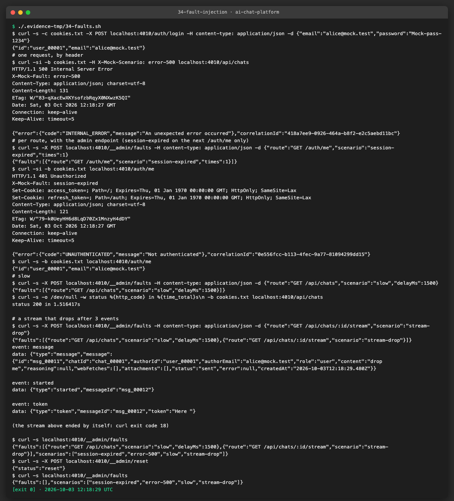

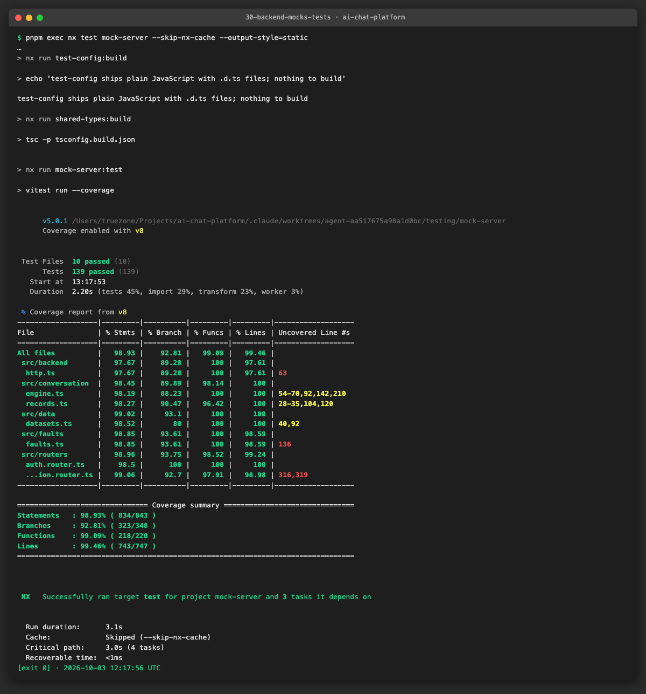

**Problems and fixes.** Ending the stream with `res.destroy()` dropped the last event that had just been written, so the drop now flushes the socket first and then closes it, without sending the end of the chunked body, which is what a real network cut looks like to the client. The fault layer sits in front of the routes of each mock, before authentication, so `session-expired` also works on routes that need a session. The faults and the answer scenarios share the header `X-Mock-Scenario`; names do not overlap (`error` is an answer scenario, `error-500` a fault).

### US12 · MFE remote mock: slow, missing and broken remotes ([AICHAT-158](https://ipca-grupo11.atlassian.net/browse/AICHAT-158))

**What and why.** The shell must keep working when a micro frontend is slow, missing or broken. The mock server now answers `GET /remotes/<name>/remoteEntry.js` and the name picks the behavior: `ok` returns a small Module Federation style container, `slow` waits (3000 ms by default, or `?delayMs=`, at most 60 s) and then answers like `ok`, `404` answers not found, and `broken-js` answers 200 with JavaScript that does not parse. The four names are also listed by `/__admin/scenarios`. A shell test loads a remote through `createRemoteRoute` and checks that `RemoteFallback` appears for `404` and `broken-js`, that the rest of the page stays, and that `ok` shows no fallback.

**Files.**
- `testing/mock-server/src/routers/remotes.router.ts` and `remotes.router.spec.ts`
- `apps/shell/src/features/remote-loader/mockRemotes.test.tsx`
- `testing/mock-server/src/app.spec.ts`: the "no scenarios" test now builds the app with an empty module list, because the remotes mock registers scenarios.

**How to run.**

```sh
pnpm exec nx test mock-server
pnpm exec nx test shell
```

**How to repeat it manually.**

1. Start the server: `pnpm exec nx serve mock-server`.
2. Run `curl -si localhost:4010/remotes/ok/remoteEntry.js` (and `404`, `broken-js` in place of `ok`).
3. Run `curl -s -o /dev/null -w '%{time_total}\n' 'localhost:4010/remotes/slow/remoteEntry.js?delayMs=2000'`; it prints about 2 seconds.
4. To see the fallback in the real shell, set `VITE_MFE_CHAT_URL=http://localhost:4010/remotes/404` in `apps/shell/.env.local` and open the chat route.

**Result.** `ok` answers 200 with the container, `slow` takes 2.0 s against 0.002 s for `ok`, `404` answers 404 and `broken-js` answers 200 with a script that Node refuses to parse. The shell test shows `RemoteFallback` for `404` and `broken-js`.

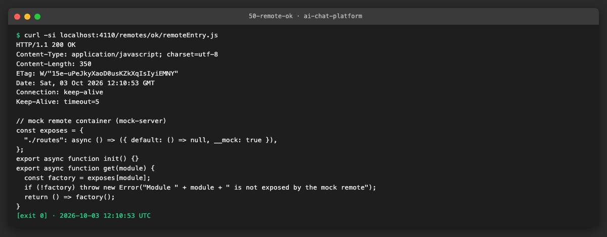
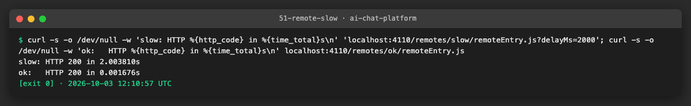
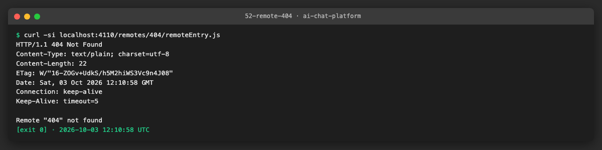
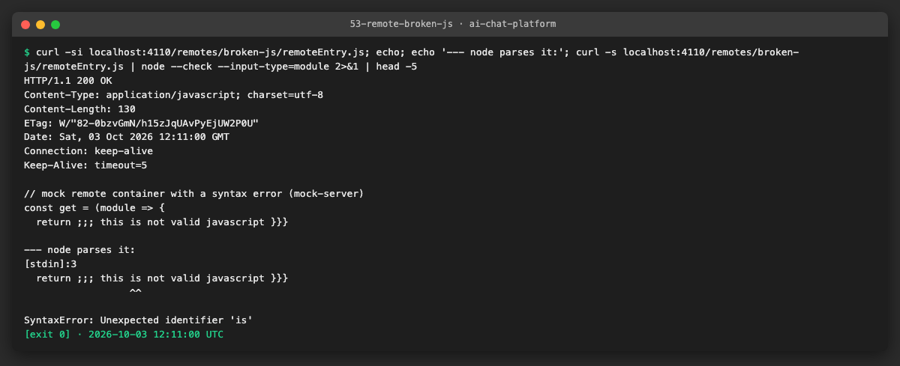
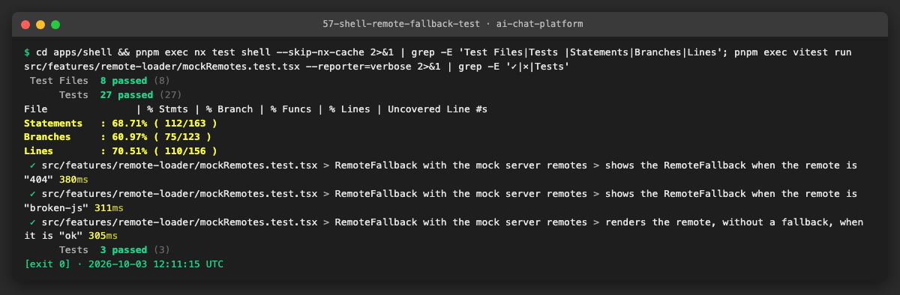

**Problems and fixes.** The shell test uses a `fetch` stub that answers what the mock answers, so it needs no running server and does not make the shell depend on the mock-server package. Real `import()` of a federated remote is covered by the manual step above. The existing "no scenarios" test in `app.spec.ts` failed once the remotes mock registered scenarios, so it now passes an empty module list.

### US13 · Telemetry sink for Faro payloads ([AICHAT-159](https://ipca-grupo11.atlassian.net/browse/AICHAT-159))

**What and why.** The shell sends Grafana Faro telemetry to a collector. The mock accepts `POST /collect` with any JSON payload, answers 202 and answers the CORS preflight a browser sends. The payloads are kept by the request log of US14, so `GET /__admin/requests?mock=collect` returns them in arrival order and `/__admin/reset` empties them.

**Files.** `testing/mock-server/src/routers/collect.router.ts` and `collect.router.spec.ts`.

**How to run.**

```sh
pnpm exec nx test mock-server
```

**How to repeat it manually.**

1. Start the server and run `curl -X POST localhost:4010/collect -H 'content-type: application/json' -d '{"logs":[{"message":"page loaded"}]}'`; the answer is `{"status":"accepted"}` with HTTP 202.
2. Run `curl 'localhost:4010/__admin/requests?mock=collect'`; the payload is in `requests[0].body`.
3. To point the shell at it, set the Faro collector URL of the shell to `http://localhost:4010/collect`.

**Result.** The POST is accepted and the GET returns the stored payload with method, path, headers and status.

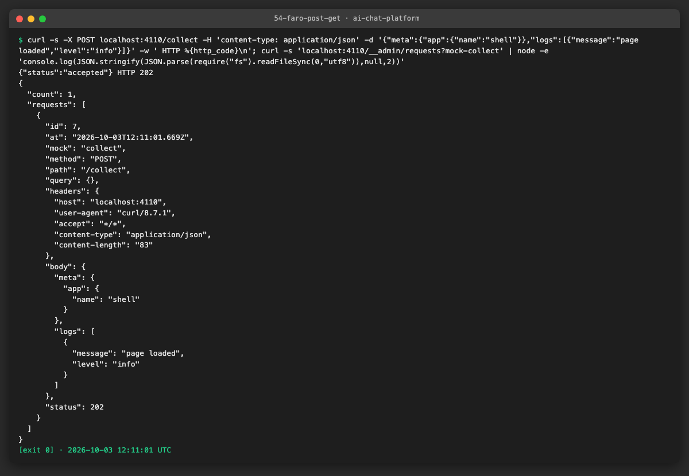

**Problems and fixes.** None. The sink has no store of its own, to keep one place where requests are kept and masked.

### US14 · Request inspection across all mocks ([AICHAT-150](https://ipca-grupo11.atlassian.net/browse/AICHAT-150))

**What and why.** Tests need to check what the app sent to the mocks without leaking secrets into logs and screenshots. A request log (`src/core/request-log.ts`) records every request to every mock (not the admin endpoints) with id, time, mock name, method, path, query, headers, body and response status. Values of `authorization`, `x-api-key`, `x-llm-api-key`, `cookie`, `set-cookie` are replaced by `***` before storing, and so are query and body fields whose name contains `key`, `token`, `password` or `secret`, at any depth. `GET /__admin/requests` lists the entries and `?mock=<name>` filters them. The log keeps the newest 1000 entries and `/__admin/reset` clears it. It is added with one line in `app.ts`, so the other mocks need no change; it also parses JSON bodies for all mocks, and answers 400 `invalid_json` for a body that does not parse.

**Files.**
- `testing/mock-server/src/core/request-log.ts` and `request-log.spec.ts`
- `testing/mock-server/src/app.ts` (log created and applied to each mock)
- `testing/mock-server/src/admin/admin.router.ts` (`GET /requests`)

**How to run.**

```sh
pnpm exec nx test mock-server
```

**How to repeat it manually.**

1. Start the server and send `curl -X POST localhost:4010/remotes/ok/remoteEntry.js -H 'authorization: Bearer sk-secret' -H 'x-api-key: sk-ant-123' -H 'cookie: session=abc' -H 'content-type: application/json' -d '{"user":"ana","password":"hunter2"}'`.
2. Run `curl 'localhost:4010/__admin/requests?mock=remotes'`; the secrets show as `***`, `user` is intact.
3. Run `curl -X POST localhost:4010/__admin/reset`, then the GET again; the list is empty.

**Result.** Headers and body fields are masked, the filter works and the reset empties the log. The mock-server suite has 77 tests, with 99.6% statements and 100% lines.

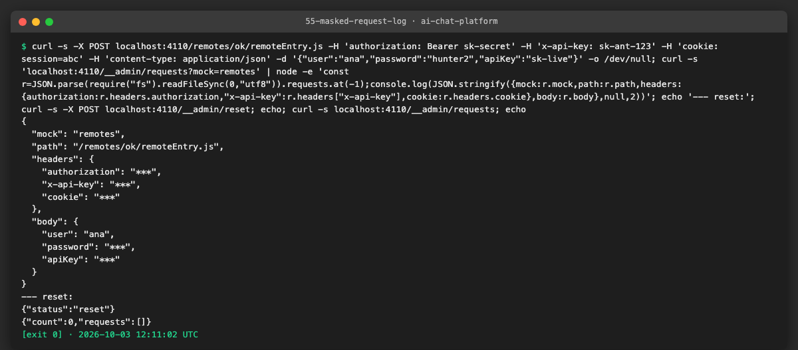
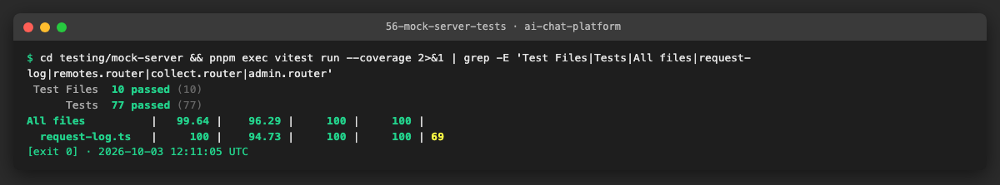

**Problems and fixes.** The log needs the parsed body, so the JSON parser runs before the mock routers; the parser skips a body that is already parsed, so routers that call `express.json()` themselves still work. After the merge we changed this: the log no longer answers a malformed body itself (see the integration fixes in section 7). The log is written when the request arrives and the status is filled in when the response finishes, so a slow request is already listed while it waits.

### US15 · Contract tests for the mocks ([AICHAT-151](https://ipca-grupo11.atlassian.net/browse/AICHAT-151))

**What and why.** A mock that drifts from the real thing is worse than no mock. Two contract tests keep the mocks honest and fail CI when they drift. The LLM test starts the mock in-process and calls it with the real `AnthropicProvider` and `OpenAiProvider` of conversation-service, once for every scenario the mock registers (and for every recorded fixture served by `replay:`). Every scenario needs an entry in the expectation table, so a new scenario nobody checked fails the test. The backend test drives the auth and conversation mocks and checks each kind of response twice: against the service schemas in `src/conversation/contract.ts` (no missing and no extra field), and against `@platform/shared-types`. Where shared-types differs from the services, the mock follows the services and the difference is in an exact drift list in the test. A new difference fails the test, and so does a difference that was fixed but is still listed.

**Files.**
- `testing/mock-server/src/contract/llm.contract.spec.ts` (new): real adapters against every LLM scenario.
- `testing/mock-server/src/contract/backend.contract.spec.ts` (new): responses and stream events against the service schemas and shared-types, the drift lists, and a check that what shared-types accepts as a request is accepted by the mock.
- `testing/mock-server/project.json`: `implicitDependencies: ["conversation-service"]`, so a change to the adapters re-runs the mock-server tests in `nx affected`.

**How to run.**

```sh
pnpm exec nx test mock-server
cd testing/mock-server && pnpm exec vitest run src/contract
```

**How to repeat it manually.**

1. Run `pnpm exec vitest run src/contract --reporter=verbose` in `testing/mock-server`. Expected: 30 tests pass, one per scenario and provider plus the backend checks.
2. Add a required field to a shared-types schema, for example `pinned: z.boolean()` in `packages/shared-types/src/chat/chat.ts`, and run the backend contract test. Expected: it fails and prints the new difference `pinned: invalid_type` for `chat`. Undo the change.
3. Add a scenario to the LLM mock without an entry in `EXPECTED`. Expected: "new scenario without a contract expectation".

**Result.** Both tests pass on the current code, and the drift demo fails as intended.

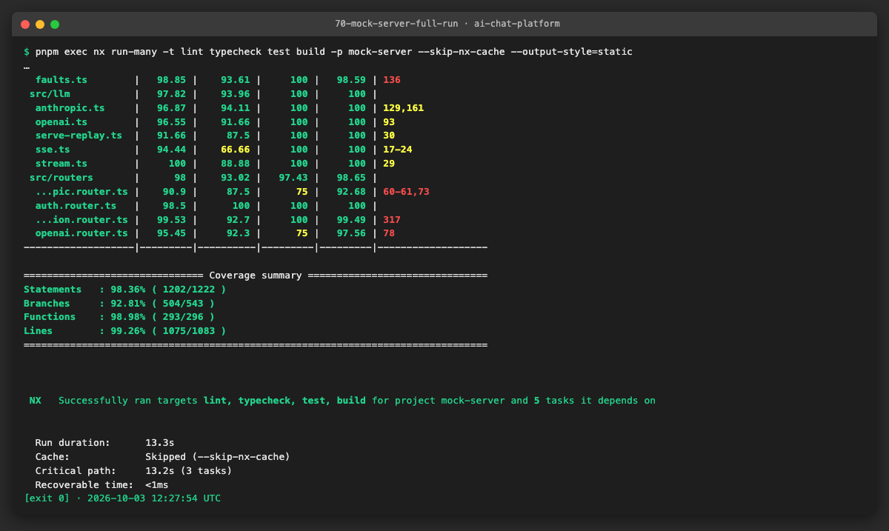

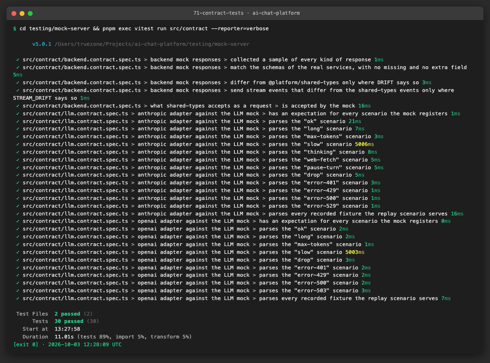

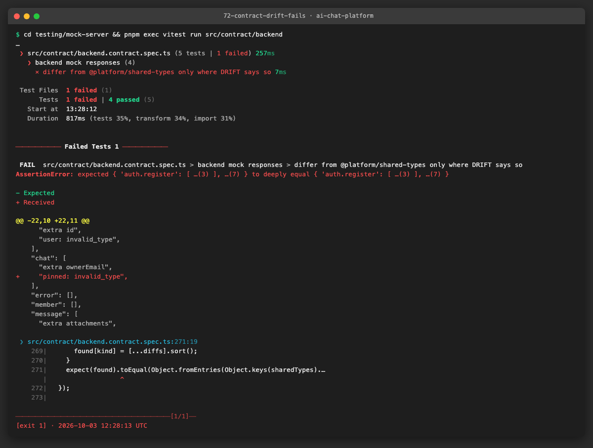

**Findings for AICHAT-20 (snapshot testing): drift of `@platform/shared-types` from the services.** The mock follows the services; these are the differences the test records.

| Kind | Service sends | shared-types says |
|---|---|---|
| auth `register`, `login`, `me` | `{ id, email }` | `authResponseSchema` is `{ user: { id, email, createdAt } }` |
| chat | has `ownerEmail` | no `ownerEmail` |
| message | `status` `sent`; `authorId`, `authorEmail`, `error`; `attachments` as objects; role may be `system` | statuses `complete` and `canceled` instead of `sent`; none of those fields; only `attachmentIds` |
| attachment | `filename`, `kind`, `size`, `messageId` | `originalFilename`, `ownerId`, `storedPath`, `extractedTextStatus`, mime type enum |
| stream events | events `message` and `started`; `queued` without `position`; `error` has `retryable`; `done` may have `stopped` | no `message` and no `started`; `queued` needs `position`; `error` without `retryable`; `done` without `stopped` |

The member entry and the error body (`{ error, correlationId }`) agree. One more finding, for AICHAT-25: when the connection drops in the middle of a stream, both adapters let fetch's own `TypeError: terminated` through instead of a `ProviderError`. The contract test only requires that the adapter fails, and the comment on the expectation says so.

**Problems and fixes.** The tests import the adapters by a relative path, which the Nx module boundary rule forbids, so the import lines carry an explicit `eslint-disable` with the reason (the adapters are the code under test). The mock-server test then depends on conversation-service, which is why the implicit dependency is declared.

### US16 · Compose profiles and one-command start with the mocks ([AICHAT-152](https://ipca-grupo11.atlassian.net/browse/AICHAT-152))

**What and why.** Testers should start the app against the mocks with one command. `compose.mock.yaml` is used on top of `compose.yaml` and adds two profiles. `llm` is the real stack plus the mock: conversation-service gets `ANTHROPIC_BASE_URL` and `OPENAI_BASE_URL` pointing at the mock, so no provider key is needed. `frontend-only` is the shell and the three MFEs plus the mock: the shell proxies `/auth` and `/api` to the mock, and no database or backend service starts. In the overlay the real services are put in the `llm` profile, so they stay out of `frontend-only`; the plain `docker compose up` of `compose.yaml` is not touched. The shell for `frontend-only` is a second service, `shell-frontend-only`, that extends `shell`. The shell strips `/api` before it forwards, so its target is `http://mock-server:4010/api`.

**Files.**
- `compose.mock.yaml` (new): `mock-server`, the profile assignments, the base URLs and `shell-frontend-only`.
- `scripts/mock-compose.sh`, `scripts/dev-mock.sh` (new) and `package.json`: `pnpm mock:up`, `pnpm mock:down`, `pnpm dev:mock`.
- `scripts/ci/mock-chat-smoke.sh` (new): register, sign in, create a chat, send a message and read the stream through the shell.
- `.gitleaks.toml`: narrow exception for the first version of the smoke script (a throwaway password).

**How to run.**

```sh
pnpm mock:up                                      # profile llm, app on :8000, mock on :4010
bash scripts/mock-compose.sh up frontend-only     # shell + MFEs + backend mock
bash scripts/ci/mock-chat-smoke.sh                # one chat flow through the shell
pnpm mock:down                                    # stops both profiles and removes the volumes
pnpm dev:mock                                     # no Docker: dev servers + mock on :4010
```

**How to repeat it manually.**

1. `pnpm mock:up`, then `docker compose -f compose.yaml -f compose.mock.yaml --profile llm ps`. Expected: postgres, auth-service, conversation-service, the MFEs, the shell, the observability services and `mock-server` are healthy.
2. `bash scripts/ci/mock-chat-smoke.sh`. Expected: the stream shows `started`, 40 `token` events and `done`. The text comes from the mock through conversation-service.
3. `pnpm mock:down`, then `bash scripts/mock-compose.sh up frontend-only` and the same smoke script. Expected: only `mfe-auth`, `mfe-chat`, `mfe-settings`, `mock-server` and `shell-frontend-only` run, and the flow works.

**Result.** Both profiles start and answer the chat flow. In the `llm` profile the answer goes through the real conversation-service and the mock.

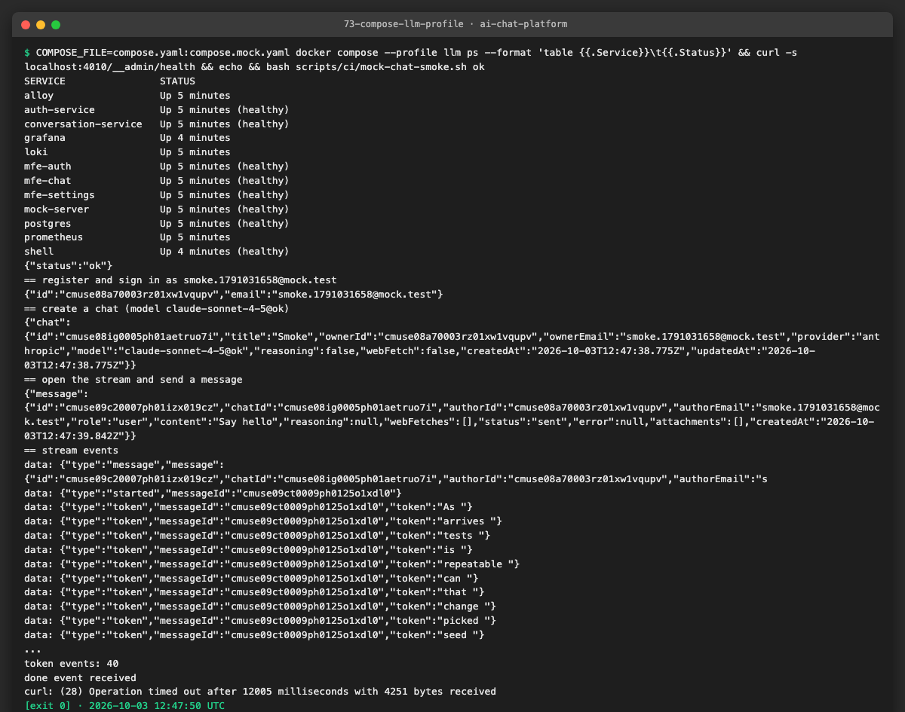

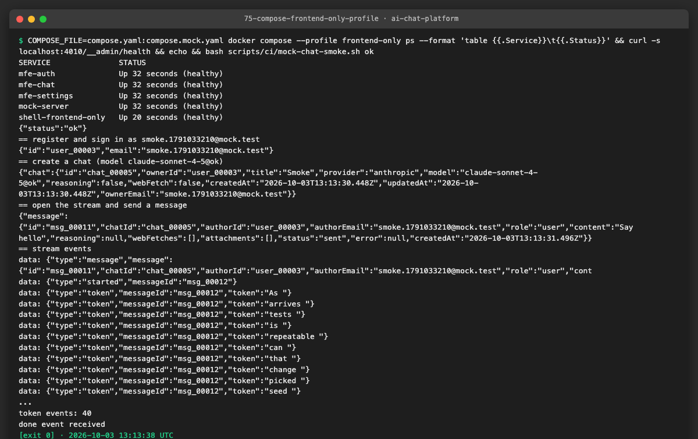

**Problems and fixes.** Compose cannot leave out a service that has no profile, so the `frontend-only` profile needs the real backend services to be profile-bound; that is done in the overlay only (`profiles: !override [llm]`), which keeps the default stack and the existing deploy commands unchanged. The conversation-service environment is validated as a URL, so the variable cannot be left empty and the overlay sets it to the mock. Ports 4001, 4002, 9090 and 3300 were in use by another stack on the machine, so we ran with `AUTH_SERVICE_PORT`, `CONVERSATION_SERVICE_PORT`, `PROMETHEUS_PORT` and `GRAFANA_PORT` changed; the overlay needs nothing else. We checked the `frontend-only` profile with the default dataset and the chat flow by curl; we did not click through the UI in that profile. `pnpm dev:mock` has a syntax check only: we did not run the five dev servers.

### US17 · E2E chat flows in CI against the mock ([AICHAT-153](https://ipca-grupo11.atlassian.net/browse/AICHAT-153))

**What and why.** The e2e workflow needed a real Anthropic key for any chat spec, so in CI the chat specs were skipped. Now the workflow starts the stack with `pnpm mock:up` (profile `llm`) and sets `ANTHROPIC_API_KEY` to a placeholder text, so conversation-service calls the mock and no real key is used. The whole suite still runs, as before. A new spec covers the flows the story asks for: send, stream, cancel (Stop, and removing a queued message), retry and provider error. Each test creates its chat through the API with a model name such as `claude-haiku-4-5@long`, which picks the mock scenario (`ok`, `long`, `error-529`). For the retry test the chat goes back to the normal model after the failure, as if the provider recovered, and the Retry button then gets an answer.

**Files.**
- `.github/workflows/e2e.yml`: `pnpm mock:up` and `pnpm mock:down`, placeholder key instead of the secret.
- `e2e/src/tests/chat-mock.spec.ts` (new): the four tests.
- `e2e/src/fixtures/settings-flows.ts`: `configureAnthropicKey` uses its own locators.
- `e2e/src/ci/e2e-workflow.spec.ts`: the structure test follows the new commands and checks the `llm` profile and the missing secret.

**How to run.**

```sh
pnpm mock:up
cd e2e && BASE_URL=http://localhost:8000 ANTHROPIC_API_KEY=mock-key pnpm exec playwright test chat-mock.spec.ts
pnpm mock:down
```

**How to repeat it manually.** Start the `llm` profile, sign up in the browser at `http://localhost:8000`, save any text as the Anthropic key in Settings, create a chat and send a message. Expected: the answer streams in, Stop keeps the part already written. In the workflow file, `ANTHROPIC_API_KEY` is the text `mock-key-not-a-secret`.

**Result.** The four tests pass locally against the `llm` profile. The GitHub run is pending the pull request.

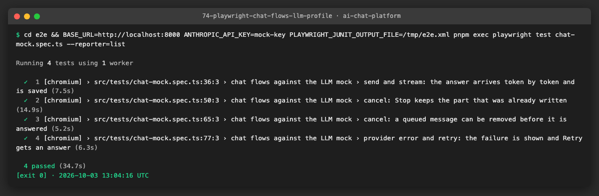

**Problems and fixes.** The settings helper `apiKeyField` matches the form and the input at once (strict mode violation), which broke every chat spec before it reached the chat; we gave `configureAnthropicKey` its own locators and left `apiKeyField` and `saveApiKey` as they are for the configuration specs. As agreed, the other failing specs (auth, configuration, shell selectors, AICHAT-4/5) are not touched. The older `chat.spec.ts` (US-13 to US-22) also fails against the current UI: "New chat" now opens a dialog, and the specs look for test ids and labels that do not exist (`assistant-message`, `user-message`). Rewriting it is outside this story, so the chat flows of this story are in the new spec. This is an open question for the report.

### US18 · Mock server usage guide for the other testing epics ([AICHAT-154](https://ipca-grupo11.atlassian.net/browse/AICHAT-154))

**What and why.** The epics AICHAT-18, 19, 21, 24, 26, 28 and 32 should reuse the mock instead of building their own. `MOCK-SERVER.md` has the run commands, the mock and scenario tables, the environment variables, the admin endpoints and a short example for each of those epics.

**Files.**
- `docs/AICHAT-144/MOCK-SERVER.md` (new).

**How to run.** Open [MOCK-SERVER.md](MOCK-SERVER.md). The scenario tables match `GET /__admin/scenarios`.

**How to repeat it manually.** Start the server, run `curl localhost:4010/__admin/scenarios` and compare the names with the tables. Run one of the examples, for example the AICHAT-32 one (`GET /__admin/requests?mock=collect`).

**Result.** The guide is written; the tables were copied from the live scenario list.

**Problems and fixes.** The examples for AICHAT-24, 26 and 28 name the tools (k6, ZAP) but we did not run those tools here; they show the mock side of the setup.

## 4. How to run everything

```sh
export PATH=$HOME/.nvm/versions/node/v24.21.0/bin:$PATH
# all checks of the mock server
pnpm exec nx run-many -t lint typecheck test build -p mock-server --skip-nx-cache
# everything that changed against the integration branch
pnpm exec nx affected -t lint typecheck test build --base=origin/integration/testing-epics
# contract tests only
cd testing/mock-server && pnpm exec vitest run src/contract
# stack with the mock, chat flows, stop
pnpm mock:up
cd e2e && BASE_URL=http://localhost:8000 ANTHROPIC_API_KEY=mock-key pnpm exec playwright test chat-mock.spec.ts
pnpm mock:down
# security checks
bash scripts/ci/semgrep.sh
gitleaks git --redact --log-opts=origin/integration/testing-epics..HEAD
```

## 5. Results

| Metric | Before | After |
|---|---|---|
| mock-server tests after the three tracks were merged | 3 failing | all pass (evidence 70) |
| Contract tests (LLM scenarios and backend responses) | none | 30 tests, new drift fails |
| Providers the e2e chat flows can use in CI | real Anthropic key only (specs skipped without it) | the LLM mock, placeholder key |
| E2E chat flows against the mock | 0 | 4 pass locally (evidence 74) |
| Compose profiles with the mock | 0 | 2 (`llm`, `frontend-only`) |
| `nx affected` lint, typecheck, test, build | not run after the merge | 16 projects pass (evidence 76) |
| Semgrep, gitleaks | not run for this branch | no new ERROR, no leaks (evidence 77, 78) |

## 6. DoD check

| DoD item | Met | Evidence |
|---|---|---|
| Mock server runs locally and in CI with one command; health check green | Locally yes (`pnpm mock:up`, health in the compose check); CI pending PR run | [73](evidence/73-compose-llm-profile.png) |
| Both LLM adapters stream a full answer from the mock (contract tests pass) | Yes | [71](evidence/71-contract-tests.png) |
| Shell + MFEs work end to end against the backend mock (`frontend-only`) with every named dataset | Partly: the profile starts and the chat flow works with the default dataset; the other datasets were checked through the API tests, not in the browser | [75](evidence/75-compose-frontend-only-profile.png) |
| Backend mock responses validated against `@platform/shared-types` (no drift from the real services) | Yes for the mock; the drift of shared-types itself is listed (US15) and passed to AICHAT-20; new drift fails the test | [72](evidence/72-contract-drift-fails.png) |
| Fault scenarios reproducible on demand | Yes (US6, US7, US11, US12) | see US sections |
| E2E chat flows run in CI against the mock, no real key used | Locally yes; GitHub run pending PR run | [74](evidence/74-playwright-chat-flows-llm-profile.png) |
| Run instructions and scenario list documented | Yes | [MOCK-SERVER.md](MOCK-SERVER.md) |
| `nx affected` green, Semgrep and gitleaks clean | Yes | [76](evidence/76-affected-final.png), [77](evidence/77-semgrep.png), [78](evidence/78-gitleaks.png) |
| e2e workflow green on GitHub | pending PR run | |

## 7. Notes for the report

- **Integration fixes after merging the three tracks.** The request log of the edge track parsed the JSON body for every router and answered `invalid_json` itself, which broke the real error shape of the auth and conversation mocks. It now parses leniently: the error is kept on the request and each router answers in its own shape (`VALIDATION_ERROR` for auth and conversation, `invalid_request_error` for the two LLM mocks). The scenario-list assertions of the remotes and conversation specs are filtered by mock. The streamed chat answer now takes its text from the LLM module (`streamScenarioText`), so `long` is ten times `TOKENS` like in the LLM mock (it was five); `error` keeps the text of `ok` and fails after two tokens. `.vitest/` is ignored.
- **Found:** `@platform/shared-types` has drifted from auth-service and conversation-service (table in US15); this is the input for AICHAT-20. The adapters do not wrap a dropped connection in a `ProviderError` (input for AICHAT-25).
- **Found:** the settings helper `apiKeyField` is ambiguous and the older `chat.spec.ts` no longer matches the chat UI. We fixed the first only for the chat specs and left the rest, as agreed with the owner.
- **Waived / not done:** the other failing e2e specs (AICHAT-4/5); a browser check of every dataset in `frontend-only`; a live run of `pnpm dev:mock`; the GitHub run of the e2e workflow.
- **Lessons learned:** a profile that must leave services out needs those services to be profile-bound, so the overlay file is the safe place for it. Choosing the scenario with the model name works through the real conversation-service without any change to it. Ports of other stacks on a developer machine can collide with the compose defaults; every published port has an environment variable.
