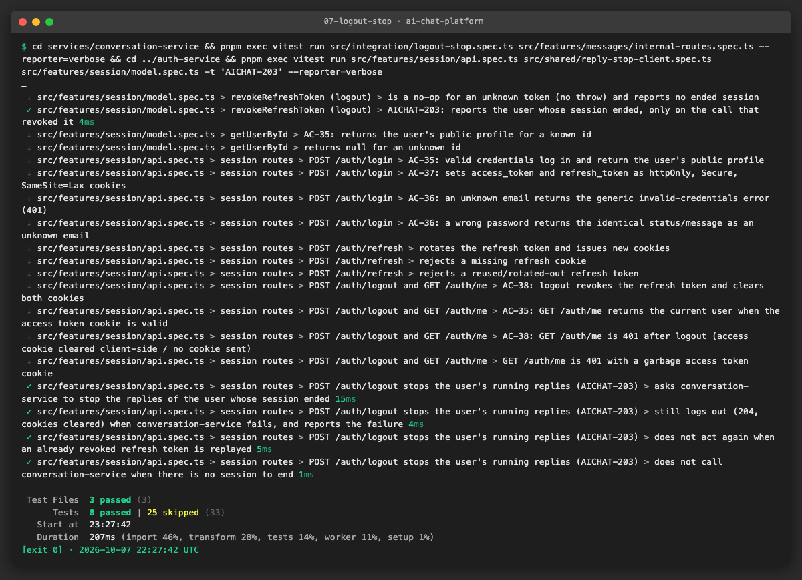
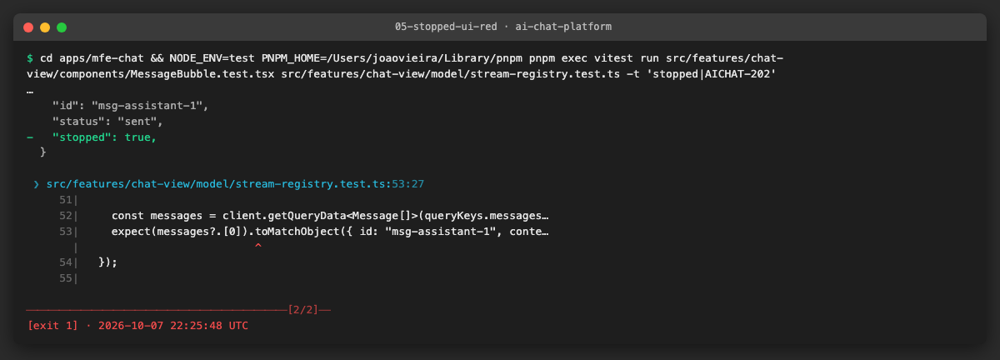
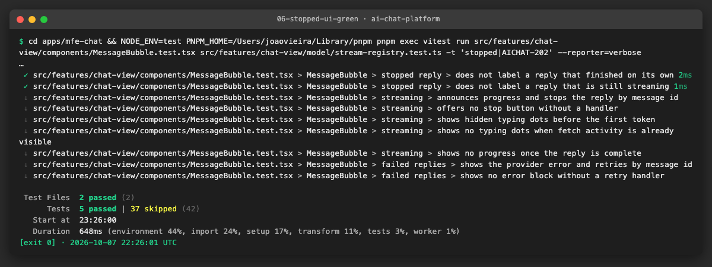
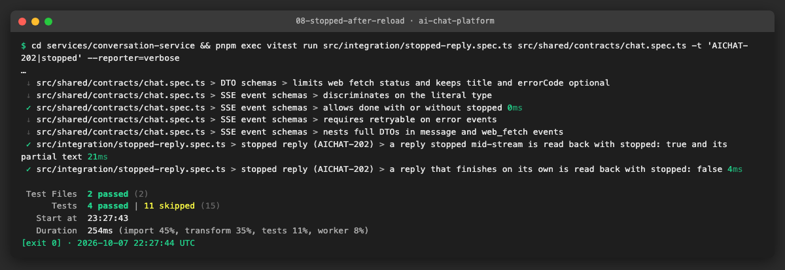
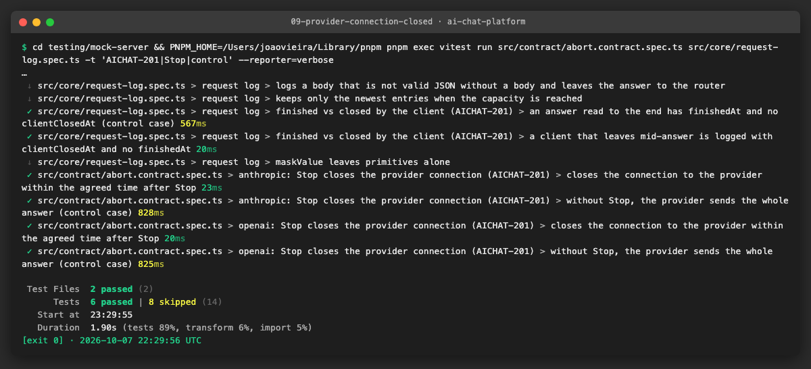
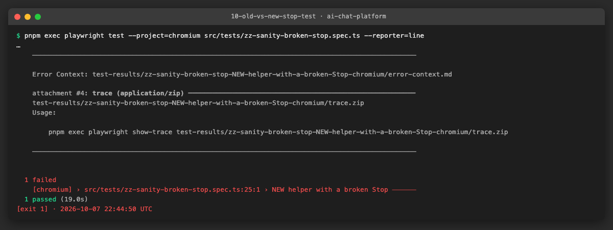
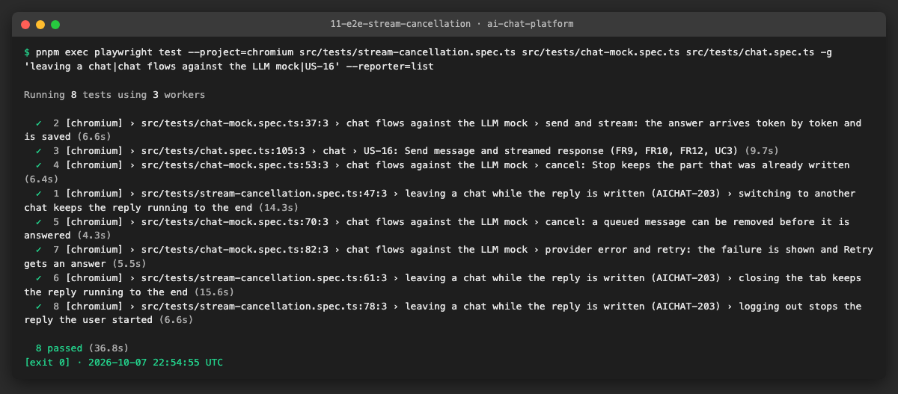

# AICHAT-15 · Stream cancellation testing: work log

| Field | Value |
|---|---|
| Epic | [AICHAT-15](https://ipca-grupo11.atlassian.net/browse/AICHAT-15) |
| Analysis | [README.md](README.md) |
| Owner | João Vieira |
| Branch | `test/AICHAT-15-stream-cancellation` |
| Started / finished | 2026-10-07 / 2026-10-08 |
| Pull requests | … |
| Status | Review |

## 1. DoR review

Date: 2026-10-07

| DoR item | Status | Question asked | Decision | Decided by |
|---|---|---|---|---|
| Owner assigned | Met | — | João Vieira | — |
| Scope and tooling agreed | Met | Tooling for the cancellation chain | Vitest + supertest for hook, route, queue, processor and adapters; mock server (AICHAT-144) for the upstream close; Playwright against `pnpm mock:up` for the UI | João Vieira |
| Target environment available | Met (partly) | — | Unit and service tests run locally without Docker. E2E stories (US5, US6) need Docker Desktop running for `pnpm mock:up` | — |
| Mock LLM server that records connection close | Partly met | AICHAT-144 status | The mock aborts its stream when the client leaves (`testing/mock-server/src/llm/sse.ts`) but does not log it. US3 adds the log entry | João Vieira |

Decisions:

| Topic | Decision |
|---|---|
| Stop URL mismatch | Fix the client: `useStopMessage` calls `POST /chats/:chatId/stop`. No second server route |
| Navigating away (AC-60/61 conflict) | Switching chats and closing the tab keep the reply running and saved (current design). **Logout** stops the user's running replies. The epic DoD "navigating away aborts" is read as "logout aborts" |
| Stopped state after reload | New boolean column `stopped` on `Message` (Prisma migration) and in the message DTO. Partial text is kept |
| Partial text on stop | Kept (current processor behaviour) |

Blockers: none. Docker Desktop must be started before US5/US6.

## 2. Environment


| Tool | Version | Install |
|---|---|---|
| macOS | 27.0.1 | — |
| Node | v26.8.2 | nvm |
| pnpm | 10.4.0 (pinned in `package.json`) | `pnpm install --frozen-lockfile` |
| Docker | 29.7.2 | Docker Desktop |
| Vitest | 5.0.1 | workspace dev dependency |

First run on a fresh clone: the shared packages and the Prisma clients must be built before the service and MFE tests can
import them:

```sh
pnpm install --frozen-lockfile
pnpm --filter "./packages/**" --if-present build
pnpm --filter @app/conversation-service prisma:generate
pnpm --filter @app/auth-service prisma:generate
```

Baseline before any change: conversation-service 68 files / 546 tests, mfe-chat 44 files / 380 tests, all passing.

## 3. Steps

### US1 · Fix and test the Stop endpoint contract ([AICHAT-199](https://ipca-grupo11.atlassian.net/browse/AICHAT-199))

**What and why.** The Stop button in mfe-chat called `POST /chats/:chatId/messages/:messageId/stop`, but conversation-service
only exposes `POST /chats/:chatId/stop` (`features/messages/routes.ts`). Stop therefore reached no route on the real server.
No test caught it because every frontend mock described the client's path instead of the server's:

- the shared MSW handlers (`packages/test-utils/src/msw/handlers.ts`) answered **both** paths,
- the hook test (`messages.test.ts`) and the component test (`ChatView.test.tsx`) registered the wrong path themselves.

A mock only proves something when it matches the real provider. We first changed the hook test to the server's route and saw
it fail (red), then fixed the client (green), removed the non-existent route from every mock, and added the missing server
cases of the stop contract.

**Files.**
- `apps/mfe-chat/src/features/chat-view/api/messages.ts`: `useStopMessage` calls `POST /chats/:chatId/stop`; `messageId`
  stays in the input (it identifies the clicked bubble) but is not sent.
- `apps/mfe-chat/src/features/chat-view/api/messages.test.ts`: the test pins the exact request list `["POST /api/chats/chat-1/stop"]`.
- `apps/mfe-chat/src/features/chat-view/components/ChatView.test.tsx`: Stop click asserts the real route.
- `packages/test-utils/src/msw/handlers.ts` and `handlers.test.ts`: the handler for the non-existent route is removed, so a
  call to it now fails any test (`onUnhandledRequest: "error"`).
- `services/conversation-service/src/features/messages/routes.spec.ts`: new block "stop contract (AICHAT-199)": the running
  reply's `AbortSignal` is aborted; an idle chat answers `{ stopped: false }`; a non-member gets 404 `CHAT_NOT_FOUND` **and the
  owner's reply keeps running**; an invited member can stop.

**How to run.**

```sh
pnpm exec nx run-many -t test -p mfe-chat conversation-service test-utils
```

**How to repeat it manually.**

1. In `apps/mfe-chat/src/features/chat-view/api/messages.ts`, put back the old path
   `` `/chats/${chatId}/messages/${messageId}/stop` ``.
2. Run `cd apps/mfe-chat && NODE_ENV=test pnpm exec vitest run src/features/chat-view/api/messages.test.ts -t useStopMessage`.
3. Expected output: the test fails and shows the wrong path next to `POST /api/chats/chat-1/stop`. Restore the line.
4. To check that the security case is real: in `services/conversation-service/src/features/messages/service.ts`, remove the
   `getAccessible` call in `stop()` and run `routes.spec.ts`. Expected: "a user who is not a member gets 404…" fails with
   `expected 200 to be 404`. Restore the line.

**Result.** Red before the fix, green after:


Full run after the change: conversation-service 68 files, mfe-chat 44 files, test-utils 5 files; test, lint and typecheck pass.

**Problems and fixes.**
- Fresh clone: the shared packages (`@app/shared-types`, `@app/ui`) and the Prisma clients must be built before the tests can
  import them (see §2).
- Found while doing this story, out of scope here: `useUploadAttachment` posts to `/chats/:chatId/attachments`, but the
  server route is `/chats/:chatId/messages/:messageId/attachments`, and the shared MSW handler again copies the client's path.
  Same class of defect; handed to AICHAT-11 (AICHAT-179, consumer pact for the upload).

### US2 · Abort propagates to the provider adapters and http-stream ([AICHAT-200](https://ipca-grupo11.atlassian.net/browse/AICHAT-200))

**What and why.** Stopping a reply is a chain: `POST /chats/:chatId/stop` → `QueueManager.stop` → `ChatQueue.stopActive()`
aborts an `AbortController` → the processor passes its `signal` to the provider adapter → the adapter passes it to `fetch`.
`readLines()` in `http-stream.ts` takes no signal: the abort reaches the read loop because real `fetch` errors the response
body with an `AbortError` when its signal aborts, so the pending `reader.read()` rejects and the `finally` releases the reader.

The existing tests covered an abort **before** the response (fetch rejects) for all three adapters, and an errored body for
Ollama. Nothing checked that the adapters hand **our** signal to fetch, or what happens when Stop is pressed in the middle of
an OpenAI or Anthropic reply. The old helper `mockStreamResponse` ignores the signal, so it could not show either.

We added `mockAbortableStreamResponse(chunks, signal)`, a body that behaves like real fetch: one chunk per read
(`highWaterMark: 0`, nothing read ahead) and, on abort, the body is errored with an `AbortError`, which drops queued chunks.

**Files.**
- `services/conversation-service/src/test-utils/mock-stream.ts`: `mockAbortableStreamResponse` (new helper).
- `services/conversation-service/src/features/llm-adapters/abort.spec.ts` (new): `describe.each` over OpenAI, Anthropic and
  Ollama, each with its own wire format. Per adapter: control case (no Stop, the whole reply streams), the signal given to
  fetch is the caller's signal, and an abort after the first token ends the stream with an `AbortError`, emits no further
  token and leaves the body unlocked.
- `services/conversation-service/src/features/messages/processor.spec.ts`: one chain test with the real `AnthropicProvider`:
  Stop when the first token reaches the event bus → only that token is streamed, no `error` event, the last event is
  `done { stopped: true }` and the partial text is saved.

**How to run.**

```sh
cd services/conversation-service && pnpm exec vitest run src/features/llm-adapters/abort.spec.ts src/features/messages/processor.spec.ts
```

**How to repeat it manually.**

1. In `services/conversation-service/src/features/llm-adapters/openai.provider.ts`, delete the line `signal: options.signal,`.
2. Run `pnpm exec vitest run src/features/llm-adapters/abort.spec.ts -t openai` in `services/conversation-service`.
3. Expected output: two failures, `expected undefined to be AbortSignal` and `promise resolved "undefined" instead of
   rejecting`: without the signal the whole reply is generated even though Stop was pressed. Restore the line.

**Result.** 9 adapter tests (3 per provider) and the chain test pass; conversation-service 69 files, test, lint and
typecheck pass.


**Problems and fixes.** None. The adapters were already correct; the gap was in the tests, which could not have detected a
missing signal.

### US5 · Logout stops the user's running replies ([AICHAT-203](https://ipca-grupo11.atlassian.net/browse/AICHAT-203)), service level

**What and why.** The epic DoD says "navigating away aborts the upstream request", but the product keeps a reply running
when the user switches chats (AC-60/61): streams live in a module-level registry in mfe-chat, and closing an SSE connection
does not touch the queue. The owner decided (§1): switching chats and closing the tab keep the reply running; **logout**
stops the replies the user started, because they spend that user's API key.

Logout happens in auth-service, which conversation-service never hears about. Following the account-erasure pattern
(AICHAT-33), auth-service calls conversation-service service-to-service:

```
POST /auth/logout (auth-service)
  ├─ revoke the refresh token, clear the cookies (as before)
  └─ best-effort: POST /internal/sessions/:userId/stop (service token) → conversation-service
                  QueueManager.stopForUser(userId): aborts only the replies that user started
```

Design points the tests pin down:
- **Only the user's own replies.** Queue entries now record `userId`; in a shared chat, a reply another member started keeps
  running.
- **Best-effort.** Logout never fails because conversation-service is slow or down: 2 s timeout, the error is logged and
  logout still answers 204 with the cookies cleared.
- **No replay.** `revokeRefreshToken` returns the user id only when it ends a live session, so replaying an old (revoked)
  refresh token cannot be used to keep stopping someone's replies.
- **Path safety.** The client URL-encodes the user id (`../erasures` → `..%2Ferasures`).
- The service-token guard moved from `features/erasure` to `shared/` (now used by two features; the lint rule
  `feature-folder-boundaries` forbids importing another feature's internals).

**Files.**
- conversation-service: `features/queue/chat-queue.ts` (`QueueEntry.userId`), `features/queue/queue-manager.ts`
  (`stopForUser`), `features/messages/service.ts` (records the user, `stopAllForUser`),
  `features/messages/internal-routes.ts` (new route) and `.spec.ts`, `app.ts` (mounted under `/internal`),
  `integration/logout-stop.spec.ts` (new), `integration/route-inventory.spec.ts` (entry for the route),
  `shared/service-token.ts` (moved), `test-utils/fake-queue.ts` (`stoppableProcessor`).
- auth-service: `shared/reply-stop-client.ts` and `.spec.ts` (new), `features/session/model.ts` (`revokeRefreshToken`
  returns the ended user), `features/session/api.ts` (logout calls the client), `main.ts` (wiring), tests in
  `features/session/api.spec.ts` and `model.spec.ts`.

**How to run.**

```sh
pnpm exec nx run-many -t test -p conversation-service auth-service
```

**How to repeat it manually.**

1. Start the stack with the mock LLM (`pnpm mock:up`), sign in, send "Write a very long story" in a chat whose model ends in
   `@long`.
2. While it streams, log out. Sign in again and open the chat.
3. Expected: the reply is cut where it was when you logged out (and marked "Stopped", see US4). Repeat with a chat switch
   instead of a logout: the reply finishes.

**Result.** Integration: 4 tests on the real app (only the user's replies stop, another member's reply keeps running, safe to
repeat, service token required). auth-service: logout calls the client with the ended user, still answers 204 when the
call fails, does not act on a replayed token or when there is no session. The browser check is in US6.



**Problems and fixes.**
- The first version of the "safe to repeat" test used `hangingProcessor`, which ignores the abort; the reply then stayed
  active and the second call stopped it again. The real processor finishes on abort, so we added `stoppableProcessor`, a
  double that does the same.
- Known limit: messages the user queued but that have not started yet are not removed; they would still run after logout.
  Recorded for the owner.

### US4 · Stopped reply is saved and shown as stopped ([AICHAT-202](https://ipca-grupo11.atlassian.net/browse/AICHAT-202))

**What and why.** A stopped reply was saved with `status: "sent"`, the same as a finished one, so after a reload nothing
showed it was cut short. Owner decision: a new boolean column `stopped` (additive, existing rows read as `false`; the
container applies the schema with `prisma db push`, so no migration file is needed).

The change crosses every layer, each with its own test:

| Layer | Change | Test |
|---|---|---|
| Database | `Message.stopped Boolean @default(false)` | — (schema) |
| Processor | the abort path saves `stopped: true` | `integration/stopped-reply.spec.ts` |
| API contract | `messageDtoSchema.stopped: z.boolean()` (always sent) | `shared/contracts/chat.spec.ts` |
| HTTP | `GET /chats/:chatId/messages` after a stop returns `stopped: true` and the partial text | `integration/stopped-reply.spec.ts` |
| Stream (mfe-chat) | `done { stopped: true }` marks the reply at once | `model/stream-registry.test.ts` |
| UI (mfe-chat) | "Stopped" label on a stopped assistant reply, not while streaming | `components/MessageBubble.test.tsx` |
| Frontend mocks | the MSW message DTO sends `stopped: false`, like the server | `packages/test-utils` |

The UI part was written test-first: the two positive tests failed (red), the three negative ones already passed and guard
against showing the label too often.

**How to run.**

```sh
pnpm exec nx run-many -t test -p conversation-service mfe-chat test-utils
```

**How to repeat it manually.**

1. In `services/conversation-service/src/features/messages/processor.ts`, remove `stopped: true` from the abort path.
2. Run `pnpm exec vitest run src/integration/stopped-reply.spec.ts` in `services/conversation-service`.
3. Expected: the first test fails with `"stopped": true` expected and `"stopped": false` received. Restore the line.

**Result.**







**Problems and fixes.**
- `packages/shared-types` has no `stopped` field, and the mock server's contract test validates against shared-types, not
  the service contract. This is the drift recorded in `docs/AICHAT-20/SSE-DRIFT.md`; the source of truth is decided in
  AICHAT-183.
- `testing/mock-server/src/faults/faults.spec.ts` ("stream-drop cuts the chat stream after a few events") fails on this
  machine before and after our change: its inputs are identical to `main`. Run under three Node versions: passes on 22 and
  25, fails only on 26. The repo pins Node 24 (`.nvmrc`, used by CI), so CI is not affected; developers should run
  `nvm install 24 && nvm use`. Not caused by this epic.

### US3 · Mock LLM proves the upstream connection is closed on stop ([AICHAT-201](https://ipca-grupo11.atlassian.net/browse/AICHAT-201))

**What and why.** US2 proved with a test double that the adapters stop reading. This story proves it over **real HTTP**: the
real adapters call the LLM mock with real `fetch`, and the mock reports whether the client left before the answer was
complete. That is what saves money: the provider stops generating once its connection is closed.

The mock already aborted its own stream when the client left (`testing/mock-server/src/llm/sse.ts`) but did not record it.
Node's HTTP server gives two signals on a response: `finish` (the whole answer was sent) and `close` (the connection ended).
A `close` before `finish` (`res.writableFinished === false`) means the client left mid-answer. The request log now stores
both times.

**Files.**
- `testing/mock-server/src/core/request-log.ts`: each entry has `finishedAt` and `clientClosedAt`.
- `testing/mock-server/src/core/request-log.spec.ts`: control (read to the end → `finishedAt`) and a client that leaves after
  the first chunk (→ `clientClosedAt`, no `finishedAt`).
- `testing/mock-server/src/contract/abort.contract.spec.ts` (new): for Anthropic and OpenAI, the real adapter reads the
  first token of a paced `long` answer and is aborted; the mock must log `clientClosedAt` within **500 ms** and no
  `finishedAt`. Control: without Stop the whole answer is sent.
- `docs/AICHAT-144/MOCK-SERVER.md`: the new fields of `/__admin/requests`.

**How to run.**

```sh
cd testing/mock-server && pnpm exec vitest run src/contract/abort.contract.spec.ts src/core/request-log.spec.ts
```

**How to repeat it manually.**

1. In `services/conversation-service/src/features/llm-adapters/anthropic.provider.ts`, delete the `signal,` line of the
   `fetch` call.
2. Run `pnpm exec vitest run src/contract/abort.contract.spec.ts -t anthropic` in `testing/mock-server`.
3. Expected: the stop test fails after about **8.4 s** with `promise resolved "undefined" instead of rejecting`: the whole
   `long` answer was streamed although Stop was pressed. With the line restored it takes about 20 ms. Restore the line.

**Result.** Both formats close the provider connection within a few milliseconds of Stop; the control cases finish.



**Problems and fixes.** The new spec imports the adapters from conversation-service on purpose (they are the code under
test), with the same scoped `@nx/enforce-module-boundaries` exception as `llm.contract.spec.ts`. The browser-to-provider check
(Stop button → `POST /chats/:chatId/stop` → closed upstream connection) is in US6.

### US6 · Strengthen the Stop E2E tests so they prove cancellation ([AICHAT-204](https://ipca-grupo11.atlassian.net/browse/AICHAT-204))

**What and why.** Two browser tests covered Stop, and both passed even when Stop did nothing: the AC-54 step in
`e2e/src/tests/chat.spec.ts` and "cancel: Stop keeps the part that was already written" in `e2e/src/tests/chat-mock.spec.ts`.
They only checked that some text was saved after the reply ended, which is also true when the reply ends on its own.

We added `stopReplyAndExpectCancelled(page)` (`e2e/src/fixtures/chat-flows.ts`), used by both tests. It checks that:
1. the stop request reaches a real route and answers `{ stopped: true }`;
2. the reply shows the "Stopped" label;
3. the text stops growing (unchanged after 1 s).

`chat-mock.spec.ts` also reads the LLM mock's request log (`e2e/src/fixtures/llm-mock.ts`): the provider request for this
prompt has `clientClosedAt` and no `finishedAt`. That is the full chain of US3: **Stop button → `POST /chats/:chatId/stop` →
queue → adapter → the provider connection closes**. After a reload the partial text and the "Stopped" label are still there
(US4).

The same file holds the browser checks of US5 (`e2e/src/tests/stream-cancellation.spec.ts`): switching chats and closing the
tab keep the reply running until the provider finishes it; logging out closes the provider connection, and after logging in
again the reply is marked "Stopped".

**Files.**
- `e2e/src/fixtures/chat-flows.ts`: `stopReplyAndExpectCancelled`; `createChat` fills the "New chat" dialog (see Problems).
- `e2e/src/fixtures/llm-mock.ts` (new) and `.spec.ts`: reads `/__admin/requests` of the LLM mock and finds the request of a
  prompt (string or Anthropic content blocks).
- `e2e/src/tests/chat-mock.spec.ts`, `e2e/src/tests/chat.spec.ts` (AC-54 step moved onto the mock's `@long` answer, so the
  reply is still streaming when Stop is pressed), `e2e/src/tests/stream-cancellation.spec.ts` (new).
- `e2e/src/fixtures/chat-flows.spec.ts`: unit test of the new `createChat` steps.
- `TESTING.md`: section "Stream cancellation (AICHAT-15)".

**How to run.**

```sh
pnpm mock:up
cd e2e && BASE_URL=http://localhost:8000 ANTHROPIC_API_KEY=mock-key-not-a-secret \
  pnpm exec playwright test --project=chromium src/tests/stream-cancellation.spec.ts src/tests/chat-mock.spec.ts
```

**How to repeat it manually.**

1. Add to a copy of the cancel test, before sending: `await page.route(/\/chats\/[^/]+\/stop$/, (r) => r.fulfill({ status: 404, body: "{}" }))`
   (Stop now hits a missing route, as before US1).
2. Run it once with the old assertions (click Stop, wait, text not empty) and once with `stopReplyAndExpectCancelled`.
3. Expected: the old assertions **pass**; the new helper fails with `the stop request must reach a real route`,
   `Expected: 200, Received: 404`.

**Result.**





8 E2E tests pass in one run (36.8 s): the 3 leave cases of US5, the 4 mock chat flows (with the stronger cancel test) and
`chat.spec.ts` US-16 (its first steps use the real local Ollama model; AC-54 uses the mock).

**Problems and fixes.**
- **New tab, missing key.** The first run of "closing the tab" failed with "Missing Anthropic API key": the provider key lives
  in `sessionStorage`, which is per tab, so the second tab must enter it again. Fixed in the test.
- **`createChat` was out of date.** "New chat" now opens a dialog (title, provider, model; Create disabled until a title is
  set), so the shared helper never reached a chat URL and every `chat.spec.ts` test that creates a chat timed out on `main`
  too. The helper now fills the dialog; this was needed for the AC-54 step.
- **Rate limit in local runs.** Running the suite several times in 15 minutes made registration fail with "Too Many
  Requests": auth-service keeps one rate-limit bucket per client IP without `trust proxy`, and every browser request comes
  through the shell's proxy (finding F6 of AICHAT-29). Restarting the auth-service container resets it.
- **Other E2E failures, not caused by this epic.** In a full run, 13 tests fail on selectors that no longer match the UI
  (configuration.spec: `getByLabel(/OpenAI.*api key/i)` matches 2 elements; chat.spec US-15/US-19 use `selectOption`/`<option>`
  on what is now a custom combobox; US-13 rename, US-17/US-21 Send, US-20/US-22 texts; shell.spec US-9, replaced by AICHAT-8).
  None touches code changed here; reported to the team.

## 4. How to run everything

```sh
pnpm exec nx run-many -t test lint typecheck -p conversation-service auth-service mfe-chat test-utils mock-server e2e workspace-config
cd testing/mock-server && pnpm exec vitest run src/contract/abort.contract.spec.ts
pnpm mock:up && cd e2e && BASE_URL=http://localhost:8000 ANTHROPIC_API_KEY=mock-key-not-a-secret \
  pnpm exec playwright test --project=chromium src/tests/stream-cancellation.spec.ts src/tests/chat-mock.spec.ts
```

## 5. Results

| Metric | Before | After |
|---|---|---|
| Stop button reaches the server | No (no route for the client's path) | Yes (`POST /chats/:chatId/stop`, 200) |
| Tests that fail when Stop does nothing | 0 (both E2E tests passed anyway) | Hook test, both E2E tests, provider contract |
| Adapters checked for passing the signal / stopping mid-reply | 0 of 3 | 3 of 3 (OpenAI, Anthropic, Ollama) |
| Provider connection closed after Stop | Not measured | Within a few ms (limit 500 ms), both formats |
| Stopped reply after a reload | Looked finished | Partial text + "Stopped" label |
| Logout | Replies kept spending the user's key | The user's running replies stop; other members' keep running |
| conversation-service test files / tests | 68 / 546 | 72 / 569 |

## 6. DoD check

| DoD item | Met | Evidence |
|---|---|---|
| Tests run in CI and pass on `main` | Pending merge | Unit, integration and contract tests run in `ci.yml` (nx affected); E2E in `e2e.yml` |
| Failure blocks the merge | ✅ (after merge) | Both workflows are required checks |
| Run instructions added | ✅ | `TESTING.md` "Stream cancellation (AICHAT-15)", §4 above |
| Stop button and navigating away (per the agreed rule) abort the upstream request | ✅ | [09](evidence/09-provider-connection-closed.png), [11](evidence/11-e2e-stream-cancellation.png): Stop and logout close the provider connection; switching chats and closing the tab keep it, as agreed |
| The message is marked as stopped | ✅ | [08](evidence/08-stopped-after-reload.png), [06](evidence/06-stopped-ui-green.png) |

## 7. Notes for the report

- **Found:** the Stop button called a route that does not exist, so Stop never reached the server. Every test stayed green
  because the frontend mocks copied the client's wrong path, and the two E2E tests only checked that some text was saved.
  The upload of attachments has the same kind of mismatch (handed to AICHAT-11).
- **Lesson:** a test double proves something only if it behaves like the real thing on the path under test. Three times in
  this epic the fix was in the double, not the app: the MSW handlers (wrong path), `mockStreamResponse` (ignored the abort
  signal) and `hangingProcessor` (ignored the abort).
- **Fixed:** client stop route; stopped replies are saved and labelled; logout stops the user's replies through a
  service-to-service call (best-effort, only the user's own replies, no replay with an old token).
- **Measured:** after Stop the provider connection closes within a few milliseconds; without the abort signal the same test
  streamed the whole 8 s answer.
- **Decided with the owner:** switching chats and closing the tab keep the reply running (AC-60/61); logout stops it.
- **Open:** messages the user queued but that have not started still run after logout; Node 26 breaks one mock-server test
  (the repo pins Node 24); 13 E2E tests fail on outdated selectors.
