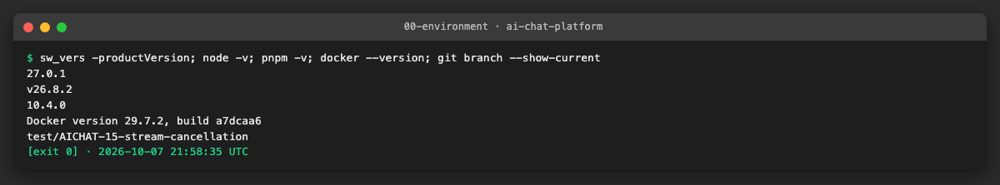
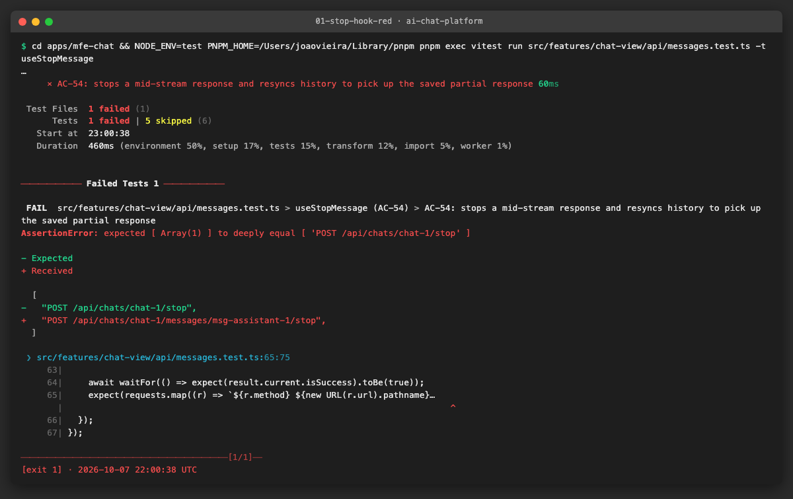
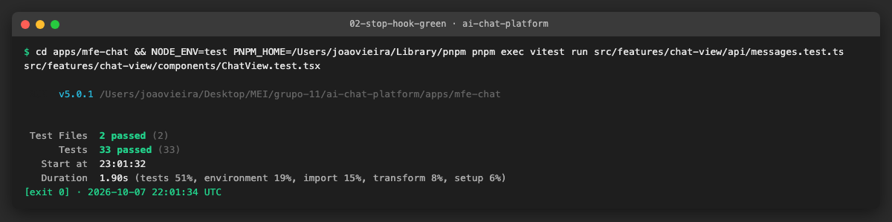
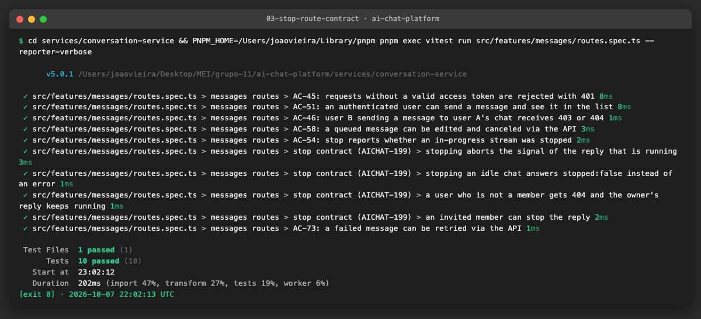
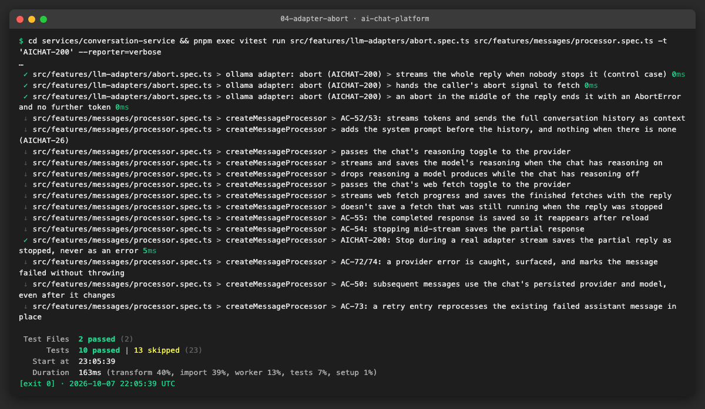

# AICHAT-15 · Stream cancellation testing: work log

| Field | Value |
|---|---|
| Epic | [AICHAT-15](https://ipca-grupo11.atlassian.net/browse/AICHAT-15) |
| Analysis | [README.md](README.md) |
| Owner | João Vieira |
| Branch | `test/AICHAT-15-stream-cancellation` |
| Started / finished | 2026-10-07 / … |
| Pull requests | … |
| Status | In Progress |

## 1. DoR review

Date: 2026-10-07

| DoR item | Status | Question asked | Decision | Decided by |
|---|---|---|---|---|
| Owner assigned | Met | — | João Vieira | — |
| Scope and tooling agreed | Met | Tooling for the cancellation chain | Vitest + supertest for hook, route, queue, processor and adapters; mock server (AICHAT-144) for the upstream close; Playwright against `pnpm mock:up` for the UI | João Vieira |
| Target environment available | Met (partly) | — | Unit and service tests run locally without Docker. E2E stories (US5, US6) need Docker Desktop running for `pnpm mock:up` | — |
| Mock LLM server that records connection close | Partly met | AICHAT-144 status | The mock aborts its stream when the client leaves (`testing/mock-server/src/llm/sse.ts`) but does not log it. US3 adds the log entry | João Vieira |

Decisions:

| Topic | Decision |
|---|---|
| Stop URL mismatch | Fix the client: `useStopMessage` calls `POST /chats/:chatId/stop`. No second server route |
| Navigating away (AC-60/61 conflict) | Switching chats and closing the tab keep the reply running and saved (current design). **Logout** stops the user's running replies. The epic DoD "navigating away aborts" is read as "logout aborts" |
| Stopped state after reload | New boolean column `stopped` on `Message` (Prisma migration) and in the message DTO. Partial text is kept |
| Partial text on stop | Kept (current processor behaviour) |

Blockers: none. Docker Desktop must be started before US5/US6.

## 2. Environment



| Tool | Version | Install |
|---|---|---|
| macOS | 27.0.1 | — |
| Node | v26.8.2 | nvm |
| pnpm | 10.4.0 (pinned in `package.json`) | `pnpm install --frozen-lockfile` |
| Docker | 29.7.2 | Docker Desktop |
| Vitest | 5.0.1 | workspace dev dependency |

First run on a fresh clone: the shared packages and the Prisma clients must be built before the service and MFE tests can
import them:

```sh
pnpm install --frozen-lockfile
pnpm --filter "./packages/**" --if-present build
pnpm --filter @app/conversation-service prisma:generate
pnpm --filter @app/auth-service prisma:generate
```

Baseline before any change: conversation-service 68 files / 546 tests, mfe-chat 44 files / 380 tests, all passing.

## 3. Steps

### US1 · Fix and test the Stop endpoint contract ([AICHAT-199](https://ipca-grupo11.atlassian.net/browse/AICHAT-199))

**What and why.** The Stop button in mfe-chat called `POST /chats/:chatId/messages/:messageId/stop`, but conversation-service
only exposes `POST /chats/:chatId/stop` (`features/messages/routes.ts`). Stop therefore reached no route on the real server.
No test caught it because every frontend mock described the client's path instead of the server's:

- the shared MSW handlers (`packages/test-utils/src/msw/handlers.ts`) answered **both** paths,
- the hook test (`messages.test.ts`) and the component test (`ChatView.test.tsx`) registered the wrong path themselves.

A mock only proves something when it matches the real provider. We first changed the hook test to the server's route and saw
it fail (red), then fixed the client (green), removed the non-existent route from every mock, and added the missing server
cases of the stop contract.

**Files.**
- `apps/mfe-chat/src/features/chat-view/api/messages.ts`: `useStopMessage` calls `POST /chats/:chatId/stop`; `messageId`
  stays in the input (it identifies the clicked bubble) but is not sent.
- `apps/mfe-chat/src/features/chat-view/api/messages.test.ts`: the test pins the exact request list `["POST /api/chats/chat-1/stop"]`.
- `apps/mfe-chat/src/features/chat-view/components/ChatView.test.tsx`: Stop click asserts the real route.
- `packages/test-utils/src/msw/handlers.ts` and `handlers.test.ts`: the handler for the non-existent route is removed, so a
  call to it now fails any test (`onUnhandledRequest: "error"`).
- `services/conversation-service/src/features/messages/routes.spec.ts`: new block "stop contract (AICHAT-199)": the running
  reply's `AbortSignal` is aborted; an idle chat answers `{ stopped: false }`; a non-member gets 404 `CHAT_NOT_FOUND` **and the
  owner's reply keeps running**; an invited member can stop.

**How to run.**

```sh
pnpm exec nx run-many -t test -p mfe-chat conversation-service test-utils
```

**How to repeat it manually.**

1. In `apps/mfe-chat/src/features/chat-view/api/messages.ts`, put back the old path
   `` `/chats/${chatId}/messages/${messageId}/stop` ``.
2. Run `cd apps/mfe-chat && NODE_ENV=test pnpm exec vitest run src/features/chat-view/api/messages.test.ts -t useStopMessage`.
3. Expected output: the test fails and shows the wrong path next to `POST /api/chats/chat-1/stop`. Restore the line.
4. To check that the security case is real: in `services/conversation-service/src/features/messages/service.ts`, remove the
   `getAccessible` call in `stop()` and run `routes.spec.ts`. Expected: "a user who is not a member gets 404…" fails with
   `expected 200 to be 404`. Restore the line.

**Result.** Red before the fix, green after:







Full run after the change: conversation-service 68 files, mfe-chat 44 files, test-utils 5 files; test, lint and typecheck pass.

**Problems and fixes.**
- Fresh clone: the shared packages (`@app/shared-types`, `@app/ui`) and the Prisma clients must be built before the tests can
  import them (see §2).
- Found while doing this story, out of scope here: `useUploadAttachment` posts to `/chats/:chatId/attachments`, but the
  server route is `/chats/:chatId/messages/:messageId/attachments`, and the shared MSW handler again copies the client's path.
  Same class of defect; handed to AICHAT-11 (AICHAT-179, consumer pact for the upload).

### US2 · Abort propagates to the provider adapters and http-stream ([AICHAT-200](https://ipca-grupo11.atlassian.net/browse/AICHAT-200))

**What and why.** Stopping a reply is a chain: `POST /chats/:chatId/stop` → `QueueManager.stop` → `ChatQueue.stopActive()`
aborts an `AbortController` → the processor passes its `signal` to the provider adapter → the adapter passes it to `fetch`.
`readLines()` in `http-stream.ts` takes no signal: the abort reaches the read loop because real `fetch` errors the response
body with an `AbortError` when its signal aborts, so the pending `reader.read()` rejects and the `finally` releases the reader.

The existing tests covered an abort **before** the response (fetch rejects) for all three adapters, and an errored body for
Ollama. Nothing checked that the adapters hand **our** signal to fetch, or what happens when Stop is pressed in the middle of
an OpenAI or Anthropic reply. The old helper `mockStreamResponse` ignores the signal, so it could not show either.

We added `mockAbortableStreamResponse(chunks, signal)`, a body that behaves like real fetch: one chunk per read
(`highWaterMark: 0`, nothing read ahead) and, on abort, the body is errored with an `AbortError`, which drops queued chunks.

**Files.**
- `services/conversation-service/src/test-utils/mock-stream.ts`: `mockAbortableStreamResponse` (new helper).
- `services/conversation-service/src/features/llm-adapters/abort.spec.ts` (new): `describe.each` over OpenAI, Anthropic and
  Ollama, each with its own wire format. Per adapter: control case (no Stop, the whole reply streams), the signal given to
  fetch is the caller's signal, and an abort after the first token ends the stream with an `AbortError`, emits no further
  token and leaves the body unlocked.
- `services/conversation-service/src/features/messages/processor.spec.ts`: one chain test with the real `AnthropicProvider`:
  Stop when the first token reaches the event bus → only that token is streamed, no `error` event, the last event is
  `done { stopped: true }` and the partial text is saved.

**How to run.**

```sh
cd services/conversation-service && pnpm exec vitest run src/features/llm-adapters/abort.spec.ts src/features/messages/processor.spec.ts
```

**How to repeat it manually.**

1. In `services/conversation-service/src/features/llm-adapters/openai.provider.ts`, delete the line `signal: options.signal,`.
2. Run `pnpm exec vitest run src/features/llm-adapters/abort.spec.ts -t openai` in `services/conversation-service`.
3. Expected output: two failures, `expected undefined to be AbortSignal` and `promise resolved "undefined" instead of
   rejecting`: without the signal the whole reply is generated even though Stop was pressed. Restore the line.

**Result.** 9 adapter tests (3 per provider) and the chain test pass; conversation-service 69 files, test, lint and
typecheck pass.



**Problems and fixes.** None. The adapters were already correct; the gap was in the tests, which could not have detected a
missing signal.
