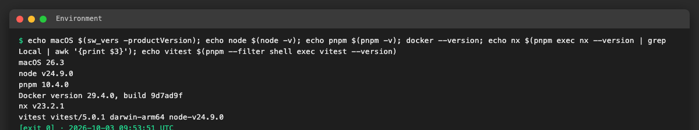

# AICHAT-17 · [Foundations] Unit testing: work log

| Field | Value |
|---|---|
| Epic | [AICHAT-17](https://ipca-grupo11.atlassian.net/browse/AICHAT-17) |
| Analysis | [README.md](README.md) |
| Owner | Jean-Pierre Carvalho |
| Branch | `test/AICHAT-17-unit-testing` |
| Started / finished | 2026-10-03 / — |
| Pull requests | #… |
| Status | In Progress |

## 1. DoR review

Date: 2026-10-03

| DoR item | Status | Question asked | Decision | Decided by |
|---|---|---|---|---|
| Owner assigned | Met | — | Jean-Pierre Carvalho (epic and all 14 stories) | — |
| Scope agreed | Met | Whole repo per MFE and microservice, the original Jira wording, or MFEs + services only? | **Every source file**, delivered per project: shell, mfe-auth, mfe-chat, mfe-settings, auth-service, conversation-service, plus shared packages and e2e helpers. Bootstrap, barrel and type-only files go on the exempt list (AICHAT-36) | JP |
| Tooling agreed | Met | Adopt MSW now, keep hand-written `fetch` stubs, or decide in a spike? | Vitest + Testing Library (`render`, `renderHook`) + supertest. **MSW decided in the time-boxed spike AICHAT-135** | JP |
| Capability parity (AICHAT-133) | Met | JSON export, move the tables to `packages/shared-types`, or a test-only cross import? | **Move the capability tables to `packages/shared-types`** as the single source of truth for mfe-chat and conversation-service (small app change, accepted) | JP |
| Target environment available | Met | Local, CI, VM? | **Local + GitHub Actions**: develop and capture evidence locally; `ci.yml` (`nx affected -t test`) is the gate on each PR | JP |
| Files to cover listed | Met | — | Inventory in README §4 (246 files; 49 without a test) | — |

Blockers: none. Note: the DoD item "meets the AICHAT-34 coverage thresholds" depends on AICHAT-34.

## 2. Environment

| Tool | Version | Install |
|---|---|---|
| macOS | 26.3 | — |
| Node | v24.9.0 | `nvm install 24` |
| pnpm | 10.4.0 | `corepack enable` |
| Docker | 29.4.0 | Docker Desktop (not needed for unit tests) |
| Nx | 23.2.1 | `pnpm install` (workspace dependency) |
| Vitest | 5.0.1 | `pnpm install` (workspace dependency) |



## 3. Steps

### US1 · <story summary> ([AICHAT-<key>](https://ipca-grupo11.atlassian.net/browse/AICHAT-<key>))

**What and why.** …

**Files.**
- `path/to/file` (new): …

**How to run.**

```sh
<one command from the repo root>
```

**How to repeat it manually.**

1. …
2. …
3. Expected output: …

**Result.** …


**Problems and fixes.** …

### US2 · …

## 4. How to run everything

```sh
# all checks added by this epic, from the repo root
```

## 5. Results

| Metric | Before | After |
|---|---|---|
| … | … | … |

## 6. DoD check

| DoD item | Met | Evidence |
|---|---|---|
| … | ✅ | [link](evidence/…) |

## 7. Notes for the report

- What was found
- What was fixed / waived
- Lessons learned
