# AICHAT-17 · Unit testing: work log

| Field | Value |
|---|---|
| Epic | [AICHAT-17](https://ipca-grupo11.atlassian.net/browse/AICHAT-17) |
| Analysis | [README.md](README.md) |
| Owner | Jean-Pierre Carvalho |
| Branch | `test/AICHAT-17-unit-testing` |
| Started / finished | 2026-10-03 / … |
| Pull requests | #… |
| Status | In Progress |

## 1. DoR review

Date: 2026-10-03

| DoR item | Status | Question asked | Decision | Decided by |
|---|---|---|---|---|
| Owner assigned | Met | — | Jean-Pierre Carvalho | — |
| Scope agreed | Met | Whole repo or only hooks, utils and capability tables? | Whole repo: every source file in `apps/*/src`, `packages/*`, `services/*/src` and `e2e/src`; exempt only bootstrap files, barrel `index` files and type-only modules, one reason each in `unit-test-exempt.json` (plan decision D2). Jira epic text updated | Owner |
| Tooling agreed | Met | Vitest + Testing Library + supertest; MSW or hand-written `fetch` stubs? | Vitest, Testing Library (`render`, `renderHook`), supertest; **MSW adopted**: handlers for auth, chats, messages and settings replace the hand-written stubs | Owner |
| Target environment available | Met | Where does it run? | Locally and in GitHub Actions (`nx affected -t test`); the e2e suite is not run for this epic (too slow, now manual-only) | Owner |
| Capability parity (AICHAT-133) | Met | Test reads both tables, or one shared table? | Move the model capability table to `packages/shared-types`, used by both mfe-chat and conversation-service | Owner |

Blockers: none

## 2. Environment

| Tool | Version | Install |
|---|---|---|
| macOS / Ubuntu | … | — |
| Node | `node -v` → … | … |
| pnpm | `pnpm -v` → … | `corepack enable` |
| Docker | `docker --version` → … | … |
| Vitest / MSW | see `package.json` of each project | `pnpm install` |

## 3. Steps

### US1 · Agree unit-test policy and exempt list ([AICHAT-36](https://ipca-grupo11.atlassian.net/browse/AICHAT-36))

**What and why.** The per-project teams will work in parallel on top of this, so the rule and the list of exceptions have to be
fixed first and in one place. We wrote the policy ("every source file has a co-located unit test unless it is on the exempt
list"), listed every source file of the repository with one script, and wrote the complete exempt list for the whole repository
now, so nobody has to edit it later and the teams do not get merge conflicts on it. Only three categories can be exempt
(bootstrap, barrel `index` files, type-only modules), as decided for the epic.

**Files.**
- `docs/AICHAT-17/UNIT-TEST-POLICY.md` (new): the policy, the source-file rules, the three exempt categories, the list format, who edits it. Linked from the epic README.
- `packages/workspace-config/unit-test-exempt.json` (new): 50 entries, each with `path`, `category` and one `reason`. It sits in `workspace-config` so the guard of AICHAT-138 can read it.
- `scripts/unit-test/source-files.mjs` (new): lists the source files with the rules of README section 4.1, shows which have a test or an entry, and `--check` validates the exempt list (exit 1 on a stale path, a missing reason, an unknown category, or an exempt file that now has a test).
- `docs/AICHAT-17/README.md`: link to the policy and the list.

**How to run.**

```sh
node scripts/unit-test/source-files.mjs --check   # validates the exempt list
node scripts/unit-test/source-files.mjs           # per project: files, own test, exempt, neither
node scripts/unit-test/source-files.mjs --list | grep NO-TEST   # what is left to test
```

**How to repeat it manually.**

1. From the repository root run `node scripts/unit-test/source-files.mjs --check`.
2. Open `packages/workspace-config/unit-test-exempt.json` and pick an entry: its file must exist and have no `*.test.*` / `*.spec.*` next to it.
3. Expected output: `245 source files, 50 exempt entries, 0 problems`, exit code 0. Add a test next to an exempt file and the check fails with "exempt but has its own test".

**Result.** 245 source files: 131 have their own test, 50 are exempt (35 barrels, 14 bootstrap, 1 type-only) and 64 still need a
test. Those 64 are the work of the per-project stories.

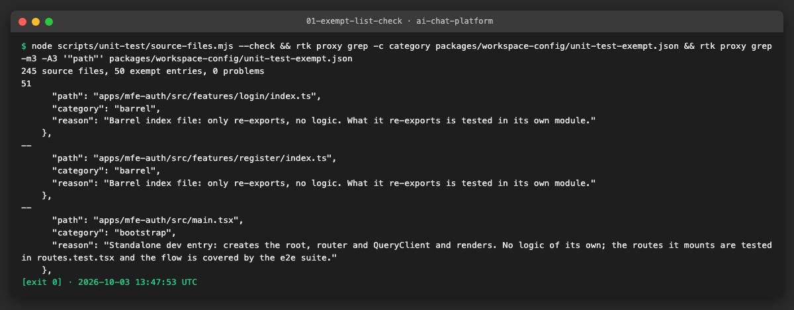

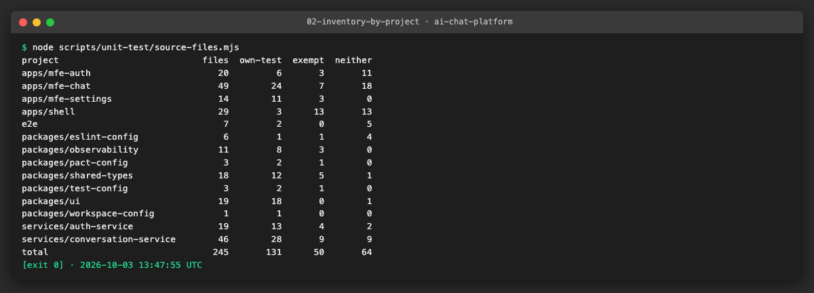

**Problems and fixes.**
- The discovery in the README says 246 files; the script finds 245. One helper file in `auth-service` was counted there and is a test helper under the rules. The policy states the real number.
- The README expected "category C" (type-only) to hold two contract files. Both export Zod schemas, constants and functions, so they are not type-only and need tests. Only `shell/.../auth-guard/model/session.ts` (two interfaces) is type-only.
- Shell route files were checked one by one: five are pure wiring and exempt; `index.tsx` (redirect) and `login.tsx` (`validateSearch`) have logic and stay on the to-test list.
- `features/login/model.ts` and `features/register/model.ts` only re-export, but they are not `index` files, so they are not exempt. A short test is enough.

### US2 · Shared render and hook test helpers for the MFEs ([AICHAT-51](https://ipca-grupo11.atlassian.net/browse/AICHAT-51))

**What and why.** Every MFE had its own copy of the same boilerplate: a `QueryClient` with retries off wrapped around `render`
(`renderWithQueryClient` in mfe-auth and mfe-settings, `withQueryClient` in mfe-chat, a hand-made client in four more tests) and
three different fake `EventSource` classes. We moved them into one small workspace package, `@platform/test-utils`, that every
MFE can import. The per-project stories now write `renderWithClient(<X />)` instead of repeating the setup.

**Files.**
- `packages/test-utils/` (new package, tagged `type:package`, plain TypeScript source with no build step, own tests, 100% lines):
  - `src/render.tsx`: `renderWithClient`, `renderHookWithClient`, `createTestQueryClient`, `withQueryClient`.
  - `src/fake-event-source.ts`: `FakeEventSource` and `installFakeEventSource()`, extracted from `ChatView.test.tsx` and `stream-registry.test.ts`.
  - `README.md`: how to use it.
- `apps/{mfe-auth,mfe-chat,mfe-settings,shell}/package.json`: `@platform/test-utils` and `msw` as dev dependencies; `pnpm-lock.yaml`.
- Tests migrated (20 files that built a client or an `EventSource` by hand): the three `mfe-auth` specs, five `mfe-settings` tests, and twelve `mfe-chat` tests (`ChatView`, `routes`, `stream-registry`, `ChatList`, `Composer`, `MembersDialog`, `MessageQueue`, `chats`, `messages`, `useComposer`, `useMessageStream`, `usePendingAttachments`).
- Removed: `apps/mfe-auth/src/shared/test/render.tsx`, `apps/mfe-settings/src/shared/test/render.tsx`, and the client helpers in `apps/mfe-chat/src/test/utils.tsx`.

**How to run.**

```sh
pnpm exec nx run test-utils:test                        # the helpers' own tests, with coverage
pnpm exec nx run-many -t test -p mfe-auth mfe-chat mfe-settings   # the migrated tests
```

**How to repeat it manually.**

1. Open `apps/mfe-chat/src/features/chat-view/model/stream-registry.test.ts`: it has no `FakeEventSource` class of its own, it calls `installFakeEventSource()` and `FakeEventSource.instances[0]!.emit("token", ...)`.
2. Open `apps/mfe-auth/src/features/login/components/LoginForm.spec.tsx`: `renderWithClient(<LoginForm />)`, no local render helper.
3. Run the two commands above. Expected: `test-utils` 51 tests green, 100% statements; mfe-auth 22, mfe-chat 122, mfe-settings 53 tests green.

**Result.** The helpers exist, are tested, and 20 existing test files use them (the AC asks for 3). There is one place to change
how tests render, and one fake `EventSource` that can also send a transport error (`emitTransportError()`).

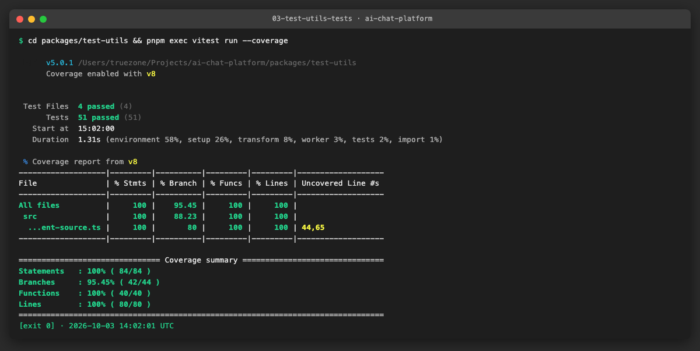

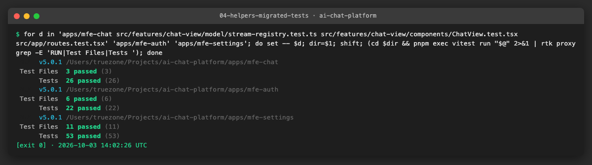

**Problems and fixes.**
- The package imports `react`, `@tanstack/react-query` and Testing Library. They are peer dependencies (and dev dependencies, for its own tests), so every app keeps a single copy.
- `ChatView.test.tsx` and `routes.test.tsx` used a no-op `EventSource`; they now call `installFakeEventSource()` too, so one class covers both the quiet and the recording case.
- The transport-error case in `stream-registry.test.ts` reached into a private `listeners` field; it now calls `emitTransportError()`.

### US3 · Spike: evaluate MSW for HTTP mocking in the MFEs ([AICHAT-135](https://ipca-grupo11.atlassian.net/browse/AICHAT-135))

**What and why.** The MFE tests answered every request with `vi.stubGlobal("fetch", vi.fn()...)`. A stub like that cannot tell a right
request from a wrong one: if the code calls the wrong URL or method, the test still passes. We tried MSW v2 and decided to
**adopt it** (decision recorded in [README §7.1](README.md)): handlers answer by method and path, and a request without a handler
fails the test. The default handlers cover auth, chats (and members), messages (and queue actions, attachments) and settings (test
connection), and build their bodies with the `@platform/mock-server` factories, mapped to the DTOs conversation-service sends.

**Files.**
- `packages/test-utils/src/msw/handlers.ts`, `fixtures.ts`, `dto.ts`, `server.ts`, `index.ts` (new): the shared handlers, data and server, with tests (`handlers.test.ts`, `dto.test.ts`).
- `packages/test-utils/src/setup.ts` (new): Vitest setup that starts the server with `onUnhandledRequest: "error"`.
- `apps/*/vite.config.ts`: `"@platform/test-utils/setup"` added to `setupFiles` in the four apps.
- `apps/{mfe-auth,mfe-chat,mfe-settings}/tsconfig.json`: `"node"` added to `types` (the mock-server factories import a module that uses `node:crypto`).
- `apps/*/Dockerfile`: one `COPY testing/mock-server/package.json` line in the install stage, so `pnpm install --frozen-lockfile` links the workspace dependency and the app image still builds (checked with a real `docker build` of mfe-auth).
- 17 test files rewritten to use `server.use(...)` and `recordRequests()`; `apps/mfe-chat/src/test/utils.tsx` deleted (only `jsonResponse` was left).
- `docs/AICHAT-17/README.md`: decision; `packages/test-utils/README.md`: API.

**How to run.**

```sh
pnpm exec nx run-many -t test -p test-utils mfe-auth mfe-chat mfe-settings shell
git grep -h 'stubGlobal("fetch"' -- apps packages e2e | wc -l   # 0
```

**How to repeat it manually.**

1. In a test file of any MFE write `await fetch("/chats/x/unknown")` and run it. Expected: the test fails with `[MSW] Cannot bypass a request when using the "error" strategy`.
2. Open `apps/mfe-auth/src/features/login/components/LogoutButton.spec.tsx`: the test checks `POST /auth/logout` with `recordRequests()`; change the path in `LogoutButton` and the test fails (the old stub would still pass).
3. Run the commands above. Expected: all four apps green; the `git grep` prints 0.

**Result.** All 54 `vi.stubGlobal("fetch")` calls in 19 test files are gone (the discovery had estimated ~23). Two single-call
`vi.spyOn(globalThis, "fetch")` remain, each with a comment: the upload test (Node `fetch` cannot send a jsdom `FormData` with a
jsdom `File`) and the `TestConnectionButton` fallback test (the code under test must see something that is not a response).
Nothing is left over for the per-project stories on the MFE side; the shell has no `fetch` stubs.

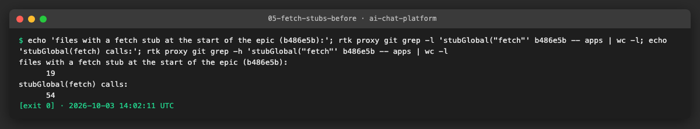

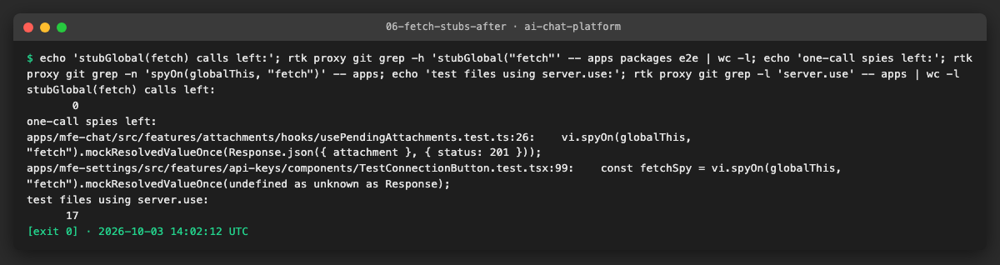

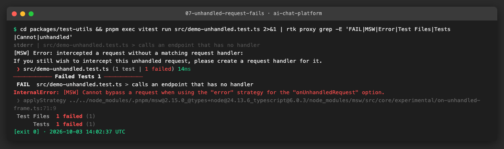

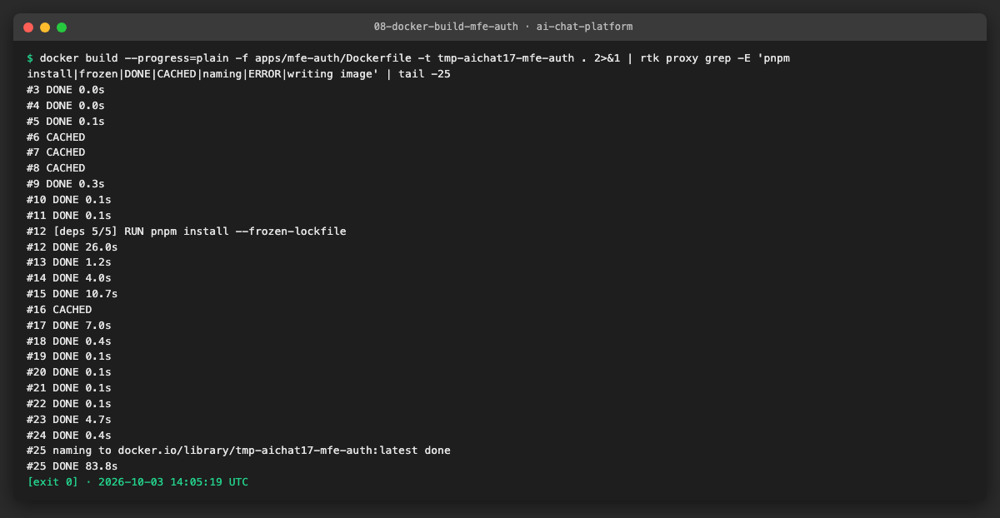

**Problems and fixes.**
- Relative URLs (`/auth/me`, `/api/chats`) work in jsdom: MSW resolves them against `location`. Handler paths start with `*` so any base URL matches.
- One test passed by accident with the old stub: the `TestConnectionButton` "fallback toast" relied on `fetch` returning `undefined`, which is not what the test says it checks. Also, the old stubs returned bare arrays where the service sends `{ chats }`; the new handlers use the real envelope. The fallback test now says plainly what it forces.
- Several tests asserted `expect(fetch).toHaveBeenCalledTimes(n)`. They now compare the list of `METHOD /path` strings from `recordRequests()`, which also checks the order.
- `@platform/mock-server` is tagged `type:service`/`projectType: application`, so the module-boundary rule rejects the import from a `type:package`. The single import carries an `eslint-disable-next-line` with the reason (the data entry has no server code); the alternative, retagging the mock server, belongs to the AICHAT-144 owners.
- The image builds of the four apps copy only `packages/`; without the extra `COPY` of the mock-server `package.json` the new dependency would be a dangling link and `tsc` (which includes the tests) would fail inside Docker.

## 4. How to run everything

```sh
# all checks added by this epic, from the repository root
node scripts/unit-test/source-files.mjs --check                       # exempt list is valid (US1)
pnpm exec nx run-many -t test -p test-utils mfe-auth mfe-chat mfe-settings shell   # helpers and MSW (US2, US3)
git grep -h 'stubGlobal("fetch"' -- apps packages e2e | wc -l          # 0 (US3)
```

## 5. Results

Foundation stories only (US1 to US3); the per-project stories add their rows.

| Metric | Before | After |
|---|---|---|
| Source files in scope (README §4.1) | 246 (discovery) | 245 (script count) |
| Source files with their own unit test | 130 | 131 |
| Exempt list entries | none | 50 (35 barrels, 14 bootstrap, 1 type-only) |
| Source files still without a test or an entry | 49 plus 30 indirect | 64 (the per-project work) |
| `vi.stubGlobal("fetch", ...)` calls in the MFE tests | 54 in 19 files | 0 (two one-call spies with a reason) |
| Hand-made `QueryClient` / `EventSource` helpers in the MFEs | 3 render helpers, 3 fake `EventSource` classes | 1 package, `@platform/test-utils` |

Gates run before the foundation stories were handed over (all green):

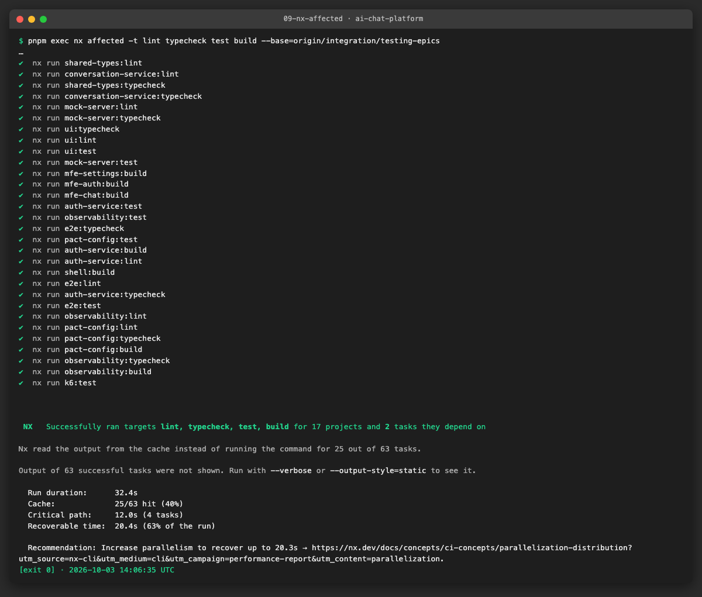

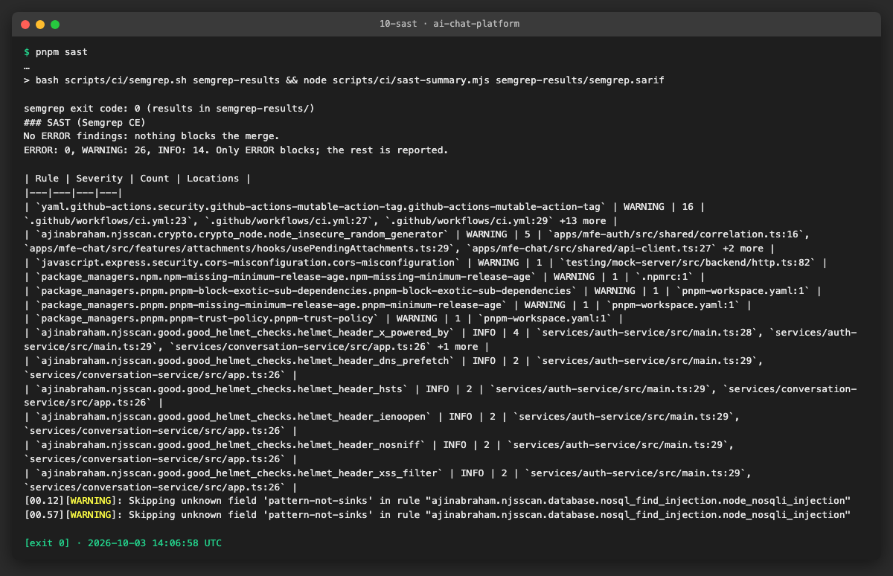

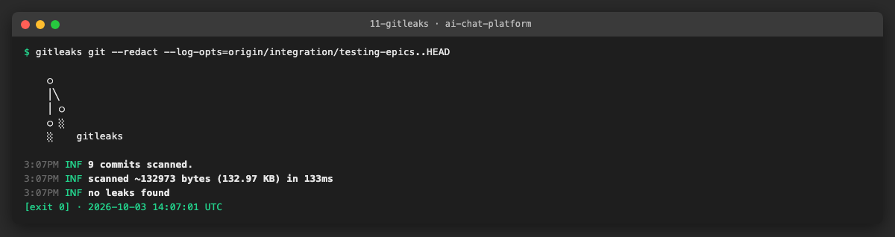

## 6. DoD check

| DoD item | Met | Evidence |
|---|---|---|
| … | ✅ | [link](evidence/…) |

## 7. Notes for the report

- What was found
- What was fixed / waived
- Lessons learned
