# AICHAT-17 · Unit testing: work log

| Field | Value |
|---|---|
| Epic | [AICHAT-17](https://ipca-grupo11.atlassian.net/browse/AICHAT-17) |
| Analysis | [README.md](README.md) |
| Owner | Jean-Pierre Carvalho |
| Branch | `test/AICHAT-17-unit-testing` |
| Started / finished | 2026-10-03 / 2026-10-03 |
| Pull requests | #… |
| Status | In Progress |

## 1. DoR review

Date: 2026-10-03

| DoR item | Status | Question asked | Decision | Decided by |
|---|---|---|---|---|
| Owner assigned | Met | — | Jean-Pierre Carvalho | — |
| Scope agreed | Met | Whole repo or only hooks, utils and capability tables? | Whole repo: every source file in `apps/*/src`, `packages/*`, `services/*/src` and `e2e/src`; exempt only bootstrap files, barrel `index` files and type-only modules, one reason each in `unit-test-exempt.json` (plan decision D2). Jira epic text updated | Owner |
| Tooling agreed | Met | Vitest + Testing Library + supertest; MSW or hand-written `fetch` stubs? | Vitest, Testing Library (`render`, `renderHook`), supertest; **MSW adopted**: handlers for auth, chats, messages and settings replace the hand-written stubs | Owner |
| Target environment available | Met | Where does it run? | Locally and in GitHub Actions (`nx affected -t test`); the e2e suite is not run for this epic (too slow, now manual-only) | Owner |
| Capability parity (AICHAT-133) | Met | Test reads both tables, or one shared table? | Move the model capability table to `packages/shared-types`, used by both mfe-chat and conversation-service | Owner |

Blockers: none

## 2. Environment

| Tool | Version | Install |
|---|---|---|
| macOS / Ubuntu | macOS 26.3 (CI: Ubuntu) | — |
| Node | `node -v` → v24.21.0 | `nvm install` (version in `.nvmrc`) |
| pnpm | `pnpm -v` → 10.4.0 | `corepack enable` |
| Docker | `docker --version` → 29.4.0 | Docker Desktop |
| Vitest / MSW | see `package.json` of each project | `pnpm install` |

## 3. Steps

### US1 · Agree unit-test policy and exempt list ([AICHAT-36](https://ipca-grupo11.atlassian.net/browse/AICHAT-36))

**What and why.** The per-project teams will work in parallel on top of this, so the rule and the list of exceptions have to be
fixed first and in one place. We wrote the policy ("every source file has a co-located unit test unless it is on the exempt
list"), listed every source file of the repository with one script, and wrote the complete exempt list for the whole repository
now, so nobody has to edit it later and the teams do not get merge conflicts on it. Only three categories can be exempt
(bootstrap, barrel `index` files, type-only modules), as decided for the epic.

**Files.**
- `docs/AICHAT-17/UNIT-TEST-POLICY.md` (new): the policy, the source-file rules, the three exempt categories, the list format, who edits it. Linked from the epic README.
- `packages/workspace-config/unit-test-exempt.json` (new): 50 entries, each with `path`, `category` and one `reason`. It sits in `workspace-config` so the guard of AICHAT-138 can read it.
- `scripts/unit-test/source-files.ts` (new): lists the source files with the rules of README section 4.1, shows which have a test or an entry, and `--check` validates the exempt list (exit 1 on a stale path, a missing reason, an unknown category, or an exempt file that now has a test).
- `docs/AICHAT-17/README.md`: link to the policy and the list.

**How to run.**

```sh
node scripts/unit-test/source-files.ts --check   # validates the exempt list
node scripts/unit-test/source-files.ts           # per project: files, own test, exempt, neither
node scripts/unit-test/source-files.ts --list | grep NO-TEST   # what is left to test
```

**How to repeat it manually.**

1. From the repository root run `node scripts/unit-test/source-files.ts --check`.
2. Open `packages/workspace-config/unit-test-exempt.json` and pick an entry: its file must exist and have no `*.test.*` / `*.spec.*` next to it.
3. Expected output: `245 source files, 50 exempt entries, 0 problems`, exit code 0. Add a test next to an exempt file and the check fails with "exempt but has its own test".

**Result.** 245 source files: 131 have their own test, 50 are exempt (35 barrels, 14 bootstrap, 1 type-only) and 64 still need a
test. Those 64 are the work of the per-project stories.


**Problems and fixes.**
- The discovery in the README says 246 files; the script finds 245. One helper file in `auth-service` was counted there and is a test helper under the rules. The policy states the real number.
- The README expected "category C" (type-only) to hold two contract files. Both export Zod schemas, constants and functions, so they are not type-only and need tests. Only `shell/.../auth-guard/model/session.ts` (two interfaces) is type-only.
- Shell route files were checked one by one: five are pure wiring and exempt; `index.tsx` (redirect) and `login.tsx` (`validateSearch`) have logic and stay on the to-test list.
- `features/login/model.ts` and `features/register/model.ts` only re-export, but they are not `index` files, so they are not exempt. A short test is enough.

### US2 · Shared render and hook test helpers for the MFEs ([AICHAT-51](https://ipca-grupo11.atlassian.net/browse/AICHAT-51))

**What and why.** Every MFE had its own copy of the same boilerplate: a `QueryClient` with retries off wrapped around `render`
(`renderWithQueryClient` in mfe-auth and mfe-settings, `withQueryClient` in mfe-chat, a hand-made client in four more tests) and
three different fake `EventSource` classes. We moved them into one small workspace package, `@platform/test-utils`, that every
MFE can import. The per-project stories now write `renderWithClient(<X />)` instead of repeating the setup.

**Files.**
- `packages/test-utils/` (new package, tagged `type:package`, plain TypeScript source with no build step, own tests, 100% lines):
  - `src/render.tsx`: `renderWithClient`, `renderHookWithClient`, `createTestQueryClient`, `withQueryClient`.
  - `src/fake-event-source.ts`: `FakeEventSource` and `installFakeEventSource()`, extracted from `ChatView.test.tsx` and `stream-registry.test.ts`.
  - `README.md`: how to use it.
- `apps/{mfe-auth,mfe-chat,mfe-settings,shell}/package.json`: `@platform/test-utils` and `msw` as dev dependencies; `pnpm-lock.yaml`.
- Tests migrated (20 files that built a client or an `EventSource` by hand): the three `mfe-auth` specs, five `mfe-settings` tests, and twelve `mfe-chat` tests (`ChatView`, `routes`, `stream-registry`, `ChatList`, `Composer`, `MembersDialog`, `MessageQueue`, `chats`, `messages`, `useComposer`, `useMessageStream`, `usePendingAttachments`).
- Removed: `apps/mfe-auth/src/shared/test/render.tsx`, `apps/mfe-settings/src/shared/test/render.tsx`, and the client helpers in `apps/mfe-chat/src/test/utils.tsx`.

**How to run.**

```sh
pnpm exec nx run test-utils:test                        # the helpers' own tests, with coverage
pnpm exec nx run-many -t test -p mfe-auth mfe-chat mfe-settings   # the migrated tests
```

**How to repeat it manually.**

1. Open `apps/mfe-chat/src/features/chat-view/model/stream-registry.test.ts`: it has no `FakeEventSource` class of its own, it calls `installFakeEventSource()` and `FakeEventSource.instances[0]!.emit("token", ...)`.
2. Open `apps/mfe-auth/src/features/login/components/LoginForm.spec.tsx`: `renderWithClient(<LoginForm />)`, no local render helper.
3. Run the two commands above. Expected: `test-utils` 51 tests green, 100% statements; mfe-auth 22, mfe-chat 122, mfe-settings 53 tests green.

**Result.** The helpers exist, are tested, and 20 existing test files use them (the AC asks for 3). There is one place to change
how tests render, and one fake `EventSource` that can also send a transport error (`emitTransportError()`).


**Problems and fixes.**
- The package imports `react`, `@tanstack/react-query` and Testing Library. They are peer dependencies (and dev dependencies, for its own tests), so every app keeps a single copy.
- `ChatView.test.tsx` and `routes.test.tsx` used a no-op `EventSource`; they now call `installFakeEventSource()` too, so one class covers both the quiet and the recording case.
- The transport-error case in `stream-registry.test.ts` reached into a private `listeners` field; it now calls `emitTransportError()`.

### US3 · Spike: evaluate MSW for HTTP mocking in the MFEs ([AICHAT-135](https://ipca-grupo11.atlassian.net/browse/AICHAT-135))

**What and why.** The MFE tests answered every request with `vi.stubGlobal("fetch", vi.fn()...)`. A stub like that cannot tell a right
request from a wrong one: if the code calls the wrong URL or method, the test still passes. We tried MSW v2 and decided to
**adopt it** (decision recorded in [README §7.1](README.md)): handlers answer by method and path, and a request without a handler
fails the test. The default handlers cover auth, chats (and members), messages (and queue actions, attachments) and settings (test
connection), and build their bodies with the `@platform/mock-server` factories, mapped to the DTOs conversation-service sends.

**Files.**
- `packages/test-utils/src/msw/handlers.ts`, `fixtures.ts`, `dto.ts`, `server.ts`, `index.ts` (new): the shared handlers, data and server, with tests (`handlers.test.ts`, `dto.test.ts`).
- `packages/test-utils/src/setup.ts` (new): Vitest setup that starts the server with `onUnhandledRequest: "error"`.
- `apps/*/vite.config.ts`: `"@platform/test-utils/setup"` added to `setupFiles` in the four apps.
- `apps/{mfe-auth,mfe-chat,mfe-settings}/tsconfig.json`: `"node"` added to `types` (the mock-server factories import a module that uses `node:crypto`).
- `apps/*/Dockerfile`: one `COPY testing/mock-server/package.json` line in the install stage, so `pnpm install --frozen-lockfile` links the workspace dependency and the app image still builds (checked with a real `docker build` of mfe-auth).
- 17 test files rewritten to use `server.use(...)` and `recordRequests()`; `apps/mfe-chat/src/test/utils.tsx` deleted (only `jsonResponse` was left).
- `docs/AICHAT-17/README.md`: decision; `packages/test-utils/README.md`: API.

**How to run.**

```sh
pnpm exec nx run-many -t test -p test-utils mfe-auth mfe-chat mfe-settings shell
git grep -h 'stubGlobal("fetch"' -- apps packages e2e | wc -l   # 0
```

**How to repeat it manually.**

1. In a test file of any MFE write `await fetch("/chats/x/unknown")` and run it. Expected: the test fails with `[MSW] Cannot bypass a request when using the "error" strategy`.
2. Open `apps/mfe-auth/src/features/login/components/LogoutButton.spec.tsx`: the test checks `POST /auth/logout` with `recordRequests()`; change the path in `LogoutButton` and the test fails (the old stub would still pass).
3. Run the commands above. Expected: all four apps green; the `git grep` prints 0.

**Result.** All 54 `vi.stubGlobal("fetch")` calls in 19 test files are gone (the discovery had estimated ~23). Two single-call
`vi.spyOn(globalThis, "fetch")` remain, each with a comment: the upload test (Node `fetch` cannot send a jsdom `FormData` with a
jsdom `File`) and the `TestConnectionButton` fallback test (the code under test must see something that is not a response).
Nothing is left over for the per-project stories on the MFE side; the shell has no `fetch` stubs.


**Problems and fixes.**
- Relative URLs (`/auth/me`, `/api/chats`) work in jsdom: MSW resolves them against `location`. Handler paths start with `*` so any base URL matches.
- One test passed by accident with the old stub: the `TestConnectionButton` "fallback toast" relied on `fetch` returning `undefined`, which is not what the test says it checks. Also, the old stubs returned bare arrays where the service sends `{ chats }`; the new handlers use the real envelope. The fallback test now says plainly what it forces.
- Several tests asserted `expect(fetch).toHaveBeenCalledTimes(n)`. They now compare the list of `METHOD /path` strings from `recordRequests()`, which also checks the order.
- `@platform/mock-server` is tagged `type:service`/`projectType: application`, so the module-boundary rule rejects the import from a `type:package`. The single import carries an `eslint-disable-next-line` with the reason (the data entry has no server code); the alternative, retagging the mock server, belongs to the AICHAT-144 owners.
- The image builds of the four apps copy only `packages/`; without the extra `COPY` of the mock-server `package.json` the new dependency would be a dangling link and `tsc` (which includes the tests) would fail inside Docker.

### US4 · Unit tests for every source file of mfe-auth ([AICHAT-69](https://ipca-grupo11.atlassian.net/browse/AICHAT-69))

**What and why.** Eight source files of `mfe-auth` had no test. The tests check behaviour and the failure paths (validation message from the server, wrong credentials, duplicate email, server error).

- Hooks: `useLogin`, `useRegister` (success, 400 validation, 401/409, 500) and `useLogout` (cache cleared and redirect to `/login`, also when the server answers 500 or 401).
- Models and schemas: `shared/schemas` (email, each password rule, all rules reported together, login only checks presence), `login/model` and `register/model` (same schema object as `shared/schemas`).
- API calls: `login.ts` and `register.ts` (JSON body, cookies, server messages).
- `AuthCard` (title, description, children, real `href`, client-side navigation) and the two indirect files with logic: `correlation` (UUID and the `corr-` fallback) and `navigation` (navigates the router in scope).
- `mfe-auth` already used the standard thresholds (`appCoverageThresholds`), so nothing was lowered or added there.

**Files.** `apps/mfe-auth/src/**/*.spec.ts(x)` next to the files above.

**How to run.** `pnpm exec nx test mfe-auth`.

**How to repeat it manually.** `cd apps/mfe-auth && pnpm exec vitest run --coverage`; `node scripts/unit-test/source-files.ts --list | grep NO-TEST | grep apps/mfe-auth/` prints nothing.

**Result.**

| Metric | Before | After |
|---|---|---|
| Statements | 92.23 | 98.05 |
| Branches | 75.40 | 85.24 |
| Functions | 93.10 | 96.55 |
| Lines | 92.23 | 98.05 |

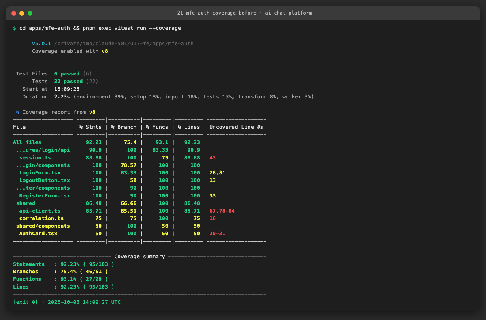
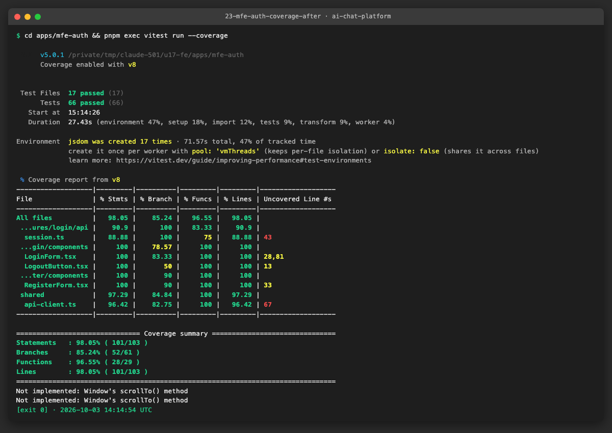

**Problems and fixes.**
- `useNavigate` from TanStack Router only logs a warning outside a router, it does not throw, so the `navigation` test mounts a real in-memory router and checks that the navigation happens.
- The hooks do not validate input (the forms do, with the schemas), so "validation error" in the hook tests is the 400 answer of the server; the client-side rules are tested in `schemas.spec.ts`.

### US5 · Unit tests for every source file of the shell ([AICHAT-105](https://ipca-grupo11.atlassian.net/browse/AICHAT-105))

**What and why.** The shell had 13 source files without a test and ran with the coverage thresholds that AICHAT-34 had lowered
(70/60/62/68). We wrote a test next to each file and put the shell back on the standard thresholds. The tests use MSW through
`@platform/test-utils/msw` for every HTTP call, with no `fetch` stub.

- Logic: `queryClient` (defaults, singleton, one retry), `useSession` (user, `{ user }` envelope, 401 as "not signed in", 500 as error, re-check on mount),
  `session` (type-only: the test pins the shape with `expectTypeOf`), `loadRemote` (success, `Error` and non-`Error` rejections, synchronous throw),
  `constants` and `apiClient` (cookies, correlation id generated or kept, base URL, 204, `ApiError`, network failure).
- Components: `RemoteFallback`, `NavBar` (signed in and out, active link, theme toggle with `<html>` class and stored choice), `AppShellLayout` (session in the nav, logout success and failure), `createRemoteRoute`.
- Routes: `index.tsx` and `login.tsx` have logic, so they are tested. The other route files stay on the exempt list.
- Existing tests moved next to the file they test (`RequireAuth.test.tsx`, `RemoteErrorBoundary.test.tsx`), and `mockRemotes.test.tsx` now answers with MSW instead of a `fetch` stub.

**Files.** `apps/shell/src/**/*.test.ts(x)` (new files for the 13 above, plus `shared/test/renderWithRouter.tsx`) and `apps/shell/vite.config.ts`.

**How to run.** `pnpm exec nx test shell` (runs `vitest run --coverage`, so the thresholds are enforced).

**How to repeat it manually.** `cd apps/shell && pnpm exec vitest run --coverage`, then `node scripts/unit-test/source-files.ts --list | grep NO-TEST | grep apps/shell/`: the list is empty.

**Result.**

| Metric | Before | After |
|---|---|---|
| Statements | 68.71 | 92.02 |
| Branches | 60.97 | 87.80 |
| Functions | 62.12 | 86.36 |
| Lines | 70.51 | 92.94 |

Thresholds are back to the standard 80/75/80/80 (the dated TODOs are gone).

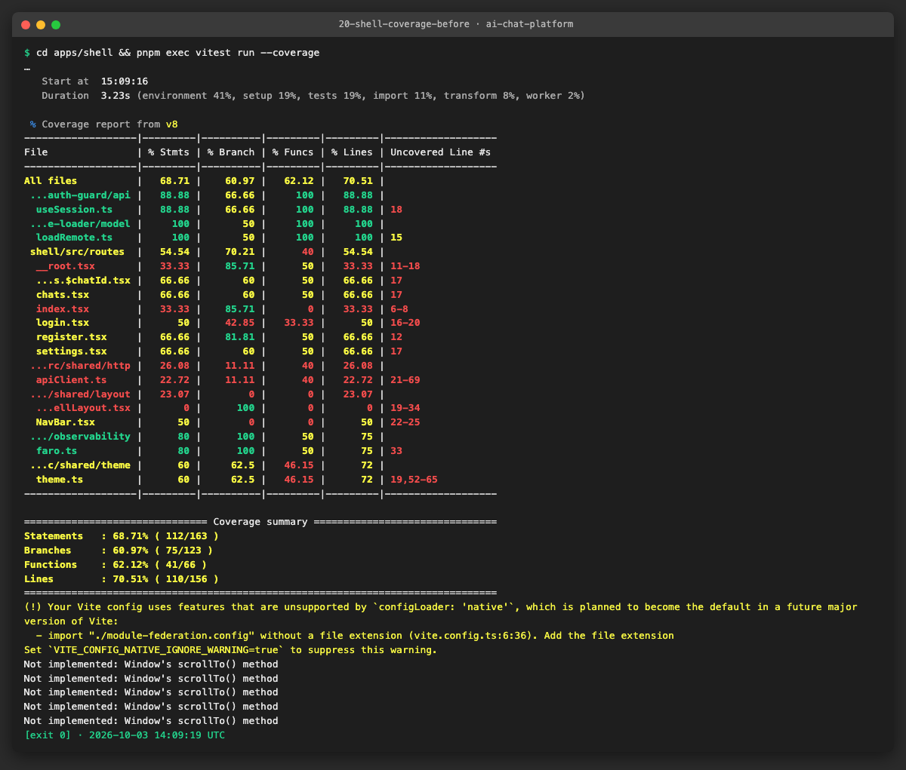
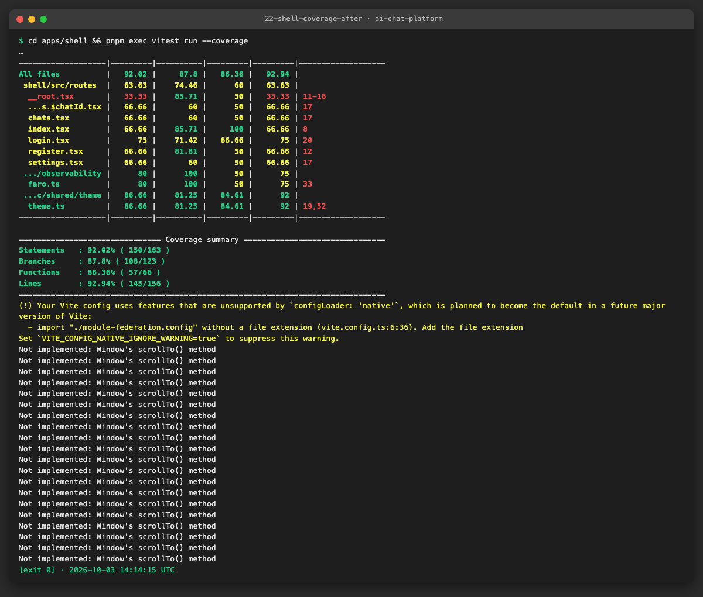
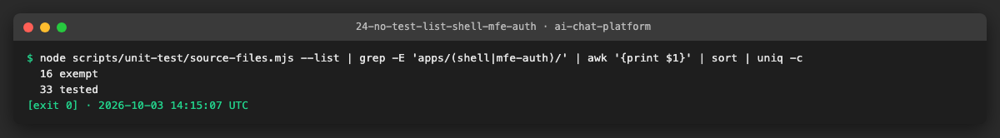

**Problems and fixes.**
- `@app/ui` resolves to `packages/ui/dist`, so a fresh checkout needs `nx run ui:build` first; running through `nx` does this by itself.
- The TanStack Router plugin treated `routes/*.test.ts` as route files. We added `routeFileIgnorePattern: '\.test\.'` to the shell's Vite config.
- `mfeAuth/routes` cannot be resolved by Vitest, so the `/login` test checks `validateSearch` and the parsed search of a real URL, not the mounted remote (covered by the e2e suite).
- `shared/test/renderWithRouter.tsx` is a test helper, so it is excluded from coverage.

### US6 · mfe-chat: unit tests for hooks, API client and SSE ([AICHAT-87](https://ipca-grupo11.atlassian.net/browse/AICHAT-87))

**What and why.** The hooks and the HTTP/SSE plumbing of `mfe-chat` carry every request the chat makes, but only their callers were tested. We added a test next to each file: `use-media-query`, `useUploadAttachment`, `useMessageQueue`, `api-client`, `auth`, `sse`, plus the two indirect files with their own logic (`chat-members/api/members.ts`, `app/auth-context.tsx`). While there we also covered the small modules that had no test (`query-keys`, `types`, `show-reasoning`), because the policy has no exemption for them. HTTP goes through the shared MSW server (`server.use(...)` for the error cases), SSE through `FakeEventSource`.

**Files.** `app/use-media-query.test.ts`, `app/auth-context.test.tsx`, `features/attachments/api/useUploadAttachment.test.ts`, `features/message-queue/hooks/useMessageQueue.test.tsx`, `features/chat-members/api/members.test.tsx`, `features/chat-view/model/show-reasoning.test.ts`, `shared/{api-client,auth,sse,query-keys,types}.test.ts` (all under `apps/mfe-chat/src`).

**How to run.** `pnpm exec nx run mfe-chat:test` (or `cd apps/mfe-chat && pnpm exec vitest run <file>`).

**How to repeat it manually.** Run the command above. To see an error path fail, change a status in `api-client.ts` (for example stop reading `payload.message`) and run `api-client.test.ts`.

**Result.** The API client is checked for the `/api` base, credentials, a new correlation id per call, JSON versus `FormData` bodies, the `X-Llm-Api-Key` header (only on opt-in and only when a key exists), the single-key envelope, 204, JSON and non-JSON error bodies and network failure. The SSE test separates provider `error` events from dropped connections and shows the same connection stays open after a transport error, so the browser can reconnect.

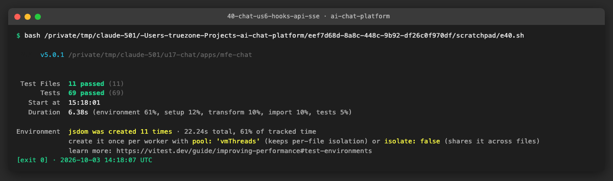

**Problems and fixes.** jsdom's `FormData` and `File` are not the classes Node's `fetch` understands, so an upload built from them failed before reaching MSW. The upload test swaps in Node's `FormData` and `File` and reads the raw multipart body in the handler. `@app/ui` must be built before the tests run (`nx` does it as a dependency); a bare `vitest` run on a fresh checkout fails to resolve it.

### US7 · mfe-chat: render-level tests for untested components and pages ([AICHAT-126](https://ipca-grupo11.atlassian.net/browse/AICHAT-126))

**What and why.** The chat pages and several components were only exercised indirectly or not at all. Each now has a render test that checks props, the main interaction and accessible names (queries by role and label). `WebFetchList` is tested against model-supplied URLs: only `http:` and `https:` become links, while `javascript:`, `data:`, `file:`, `ftp:` and text that is not a URL show as plain text.

**Files.** `app/{ChatWorkspace,ChatListPage,ChatDetailPage}.test.tsx`, `features/chat-view/components/{MessageBubble,ReasoningSection,WebFetchList}.test.tsx`, `features/message-queue/components/QueuedMessageItem.test.tsx`.

**How to run.** `pnpm exec nx run mfe-chat:test`.

**How to repeat it manually.** Open a chat in the app with a model that fetches pages; the list of pages appears under the reply. In `WebFetchList.test.tsx`, change `isWebUrl` to accept any protocol and the `javascript:` cases fail.

**Result.** The workspace tests cover the empty state, opening a chat from the URL, swapping and splitting panes, the layout toggle, focus moving between panes (not through the close button), closing the pane of a deleted chat, and the small-screen back button. The coverage exclude of `mfe-chat` already lists only `src/app/remote-entry.tsx` (the Module Federation mount, which wires `createRoot` and has no logic of its own); nothing else in `src/app` is excluded.

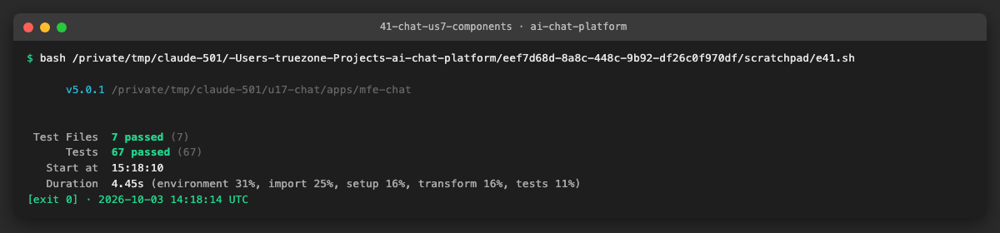

**Problems and fixes.** The first workspace harness read the route param outside React and did not re-render; mounting the real `ChatListPage` and `ChatDetailPage` as route components fixed it and also covers both pages. The `scrollTo` "not implemented" lines in the output come from jsdom and are harmless.

### US8 · mfe-chat: table-driven tests for model capability tables ([AICHAT-129](https://ipca-grupo11.atlassian.net/browse/AICHAT-129))

**What and why.** The capability tests asserted a handful of models by hand. `shared/model-capability-tables.test.ts` walks every `PROVIDER_MODELS` entry with `it.each` and checks reasoning, web fetch, vision, text and pdf against an explicit expectation row. A model without a row fails, and so does a row for a model that no longer exists, so a new model cannot be added with an unchecked capability. When the table moved to `packages/shared-types` (US13) only the imports changed.

**Files.** `apps/mfe-chat/src/shared/model-capability-tables.test.ts`.

**How to run.** `cd apps/mfe-chat && pnpm exec vitest run src/shared/model-capability-tables.test.ts`.

**How to repeat it manually.** Add `"gpt-6"` to `PROVIDER_MODELS.openai` in `shared/types.ts` and run the command: four tests fail until a row is added.

**Result.** 55 tests pass for the ten current models. Adding a model without a row fails:

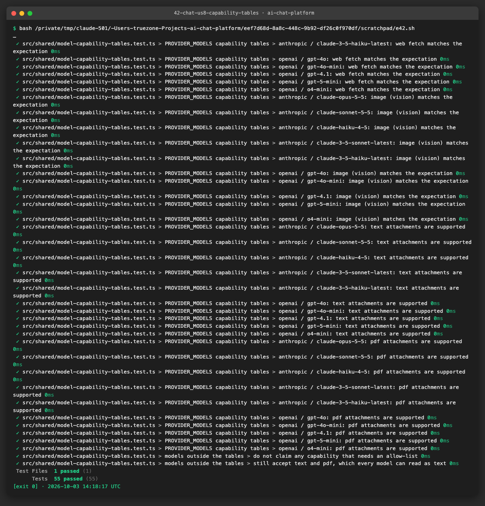

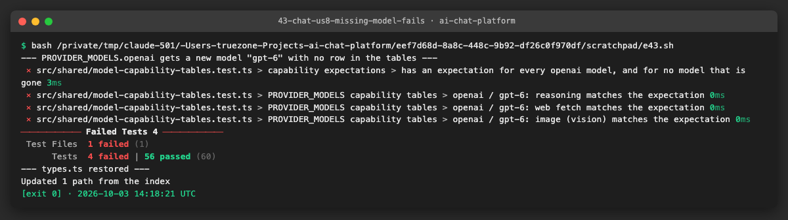

Coverage of `mfe-chat` went from 89.87 / 85.05 / 89.71 / 91.86 (statements / branches / functions / lines, 24 test files, 122 tests) to 94.37 / 89.50 / 93.24 / 96.01 (43 files, 313 tests).

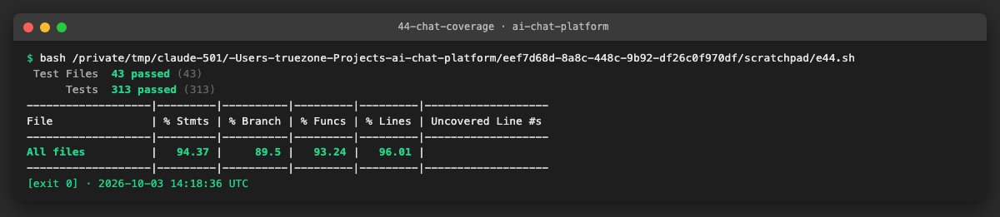

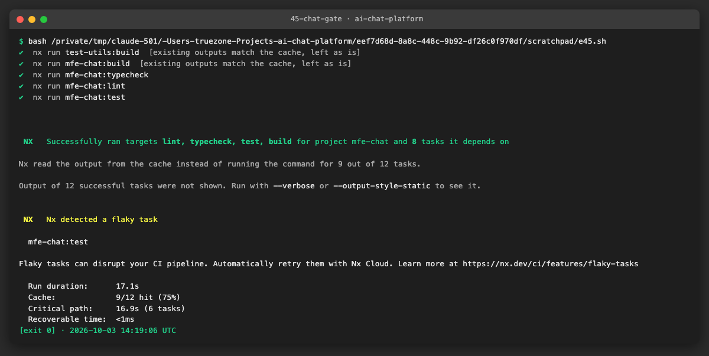

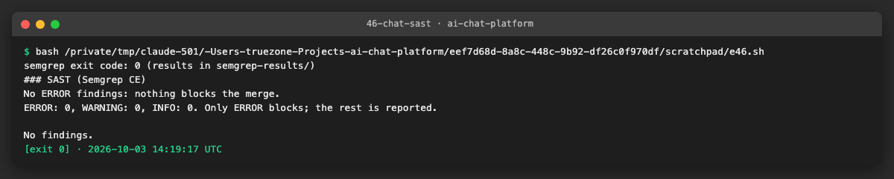

**Problems and fixes.** `MembersDialog.test.tsx` (an existing test) timed out once when `nx` ran lint, typecheck, test and build in parallel and passed on every rerun; `nx` marks `mfe-chat:test` as flaky. Its `findByText` uses the default one second wait and got a longer wait in the closing round (see §7). `supportsAttachmentKind` compares model names case-sensitively while the reasoning and web fetch checks lower-case them; the table test pinned today's behaviour until US13 fixed it.

### US9 · mfe-settings: close the remaining unit-test gaps ([AICHAT-141](https://ipca-grupo11.atlassian.net/browse/AICHAT-141))

**What and why.** The analysis listed one file without a test and one tested only indirectly in `apps/mfe-settings`. Before writing anything we ran the inventory again: the MSW migration of the foundation stories had already added `api/auth.test.ts`, `api/testConnection.test.ts`, `hooks/useCurrentUserId.test.tsx` and `shared/correlation.test.ts`, so every file in `mfe-settings` now has a test next to it or an exempt entry. No new test was needed and no exempt entry is proposed for this project.

**Files.** None changed. Existing exempt entries: `main.tsx`, `routes.tsx` (bootstrap) and `features/api-keys/index.ts` (barrel).

**How to run.**

```bash
pnpm exec nx run mfe-settings:test
node scripts/unit-test/source-files.ts --list | grep -E "apps/mfe-settings" | grep NO-TEST
```

**How to repeat it manually.** Run the second command: it prints nothing. The first one runs the 53 tests with coverage and checks the thresholds.

**Result.** 11 test files, 53 tests, statements 100 %, branches 91.01 %; thresholds met.

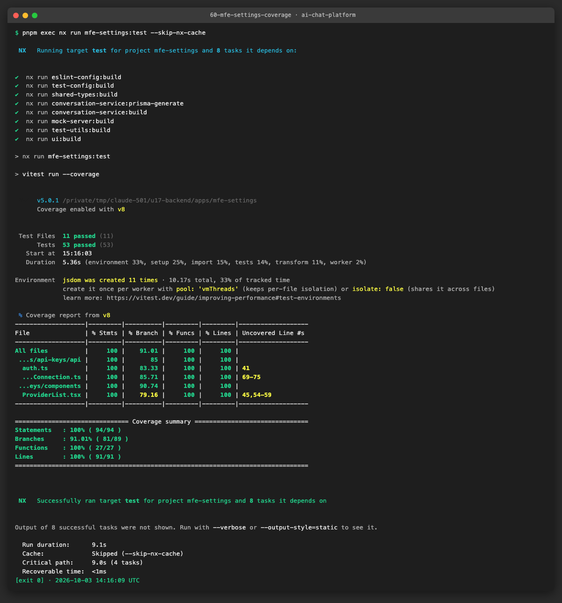

**Problems and fixes.** None. The gap had been closed by an earlier story, so this one only confirms it.

### US10 · auth-service: close the remaining unit-test gaps ([AICHAT-142](https://ipca-grupo11.atlassian.net/browse/AICHAT-142))

**What and why.** `shared/contracts/http.ts` exports runtime values (`CORRELATION_HEADER`, `getOrCreateCorrelationId`, `errorResponseSchema`, `toErrorResponse`), so it is tested instead of exempted as type-only. `shared/contracts/auth.ts` (the password policy, request and response schemas, token claims and lifetimes) also had no test and got one. The three files that were reached only through other tests (`correlation-id.ts`, `error-middleware.ts`, `jwt.ts`) already have their own `*.spec.ts` next to them, so nothing was missing there.

**Files.** `services/auth-service/src/shared/contracts/http.spec.ts`, `services/auth-service/src/shared/contracts/auth.spec.ts`.

**How to run.**

```bash
pnpm exec nx run auth-service:test
cd services/auth-service && pnpm exec vitest run src/shared/contracts
```

**How to repeat it manually.** Change `PASSWORD_MIN_LENGTH` in `auth.ts` to 6: the table in `auth.spec.ts` fails on `short1a`. Change the order of the two header lookups in `getOrCreateCorrelationId`: `http.spec.ts` fails.

**Result.** 19 new tests. The service has 16 test files and 95 tests; statements 95.32 %, branches 89.74 %, functions 96.07 %, lines 95.67 %. Thresholds met.

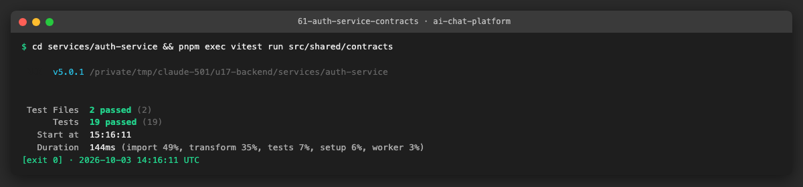

**Problems and fixes.** The `Prisma` client is generated, so a fresh checkout fails on `vitest run` until `prisma-generate` has run; the `nx` target does it first, so the commands above use `nx` for the whole service.

### US11 · conversation-service: unit tests for controllers and shared helpers ([AICHAT-123](https://ipca-grupo11.atlassian.net/browse/AICHAT-123))

**What and why.** The three controllers and the shared helpers were only reached through route tests, which hide the mapping details. Now each one has a focused test with a fake service:

- `shared/async-handler.ts`: resolved (next not called), rejected (error forwarded) and thrown inside the handler (error forwarded).
- `features/{chats,messages,attachments}/controller.ts`: parameters and body are parsed, the right service method is called with the right arguments (principal or user id), and the status and body are as agreed (201, 202, 204, wrapped `{ chat }`, `{ messages }`). Invalid input rejects with a `ZodError` before the service is called, a missing upload answers 400 `ATTACHMENT_REQUIRED`, and an empty `X-Llm-Api-Key` header counts as no key.
- `shared/contracts/auth.ts` and `shared/contracts/chat.ts` export Zod schemas and constants, so they are tested (not type-only). `features/attachments/schema.ts`, `shared/logger.ts` (redaction of the key header, cookies, authorization and password fields on real `pino` output) and `features/llm-adapters/types.ts` (`ProviderError`) got tests too.
- The capability tables `THINKING_STYLES`, `WEB_FETCH_TOOLS` and `VISION_MODEL_HINTS` are private to the adapters, so `llm-adapters/capability-tables.spec.ts` checks them through the public `supports*` methods and through the request each model produces. The cases are tables (one row per model id), including the ids where the order matters (`claude-opus-5-5` before `claude-opus-5`, `claude-opus-4-6` before `claude-opus-4`).

**Files.** `shared/async-handler.spec.ts`, `shared/logger.spec.ts`, `shared/contracts/auth.spec.ts`, `shared/contracts/chat.spec.ts`, `features/{chats,messages,attachments}/controller.spec.ts`, `features/attachments/schema.spec.ts`, `features/llm-adapters/types.spec.ts`, `features/llm-adapters/capability-tables.spec.ts`, helper `test-utils/fake-http.ts` (all under `services/conversation-service/src`).

**How to run.**

```bash
pnpm exec nx run conversation-service:test
cd services/conversation-service && pnpm exec vitest run src/features/llm-adapters/capability-tables.spec.ts
```

**How to repeat it manually.** Swap two rows of `THINKING_STYLES` in `anthropic.provider.ts` (put `claude-opus-5` above `claude-opus-5-5`): the table test for `claude-opus-5-5` fails. Remove `.catch(next)` in `async-handler.ts`: the rejected and thrown cases fail.

**Result.** 44 test files, 391 tests (2 todo that were already there); statements 98.45 %, branches 91.26 %, functions 97.9 %, lines 99.03 %. Thresholds met.

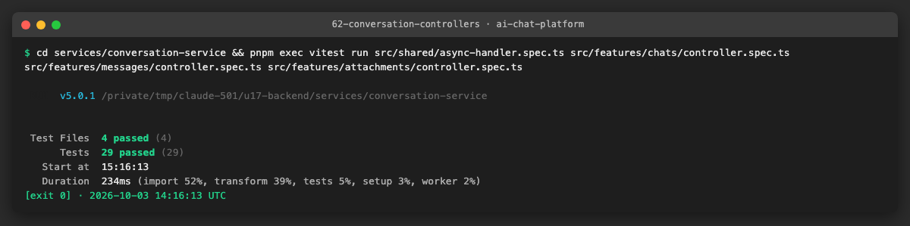
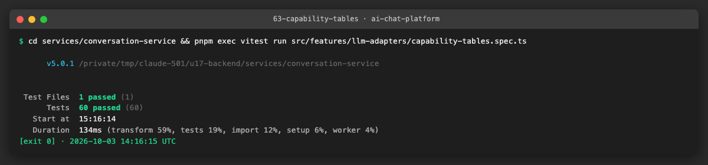
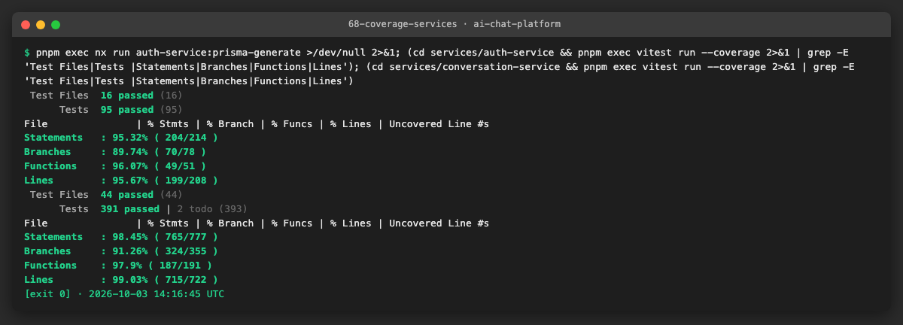

**Problems and fixes.** `pino` writes to stdout by default, so the first logger test printed the log line instead of asserting on it. The test now captures the options `createLogger` passes to `pino` and feeds the same options to the real `pino` writing to an in-memory stream.

### US12 · Shared packages and tooling: close the remaining unit-test gaps ([AICHAT-143](https://ipca-grupo11.atlassian.net/browse/AICHAT-143))

**What and why.**

- `packages/ui` `components/alert/alert.tsx`: the only design-system component without a test. It now checks the role, the three variants, class merging, ref forwarding and the title and description slots.
- `packages/eslint-config`: `base.js`, `node.js`, `react.js` and `local-plugin.js` are tested by linting small code fixtures with the real `ESLint` class and asserting which rules fire (unused variables with and without `_`, `import type`, `console`, deep imports between features, hooks called conditionally, missing `key`, Node globals). `local-plugin.js` is also run through `RuleTester`. The helper `src/test-utils/lint.js` is shared by the three preset tests.
- `e2e/src/fixtures/wait-for-stack-cli.ts`: the module runs on import, so the test loads it fresh with `waitForStack` mocked and checks the time budget (default 180000 ms, or `E2E_WAIT_TIMEOUT_MS`), exit code 0 when healthy, and exit code 1 plus the printed message when not (also for a non-`Error` rejection).
- Also in scope of "cover all of them": `e2e/src/fixtures/{auth-flows,chat-flows,settings-flows,test-users}.ts` are tested with a recording fake Playwright `Page` (`e2e/src/test-utils/fake-page.ts`), without a browser, and `packages/shared-types/src/chat/provider.ts` got a schema test. `e2e/vitest.config.ts` now measures all of `src/fixtures`.

Playwright was never started: only Vitest runs here.

**Files.** `packages/ui/src/components/alert/alert.test.tsx`, `packages/eslint-config/src/{base,node,react,local-plugin}.test.ts`, `packages/eslint-config/src/test-utils/lint.js`, `e2e/src/fixtures/*.spec.ts` (five new), `e2e/src/test-utils/fake-page.ts`, `e2e/vitest.config.ts`, `packages/shared-types/src/chat/provider.test.ts`.

**How to run.**

```bash
pnpm exec nx run-many -t test -p ui eslint-config e2e shared-types
cd e2e && pnpm exec vitest run --coverage
```

**How to repeat it manually.** In `eslint-config/src/node.js` set `"no-console"` back to `"warn"`: the node preset test fails. Change `180_000` in `wait-for-stack-cli.ts`: the default-budget test fails.

**Result.** ui: 9 new tests. eslint-config: 45 tests. e2e: 50 tests, statements 91.91 %, branches 80.55 %. After this the inventory has no `NO-TEST` file in `mfe-settings`, `services`, `packages` or `e2e`.

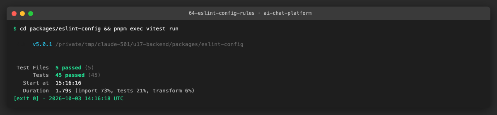
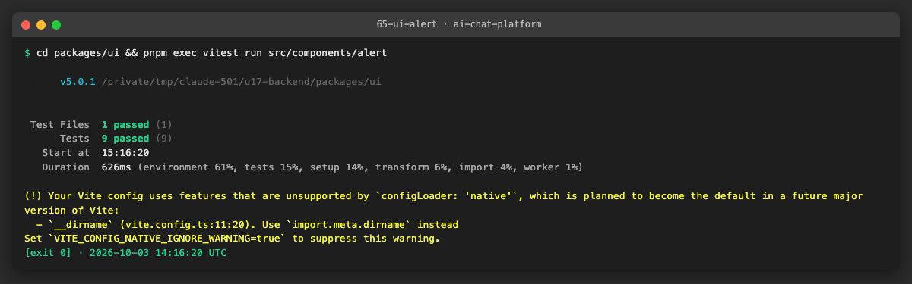
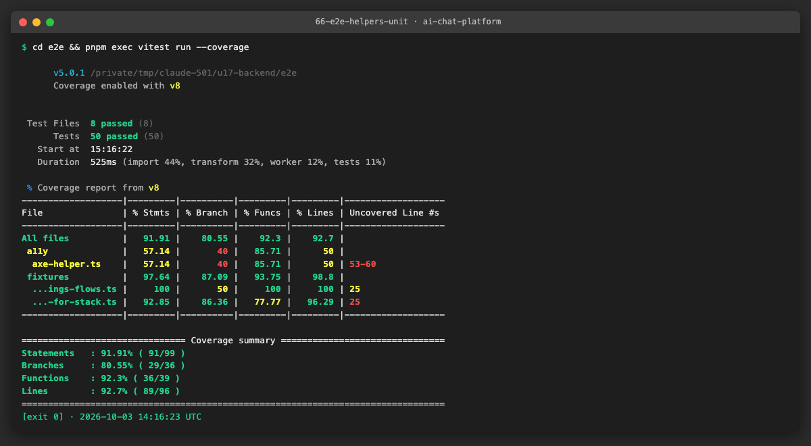
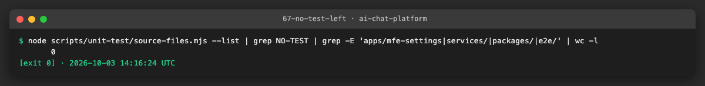

Final gate for the four stories (lint, typecheck, test and build for the six projects, then SAST):

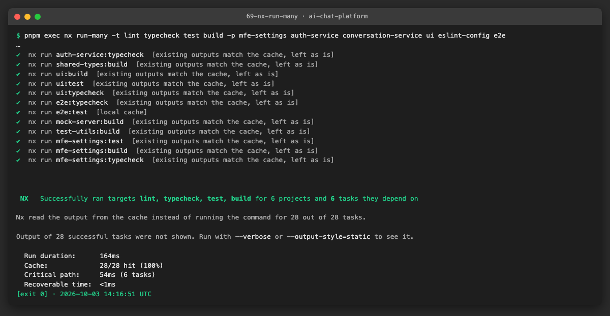
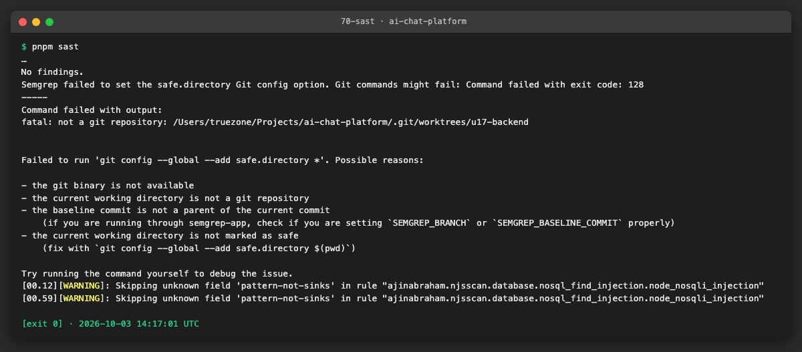

**Problems and fixes.** The shared `node` preset has no `URL` global, so a helper using `new URL(...)` failed `no-undef` in lint; the helper uses `import.meta.dirname` instead. The `eslint-config` coverage keeps measuring only `src/rules`, as before, because the package cannot import the shared preset (it would be a cycle); the preset files are covered by the behaviour tests above.

### US13 · Capability parity test between mfe-chat and conversation-service ([AICHAT-133](https://ipca-grupo11.atlassian.net/browse/AICHAT-133))

**What and why.** The chat UI decides which toggles and attachments to offer (reasoning, web fetch, images) from its own copy of the
model table, while `conversation-service` decides what to send from another one. Two copies drift: the UI can offer something the
server then ignores or refuses. As agreed with the owner, we moved the table to `packages/shared-types` so both read one source, and
added a parity test that fails CI when the two sides disagree for any model of `PROVIDER_MODELS`.

- `packages/shared-types/src/model-capabilities.ts` (new): `PROVIDER_MODELS`, `PROVIDERS`, `THINKING_STYLES`, `WEB_FETCH_TOOLS`, the vision hints per provider, the OpenAI reasoning pattern, and the functions `supportsReasoning`, `supportsWebFetch`, `supportsVision`, `thinkingStyle`, `webFetchToolType`. It has no imports on purpose: the service runs the compiled file with plain Node ESM.
- `mfe-chat`: `shared/types.ts`, `shared/model-capabilities.ts` and `attachments/model/model-capabilities.ts` now call the shared module. The app resolves it from source (Vite alias and tsconfig path, like `mfe-settings` does for `api-keys`).
- `conversation-service`: both adapters call the shared module. The package is consumed as compiled JS (`exports` points to `dist`), so `nx` builds it first (`dependsOn: ^build`), and the service `Dockerfile` builds it and copies it into the runtime image.
- Parity test: `packages/workspace-config/src/model-capability-parity.test.ts`. It imports the chat helpers and both adapters and compares them for every model of `PROVIDER_MODELS` plus extra ids (other letter case, unknown ids, empty string): 81 checks. It also checks that the chat UI holds the shared catalogue itself, not a copy. `workspace-config` depends on the three projects, so a change in any of them runs it in `nx affected`.

**Files.** `packages/shared-types/src/{model-capabilities.ts,model-capabilities.test.ts,index.ts}`, `packages/shared-types/package.json`; `apps/mfe-chat/src/shared/{types.ts,model-capabilities.ts,model-capability-tables.test.ts}`, `apps/mfe-chat/src/features/attachments/**/model-capabilities*.ts`, `apps/mfe-chat/{vite.config.ts,tsconfig.json,package.json}`; `services/conversation-service/src/features/llm-adapters/{anthropic,openai}.provider.ts`, `services/conversation-service/{Dockerfile,package.json}`; `packages/workspace-config/{src/model-capability-parity.test.ts,vitest.config.ts,project.json,package.json}`.

**How to run.**

```sh
cd packages/workspace-config && pnpm exec vitest run src/model-capability-parity.test.ts
pnpm exec nx run-many -t test -p shared-types mfe-chat conversation-service workspace-config
```

**How to repeat it manually.**

1. In `apps/mfe-chat/src/shared/model-capabilities.ts` make `supportsWebFetch` return `false` for `claude-haiku-4-5`.
2. Run the first command. Expected: 1 failed (`anthropic / claude-haiku-4-5: web fetch`), 80 passed.
3. Undo the change. Expected: 81 passed. The existing table tests of both projects (`model-capability-tables.test.ts`, `capability-tables.spec.ts`) stay green throughout the move.

**Result.** One table, two consumers; the old table-driven tests of both projects pass unchanged apart from the two fixes below.

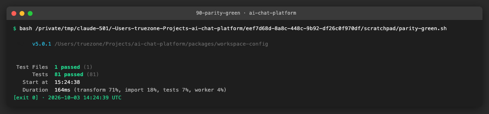

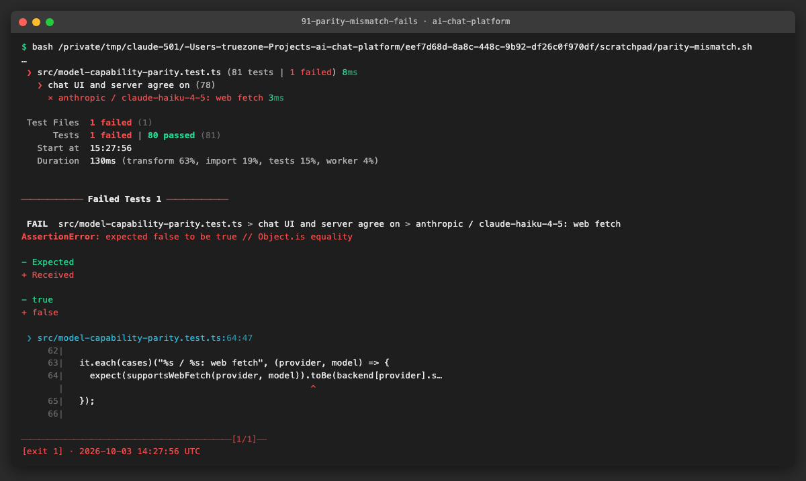

**Problems and fixes.**
- Fixed defect 1: `supportsAttachmentKind` compared the model id case-sensitively, while the server (and the reasoning and web fetch checks) lower-case it. The shared function lower-cases, with a test (`GPT-4O`, `Claude-Sonnet-5-5`).
- Fixed defect 2 (found by the parity test, a change in the UI answer): the UI refused images for `claude-3-5-haiku-latest` (exact allow-list) while the server accepts them (hint `claude-3`). The server is the authority, so the UI now follows it; three tests that used Haiku 3.5 as "no vision" model now use `claude-2.1`, and the expectation row of the table test says `vision: true`. The reasoning and web fetch answers for the ten catalogue models are unchanged. For ids outside the catalogue the UI now uses the server rules instead of its own regular expressions.
- The service cannot import TypeScript sources of another package (`rootDir`, plain Node at run time), hence the compiled `dist` export and the `build` script and Docker steps. The new `workspace-config` test target has no `^build` dependency (it reads the sources by alias) and lists the source folders as inputs so `nx` does not reuse a stale result.
- The cross-project imports of the parity test use aliases (`@parity/mfe-chat`, `@parity/conversation-service`) defined in the `workspace-config` Vitest config, because the module-boundary lint rule rejects relative paths between projects.

### US14 · Guard test for source files without unit tests ([AICHAT-138](https://ipca-grupo11.atlassian.net/browse/AICHAT-138))

**What and why.** The exempt list says which files may go without a test, but nothing stopped a new file from being added with neither. The inventory rules of `scripts/unit-test/source-files.ts` now live in `packages/workspace-config/src/source-files.ts`, and a guard test built on them runs with the rest of the suite in CI. It fails when a source file has no co-located test and no exempt entry, and when an exempt entry points at a file that is gone, is outside the policy, or has a test now.

**Files.** `packages/workspace-config/src/source-files.ts` (the rules), `packages/workspace-config/src/source-files.test.ts` (the guard on the repository, plus the rules on a scratch git repository), `scripts/unit-test/source-files.ts` (now a thin wrapper, same options; `--check` also reports untested files), `packages/workspace-config/unit-test-exempt.json` (one stale entry removed), `packages/workspace-config/vitest.config.ts`.

**How to run.**

```sh
pnpm exec nx run workspace-config:test
node scripts/unit-test/source-files.ts --check
```

**How to repeat it manually.**

1. Create `apps/mfe-chat/src/shared/untested-demo.ts` with `export const answer = 42;` (no test, no exempt entry).
2. Run `cd packages/workspace-config && pnpm exec vitest run src/source-files.test.ts`. Expected: the guard test fails and names the file.
3. Delete the file and run again: green. For the stale-entry case rename a path in `unit-test-exempt.json`: the guard reports "exempt entry for a file that no longer exists".

**Result.** The guard is green on the repository (247 source files: 198 with their own test, 49 exempt, 0 with neither). Adding an untested file, or an exempt entry for a missing file, fails it; both were reverted after the run.


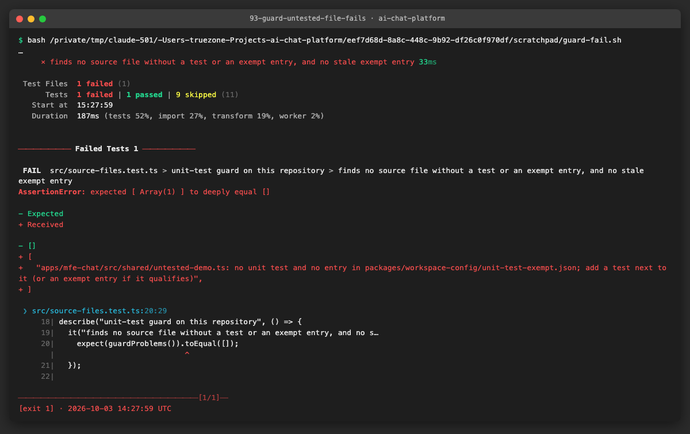

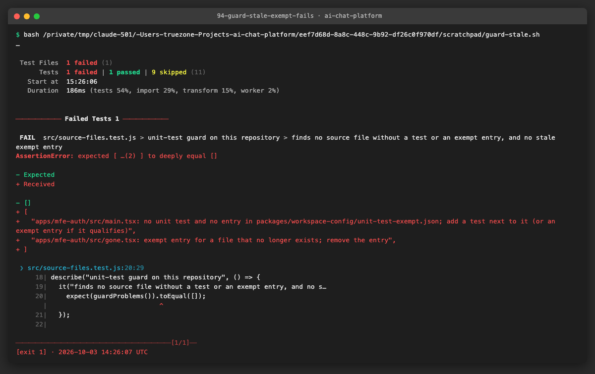

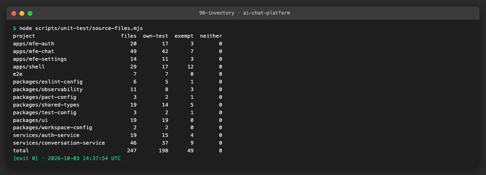

**Problems and fixes.**
- The first run of the guard found a real problem: the exempt entry for `apps/shell/src/features/auth-guard/model/session.ts` was stale, because the shell story gave that file a test. We removed the entry.
- The inventory now also lists files that git does not track yet (new and not ignored), so the guard catches a new file before it is committed, not only in CI.
- Build output (`dist/`) is excluded from the file list, since a built package would otherwise count as source.


## 4. How to run everything

```sh
pnpm install
# the whole suite, as CI runs it (lint, typecheck, test with coverage, build)
pnpm exec nx affected -t lint typecheck test build --base=origin/integration/testing-epics
pnpm exec nx run-many -t test                         # every project, with coverage thresholds
pnpm exec nx run <project>:test                       # one project (for example mfe-chat, shell, conversation-service)
cd apps/mfe-chat && pnpm exec vitest src/shared       # watch mode on a folder

node scripts/unit-test/source-files.ts               # inventory by project
node scripts/unit-test/source-files.ts --check       # untested files and the exempt list (US1, US14)
pnpm exec nx run workspace-config:test                # guard (US14) and capability parity (US13)
git grep -h 'stubGlobal("fetch"' -- apps packages e2e | wc -l   # 0 (US3)

pnpm sast                                             # static analysis
gitleaks git --redact --log-opts=origin/integration/testing-epics..HEAD   # secrets
```

Coverage reports are written to `coverage/` of each project (`text`, `lcov` and `json-summary`). The Playwright e2e suite is not part of this epic and was not run.

## 5. Results

Coverage per project, statements / branches / functions / lines (%). Before: the merge base with `integration/testing-epics`; after: the end of this epic. A dash means the project had no tests or no coverage run.

| Project | Before | After |
|---|---|---|
| apps/shell | 68.71 / 60.97 / 62.12 / 70.51 | 92.02 / 87.80 / 86.36 / 92.94 |
| apps/mfe-auth | 92.23 / 75.40 / 93.10 / 92.23 | 98.05 / 85.24 / 96.55 / 98.05 |
| apps/mfe-chat | 89.87 / 85.21 / 89.71 / 91.86 | 94.33 / 89.60 / 93.24 / 95.97 |
| apps/mfe-settings | 100 / 92.13 / 100 / 100 | 100 / 91.01 / 100 / 100 |
| services/auth-service | 94.85 / 85.89 / 94.11 / 95.19 | 95.32 / 89.74 / 96.07 / 95.67 |
| services/conversation-service | 98.32 / 90.70 / 97.38 / 98.89 | 98.42 / 91.26 / 97.83 / 99.01 |
| packages/ui | 97.20 / 80.48 / 92.06 / 97.20 | 98.88 / 82.92 / 96.82 / 98.88 |
| packages/shared-types | 96.07 / 85.36 / 100 / 96.07 | 96.63 / 86.66 / 100 / 96.55 |
| packages/eslint-config | 100 / 92 / 100 / 100 | 100 / 92 / 100 / 100 |
| packages/workspace-config | 100 / 88 / 100 / 100 | 95.40 / 87.30 / 91.30 / 97.14 |
| packages/test-utils | — | 100 / 95.45 / 100 / 100 |
| e2e (helpers) | 80.95 / 77.77 / 81.25 / 82.05 | 91.91 / 80.55 / 92.30 / 92.70 |

Tests (files / tests), `vitest run` in each project:

| Project | Before | After |
|---|---|---|
| apps/shell | 8 / 27 | 20 / 83 |
| apps/mfe-auth | 6 / 22 | 17 / 66 |
| apps/mfe-chat | 24 / 122 | 43 / 314 |
| apps/mfe-settings | 11 / 53 | 11 / 53 |
| services/auth-service | 14 / 76 | 16 / 95 |
| services/conversation-service | 34 / 275 | 44 / 393 |
| packages/ui | 21 / 128 | 22 / 137 |
| packages/shared-types | 12 / 82 | 14 / 98 |
| packages/eslint-config | 1 / 17 | 5 / 45 |
| packages/workspace-config | 9 / 84 | 11 / 177 |
| packages/test-utils | — | 4 / 51 |
| e2e (helpers) | 3 / 19 | 8 / 50 |
| Total | 143 / 905 | 215 / 1,562 |

The mock server (`testing/mock-server`, 253 tests) belongs to another epic and did not change. The `workspace-config` percentages dropped because its sources grew (the guard and the parity test are measured too) and it now includes TypeScript.

Source files under the policy (README §4.1):

| Metric | Before | After |
|---|---|---|
| Source files in scope | 246 (discovery) | 247 |
| With their own unit test | 130 | 198 |
| Exempt (bootstrap, barrel, type-only) | none | 49 |
| Without a test or an entry | 49 plus 30 indirect | 0, enforced by a test (US14) |
| `vi.stubGlobal("fetch", ...)` calls in the MFE tests | 54 in 19 files | 0 (two one-call spies with a reason) |
| Copies of the model capability table | 2 (chat and service) | 1, with a parity test (US13) |


Final gates (all green; `pnpm sast` exit 0; gitleaks found no leaks):

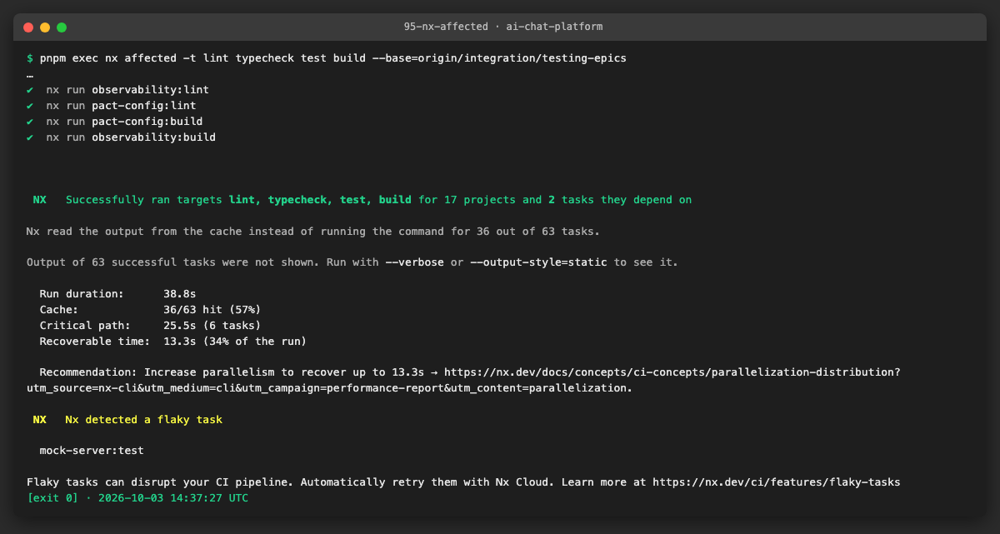

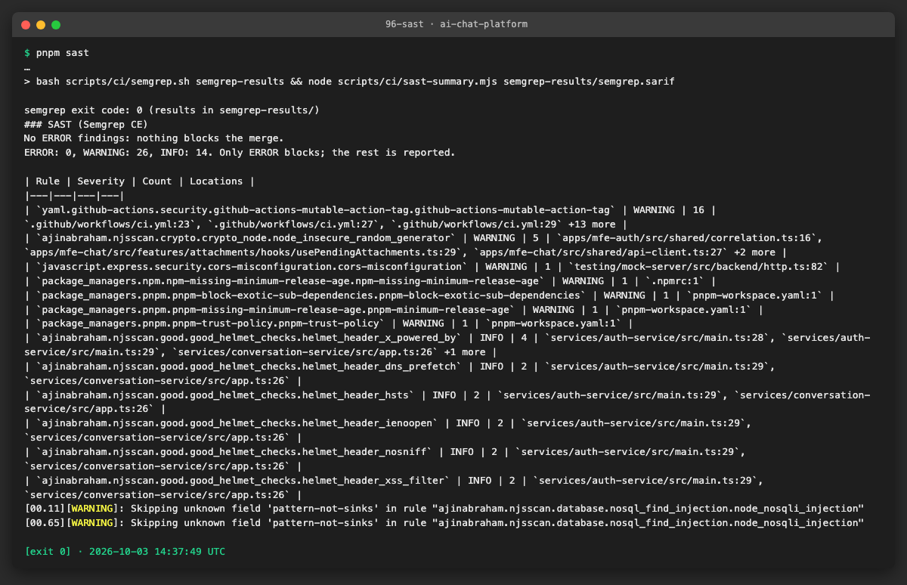

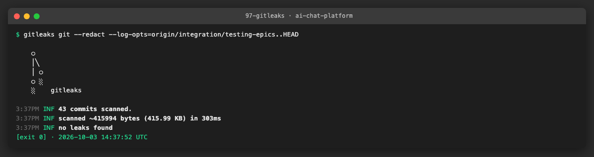

## 6. DoD check

| DoD item | Met | Evidence |
|---|---|---|
| Tests run in CI and pass on `main` | CI: pending PR run (the same `nx affected` command is green locally) | [95](evidence/95-nx-affected.png) |
| Failure blocks the merge | CI: pending PR run | [95](evidence/95-nx-affected.png) |
| Run instructions in README or `docs/` | Yes, section 4 of this log and the "How to run" of each story | §4 |
| Every non-exempt source file has a unit test | Yes: 198 tested, 49 exempt, 0 with neither | [98](evidence/98-inventory.png) |
| A guard test fails when a new source file has no test and isn't on the exempt list | Yes (US14) | [93](evidence/93-guard-untested-file-fails.png) |
| Meets the AICHAT-34 coverage thresholds | Yes, every project passes its thresholds locally; CI: pending PR run | [95](evidence/95-nx-affected.png) |
| Model capability parity between UI and server (AICHAT-133) | Yes (US13) | [91](evidence/91-parity-mismatch-fails.png) |
| SAST and secret scan clean | Yes locally; CI: pending PR run | [96](evidence/96-sast.png), [97](evidence/97-gitleaks.png) |

## 7. Notes for the report

**Defects found**
- `supportsAttachmentKind` in `mfe-chat` compared model ids case-sensitively; the server lower-cases. Fixed in US13.
- The UI refused images for `claude-3-5-haiku-latest` while the server accepts them. Found by the parity test; the UI now follows the server (US13).
- The exempt entry for `apps/shell/.../auth-guard/model/session.ts` went stale when the shell got its test. Found by the new guard and removed (US14).
- A few existing tests passed by accident or checked little: the `TestConnectionButton` fallback relied on `fetch` returning `undefined`, and the old stubs returned bare arrays where the service sends `{ chats }` (US3).
- Flaky tests: `MembersDialog.test.tsx` timed out under parallel `nx` runs; all its async waits now allow 5 s (`configure({ asyncUtilTimeout })`), and the suite is not slower because the wait ends as soon as the response arrives. `testing/mock-server` (`stream-drop` test, 5 s limit) and a conversation-service metrics test also timed out once each under load and passed on rerun; they are outside this epic and left as they are.

**Decisions**
- Whole repository in scope; exemptions only for bootstrap files, barrels and type-only modules, listed with a reason (D2).
- MSW adopted for HTTP in the MFE tests (US3): handlers per API in `@platform/test-utils`, unhandled requests fail the test.
- The model capability table was moved to `packages/shared-types` (owner decision, US13): one source for the UI and the service, consumed from source by the app and as compiled JS by the service.
- The Playwright e2e suite was not run for this epic (slow, manual-only); only the e2e helpers have unit tests.
- All new test code is TypeScript.

**Lessons learned**
- Tests that import across projects need aliases or a shared package, not relative paths: the module-boundary rule is right to block them.
- A package consumed by a Node service needs a compiled output, a `build` script and a Docker step, not only a path alias.
- Run the guard first: it finds stale exempt entries on day one.
- Coverage thresholds alone are not enough; the guard says a file has a test, the thresholds say the test exercises it.

**TypeScript everywhere**

The repository had grown 52 JavaScript files next to the TypeScript code: the ESLint configs, the `eslint-config` and `test-config` packages, the `workspace-config` helpers, the CI and evidence scripts, the PostCSS config and the k6 script. The team rule is TypeScript only, so we converted all of them (`git ls-files | grep -E "\.(m?js|cjs)$"` now prints nothing outside `docs/`). Files were moved with `git mv`, so their history follows them.

- **ESLint configs** are `eslint.config.ts` in every project. ESLint loads them through `jiti`, which is a root dev dependency (`packages/ui` still uses ESLint 9 and has its own `jiti` 2). `@platform/eslint-config` is TypeScript source with typed presets and a typed local rule, and its tests run with Vitest and the `RuleTester`. It has a `typecheck` target now.
- **`@platform/test-config`** is TypeScript source again, and the hand-written `.d.ts` files are gone. Relative imports inside the shared packages carry the `.ts` extension, because Vite loads a `vitest.config.ts` natively through Node, which does not map `.js` to `.ts`. For that, `tsconfig.base.json` sets `rewriteRelativeImportExtensions` and the projects that do not extend it set `allowImportingTsExtensions`. No build step or Dockerfile change was needed; the image builds work from a clean checkout.
- **Scripts** (`scripts/**`, `testing/mock-server/scripts/build.ts`) run as `node file.ts` on Node 24 type stripping, so they only use erasable syntax. `tsconfig.scripts.json` (`erasableSyntaxOnly`, `verbatimModuleSyntax`, `noEmit`) checks them: `pnpm typecheck:scripts`. The script tests keep `node:test` and run with `pnpm test:scripts`. CI runs both before `nx affected`, and the `sast` job now sets up the pinned Node so `sast-summary.ts` runs there.
- **`packages/ui/postcss.config.ts`** is read by `postcss-load-config`; the library and the apps build as before.
- **`testing/k6/streaming-load.ts`**: k6 runs TypeScript natively (checked with `k6 inspect`), types come from `@types/k6`, and the project has a `typecheck` target.
- **Rules that look at file names** (the unit-test inventory, the coverage guard, `nx.json` inputs, `.semgrepignore`) and every command in the docs and in the epic skills now use the `.ts` names.

Problems we hit: `tsc` rejected the `.ts` import specifiers in projects that do not extend the base config (fixed per project, see above), and ESLint 9 in `packages/ui` refused the old `jiti` 1.
