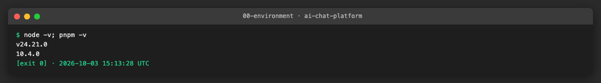
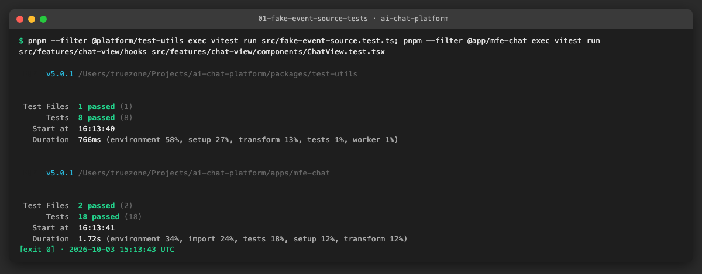
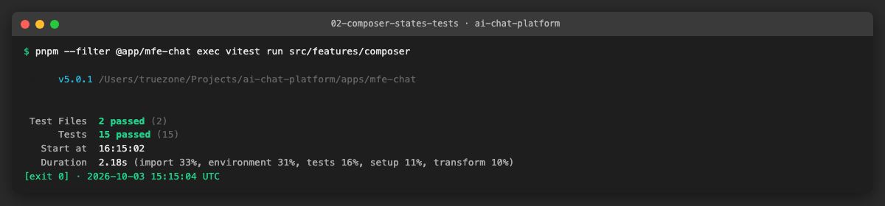
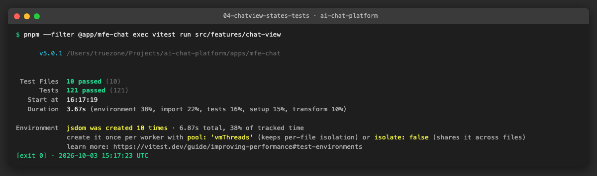
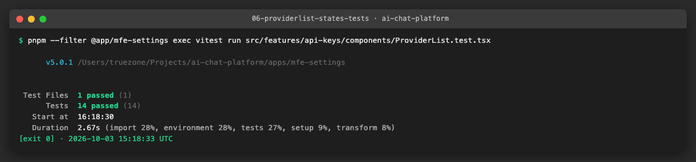
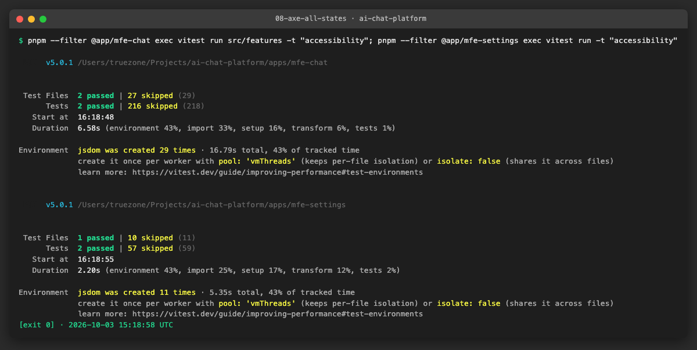
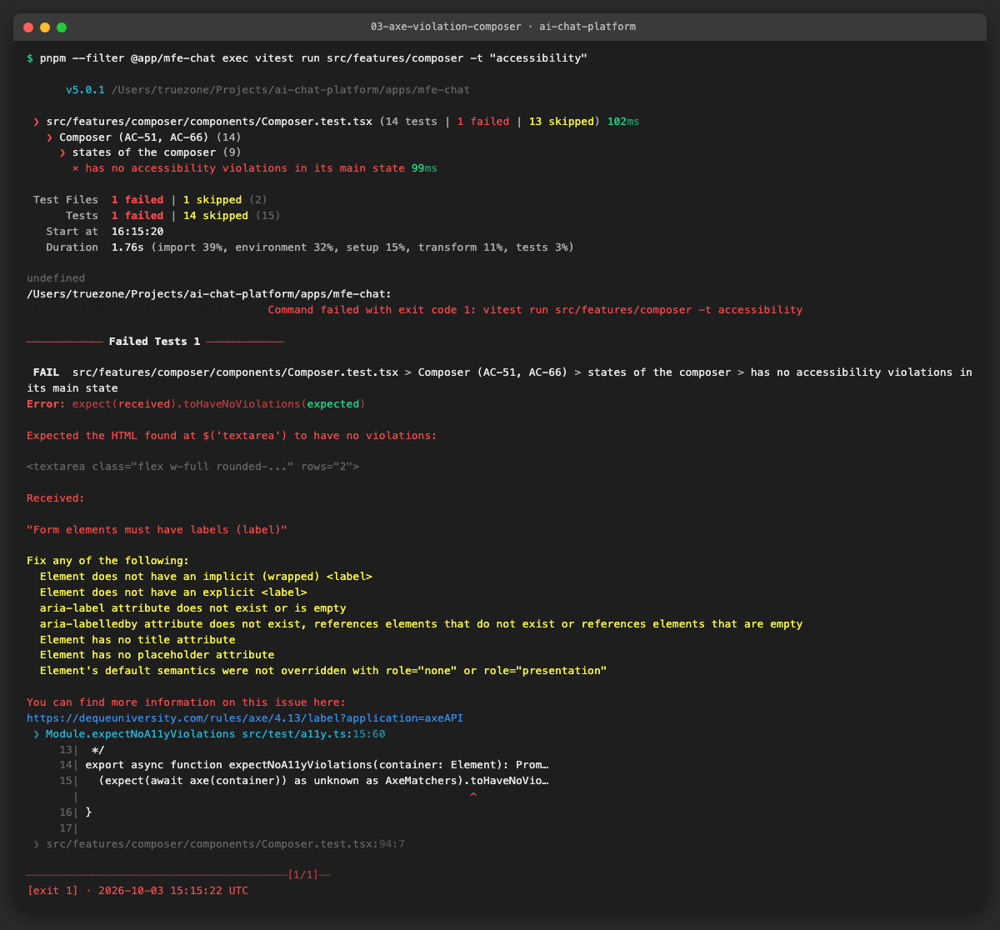
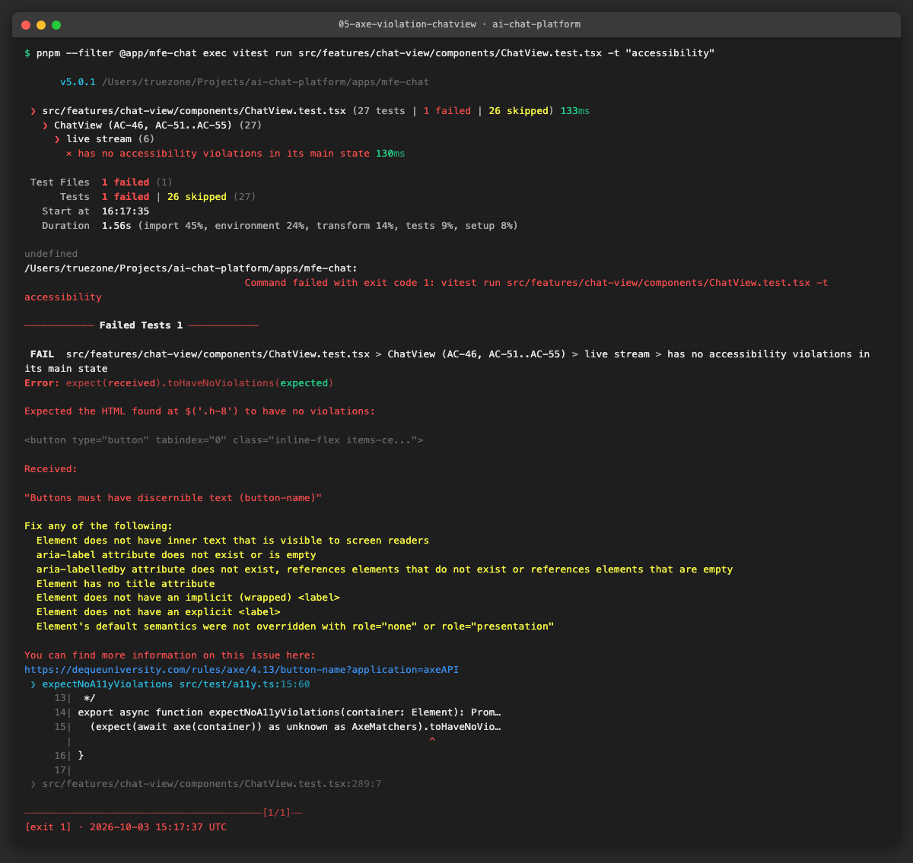
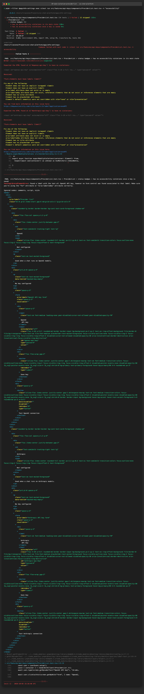

# AICHAT-18 · Component testing: work log

| Field | Value |
|---|---|
| Epic | [AICHAT-18](https://ipca-grupo11.atlassian.net/browse/AICHAT-18) |
| Analysis | [README.md](README.md) |
| Owner | Jean-Pierre Carvalho |
| Branch | `test/AICHAT-18-component-testing` |
| Started / finished | 2026-10-03 / 2026-10-03 |
| Pull requests | #… |
| Status | Ready for review |

## 1. DoR review

Date: 2026-10-03

| DoR item | Status | Question asked | Decision | Decided by |
|---|---|---|---|---|
| Owner assigned | Met | — | Jean-Pierre Carvalho | — |
| Scope agreed | Met | Which components and states? | Composer, ChatView and ProviderList with the state matrix of README §4 | Team (owner delegated) |
| Tooling agreed | Met | Tools, and is `vitest-axe` adopted? | Vitest, Testing Library, user-event, MSW and the shared fake `EventSource` from `@platform/test-utils` (extended with `emit`, `error`, `close`); `vitest-axe` adopted for one assertion per component state | Team (owner delegated) |
| Target environment available | Met | Where does it run? | Locally and in GitHub Actions (`nx affected -t test`); e2e not run | Team (owner delegated) |
| Testing Library set up | Met | Already in every app? | Yes (and the shared helpers from AICHAT-17) | Team (owner delegated) |
| States listed per component | Met | Where? | README §4 | Team (owner delegated) |
| Flaky streaming tests | Met | How do we wait for streamed tokens? | `findBy*` queries or `vi.useFakeTimers()`, never sleeps | Team (owner delegated) |
| Dead code in ProviderList | Met | Test the keyless Local branch? | No: it cannot be reached; reported to the configuration owner as a ticket | Team (owner delegated) |

Blockers: none

## 2. Environment

| Tool | Version | Install |
|---|---|---|
| macOS / Ubuntu | macOS 26.3 (CI: Ubuntu) | — |
| Node | `node -v` → v24.21.0 | `nvm install` (version in `.nvmrc`) |
| pnpm | `pnpm -v` → 10.4.0 | `corepack enable` |
| Docker | not needed for this epic | — |
| Vitest / Testing Library / vitest-axe | Vitest 5.0.1, Testing Library (react 16, user-event 14), vitest-axe 0.1.0 (axe-core 4.13) | `pnpm install` |



## 3. Steps

### US1 · Reusable fake EventSource for component tests ([AICHAT-37](https://ipca-grupo11.atlassian.net/browse/AICHAT-37))

**What and why.** `@platform/test-utils` already had a `FakeEventSource` (from AICHAT-17) with `emit` and `close`, so we extended it
instead of adding a second one. It now also has `error(data?)`: without an argument it is a dropped connection, with a payload it
is the `event: error` the server sends for a provider failure. Until now the `ChatView` tests installed the fake but never pushed
an event, and the `useMessageStream` tests mocked the whole registry. They now run the real registry on top of the fake, so what
is tested is the code that runs in the browser. `ChatView` tests reset the stream registry after each test, because the registry is
module-level and the second test would otherwise find the stream already open.

**Files.**
- `packages/test-utils/src/fake-event-source.ts`: new `error()` and a documented usage.
- `packages/test-utils/src/fake-event-source.test.ts`: test for `error()` with and without a payload.
- `apps/mfe-chat/src/features/chat-view/hooks/useMessageStream.test.ts`: rewritten, 7 tests (no id, one stream, no second stream on rerender, new stream on a new id, tokens reach the cache, stream stays open after unmount, dropped connection).
- `apps/mfe-chat/src/features/chat-view/components/ChatView.test.tsx`: registry reset after each test.
- `apps/mfe-chat/src/test/setup.ts`, `apps/mfe-settings/src/shared/test/setup.ts`, `.../a11y.ts` (new): `vitest-axe` registration and the `expectNoA11yViolations` helper used in US5.
- `apps/mfe-chat/package.json`, `apps/mfe-settings/package.json`, `pnpm-lock.yaml`: `vitest-axe` as dev dependency.

**How to run.**

```sh
pnpm --filter @platform/test-utils exec vitest run src/fake-event-source.test.ts
pnpm --filter @app/mfe-chat exec vitest run src/features/chat-view/hooks
```

**How to repeat it manually.**

1. From the repository root run the two commands above.
2. In `useMessageStream.test.ts` change `FakeEventSource.last.emit("token", …)` to a different message id and see the cache assertion fail.
3. Expected output: all tests pass; with the change, "writes the streamed tokens of the chat into the query cache" fails.

**Result.** The helper has `emit`, `error` and `close` and is used by the `ChatView` and `useMessageStream` tests.



**Problems and fixes.**
- Typing the axe matcher: the `Assertion` interface of Vitest 5 and the one in `@testing-library/jest-dom` do not have the same type parameters, so a third declaration for `vitest-axe` is a type error. We type the call once in `a11y.ts` instead of augmenting the interface.
- jsdom cannot compute colours (it logs "Not implemented: HTMLCanvasElement.getContext"), so the `color-contrast` rule is switched off in `a11y.ts`; contrast stays with the browser checks.

### US2 · Composer state tests: sending, queueing, attachments ([AICHAT-54](https://ipca-grupo11.atlassian.net/browse/AICHAT-54))

**What and why.** The composer had 5 tests; the six states of the matrix were missing. We added them to `Composer.test.tsx`:
sending (the button is busy and a second click does not send twice, the server answer is held back on purpose), Shift+Enter
(new line, no request), compact mode (one row and the short placeholder, Send still works) next to the regular layout,
non-vision model (a PNG on `openai/gpt-3.5-turbo` shows the warning and blocks Send until it is removed), queued response
(the server answers `202` with a `queued` message: input cleared, no error, message in the cache as queued) and the
`X-Llm-Api-Key` header (the key of the chat's provider, not the other one; no header when there is no key).

**Files.**
- `apps/mfe-chat/src/features/composer/components/Composer.test.tsx`: 9 new tests, including the axe check of the main state.

**How to run.**

```sh
pnpm --filter @app/mfe-chat exec vitest run src/features/composer
```

**How to repeat it manually.**

1. Run the command above.
2. In `Composer.tsx` change `!e.shiftKey` to `true` and run again.
3. Expected output: 14 tests pass; with the change the Shift+Enter test fails (the message is sent instead of a new line).

**Result.** 14 tests (5 before), all states of the matrix covered.



**Problems and fixes.** The warning text is "The selected model (openai/gpt-3.5-turbo) does not support image attachments."; the first version of the test used a shorter text and failed, so it now asserts the full sentence.

### US3 · ChatView state tests: loading, error, live stream ([AICHAT-72](https://ipca-grupo11.atlassian.net/browse/AICHAT-72))

**What and why.** `ChatView` had 10 tests and nothing that moved after the first render. We added 17: the skeleton with its
"Loading chat…" label; a 500 on the chat ("Could not load this chat", not the not-found text) with and without the close button of
a split pane; a failing history ("Could not load messages." with the chat still usable); the live stream through the fake
`EventSource` (tokens one by one and the finished reply, reasoning open while the model thinks and collapsed once the answer
starts, a page fetch going from "Fetching…" to a link, a provider error in the middle of a reply, a dropped connection); the
header (Back, Close, compact icons, members dialog for owner and member); and the reasoning toggle while the update is in flight
and after it fails. No test sleeps: every wait is a `findBy*` or `waitFor`, and held-back responses use a promise that the test
resolves.

**Files.**
- `apps/mfe-chat/src/features/chat-view/components/ChatView.test.tsx`: 17 new tests, including the axe check of the main state.

**How to run.**

```sh
pnpm --filter @app/mfe-chat exec vitest run src/features/chat-view
```

**How to repeat it manually.**

1. Run the command above (three times in a row to see that it is stable).
2. In `stream-registry.ts` remove the `onReasoning` handler.
3. Expected output: all tests pass; with the change the reasoning test fails because the region never appears.

**Result.** 27 tests in the file (10 before). `ChatView.tsx` went from 95 % statements and 81.8 % functions to fully covered.



**Problems and fixes.**
- A 500 on the chat takes 3 s to show, because `useChat` retries twice with the default delay. The tests set `retryDelay: 0` for that query on their own client, so the state shows at once and the test does not depend on a timer.
- The registry refetches the history on `done` and on `error`, and the default history is empty, so the streamed reply vanished. The tests serve the saved reply before they emit those events, as the service does.
- The members dialog is named by its title ("Members"), not by its `aria-label` ("Chat members"); the test uses the name a screen reader gets.
- A failed reasoning toggle gives no message (see section 7).

### US4 · Settings provider list state tests ([AICHAT-89](https://ipca-grupo11.atlassian.net/browse/AICHAT-89))

**What and why.** We added the badge assertions (both providers "Not configured" at the start; only the saved one "Configured";
back to "Not configured" after removing it; "Re-enter key" for a key saved in an earlier session and "Configured" again after the
key is entered) and a failed save (the browser refuses `setItem` with a quota error). The keyless "Local" branch is not tested:
since Ollama was removed `PROVIDERS_WITHOUT_KEY` is empty, so the branch cannot be reached. It is reported as a separate ticket
(dead code in `ProviderList.tsx`, lines 45 and 54-59) and is the reason the branch coverage of the file stays at 79 %.

**Files.**
- `apps/mfe-settings/src/features/api-keys/components/ProviderList.test.tsx`: 6 new tests, including two axe checks.

**How to run.**

```sh
pnpm --filter @app/mfe-settings exec vitest run src/features/api-keys/components/ProviderList.test.tsx
```

**How to repeat it manually.**

1. Run the command above.
2. In `ProviderList.tsx` change `"Configured"` to `"Ready"` and run again.
3. Expected output: 14 tests pass; with the change the three badge tests fail.

**Result.** 14 tests (8 before).



**Problems and fixes.** The failed save throws inside the submit handler. React reports it as an uncaught error on `window`, which
would fail the run, so the test collects that event, asserts that it is the quota error, and then checks that nothing is shown as
configured. What the user sees is a defect (section 7).

### US5 · Accessibility (axe) check per component state ([AICHAT-107](https://ipca-grupo11.atlassian.net/browse/AICHAT-107))

**What and why.** One `vitest-axe` assertion in the main state of each component, plus the saved-key state of the provider list.
`expectNoA11yViolations(container)` (per app, in the test folder) runs axe on the rendered DOM and prints the violations when
there are any. To show that the check can fail we broke an accessible name on purpose, ran the test, and reverted the change.

**Files.**
- `apps/mfe-chat/src/test/a11y.ts`, `apps/mfe-settings/src/shared/test/a11y.ts`: the helper (from US1).
- The checks are in `Composer.test.tsx`, `ChatView.test.tsx` and `ProviderList.test.tsx`.

**How to run.**

```sh
pnpm --filter @app/mfe-chat exec vitest run src/features -t accessibility
pnpm --filter @app/mfe-settings exec vitest run -t accessibility
```

**How to repeat it manually.**

1. Run the two commands above: 2 and 2 tests pass.
2. In `Composer.tsx` remove `aria-label="Message"` and the `placeholder` of the `Textarea` and run the first command again.
3. Expected output: the Composer check fails with "Form elements must have labels (label)". Revert the change.

**Result.** The three components pass in their main state; the demos show the failure for each one.









**Problems and fixes.** The first demo (removing only `aria-label`) did not fail: axe accepts a placeholder as a name for a
textarea. We removed the placeholder too. Colour contrast is not checked here (see US1).

## 4. How to run everything

```sh
pnpm install
# the three component suites
pnpm --filter @app/mfe-chat exec vitest run src/features/composer src/features/chat-view
pnpm --filter @app/mfe-settings exec vitest run src/features/api-keys/components/ProviderList.test.tsx
pnpm --filter @platform/test-utils exec vitest run
# only the accessibility checks
pnpm --filter @app/mfe-chat exec vitest run src/features -t accessibility
pnpm --filter @app/mfe-settings exec vitest run -t accessibility
# the whole suite, as CI runs it (lint, typecheck, test with coverage, build)
pnpm exec nx affected -t lint typecheck test build --base=origin/integration/testing-epics
pnpm sast
gitleaks git --redact --log-opts=origin/integration/testing-epics..HEAD
```

The Playwright e2e suite is not part of this epic and was not run.

## 5. Results

| Metric | Before | After |
|---|---|---|
| Tests in `Composer.test.tsx` | 5 | 14 |
| Tests in `ChatView.test.tsx` | 10 | 27 |
| Tests in `useMessageStream.test.ts` | 2 | 7 |
| Tests in `ProviderList.test.tsx` | 8 | 14 |
| Tests in apps/mfe-chat | 314 | 345 |
| Tests in apps/mfe-settings | 53 | 59 |
| `ChatView.tsx` statements / branches / functions / lines (%) | 95 / 87.61 / 81.81 / 94.59 | 100 on all four (not listed in the report) |
| `Composer.tsx` statements / branches / functions / lines (%) | 100 / 95 / 100 / 100 | 100 on all four (not listed in the report) |
| `ProviderList.tsx` statements / branches / functions / lines (%) | 100 / 79.16 / 100 / 100 | 100 / 79.16 / 100 / 100 (the rest is the unreachable Local branch) |
| apps/mfe-chat statements / branches / functions / lines (%) | 94.33 / 89.6 / 93.24 / 95.97 | 94.9 / 91.2 / 94.21 / 96.64 |
| apps/mfe-settings statements / branches / functions / lines (%) | 100 / 91.01 / 100 / 100 | 100 / 91.01 / 100 / 100 |
| Components with an axe check | 0 of 3 | 3 of 3 |

## 6. DoD check

| DoD item | Met | Evidence |
|---|---|---|
| Fake EventSource with `emit`, `error`, `close`, used by ChatView and `useMessageStream` tests | Yes (US1) | [01](evidence/01-fake-event-source-tests.png) |
| Composer, ChatView and ProviderList states of README section 4 covered | Yes, except the unreachable Local branch (ticket) | [02](evidence/02-composer-states-tests.png), [04](evidence/04-chatview-states-tests.png), [06](evidence/06-providerlist-states-tests.png) |
| `vitest-axe` assertion in the main state of the 3 components | Yes (US5) | [08](evidence/08-axe-all-states.png), [03](evidence/03-axe-violation-composer.png), [05](evidence/05-axe-violation-chatview.png), [07](evidence/07-axe-violation-providerlist.png) |
| Tests run in CI and pass | CI: pending PR run (the same `nx affected` command is green locally) | [09](evidence/09-nx-affected.png) |
| Failure blocks the merge | CI: pending PR run | [09](evidence/09-nx-affected.png) |
| Run instructions in `docs/` | Yes, section 4 of this log and the "How to run" of each story | §4 |
| Meets the AICHAT-34 coverage thresholds | Yes locally; CI: pending PR run | [09](evidence/09-nx-affected.png) |
| No flaky streaming tests | Yes: no sleeps, `findBy*`/`waitFor` and gates; the suites were run three times in a row and under the parallel `nx` run | [09](evidence/09-nx-affected.png) |
| SAST and secret scan clean | Yes locally; CI: pending PR run | [10](evidence/10-sast.png), [11](evidence/11-gitleaks.png) |

## 7. Notes for the report

**Defects found**
- A failed save of an API key (storage full or blocked) is silent for the user: `saveKey` throws inside the submit handler, React reports an uncaught error, the form keeps the typed key and nothing says that the key was not saved. `ApiKeyForm` only handles the empty key. Not fixed in this epic; it needs a decision on the message.
- A failed update of the reasoning or web-fetch toggle in `ChatView` is silent: the button goes back to its old state without any message (`updateChat.error` is never read). Not fixed in this epic.
- Dead code in `ProviderList.tsx`: the keyless "Local" branch cannot be reached since Ollama was removed (`PROVIDERS_WITHOUT_KEY` is empty). It is not tested; reported to the configuration owner as a separate ticket.
- The members dialog has `aria-label="Chat members"` but its accessible name is "Members", from the title, so the label is dead.

**Decisions**
- The existing `FakeEventSource` was extended, not duplicated.
- `vitest-axe` adopted as a dev dependency of `mfe-chat` and `mfe-settings`; matcher registered in each setup file. Contrast is not checked in jsdom.
- The axe matcher is typed in a small helper per app, because the `Assertion` interfaces of Vitest and jest-dom do not allow another declaration.
- The Playwright e2e suite was not run for this epic.
- All new test code is TypeScript.

**Lessons learned**
- A module-level registry (`stream-registry`) has to be reset in every test file that opens a stream, or the second test silently gets no `EventSource`.
- Retries with a real delay make an error state look "slow"; set the delay to 0 for that query in the test instead of raising the timeout.
- Axe accepts a placeholder as the name of a text field, so a demo of a failing check has to remove it too.
