# AICHAT-19 · Visual regression testing: work log

| Field | Value |
|---|---|
| Epic | [AICHAT-19](https://ipca-grupo11.atlassian.net/browse/AICHAT-19) |
| Analysis | [README.md](README.md) |
| Owner | Jean-Pierre Carvalho |
| Branch | `test/AICHAT-19-visual-regression-testing` |
| Started / finished | 2026-10-04 / 2026-10-04 |
| Pull requests | [#24](https://github.com/ipca-group11/ai-chat-platform/pull/24) |
| Status | Done, merged into `integration/testing-epics` |

## 1. DoR review

Date: 2026-10-04

| DoR item | Status | Question asked | Decision | Decided by |
|---|---|---|---|---|
| Owner assigned | Met | — | Jean-Pierre Carvalho | — |
| Scope agreed | Met | Which screens? | The 9 key screens of README §4.4 × light and dark at 1280×800 desktop = 18 baselines | Team (owner delegated) |
| Tooling agreed | Met | Tool, and how are fonts made stable? | Playwright `toHaveScreenshot` in a separate `visual` project, run only inside the Playwright Docker image (Linux, same as CI). Fonts: intercept the Google Fonts requests in the visual tests only and serve local font files; no app change here, because self-hosting is tracked in AICHAT-230 | Team (owner delegated) |
| Target environment available | Met | Does it need the compose stack? | No. The built shell and remotes are served statically and every API call is mocked with fixed JSON and a frozen clock, so the run is short and independent of the backend. The slow e2e suite stays disabled (owner decision 2026-10-03); only the `visual` project runs | Team (owner delegated) |
| Key screens listed | Met | README §4.4 | Login, login with validation error, register, chat list empty, chat list with chats, chat detail with messages, new chat dialog, settings / API keys, remote failure fallback | Team (owner delegated) |
| Fixed fonts and data | Met | Not met before this epic (README §4.2) | Delivered by AICHAT-39: local fonts, API mocks, frozen clock, animations off; proven by 10 identical runs | Team (owner delegated) |
| CI trigger | Met | When does the visual job run? | Own workflow `visual.yml` on pull requests to `integration/testing-epics` and `main` when files under `apps/`, `packages/ui` or the visual tests change, plus manual runs; a diff fails the job and the diff images are uploaded | Team (owner delegated) |
| Fixtures from AICHAT-20 | Met | The analysis says to reuse the DTO fixtures of AICHAT-20, but none exist (`packages/shared-types` only has snapshot tests) | Own fixtures in `e2e/src/visual/lib/data.ts`, shaped like `Chat` and `Message` of `apps/mfe-chat/src/shared/types.ts` and like the real `GET /auth/me` answer (`{ id, email }`) | Team (owner delegated) |
| Static servers | Met | `vite preview` or a small server? | A small Node server (`lib/static-server.ts`), because `vite preview` of the shell also proxies `/api` and `/auth` to a backend that does not exist here. Ports 5000 to 5003 are the ones the shell has baked in for its remotes, so no build variable is needed | Team (owner delegated) |
| Comparison limit | Met | The analysis suggests 1% of the pixels | At most 50 different pixels and a per-pixel `threshold` of 0.2. With 1% (10 240 pixels) a changed login heading (649 pixels) passed | Team (owner delegated) |
| Rendering flags | Met | Identical images were not reached with the defaults | Chromium flags `--disable-gpu --disable-lcd-text --font-render-hinting=none --force-color-profile=srgb --disable-skia-runtime-opts --num-raster-threads=1`, and a test-only style that puts every rounded element on its own layer (`lib/stable-css.ts`); the app is not changed | Team (owner delegated) |
| e2e target | Met | A plain `playwright test` would run both projects | `nx run e2e:e2e` and `pnpm --filter e2e run e2e` now pass `--project=chromium`; the visual specs are only run by `pnpm --filter e2e run visual` | Team (owner delegated) |
| Workflow paths | Met | The brief names `apps/**`, `packages/ui/**`, `e2e/src/visual/**` | Also `e2e/playwright.config.ts` and the workflow file itself, because both change the result | Team (owner delegated) |
| Docker platform | Open | amd64 on GitHub, arm64 on the Mac used here | Baselines made in the arm64 image; the amd64 image could not be run here (see section 7) | Team (owner delegated) |

Blockers: none

## 2. Environment

| Tool | Version | Install |
|---|---|---|
| macOS | 26.3 (Apple silicon) | n/a |
| Node | `node -v` → v24.21.0 | `nvm install` (reads `.nvmrc`) |
| pnpm | `pnpm -v` → 10.4.0 | `corepack enable` |
| Docker | `docker --version` → Docker version 29.4.0 | Docker Desktop or OrbStack |
| Playwright | `playwright --version` → 1.63.0 | `@playwright/test` in `e2e/package.json` |
| Playwright image | `mcr.microsoft.com/playwright:v1.63.0-noble` | pulled by `pnpm --filter e2e run visual` |

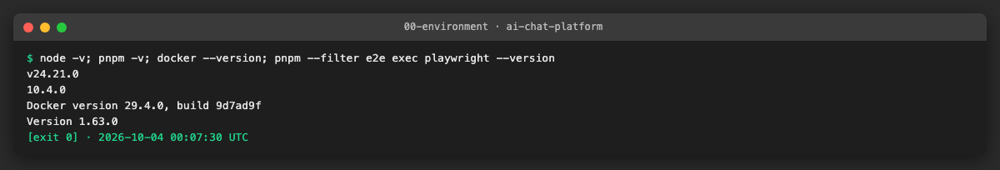

## 3. Steps

### US1 · Deterministic fonts and test data for screenshots ([AICHAT-39](https://ipca-grupo11.atlassian.net/browse/AICHAT-39))

**What and why.** A screenshot is only useful if the same page gives the same pixels every time. The shell loads Inter and JetBrains Mono from Google Fonts and the chat screens show server data, so both had to be fixed. In the visual tests only, the Google Fonts stylesheet and font requests are answered with local files (`e2e/src/visual/fonts/`, Latin subset, OFL licence included); the app is unchanged (self-hosting is AICHAT-230). Every `/auth` and `/api` call is answered with fixed JSON by `page.route`, any call that is not mocked fails the test, the clock is frozen with `page.clock.install` and `setFixedTime`, and animations are disabled. The built shell and the three remotes are served by a small static server on ports 5000 to 5003, so no backend or compose stack is needed.

**Files.**
- `e2e/src/visual/fonts/` (new): three woff2 files, `OFL.txt`, `README.md`.
- `e2e/src/visual/lib/fonts.ts`, `data.ts`, `mock-api.ts`, `static-server.ts`, `servers.ts`, `stable-css.ts` (new) with a `*.spec.ts` each (Vitest).
- `e2e/vitest.config.ts`: includes `src/visual/lib`.
- `scripts/visual/determinism.ts` (new): runs the comparison N times and checks every image byte for byte.

**How to run.**

```sh
pnpm exec nx run-many -t build -p shell mfe-auth mfe-chat mfe-settings && node scripts/visual/determinism.ts 10
```

**How to repeat it manually.**

1. Build the four apps as above and keep the machine idle.
2. Run `node scripts/visual/determinism.ts 10`. Each run rewrites all 18 baselines in Docker and compares them with the committed ones.
3. Expected output: ten lines `identical` and `all 10 runs produced identical images`.

**Result.** Ten runs in a row gave the same 18 images, byte for byte.

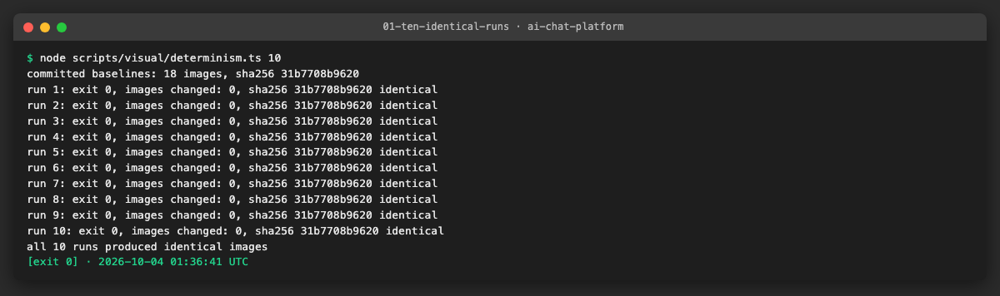

**Problems and fixes.** (1) The chat remote showed its fallback because the mocked `/auth/me` answer had no `id`; the real service answers `{ id, email }`, so the mock does the same. (2) The Vitest specs of the helpers were picked up by Playwright; the project now ignores `lib/`. (3) Runs were not identical: `chat-detail` came out in several variants that differ by one colour level on a few corner pixels of rounded borders (avatar, "Reasoning on" button). Chromium flags (software rendering, no LCD text, no hinting) were not enough; putting every `rounded*` element on its own layer in the test only (`will-change: transform`) gave 14 of 14 identical probes. The probes also showed that `--update-snapshots` alone keeps old images that are within tolerance, so the baselines are rewritten with `--update-snapshots=all` when the rendering changes.

### US2 · Playwright visual project and screenshot settings ([AICHAT-56](https://ipca-grupo11.atlassian.net/browse/AICHAT-56))

**What and why.** One place for the comparison rules: the project `visual` in `e2e/playwright.config.ts` with its own `testDir` (`src/visual`), viewport 1280×800 at scale 1, locale and time zone fixed, `snapshotPathTemplate` `{testDir}/__screenshots__/{projectName}/{arg}{ext}`, `animations: "disabled"`, `caret: "hide"`, and a limit of 50 different pixels with a per-pixel `threshold` of 0.2. The analysis suggested 1% of the pixels; we tried it and a changed login heading (649 pixels) passed, so the limit is tight now that the images are identical from run to run. The `e2e` target runs `--project=chromium`, so the two suites never run each other's specs.

**Files.**
- `e2e/playwright.config.ts`: project `visual`.
- `e2e/src/visual/screens.spec.ts` (new): 9 screens × 2 themes.
- `e2e/package.json`, `e2e/project.json`: `visual`, `visual:update` scripts; `e2e` runs `--project=chromium`.

**How to run.**

```sh
pnpm --filter e2e exec playwright test --list --project=visual
```

**How to repeat it manually.**

1. Run the command above: 18 tests in 1 file.
2. Run it with `--project=chromium` and check that no test comes from `src/visual`.

**Result.** The visual project lists only the 18 screens, the e2e project none of them.

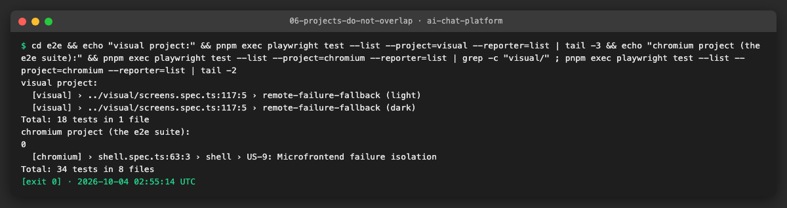

**Problems and fixes.** The 1% limit was too loose (see above and section 1).

### US3 · Visual baselines for 9 key screens, light and dark ([AICHAT-74](https://ipca-grupo11.atlassian.net/browse/AICHAT-74))

**What and why.** Login, login with validation error, register, chat list empty, chat list with three chats, chat detail (reasoning and fetched pages), new chat dialog, settings / API keys and the remote failure fallback, each in light and dark: 18 PNG files in `e2e/src/visual/__screenshots__/visual/`, made in the Playwright Docker image of the installed version.

**Files.**
- `e2e/src/visual/__screenshots__/visual/*.png` (new): 18 baselines.

**How to run.**

```sh
pnpm exec nx run-many -t build -p shell mfe-auth mfe-chat mfe-settings && pnpm --filter e2e run visual:update --update-snapshots=all
```

**How to repeat it manually.**

1. Build the apps and run the command above.
2. Expected: `18 passed` and `git status` shows no change in the screenshots folder (the baselines are reproducible).

**Result.** All 18 baselines were deleted and generated again from nothing; the result is identical to the committed files.

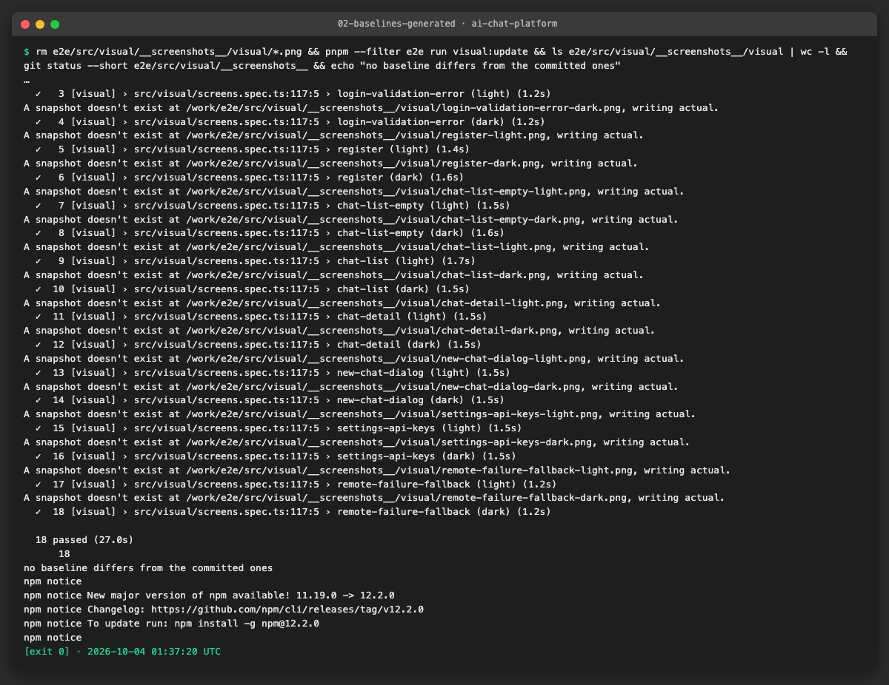

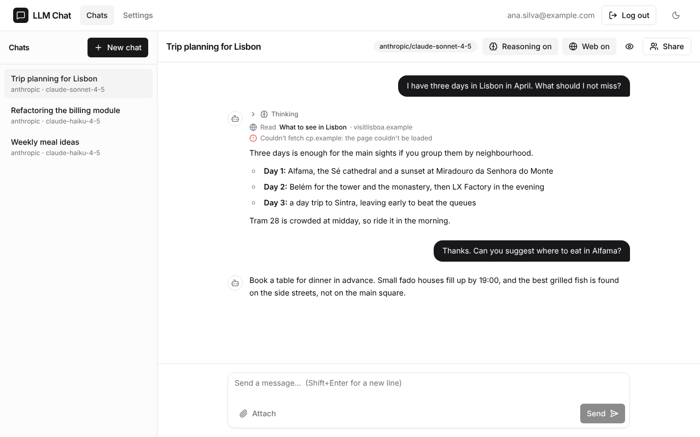

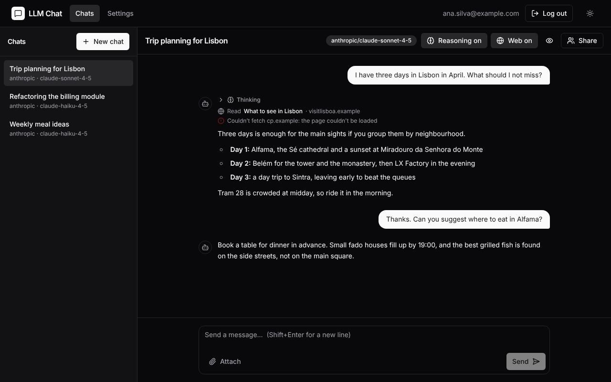

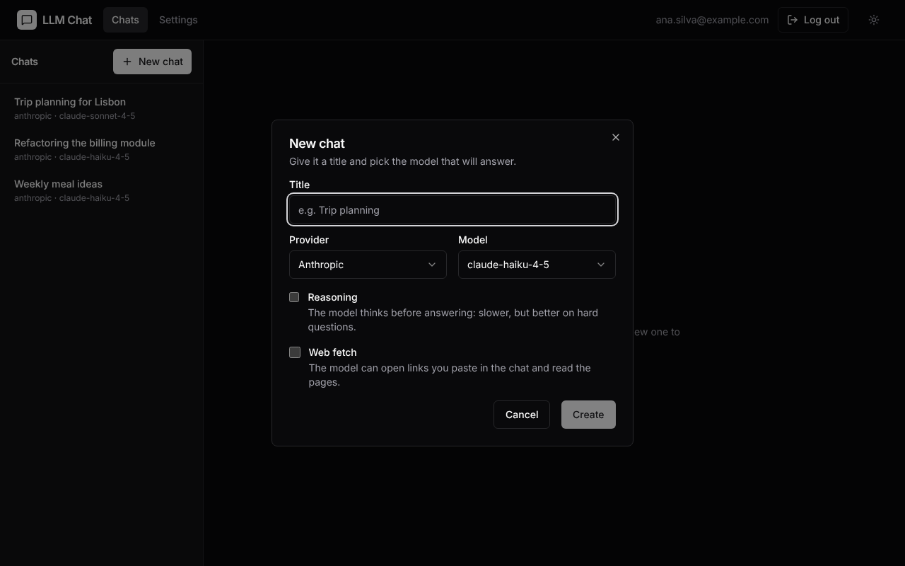

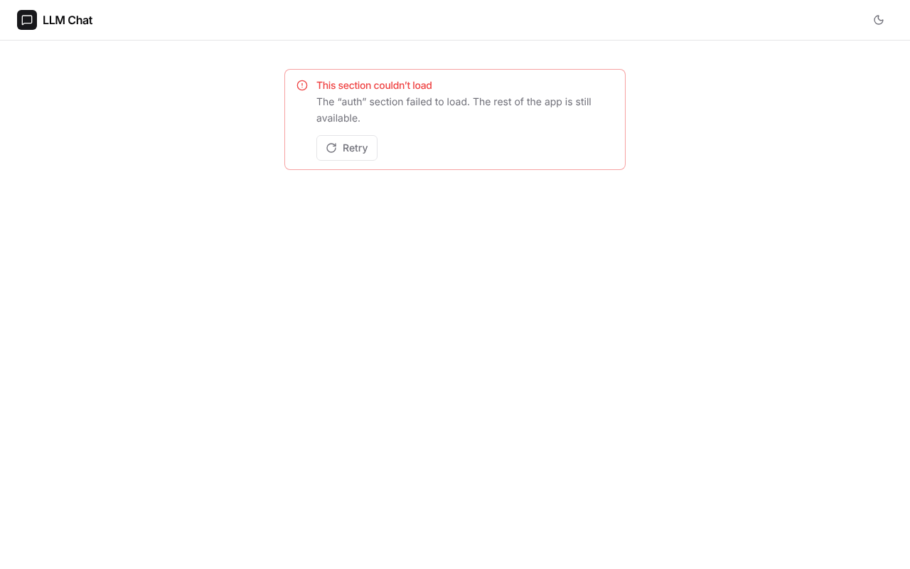

**Problems and fixes.** The baselines come from the arm64 image (Apple silicon); GitHub uses amd64. The amd64 image could not be run here (emulated Chromium never started and blocked the Docker daemon). See section 7.

### US4 · Fail CI on visual diffs and attach diff images ([AICHAT-92](https://ipca-grupo11.atlassian.net/browse/AICHAT-92))

**What and why.** `.github/workflows/visual.yml` runs on pull requests to `integration/testing-epics` and `main` that change `apps/**`, `packages/ui/**`, `e2e/src/visual/**`, the Playwright config or the workflow, and on demand. It builds the four apps and runs `pnpm --filter e2e run visual`, the same Docker command as on a developer machine. A diff makes Playwright exit with 1, so the job `visual / screenshots` fails, and `e2e/test-results/` (expected, actual and diff PNG) is uploaded as the artifact `visual-diff`. A structural Vitest spec (`e2e/src/ci/visual-workflow.spec.ts`) checks triggers, build, command, artifact, the image tag against the `@playwright/test` version and the project settings.

**Files.**
- `.github/workflows/visual.yml` (new).
- `e2e/src/ci/visual-workflow.spec.ts` (new).

**How to run.**

```sh
pnpm --filter e2e exec vitest run src/ci/visual-workflow.spec.ts
```

**How to repeat it manually.**

1. Change a visible text in an app (for example the title in `apps/mfe-auth/src/features/login/components/LoginForm.tsx`), build that app and run `pnpm --filter e2e run visual`.
2. Expected: the login screens fail, the exit code is 1 and `e2e/test-results/` holds the three PNG files per screen.
3. Undo the change and build again.

**Result.** A changed login heading fails 4 of 18 tests (649 pixels each); the diff image shows the old and new text in red. The change was not committed.

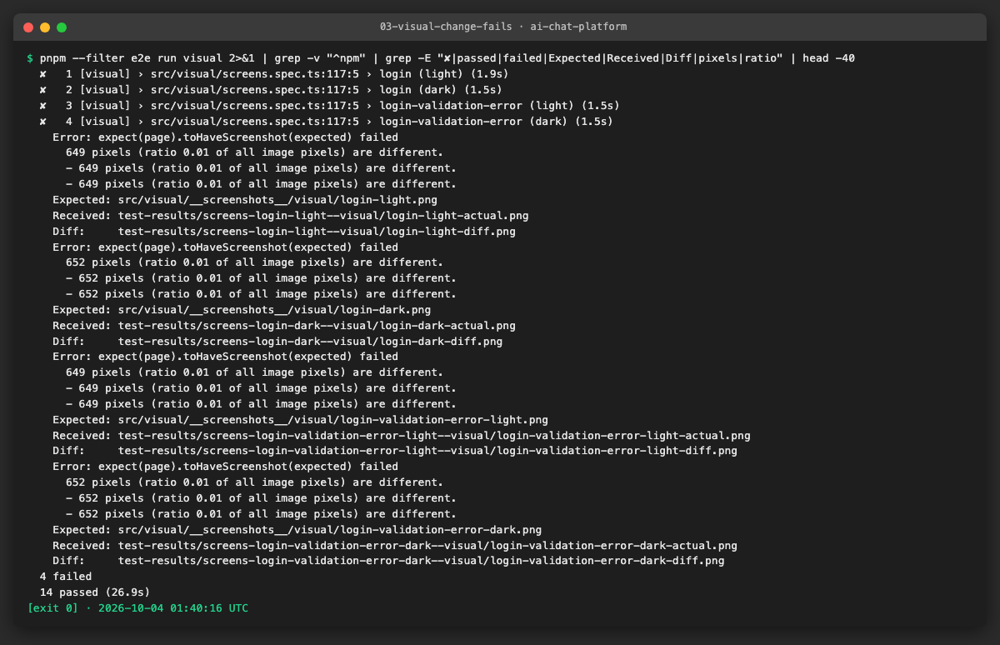

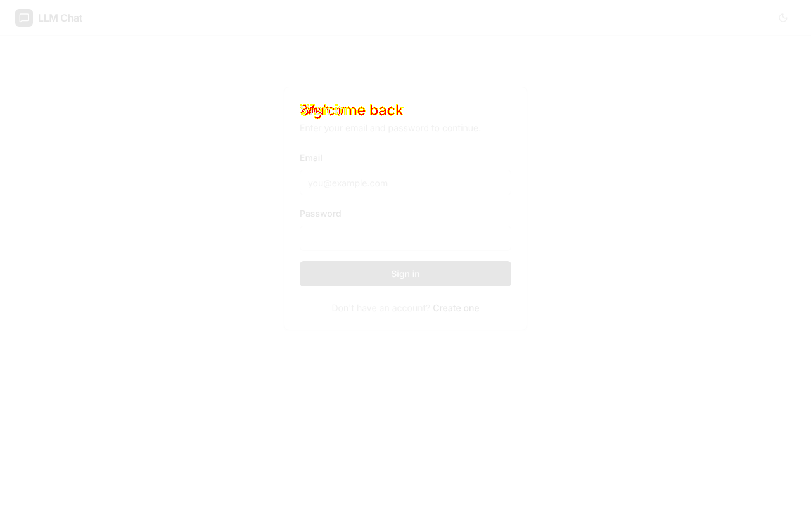

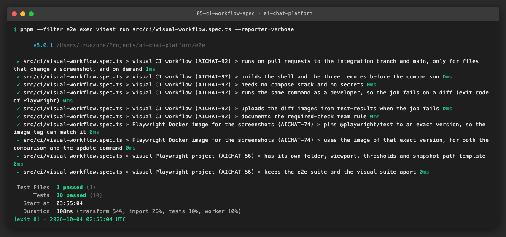

**Problems and fixes.** The workflow has not run on GitHub yet (not pushed). Branch protection is not available on this private repository, so "do not merge while `visual / screenshots` is red" is a team rule written in the workflow header.

### US5 · Document the baseline update procedure ([AICHAT-110](https://ipca-grupo11.atlassian.net/browse/AICHAT-110))

**What and why.** `docs/AICHAT-19/RUNNING.md` explains the rules (Docker image only, no backend), how to run the comparison, the Docker command to update baselines, a review checklist for changed PNGs, what to do when CI fails, how to check determinism and how to add a screen.

**Files.**
- `docs/AICHAT-19/RUNNING.md` (new).

**How to run.**

```sh
pnpm --filter e2e run visual:update
```

**How to repeat it manually.**

1. Follow "Update the baselines" in `RUNNING.md` after a UI change.
2. Go through the review checklist on the changed PNGs.

**Result.** The procedure was followed in this epic (baselines generated, rewritten and compared) with the commands in the document.

**Problems and fixes.** None.

## 4. How to run everything

```sh
pnpm exec nx run-many -t build -p shell mfe-auth mfe-chat mfe-settings   # the tests look at apps/*/dist
pnpm --filter e2e run visual                                              # compare in the Playwright Docker image
pnpm --filter e2e run visual:update                                       # update baselines after an intended change
node scripts/visual/determinism.ts 10                                     # 10 identical runs
pnpm --filter e2e exec vitest run                                         # unit tests of helpers and workflow spec
```

## 5. Results

| Metric | Before | After |
|---|---|---|
| Visual tests | none | 18 screenshots (9 screens × light and dark) |
| Fonts and data | Google Fonts, live data | local fonts, mocked API, frozen clock |
| Identical runs | n/a | 10 of 10 (byte for byte) |
| Limit | n/a | 50 pixels; a changed heading (649 pixels) fails |
| CI | none | `visual.yml`, diff images as artifact |

## 6. DoD check

| DoD item | Met | Evidence |
|---|---|---|
| Fonts without network, mocks, frozen clock, 10 identical runs | ✅ | [10 runs](evidence/01-ten-identical-runs.png) |
| `visual` project with thresholds, path template, viewport | ✅ | [projects](evidence/06-projects-do-not-overlap.png) |
| 18 baselines made in the Playwright Docker image | ✅ | [baselines](evidence/02-baselines-generated.png) |
| CI fails on a diff and uploads the diff PNGs | ✅ | [diff fails](evidence/03-visual-change-fails.png), [diff image](evidence/04-diff-image-login-light.png), [workflow spec](evidence/05-ci-workflow-spec.png) |
| `RUNNING.md` with Docker update command and review checklist | ✅ | `docs/AICHAT-19/RUNNING.md` |
| Lint, typecheck, test, build of affected projects | ✅ | section 7 |
| SAST and secret scan | ✅ | section 7 |
| Required check | ➖ | Not enforceable (branch protection unavailable); team rule in `visual.yml` |

## 7. Notes for the report

- **Checks before the pull request.** `pnpm exec nx affected -t lint typecheck test build size --base=origin/integration/testing-epics --parallel=3`: green. `pnpm sast`: no ERROR finding on the final commits. `gitleaks git --redact --config .gitleaks.toml --log-opts=origin/integration/testing-epics..HEAD`: no leaks.
- **Found.** Default rendering was not identical from run to run: one screen changed by one colour level on a few corner pixels. A 1% limit would let a changed heading pass.
- **Not done.** The workflow has not run on GitHub. The baselines come from the arm64 image; the amd64 image was not run here (it did not start under emulation and blocked the local Docker daemon, which needed a restart). If the first run on GitHub differs, use the `visual-diff` artifact or regenerate on amd64 (see `RUNNING.md`). The app still loads Google Fonts (AICHAT-230). The required check is a team rule.
- **Lessons.** `--update-snapshots` without a value keeps images that are within tolerance; use `=all` after a rendering change. Tolerances must be tested with a real change. A helper folder next to Playwright specs needs `testIgnore`.
