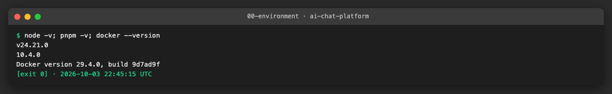
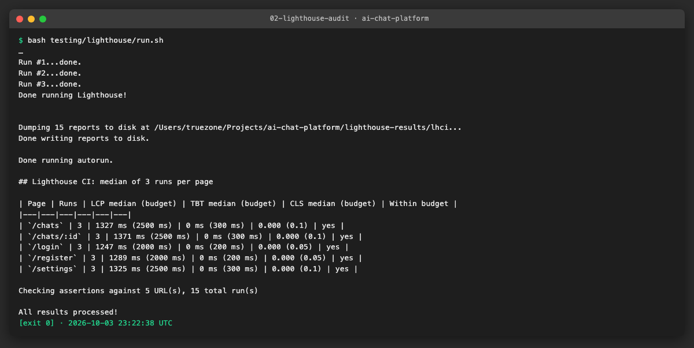
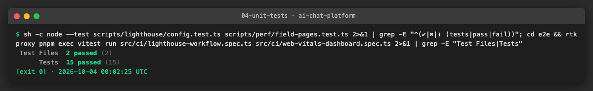
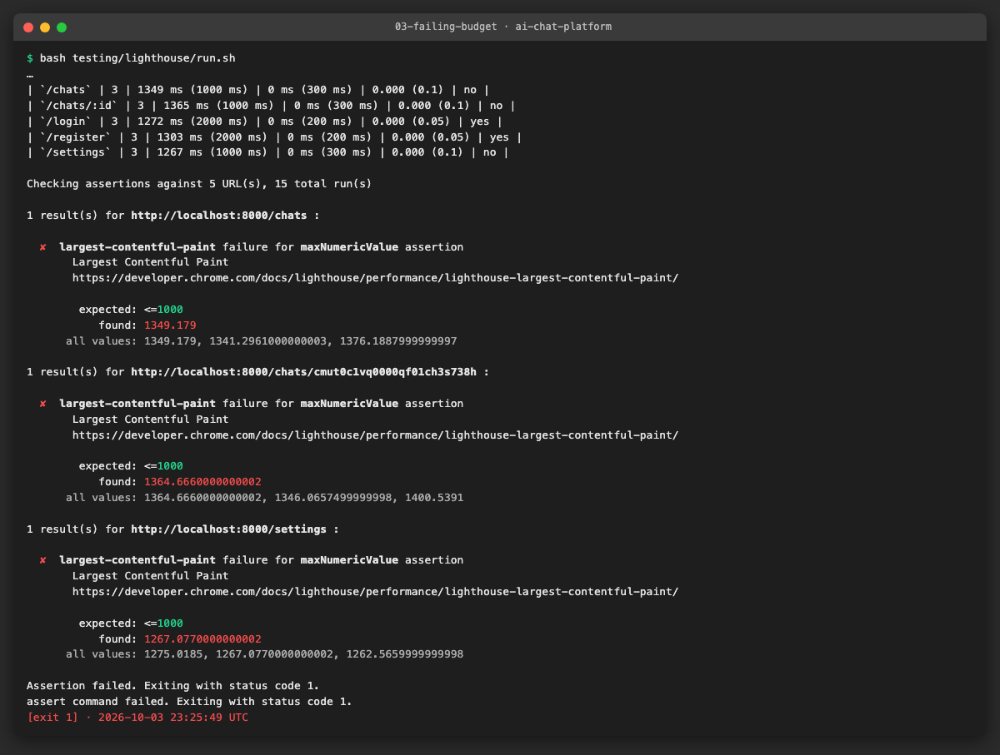
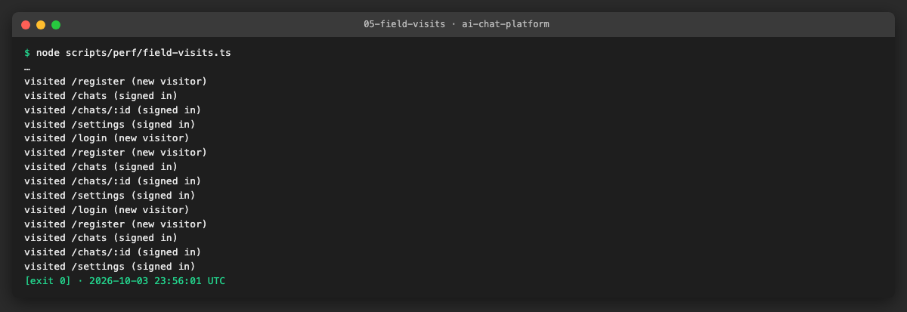
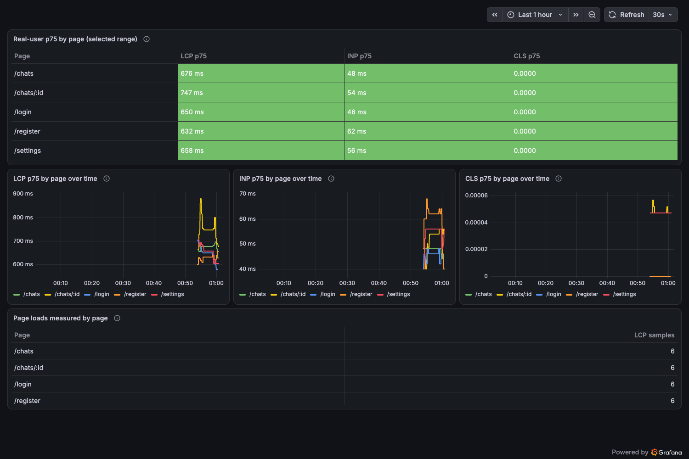
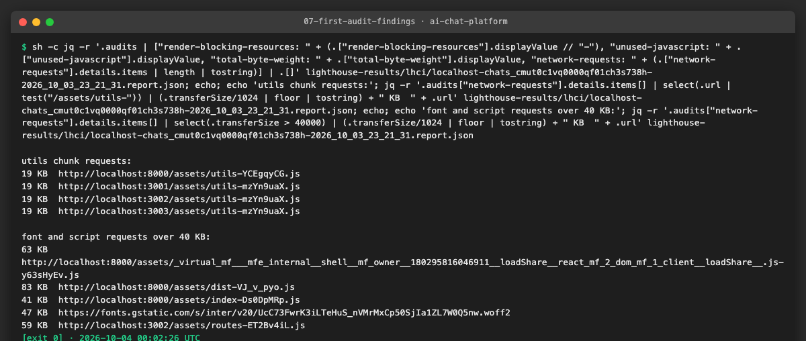

# AICHAT-21 · Performance testing (frontend): work log

| Field | Value |
|---|---|
| Epic | [AICHAT-21](https://ipca-grupo11.atlassian.net/browse/AICHAT-21) |
| Analysis | [README.md](README.md) |
| Owner | Jean-Pierre Carvalho |
| Branch | `test/AICHAT-21-performance-testing` |
| Started / finished | 2026-10-03 / 2026-10-04 |
| Pull requests | [#23](https://github.com/ipca-group11/ai-chat-platform/pull/23) |
| Status | Done, merged into `integration/testing-epics` |

## 1. DoR review

Date: 2026-10-03

| DoR item | Status | Question asked | Decision | Decided by |
|---|---|---|---|---|
| Owner assigned | Met | — | Jean-Pierre Carvalho | — |
| Scope agreed | Met | Which pages? | `/login`, `/register`, `/chats`, `/chats/:id`, `/settings` | Team (owner delegated) |
| Tooling agreed | Met | Lab and field tools? | Lighthouse CI (desktop preset, median of 3 runs) for lab data with TBT as the INP proxy; Grafana Faro (already in the shell) for field LCP/INP/CLS | Team (owner delegated) |
| Target environment available | Met | Where does it run? | The compose stack with the LLM mock (`pnpm mock:up llm`), locally and on the CI runner. The Azure VM is not used by this epic, so the field dashboard is proven with real browser visits on the local stack | Team (owner delegated) |
| Budgets agreed per page | Met | README §5 proposal | Approved as proposed (login/register LCP ≤ 2.0 s, TBT ≤ 200 ms, CLS ≤ 0.05; other pages LCP ≤ 2.5 s, TBT ≤ 300 ms, CLS ≤ 0.1; INP field p75 ≤ 200 ms) | Team (owner delegated) |
| Signed-in pages | Met | How does Lighthouse see them? | A seeded test user signs in before the run; its session cookie is passed to Lighthouse (extra headers), so no browser login script is needed | Team (owner delegated) |
| CI trigger and noise | Met | The full e2e suite left pull requests because it was slow | Own workflow `lighthouse.yml` with the same triggers as DAST: pull requests to `main`, pushes to `integration/testing-epics` and `main`, manual runs. Budgets assert as `error` with median of 3; reports kept as artifacts | Team (owner delegated) |
| Budgets table recorded | Met | AC of AICHAT-45 | Recorded in US1 below, same numbers as the README §5 proposal | Team (owner delegated) |
| Config file format | Deviation from the AC wording | The AC of AICHAT-62 names `lighthouserc.cjs` and a login script; the repository allows TypeScript only (no `.cjs`, `.js`, `.mjs`) | `lighthouserc.json` (data, not code) plus `scripts/lighthouse/run.ts`, run with `node run.ts`, which registers and signs in the test user and passes the session cookie to Lighthouse CI as an extra header | Team (owner delegated) |
| Login and register pages | Met, with a limit | One Lighthouse CI run sends the same headers to all five URLs | The cookie is sent to `/login` and `/register` too; they do not redirect a signed-in user, so they are measured as served. A run without a cookie for these two pages is a possible follow-up | Team (owner delegated) |
| Field data | Met, from the local stack | There is no VM for this epic | `scripts/perf/field-visits.ts` visits the pages in headless Chrome on the local stack; Grafana shows what Faro stored. The numbers are **from the local stack, not the VM** | Team (owner delegated) |
| Dashboard | Met | Extend `frontend-faro.json` or add one? | New `web-vitals-by-page.json` next to it; the existing dashboard stays as it was | Team (owner delegated) |
| Follow-up tickets | Met | Create Jira tickets? | Not by this work: the findings are listed in US5 and the coordinator creates the tickets | Team (owner delegated) |
| Ports on the development machine | Stack on 14001, 14002, 13300 and 19090 | Another project uses 4001, 4002, 3300 and 9090 (same as AICHAT-28); CI uses the defaults | Team (owner delegated) |

Blockers: none

## 2. Environment

| Tool | Version | Install |
|---|---|---|
| macOS | 26.3 | n/a |
| Node | `node -v` → v24.21.0 | `nvm install` (reads `.nvmrc`) |
| pnpm | `pnpm -v` → 10.4.0 | `corepack enable` |
| Docker | `docker --version` → Docker version 29.4.0 | Docker Desktop or OrbStack |
| Lighthouse CI | `pnpm exec lhci --version` → 0.15.1 | `pnpm add -D -w @lhci/cli` (already in `package.json`) |
| Google Chrome | 154.0.8037.95 | installed on the machine; the CI runner has Chrome preinstalled |
| puppeteer-core | 25.12.0 | `pnpm add -D -w puppeteer-core`; drives Chrome for the field visits and the dashboard screenshot |
| Grafana / Loki / Alloy | from `compose.yaml` (Grafana 13.2.3) | `pnpm mock:up` |



## 3. Steps

### US1 · Agree LCP/INP/CLS budgets per page ([AICHAT-45](https://ipca-grupo11.atlassian.net/browse/AICHAT-45))

**What and why.** The team approved the budget proposal of the analysis (README §5) without changes, as recorded in section 1. The budgets are Google's "good" thresholds, made stricter for the two simple pages. Lab runs use the Lighthouse desktop preset and the median of 3 runs. Lighthouse cannot measure INP (it needs a real interaction), so the lab budget uses Total Blocking Time (TBT) as the proxy and INP is judged on the field data in Grafana.

| Page | LCP (lab) | TBT (lab, INP proxy) | CLS | INP (field p75) |
|---|---|---|---|---|
| `/login`, `/register` | ≤ 2.0 s | ≤ 200 ms | ≤ 0.05 | ≤ 200 ms |
| `/chats` | ≤ 2.5 s | ≤ 300 ms | ≤ 0.1 | ≤ 200 ms |
| `/chats/:id` | ≤ 2.5 s | ≤ 300 ms | ≤ 0.1 | ≤ 200 ms |
| `/settings` | ≤ 2.5 s | ≤ 300 ms | ≤ 0.1 | ≤ 200 ms |

**Files.**
- `docs/AICHAT-21/WORKLOG.md` (this table and section 1): the record of the approval.
- `lighthouserc.json`: the same numbers as assertions (US2, US3). `e2e/src/ci/lighthouse-workflow.spec.ts` fails if the file and this table drift apart.

**How to run.**

```sh
cd e2e && pnpm exec vitest run src/ci/lighthouse-workflow.spec.ts
```

**How to repeat it manually.**

1. Read the table above and section 1 for who decided.
2. Open `lighthouserc.json` and compare the `maxNumericValue` of each `assertMatrix` entry (milliseconds for LCP and TBT, a score for CLS).

**Result.** Budgets approved and recorded. The test above passes ([evidence 04](evidence/04-unit-tests.png)).

**Problems and fixes.** None.

### US2 · Lighthouse CI audit for every page, including logged-in pages ([AICHAT-62](https://ipca-grupo11.atlassian.net/browse/AICHAT-62))

**What and why.** `lhci autorun` audits the five pages, 3 runs each, with the desktop preset and only the performance category. The pages behind sign-in need a session, so `scripts/lighthouse/run.ts` registers the test user on the local stack (reusing `signInSeededUser` of the DAST epic, `scripts/dast/zap-session.ts`), signs in, creates one chat, and writes a temporary config: `lighthouserc.json` with the real chat id in `/chats/{CHAT_ID}` and the access token cookie as an extra header (`settings.extraHeaders`). The temporary file has mode 600, is deleted after the run, and is the only place the cookie is stored. In GitHub Actions the cookie value is also masked in the log. After the run the script prints the median of each page against its budget and writes `lighthouse-results/summary.md`.

This replaces the wording of the AC (`lighthouserc.cjs` and a login script): the repository allows TypeScript only, so the config is JSON and the sign-in is a `.ts` file run with `node` (decision in section 1, "Team (owner delegated)").

**Files.**
- `lighthouserc.json` (new): URLs, 3 runs, desktop preset, filesystem upload, assertions (US3).
- `scripts/lighthouse/run.ts` (new): sign-in, temporary config, `lhci autorun`, summary, exit code of `lhci`.
- `scripts/lighthouse/config.ts`, `config.test.ts` (new): pure helpers (config with chat id and cookie, median, budget lookup, Markdown table) and their 6 unit tests.
- `testing/lighthouse/run.sh` (new): sets the password of the throw-away account and starts `run.ts`.
- `package.json`, `pnpm-lock.yaml`: `@lhci/cli` as a dev dependency. `.gitignore`: `lighthouse-results/`.

**How to run.**

```sh
pnpm mock:up && bash testing/lighthouse/run.sh
```

**How to repeat it manually.**

1. Start the stack with `pnpm mock:up` (if 4001, 4002, 3300 or 9090 are busy, set `AUTH_SERVICE_PORT`, `CONVERSATION_SERVICE_PORT`, `GRAFANA_PORT` and `PROMETHEUS_PORT`). Export `ACCESS_TOKEN_TTL_SECONDS=3600` before it.
2. Run `bash testing/lighthouse/run.sh`. It takes about 3.5 minutes (15 audits). Google Chrome must be installed.
3. Read the table at the end of the output, or open `lighthouse-results/summary.md`. The HTML report of every run is in `lighthouse-results/lhci/*.report.html`.
4. To see the signed-in pages in a report, open the `/chats` HTML report and look at the screenshot: it shows the chat list, not the login form.

**Result.** 5 URLs × 3 runs = 15 reports. Median per page (full table in [results/lighthouse-summary.md](results/lighthouse-summary.md)):

| Page | LCP median (budget) | TBT median (budget) | CLS median (budget) |
|---|---|---|---|
| `/login` | 1247 ms (2000 ms) | 0 ms (200 ms) | 0.000 (0.05) |
| `/register` | 1289 ms (2000 ms) | 0 ms (200 ms) | 0.000 (0.05) |
| `/chats` | 1327 ms (2500 ms) | 0 ms (300 ms) | 0.000 (0.1) |
| `/chats/:id` | 1371 ms (2500 ms) | 0 ms (300 ms) | 0.000 (0.1) |
| `/settings` | 1325 ms (2500 ms) | 0 ms (300 ms) | 0.000 (0.1) |

All five pages are inside their budget with room to spare on this machine. A CI runner is slower, so the first runs in Actions may sit closer to the limits.





**Problems and fixes.**
- The first version of the summary read `lhr-*.json`; the filesystem target writes `<host>-<path>-<time>.report.json`. The table was empty until the file filter was fixed (commit "read the report files under the names Lighthouse CI writes").
- `/login` and `/register` are measured with the session cookie because one run sends the same headers to every URL. They do not redirect a signed-in user, so the pages are the real ones, but a visitor without a session is not what is measured. Noted in section 1.
- TBT is 0 ms on every page on this machine (desktop preset, no CPU throttling), so it will only trigger when a page gets much heavier. The field INP in US4 is the better judge of interactivity.

### US3 · Fail CI when a page exceeds its budget ([AICHAT-80](https://ipca-grupo11.atlassian.net/browse/AICHAT-80))

**What and why.** `.github/workflows/lighthouse.yml` has one job, `budgets`, with the same triggers as DAST (pull requests to `main`, pushes to `integration/testing-epics` and `main`, manual runs) and the same stack steps as `dast.yml` (free disk, `pnpm mock:up`, bounded wait on three health URLs, `pnpm mock:down` always). It installs the dependencies, runs `bash testing/lighthouse/run.sh` and uploads `summary.md`, the HTML reports and `manifest.json` as the artifact `lighthouse-report` (14 days), also when the job fails. The budgets are `assertMatrix` entries in `lighthouserc.json`: `error` level, `aggregationMethod: median`, so one slow run does not fail a page but a slow median does. `lhci` exits 1 on a failing assertion, `run.ts` passes that code on, and the job fails. The job is named `lighthouse / budgets`. Branch protection is not available on this private free-plan repository (HTTP 403), so, as for DAST, the team rule is not to merge into `main` while it is red.

**Files.**
- `.github/workflows/lighthouse.yml` (new).
- `e2e/src/ci/lighthouse-workflow.spec.ts` (new): 11 structural tests: triggers equal to DAST, stack steps, artifact and teardown with `if: always()`, the script exit code, the five URLs, 3 runs, every budget as `error` on the median, no cookie in the committed config.

**How to run.**

```sh
cd e2e && pnpm exec vitest run src/ci/lighthouse-workflow.spec.ts
```

**How to repeat it manually.**

1. Start the stack as in US2.
2. Make a copy of the config with a budget that cannot be met, for example `sed 's/"maxNumericValue": 2500/"maxNumericValue": 1000/' lighthouserc.json > /tmp/tight.json`.
3. Run `LH_CONFIG=/tmp/tight.json LH_RESULTS=/tmp/lh-tight bash testing/lighthouse/run.sh; echo $?`.
4. Expected: `expected: <=1000, found: 13xx` for `/chats`, `/chats/:id` and `/settings`, then `Assertion failed. Exiting with status code 1.` and exit code 1. The committed file is not changed. In Actions the same exit code turns the job red and the artifact is still uploaded.

**Result.** With the LCP budget of the three signed-in pages tightened to 1000 ms, the audit fails and exits 1; the other pages stay green.




**Problems and fixes.**
- The workflow has not run on GitHub yet (the branch is not pushed), so the first Actions run can still show Linux-only differences (Chrome flags, timings). `chromeFlags` has `--no-sandbox` for the runner.
- The audit needs the dependencies, so this workflow installs them (`pnpm install --frozen-lockfile`); `dast.yml` does not need `node_modules` for its scripts.

### US4 · Real-user Web Vitals per page in Grafana ([AICHAT-98](https://ipca-grupo11.atlassian.net/browse/AICHAT-98))

**What and why.** Faro already sends the Web Vitals to Loki through Alloy, and the existing dashboard `frontend-faro.json` shows one overall p75 per vital. The AC asks for the breakdown by page, so we added the dashboard `web-vitals-by-page.json` in `observability/grafana/provisioning/dashboards` (the provisioning provider picks it up; the Grafana image bakes the folder, so rebuild the `grafana` service). It has a table with LCP, INP and CLS p75 per page, coloured by the Google thresholds, a p75-over-time chart per vital, and the number of page loads behind each value. Each Faro line carries `page_url`; the LogQL `label_format` folds `/chats/<id>` into `/chats/:id` and keeps the first path segment of the others, so the table has one row per page.

There is no VM for this epic, so the data is generated on the local stack: `scripts/perf/field-visits.ts` opens each page in headless Chrome (a new browser context per visit, so no cache; `/login` and `/register` without a session, the others with the test user's cookie), clicks and types so INP exists, hides the page so the browser reports LCP, CLS and INP, and lets Faro send them. The values are the ones Chrome measured. **They are from the local stack, not the VM.**

**Files.**
- `observability/grafana/provisioning/dashboards/web-vitals-by-page.json` (new).
- `scripts/perf/field-visits.ts`, `field-pages.ts`, `field-pages.test.ts` (new): the visits, their pure plan and 3 unit tests.
- `scripts/perf/dashboard-shot.ts` (new): headless Chrome screenshot of a Grafana dashboard (used for the evidence).
- `e2e/src/ci/web-vitals-dashboard.spec.ts` (new): 4 structural tests of the dashboard JSON.
- `package.json`, `pnpm-lock.yaml`: `puppeteer-core` as a dev dependency.

**How to run.**

```sh
pnpm mock:up && FIELD_PASSWORD=<any password for the test user> node scripts/perf/field-visits.ts
```

**How to repeat it manually.**

1. Start the stack as in US2 (build the `grafana` service again if the dashboard JSON changed: `docker compose --profile llm up -d --build --no-deps grafana`).
2. Run the visits above (6 rounds, about 3 minutes; `FIELD_ROUNDS` changes the number).
3. Open Grafana at `http://localhost:3300` (user `admin`, password `admin` on the local stack; skip the password change), then the dashboard "Web Vitals by page (Grafana Faro)", range "Last 1 hour".
4. Or take the screenshot with `GRAFANA_PASSWORD=admin node scripts/perf/dashboard-shot.ts --uid web-vitals-by-page --out shot.png` (`GRAFANA_URL` if the port differs).

**Result.** After 30 visits (6 per page) the dashboard shows p75 per page, all green (full table in [results/field-vitals-p75.md](results/field-vitals-p75.md)):

| Page | LCP p75 | INP p75 | CLS p75 |
|---|---|---|---|
| `/login` | 650 ms | 46 ms | 0.0000 |
| `/register` | 632 ms | 62 ms | 0.0000 |
| `/chats` | 676 ms | 48 ms | 0.0000 |
| `/chats/:id` | 747 ms | 54 ms | 0.0000 |
| `/settings` | 658 ms | 56 ms | 0.0000 |

Field LCP is lower than the lab LCP (about 1.3 s) because Lighthouse measures with its own load profile and settings; INP is well under the 200 ms budget on every page.





**Problems and fixes.**
- A first dashboard with bar gauges rendered empty in the screenshot, although the queries returned data. A table with one query per vital joined on `page`, plus time series, renders correctly and is easier to read.
- `networkidle0` never fires on the chat page (it keeps a stream open), so the visits wait for `load` plus a fixed 2 s.
- A fresh Grafana asks for a new admin password; the screenshot script skips that step (the stack is throw-away).
- The first `docker compose up --build grafana` was interrupted and left two containers half created; the stack was brought down and up again.
- Faro page URLs contain chat ids (AICHAT-32 already tracks scrubbing); the dashboard folds them so ids do not become labels.

### US5 · Performance improvements list from the first audit ([AICHAT-115](https://ipca-grupo11.atlassian.net/browse/AICHAT-115))

**What and why.** We read the first `/chats` report (and the other pages for the shared parts) for the three areas of the AC: shared dependencies, fonts, preloading. The pages are inside their budgets, so these are improvements, not fixes. Numbers come from the Lighthouse audits of US2 on the local stack.

**Files.**
- `docs/AICHAT-21/WORKLOG.md`: this list. No ticket is created by this work; the coordinator creates them from the table.

**How to run.**

```sh
jq -r '.audits["unused-javascript"].displayValue' lighthouse-results/lhci/*chats_*.report.json
```

**How to repeat it manually.**

1. Run the audit of US2.
2. Open `lighthouse-results/lhci/localhost-chats_<id>-<time>.report.html` and read "Diagnostics" (render blocking requests, unused JavaScript, network dependency tree).
3. Or list the requests: `jq -r '.audits["network-requests"].details.items[] | (.transferSize/1024|floor|tostring) + " KB " + .url' <report>.json`.

**Result.**

| # | Area | Finding | Evidence | Follow-up |
|---|---|---|---|---|
| 1 | Fonts | Inter (5 weights) and JetBrains Mono load from Google Fonts: a render-blocking stylesheet (est. 280 ms on LCP), then a 47 KB WOFF2 from a third origin on the critical path | `render-blocking-resources`, network tree | Already tracked: AICHAT-230 (self-host fonts). Add to its scope: load only the weights used, `preload` the main WOFF2 |
| 2 | Shared dependencies | The `utils` chunk (19 KB transferred) is downloaded four times, once from each origin (shell and the three remotes), under two hashes (`utils-YCEgqyCG` in the shell, `utils-mzYn9uaX` in the remotes) | `network-requests`, [evidence 07](evidence/07-first-audit-findings.png) | The AICHAT-22 utils-chunk finding; not duplicated here |
| 3 | Shared dependencies | The README suspected that each remote bundles its own react-dom. The audit does not confirm it: `duplicated-javascript` passes and React, React DOM and TanStack are served once by the shell through Module Federation (`loadShare` chunks). No ticket | `duplicated-javascript` score 1 | None |
| 4 | Preloading | The page starts a chain: HTML → `mf-entry-bootstrap` → shell `remoteEntry.js` → remote `remoteEntry.js` → remote route chunk (`routes-*.js`, 59 KB) → its imports. The remote files are only requested after the shell runs | `network-dependency-tree-insight` (28 chains) | New ticket A |
| 5 | Unused code | 136 KiB of JavaScript is downloaded but not run on `/chats`: the shared `dist-*.js` chunk (83 KB, 77 % unused) and the chat `routes-*.js` (59 KB, 77 % unused) | `unused-javascript` | New ticket B |
| 6 | Field coverage | The Faro dashboard folds chat ids, but Faro still sends full URLs with chat ids to Loki | Loki lines have `page_url=.../chats/<id>` | Already tracked: AICHAT-32 |
| 7 | Lab signal | TBT is 0 ms everywhere, so the TBT budget cannot catch regressions in interactivity on this runner | `total-blocking-time` | New ticket C |

Tickets to create (proposed):
- **A. Preload the micro-frontend entry points.** Add `modulepreload` or `preconnect` hints for the remote `remoteEntry.js` of the current route (or start the remote load in the shell before React mounts), so the remote chunks do not wait for the shell's JavaScript. Measure the change in `/chats` LCP and the depth of the dependency tree.
- **B. Split and trim the unused JavaScript.** Reduce the 136 KiB of unused code on `/chats`: split the shared UI chunk by component, lazy-load parts of the chat route that are not needed for the first paint, and check that tree shaking removes the unused exports. Recheck `unused-javascript` after each change.
- **C. Add an interaction check for INP in CI.** TBT is always 0, so add a Lighthouse user flow (or a scripted interaction) for the chat page that measures INP, and assert it against the 200 ms budget.



**Problems and fixes.** The audit runs on a fast machine without throttling, so the sizes are reliable and the timings are only a guide. The estimated savings (280 ms for the fonts, 136 KiB for unused code) come from Lighthouse's own estimates.

## 4. How to run everything

```sh
export ACCESS_TOKEN_TTL_SECONDS=3600                     # the audit signs in with a cookie; the default lifetime is 15 minutes
pnpm mock:up                                             # stack with the LLM mock (set the *_PORT variables if 4001, 4002, 3300, 9090 are busy)
bash testing/lighthouse/run.sh                           # US2, US3: 5 pages x 3 runs, median against the budgets, exit 1 over budget
LH_CONFIG=<copy with tighter budgets> bash testing/lighthouse/run.sh   # US3: see the job fail
FIELD_PASSWORD=<password> node scripts/perf/field-visits.ts            # US4: real-browser visits for the Faro data
GRAFANA_PASSWORD=admin node scripts/perf/dashboard-shot.ts --uid web-vitals-by-page --out shot.png
pnpm mock:down
pnpm test:scripts && (cd e2e && pnpm exec vitest run src/ci)           # unit tests of the helpers and the workflow/dashboard specs
```

## 5. Results

| Metric | Before | After |
|---|---|---|
| Lab performance checks | none | Lighthouse CI on every pull request to `main`: 5 pages × 3 runs, median asserted against the budgets |
| Budgets | proposal | approved and enforced: LCP, TBT and CLS per page, `error` level |
| First audit, median LCP | n/a | 1247–1371 ms (budget 2000–2500 ms) |
| First audit, median TBT / CLS | n/a | 0 ms / 0.000 on all pages |
| Field Web Vitals by page | one overall p75 per vital | table and charts per page; local p75 LCP 632–747 ms, INP 46–62 ms, CLS about 0 |
| Findings | none | 7 findings; 3 new tickets proposed, 3 already tracked (AICHAT-230, AICHAT-22, AICHAT-32) |

## 6. DoD check

| DoD item | Met | Evidence |
|---|---|---|
| Budgets table approved and recorded | ✅ | US1 |
| Lighthouse CI config and sign-in for the logged-in pages, 5 URLs × 3 runs locally | ✅ (TypeScript instead of `.cjs`) | [audit](evidence/02-lighthouse-audit.png) |
| CI job with assertions, reports kept as an artifact | ✅ | [workflow spec](evidence/04-unit-tests.png) |
| A failing assertion fails the job | ✅ | [failing budget](evidence/03-failing-budget.png) |
| Required check | ➖ | Not enforceable: branch protection is unavailable on this private free-plan repository (HTTP 403). Team rule in the header of `lighthouse.yml`: no merge to `main` while `lighthouse / budgets` is red |
| Faro dashboard with LCP/INP/CLS p75 by page, documented with a screenshot | ✅ (local stack, not the VM) | [Grafana](evidence/06-grafana-web-vitals.png) |
| Improvements list linked to follow-up tickets | ✅ | US5; tickets are created by the coordinator |
| Unit tests for the new scripts | ✅ | [tests](evidence/04-unit-tests.png) |
| Lint, typecheck, test, build of affected projects | ✅ | section 7 |
| SAST and secret scan | ✅ | section 7 |
| Documentation | ✅ | headers of `lighthouse.yml`, `run.ts`, `run.sh`, this log |

## 7. Notes for the report

- **Checks before the pull request.** `pnpm exec nx affected -t lint typecheck test build --base=origin/integration/testing-epics`: 18 projects, all green. `pnpm test:scripts` (28 tests) and `pnpm typecheck:scripts`: green. `pnpm sast`: no ERROR finding. `gitleaks git --redact --log-opts=origin/integration/testing-epics..HEAD`: no leaks. No session cookie or token is in a committed file (`grep` for `access_token=` and `eyJ` over `docs/AICHAT-21` and `lighthouserc.json`); the cookie is only in a temporary config (mode 600, deleted) and masked in CI.
- **Found.** All five pages pass their budgets by a wide margin on the local stack. The only items worth a change are fonts (AICHAT-230), the request chain to the remotes, and unused JavaScript. The suspected duplicated react-dom is not there.
- **Not done.** The workflow has not run on GitHub yet (the branch is not pushed). The required check is a team rule, not a branch protection. Field data is from the local stack, not the VM: the same dashboard works on the VM once the stack runs there. `/login` and `/register` are audited with the session cookie. Nothing is audited with CPU or network throttling.
- **Lessons.** A report summary must not depend on a file name pattern you have not looked at. A table panel is the safest way to show a per-page breakdown from Loki. `networkidle` does not work on pages with an open stream.

## 8. Follow-ups

Lighthouse (desktop preset, median of 3) on 2026-10-04 with Docker off: the four apps built and served with `vite preview` (shell :15000, remotes :15001-15003), backend = the mock server run with `tsx` (`testing/mock-server`). Before = `integration/develop`, after = AICHAT-237 to 240 together.

| Page | JS requests | JS transferred | Unused JS | LCP |
|---|---|---|---|---|
| `/chats` | 51 → 32 | 453 → 316 KiB | 166 → 78 KiB | 1277 → 982 ms |
| `/chats/:id` | 52 → 36 | 454 → 372 KiB | 161 → 119 KiB | 1255 → 1108 ms |
| `/login` | 49 → 28 | 414 → 268 KiB | 119 → 55 KiB | 1237 → 943 ms |
| `/settings` | 49 → 29 | 414 → 307 KiB | 118 → 55 KiB | 1246 → 981 ms |

### AICHAT-238 · Preload the micro-frontend entry points

`apps/shell/remote-preload.ts` (a Vite plugin) adds a `preconnect` per remote origin to `index.html` and an inline script that adds a `modulepreload` for the `remoteEntry.js` of the page being opened, tagged `data-mf-remote`. `main.tsx` reads the tag and starts the federated import of that remote before React mounts, so the remote downloads in parallel with the shell boot and the session check of `RequireAuth` instead of after it. Unit tests: `src/app/remotePreload.test.ts`, `preloadRemote.test.ts`.

### AICHAT-239 · Unused JavaScript on `/chats`

Unused JS on `/chats` 166 → 78 KiB (table above): the shared design system was split by component and the chat view and dialogs are lazy (details in docs/AICHAT-22/WORKLOG.md §8).
