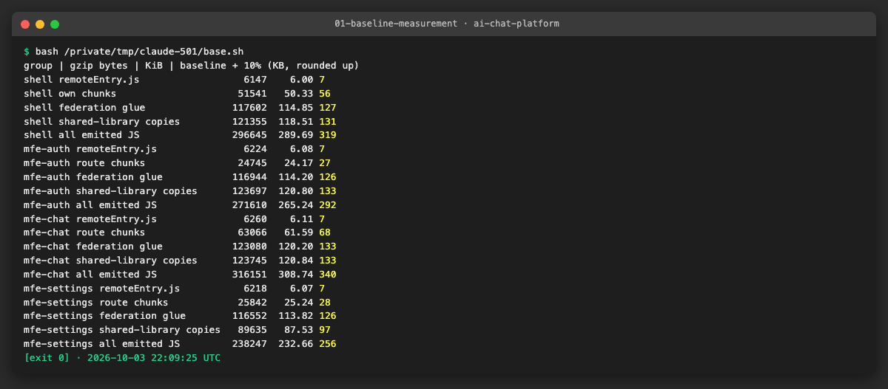

# AICHAT-22 · Bundle size budget testing: work log

| Field | Value |
|---|---|
| Epic | [AICHAT-22](https://ipca-grupo11.atlassian.net/browse/AICHAT-22) |
| Analysis | [README.md](README.md) |
| Owner | Jean-Pierre Carvalho |
| Branch | `test/AICHAT-22-bundle-size-budget-testing` |
| Started / finished | 2026-10-03 / … |
| Pull requests | #… |
| Status | In Progress |

## 1. DoR review

Date: 2026-10-03

| DoR item | Status | Question asked | Decision | Decided by |
|---|---|---|---|---|
| Owner assigned | Met | — | Jean-Pierre Carvalho | — |
| Scope agreed | Met | Which files? | Shell and the 3 remotes (mfe-auth, mfe-chat, mfe-settings): each `remoteEntry.js`, the exposed-module chunk graph and a total guard rail that includes the shared fallbacks | Team (owner delegated) |
| Tooling agreed | Met | Which tool? | size-limit with `@size-limit/file` (gzip) as an Nx `size` target per app, config in TypeScript where size-limit allows it; globs for hashed chunk names | Team (owner delegated) |
| Target environment available | Met | Where does it run? | The production build output (`nx build`) locally and in the CI `nx affected` job; no stack needed | Team (owner delegated) |
| Size limits agreed per remote | Met | README §5 proposal | Measured baseline + 10% for every group (rounded up to the next KB), with the README numbers as upper bounds: `remoteEntry.js` ≤ 8 KB gzip, shell own chunks ≤ 120 KB, auth and settings routes ≤ 40 KB, chat routes ≤ 80 KB. Limits are tightened after improvements, never loosened without a PR note | Team (owner delegated) |
| Runtime-loaded vs all emitted | Met | Fallback chunks inflate totals | Both: strict limits on what loads at runtime, a looser total over all emitted JS | Team (owner delegated) |
| Shared-once check (AICHAT-119) | Met | The browser e2e suite is disabled | One small local headless run that opens `/chats` against the mock stack and lists the JS requests (React, react-dom, router loaded once); the result is recorded in the work log, not run in CI | Team (owner delegated) |

Blockers: none

## 2. Environment

| Tool | Version | Install |
|---|---|---|
| macOS / Ubuntu | … | — |
| Node | `node -v` → … | … |
| pnpm | `pnpm -v` → … | `corepack enable` |
| Docker | `docker --version` → … | … |
| <tool for this epic> | … | … |

## 3. Steps

### US1 · Agree bundle size limits per remote ([AICHAT-47](https://ipca-grupo11.atlassian.net/browse/AICHAT-47))

**What and why.** The analysis only had rough numbers, and they mixed two different things: files the browser downloads and fallback copies of React, the router and Query that every remote emits but never uses while the shell provides them. We built the four apps (`pnpm exec nx run-many -t build`) and measured the gzip size of every emitted `.js` file, then split them into groups by file name:

- `remoteEntry.js`: the federation manifest, the first file a host requests.
- application chunks: everything that is not federation glue and not a shared-library copy (the exposed routes of a remote, the pages of the shell).
- federation glue: the Module Federation runtime and loaders (`dist-*`, `utils-*`, `hostInit-*`, `mf-entry-bootstrap-*`, ...).
- shared-library copies: `*prebuild*` (fallbacks in a remote) and `*loadShare*` (the shell's own copies of react, react-dom, router, query and `@app/ui`).
- all emitted JS: a guard rail over everything.

The rule of the DoR review is: limit = measured baseline + 10%, rounded up to the next KB (1 KB = 1024 bytes, as size-limit counts), never above the upper bounds of the analysis (`remoteEntry.js` 8 KB, shell 120 KB, auth and settings routes 40 KB, chat routes 80 KB). Sizes are gzip, summed per group from the per-file gzip size, measured on 2026-10-03 on Node 24.21.0.

| App | Group | Baseline (KB) | Limit (KB) | Upper bound of the analysis |
|---|---|---|---|---|
| shell | `remoteEntry.js` | 6.00 | 7 | 8 |
| shell | application chunks | 50.33 | 56 | 120 |
| shell | federation glue | 114.85 | 127 | none |
| shell | shared-library copies | 118.51 | 131 | none |
| shell | all emitted JS | 289.69 | 319 | none |
| mfe-auth | `remoteEntry.js` | 6.08 | 7 | 8 |
| mfe-auth | route chunks | 24.17 | 27 | 40 |
| mfe-auth | federation glue | 114.20 | 126 | none |
| mfe-auth | shared-library copies | 120.80 | 133 | none |
| mfe-auth | all emitted JS | 265.24 | 292 | none |
| mfe-chat | `remoteEntry.js` | 6.11 | 7 | 8 |
| mfe-chat | route chunks | 61.59 | 68 | 80 |
| mfe-chat | federation glue | 120.20 | 133 | none |
| mfe-chat | shared-library copies | 120.84 | 133 | none |
| mfe-chat | all emitted JS | 308.74 | 340 | none |
| mfe-settings | `remoteEntry.js` | 6.07 | 7 | 8 |
| mfe-settings | route chunks | 25.24 | 28 | 40 |
| mfe-settings | federation glue | 113.82 | 126 | none |
| mfe-settings | shared-library copies | 87.53 | 97 | none |
| mfe-settings | all emitted JS | 232.66 | 256 | none |

Limits are tightened after improvements and never raised without a reason in the pull request.

**Files.**
- `docs/AICHAT-22/WORKLOG.md`: this table (the configuration that enforces it comes with US2).

**How to run.**

```sh
pnpm exec nx run-many -t build && for a in shell mfe-auth mfe-chat mfe-settings; do (cd apps/$a && pnpm exec size-limit --json); done
```

**How to repeat it manually.**

1. Build the apps: `pnpm exec nx run-many -t build`.
2. Run `gzip -9c apps/mfe-chat/dist/assets/routes-*.js | wc -c` for a single file, or the loop above for all groups (the group definitions are in `apps/<app>/.size-limit.ts`, added in US2).
3. Expected output: the sizes of the table (they move by a few bytes with the file hash and the gzip level).

**Result.** The remote entries are about 6 KB each. The application code is small (24 to 62 KB), while the federation glue (114 to 120 KB, mostly the 85 KB `dist-*` chunk that holds the federation runtime) and the shared-library copies weigh more than the application. That is why the budget separates the groups: a single "total" would hide a growth of the application behind the glue.



**Problems and fixes.** The analysis gave a total of 241 KB gzip for the shell; our figure is 290 KB because the total here adds the gzip size of every file (each file is compressed on its own, which is what a browser downloads), and the analysis compressed the whole folder once. The measurement is repeatable, so the new figure is the baseline.

### US2 · …

## 4. How to run everything

```sh
# all checks added by this epic, from the repo root
```

## 5. Results

| Metric | Before | After |
|---|---|---|
| … | … | … |

## 6. DoD check

| DoD item | Met | Evidence |
|---|---|---|
| … | ✅ | [link](evidence/…) |

## 7. Notes for the report

- What was found
- What was fixed / waived
- Lessons learned
