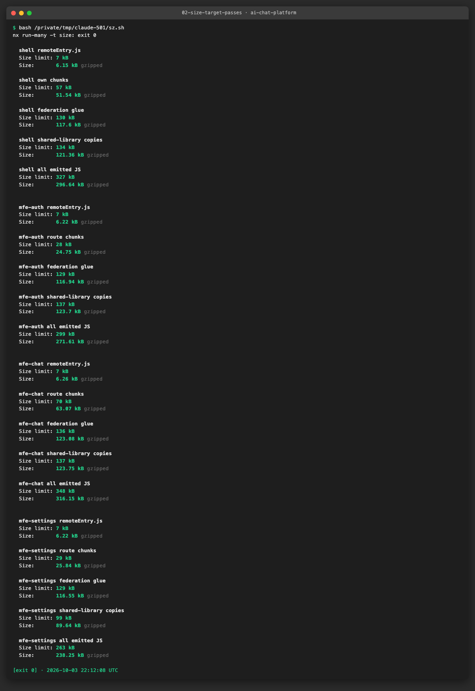
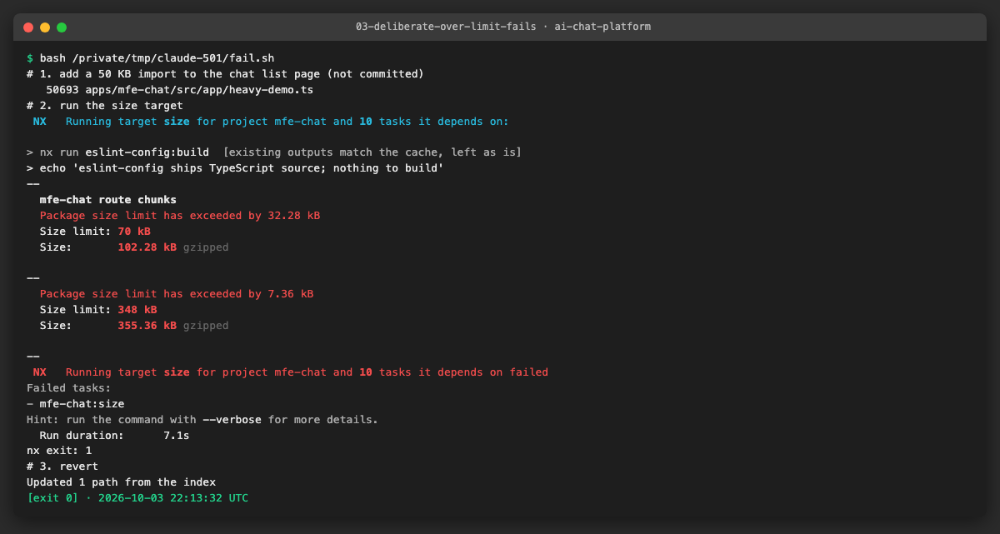
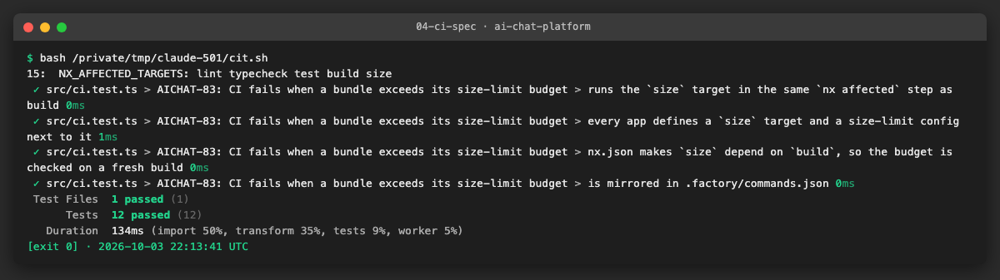
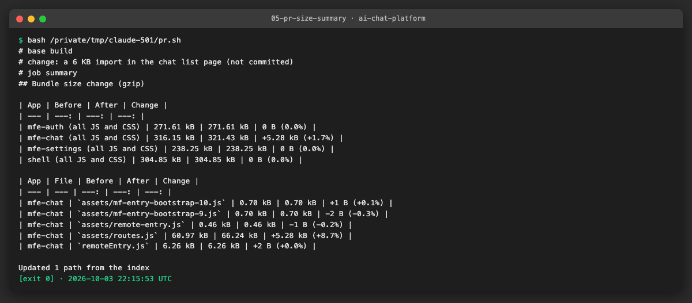
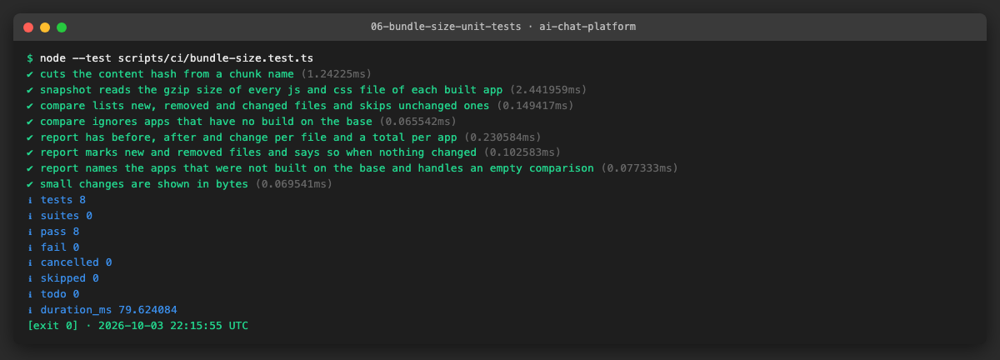

# AICHAT-22 · Bundle size budget testing: work log

| Field | Value |
|---|---|
| Epic | [AICHAT-22](https://ipca-grupo11.atlassian.net/browse/AICHAT-22) |
| Analysis | [README.md](README.md) |
| Owner | Jean-Pierre Carvalho |
| Branch | `test/AICHAT-22-bundle-size-budget-testing` |
| Started / finished | 2026-10-03 / … |
| Pull requests | #… |
| Status | In Progress |

## 1. DoR review

Date: 2026-10-03

| DoR item | Status | Question asked | Decision | Decided by |
|---|---|---|---|---|
| Owner assigned | Met | — | Jean-Pierre Carvalho | — |
| Scope agreed | Met | Which files? | Shell and the 3 remotes (mfe-auth, mfe-chat, mfe-settings): each `remoteEntry.js`, the exposed-module chunk graph and a total guard rail that includes the shared fallbacks | Team (owner delegated) |
| Tooling agreed | Met | Which tool? | size-limit with `@size-limit/file` (gzip) as an Nx `size` target per app, config in TypeScript where size-limit allows it; globs for hashed chunk names | Team (owner delegated) |
| Target environment available | Met | Where does it run? | The production build output (`nx build`) locally and in the CI `nx affected` job; no stack needed | Team (owner delegated) |
| Size limits agreed per remote | Met | README §5 proposal | Measured baseline + 10% for every group (rounded up to the next kB), with the README numbers as upper bounds: `remoteEntry.js` ≤ 8 KB gzip, shell own chunks ≤ 120 KB, auth and settings routes ≤ 40 KB, chat routes ≤ 80 KB. Limits are tightened after improvements, never loosened without a PR note | Team (owner delegated) |
| Runtime-loaded vs all emitted | Met | Fallback chunks inflate totals | Both: strict limits on what loads at runtime, a looser total over all emitted JS | Team (owner delegated) |
| Shared-once check (AICHAT-119) | Met | The browser e2e suite is disabled | One small local headless run that opens `/chats` against the mock stack and lists the JS requests (React, react-dom, router loaded once); the result is recorded in the work log, not run in CI | Team (owner delegated) |

Blockers: none

## 2. Environment

| Tool | Version | Install |
|---|---|---|
| macOS / Ubuntu | … | — |
| Node | `node -v` → … | … |
| pnpm | `pnpm -v` → … | `corepack enable` |
| Docker | `docker --version` → … | … |
| <tool for this epic> | … | … |

## 3. Steps

### US1 · Agree bundle size limits per remote ([AICHAT-47](https://ipca-grupo11.atlassian.net/browse/AICHAT-47))

**What and why.** The analysis only had rough numbers, and they mixed two different things: files the browser downloads and fallback copies of React, the router and Query that every remote emits but never uses while the shell provides them. We built the four apps (`pnpm exec nx run-many -t build`) and measured the gzip size of every emitted `.js` file, then split them into groups by file name:

- `remoteEntry.js`: the federation manifest, the first file a host requests.
- application chunks: everything that is not federation glue and not a shared-library copy (the exposed routes of a remote, the pages of the shell).
- federation glue: the Module Federation runtime and loaders (`dist-*`, `utils-*`, `hostInit-*`, `mf-entry-bootstrap-*`, ...).
- shared-library copies: `*prebuild*` (fallbacks in a remote) and `*loadShare*` (the shell's own copies of react, react-dom, router, query and `@app/ui`).
- all emitted JS: a guard rail over everything.

The rule of the DoR review is: limit = measured baseline + 10%, rounded up to the next kB (1 kB = 1000 bytes, as size-limit counts), never above the upper bounds of the analysis (`remoteEntry.js` 8 KB, shell 120 KB, auth and settings routes 40 KB, chat routes 80 KB). Sizes are gzip, summed per group from the per-file gzip size, measured on 2026-10-03 on Node 24.21.0.

| App | Group | Baseline (kB) | Limit (kB) | Upper bound of the analysis |
|---|---|---|---|---|
| shell | `remoteEntry.js` | 6.15 | 7 | 8 |
| shell | application chunks | 51.54 | 57 | 120 |
| shell | federation glue | 117.60 | 130 | none |
| shell | shared-library copies | 121.36 | 134 | none |
| shell | all emitted JS | 296.64 | 327 | none |
| mfe-auth | `remoteEntry.js` | 6.22 | 7 | 8 |
| mfe-auth | route chunks | 24.75 | 28 | 40 |
| mfe-auth | federation glue | 116.94 | 129 | none |
| mfe-auth | shared-library copies | 123.70 | 137 | none |
| mfe-auth | all emitted JS | 271.61 | 299 | none |
| mfe-chat | `remoteEntry.js` | 6.26 | 7 | 8 |
| mfe-chat | route chunks | 63.07 | 70 | 80 |
| mfe-chat | federation glue | 123.08 | 136 | none |
| mfe-chat | shared-library copies | 123.75 | 137 | none |
| mfe-chat | all emitted JS | 316.15 | 348 | none |
| mfe-settings | `remoteEntry.js` | 6.22 | 7 | 8 |
| mfe-settings | route chunks | 25.84 | 29 | 40 |
| mfe-settings | federation glue | 116.55 | 129 | none |
| mfe-settings | shared-library copies | 89.64 | 99 | none |
| mfe-settings | all emitted JS | 238.25 | 263 | none |

Limits are tightened after improvements and never raised without a reason in the pull request.

**Files.**
- `docs/AICHAT-22/WORKLOG.md`: this table (the configuration that enforces it comes with US2).

**How to run.**

```sh
pnpm exec nx run-many -t build && for a in shell mfe-auth mfe-chat mfe-settings; do (cd apps/$a && pnpm exec size-limit --json); done
```

**How to repeat it manually.**

1. Build the apps: `pnpm exec nx run-many -t build`.
2. Run `gzip -9c apps/mfe-chat/dist/assets/routes-*.js | wc -c` for a single file, or the loop above for all groups (the group definitions are in `apps/<app>/.size-limit.ts`, added in US2).
3. Expected output: the sizes of the table (they move by a few bytes with the file hash and the gzip level).

**Result.** The remote entries are about 6 KB each. The application code is small (24 to 62 KB), while the federation glue (114 to 120 KB, mostly the 85 KB `dist-*` chunk that holds the federation runtime) and the shared-library copies weigh more than the application. That is why the budget separates the groups: a single "total" would hide a growth of the application behind the glue.


**Problems and fixes.** The analysis gave a total of 241 KB gzip for the shell; our figure is 290 KB because the total here adds the gzip size of every file (each file is compressed on its own, which is what a browser downloads), and the analysis compressed the whole folder once. The measurement is repeatable, so the new figure is the baseline.

### US2 · Nx size target for remoteEntry.js and chunks ([AICHAT-65](https://ipca-grupo11.atlassian.net/browse/AICHAT-65))

**What and why.** We added `size-limit` with the `@size-limit/file` plugin as root dev dependencies (`pnpm add -D size-limit @size-limit/file -w`) and one configuration per app, `apps/<app>/.size-limit.ts` (size-limit 14 reads TypeScript configuration, so there is no `.js` file). Each file lists the five groups of US1 with their limits and `gzip: true`; the groups are globs over `dist/` (the application chunks are "all `assets/*.js` except the glue and the shared-library copies", so a new chunk lands in the budget without a config change). Every app has a `size` Nx target (`size-limit`, cwd the app) and `nx.json` gives the target its defaults: `dependsOn: ["build"]` (the check always measures a fresh build) and caching. The limits are the ones of US1.

**Files.**
- `apps/shell/.size-limit.ts`, `apps/mfe-auth/.size-limit.ts`, `apps/mfe-chat/.size-limit.ts`, `apps/mfe-settings/.size-limit.ts` (new): groups and limits.
- `apps/*/project.json`: `size` target.
- `nx.json`: `size` in `targetDefaults`.
- `package.json`, `pnpm-lock.yaml`: `size-limit`, `@size-limit/file`.

**How to run.**

```sh
pnpm exec nx run-many -t size        # builds what is missing, then checks the four apps
pnpm exec nx run mfe-chat:size       # one app
```

**How to repeat it manually.**

1. `pnpm install` (the lockfile has the two packages).
2. `pnpm exec nx run-many -t size`.
3. Expected output: for every group "Size limit: N kB" above "Size: M kB gzipped" with M smaller than N, and exit code 0.

**Result.** All 20 checks (5 groups, 4 apps) pass on the current base of the integration branch, which is the code that becomes `main`; `main` itself still lacks the earlier epics (unit-test, DAST and so on), so its build is not the one we measured.



**Problems and fixes.** size-limit counts 1 kB as 1000 bytes, not 1024, so the first limits (computed with 1024) were wrong by about 2.4% and were recomputed; the table of US1 has the final figures. The shell and the remotes name the shared-library copies differently (`*loadShare*` in the shell, `*prebuild*` and `*loadShare*` in remotes), so the group takes both patterns.

### US3 · Fail CI when a bundle exceeds its limit ([AICHAT-83](https://ipca-grupo11.atlassian.net/browse/AICHAT-83))

**What and why.** The `nx affected` step of `ci.yml` now runs `lint typecheck test build size`. `size` depends on `build` (set in `nx.json`), and size-limit exits with code 1 when a group is over its limit, so Nx marks the task failed and the job and the pull request go red. Only affected apps run the check: a change in `packages/ui` runs it for every app that uses it, a change in one remote runs it for that remote. `.factory/commands.json` (the `test` command that the CI spec compares with the workflow) has the same target list. The CI structural test `packages/workspace-config/src/ci.test.ts` checks the new target list, the `size` target and config of the four apps, and the dependency on `build`.

**Files.**
- `.github/workflows/ci.yml`: `size` in `NX_AFFECTED_TARGETS`, job name and comment.
- `.factory/commands.json`: `size` in the `test` command.
- `packages/workspace-config/src/ci.test.ts`: four new tests.

**How to run.**

```sh
pnpm exec nx affected -t lint typecheck test build size --base=origin/integration/testing-epics
pnpm --filter @platform/workspace-config exec vitest run src/ci.test.ts
```

**How to repeat it manually.**

1. Create `apps/mfe-chat/src/app/heavy-demo.ts` with an exported string of 50 KB of random characters.
2. Import it in `apps/mfe-chat/src/app/ChatListPage.tsx` and use it (`console.debug(heavy.length)`) so the bundler keeps it.
3. `pnpm exec nx run mfe-chat:size`.
4. Expected output: "Package size limit has exceeded" for `mfe-chat route chunks` and exit code 1. Delete the file and restore `ChatListPage.tsx`.

**Result.** The deliberate import of a 50 KB file (random text, which gzip cannot shrink) takes the chat route chunks from 63.07 kB to 102.28 kB against a limit of 70 kB, the `all emitted JS` group goes over as well, and `nx` exits with 1. Nothing of the test is committed: the script of the evidence adds the file and removes it at the end (`git status` is clean afterwards).





**Problems and fixes.** A first idea was a separate CI job for the size check; it would build the apps a second time and `ci.test.ts` asserts that the workflow has one job, so the target stays in the same `nx affected` run, where the Nx cache already has the build. Branch protection is not available on this private repository (as noted in AICHAT-28), so the rule "no merge with a red `nx affected` job" remains a team rule.

### US4 · Show bundle size change on each PR ([AICHAT-101](https://ipca-grupo11.atlassian.net/browse/AICHAT-101))

**What and why.** A reviewer should see what a pull request does to the bundles without reading build logs. We chose the job summary of `ci.yml` (no token, no comment spam, nothing to maintain) over a PR comment. `scripts/ci/bundle-size.ts` has two commands: `snapshot` writes the gzip size of every `.js` and `.css` file in `apps/*/dist` to a JSON file, and `report` compares two snapshots and prints a Markdown table: one line per app with the total before and after, then one line per file that is new, removed or different, with before, after and change (bytes below 1 kB, kB above). File names carry a content hash, so the hash is cut (`index-BCMqHVD7.js` becomes `index.js`) to find the same chunk on both sides. In CI, the new step `Bundle size change` runs on pull requests only: it snapshots the `dist` folders of this run, checks out the base branch in a second worktree, builds the four apps there, snapshots them and appends the report to `$GITHUB_STEP_SUMMARY`. Apps that were not affected have no `dist` in this run and are left out of the comparison. The step has `continue-on-error: true`: it informs, the budget is enforced by the `size` target (US3).

**Files.**
- `scripts/ci/bundle-size.ts`, `scripts/ci/bundle-size.test.ts` (new): snapshot, compare, report; 8 tests (name normalisation, snapshot of a temporary `dist`, new/removed/changed files, unchanged files left out, apps without a base build, bytes for small changes).
- `.github/workflows/ci.yml`: step `Bundle size change`.
- `packages/workspace-config/src/ci.test.ts`: two tests for the step.

**How to run.**

```sh
node scripts/ci/bundle-size.ts snapshot --out /tmp/head.json           # after a build
node scripts/ci/bundle-size.ts report /tmp/base.json /tmp/head.json    # base.json from the base branch
pnpm test:scripts && pnpm typecheck:scripts
```

**How to repeat it manually.**

1. `pnpm exec nx run-many -t build` and `node scripts/ci/bundle-size.ts snapshot --out /tmp/base.json`.
2. Add a 6 KB import to `apps/mfe-chat/src/app/ChatListPage.tsx` (as in US3), build again and write `/tmp/head.json`.
3. `node scripts/ci/bundle-size.ts report /tmp/base.json /tmp/head.json`. Expected output: `assets/routes.js` of `mfe-chat` about +5 kB, the app total +5 kB, other apps 0. Undo the change.

**Result.** With the 6 KB import the report shows `mfe-chat` growing from 316.15 kB to 321.43 kB (+1.7%) and, per file, `assets/routes.js` from 60.97 kB to 66.24 kB (+8.7%); the few-byte changes of the entry files come from the hashes of other chunks written into them. The test file passes and the scripts typecheck. The step has not run on GitHub yet: the branch is not pushed.





**Problems and fixes.** The first version printed `+0.00 kB` for changes of a few bytes, which reads as no change; sizes below 1 kB now show in bytes. The base build needs its own `pnpm install` in the second worktree, which adds about a minute to pull request runs; it is the price of an exact before and after, and Nx and pnpm caches of the runner keep it low.

### US5 · …

## 4. How to run everything

```sh
# all checks added by this epic, from the repo root
```

## 5. Results

| Metric | Before | After |
|---|---|---|
| … | … | … |

## 6. DoD check

| DoD item | Met | Evidence |
|---|---|---|
| … | ✅ | [link](evidence/…) |

## 7. Notes for the report

- What was found
- What was fixed / waived
- Lessons learned
