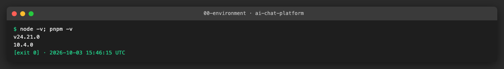
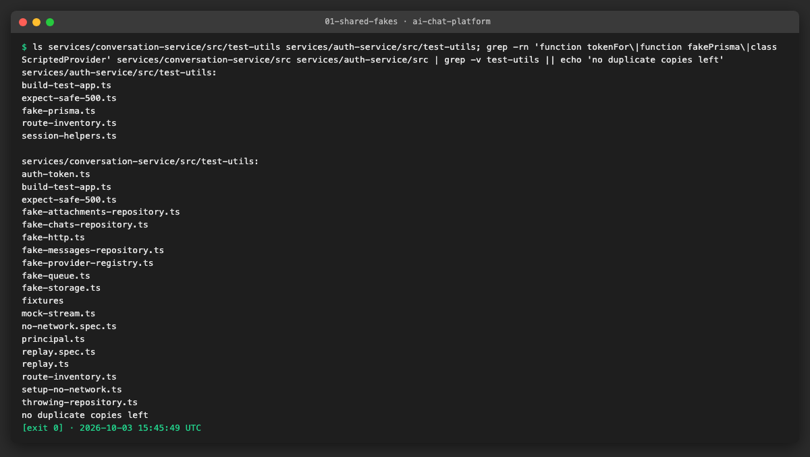
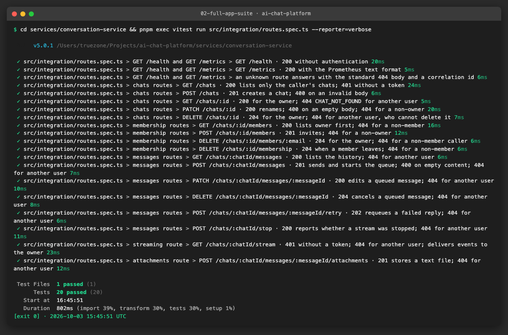
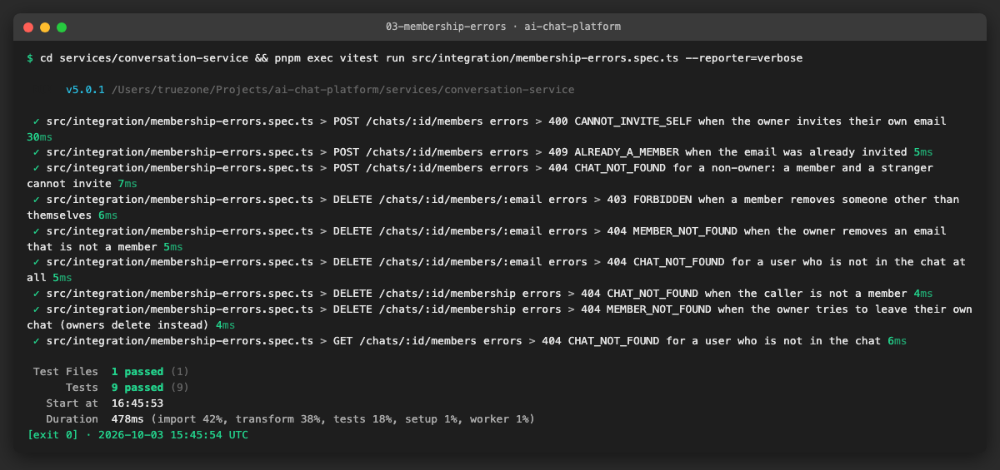
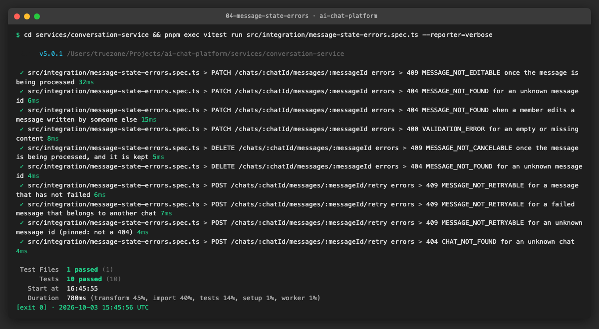
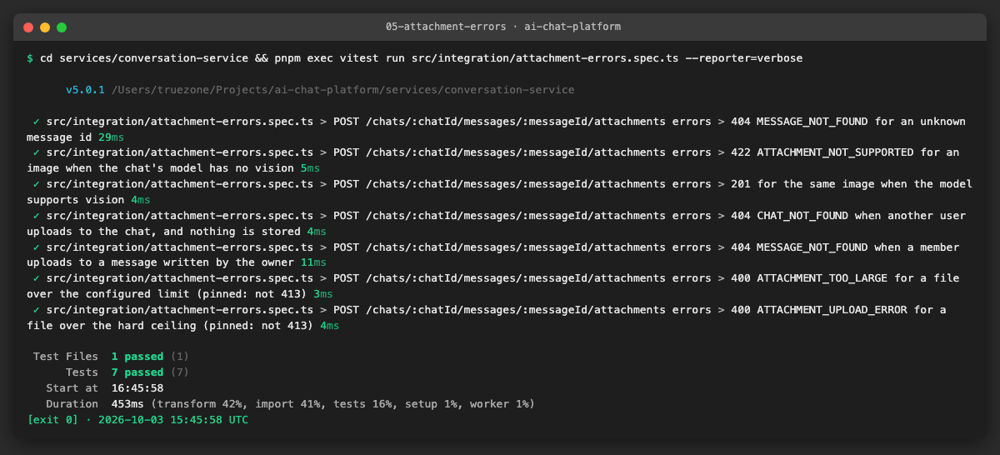
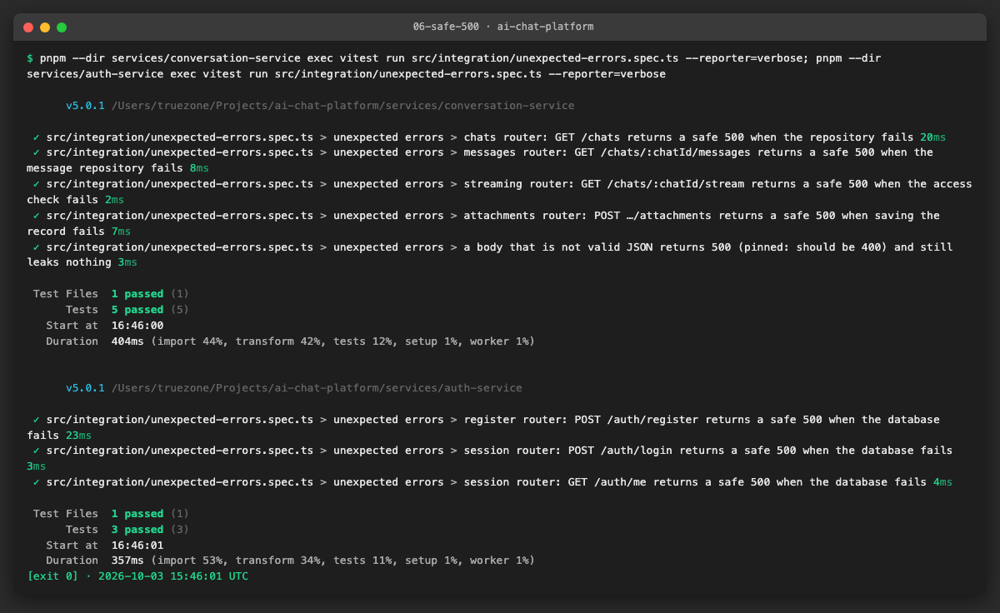
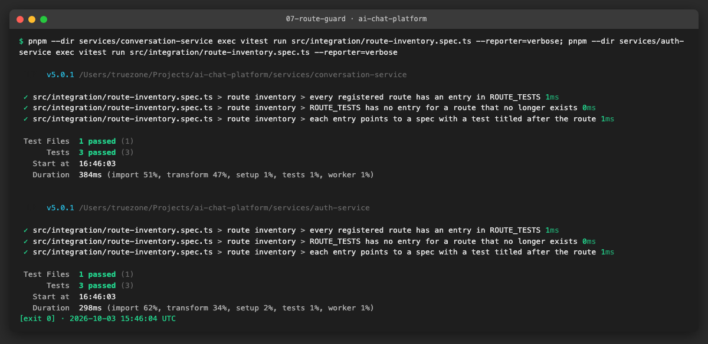
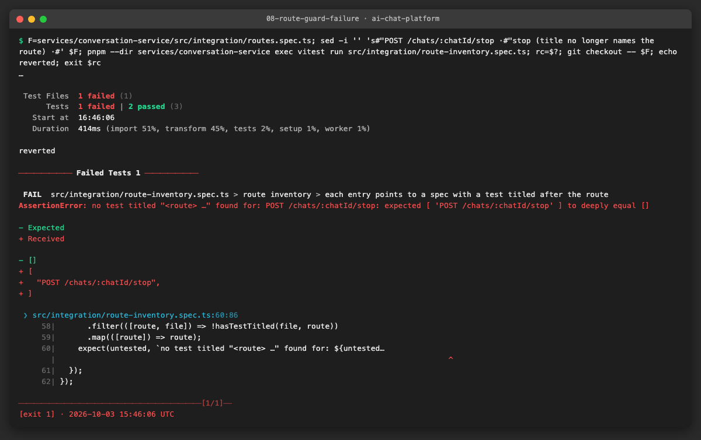
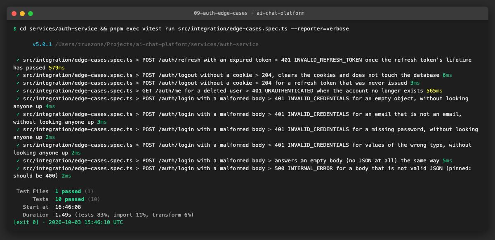

# AICHAT-23 · Integration testing: work log

| Field | Value |
|---|---|
| Epic | [AICHAT-23](https://ipca-grupo11.atlassian.net/browse/AICHAT-23) |
| Analysis | [README.md](README.md) |
| Owner | Jean-Pierre Carvalho |
| Branch | `test/AICHAT-23-integration-testing` |
| Started / finished | 2026-10-03 / 2026-10-03 |
| Pull requests | [#15](https://github.com/ipca-group11/ai-chat-platform/pull/15) |
| Status | Ready for review |

## 1. DoR review

Date: 2026-10-03

| DoR item | Status | Question asked | Decision | Decided by |
|---|---|---|---|---|
| Owner assigned | Met | — | Jean-Pierre Carvalho | — |
| Scope agreed | Met | Which routes? | The 24 routes of README §4.2 and their error paths, in conversation-service and auth-service | Team (owner delegated) |
| Tooling agreed | Met | Tools, and how are fakes injected? | Vitest + supertest + in-memory fakes; `createApp` accepts overrides (small testability change allowed by plan decision D3, one commit) | Team (owner delegated) |
| Target environment available | Met | Where does it run? | Locally and in GitHub Actions, in process, no database or network | Team (owner delegated) |
| Fake repositories per service | Met | conversation-service has fakes, auth-service not | We add in-memory fakes for auth-service in this epic | Team (owner delegated) |
| Authorization / IDOR overlap | Met | How far do we test cross-user access? | One cross-user case per route here; the full matrix belongs to a dedicated IDOR epic | Team (owner delegated) |

Blockers: none

## 2. Environment

| Tool | Version | Install |
|---|---|---|
| macOS / Ubuntu | macOS 26.3 (CI: Ubuntu) | — |
| Node | `node -v` → v24.21.0 | `nvm install` (version in `.nvmrc`) |
| pnpm | `pnpm -v` → 10.4.0 | `corepack enable` |
| Docker | Docker 29.4.0, used only by `pnpm sast` (Semgrep image) | — |
| Vitest / supertest | Vitest 5.0.1, supertest 7 (see `services/*/package.json`) | `pnpm install` |



## 3. Steps

### US1 · Shared in-memory fakes ([AICHAT-40](https://ipca-grupo11.atlassian.net/browse/AICHAT-40))

**What and why.** The route specs of conversation-service each carried their own `tokenFor`, an inline fake provider (two copies and a scripted one in the processor spec) and a processor that never finishes. auth-service had two copies of `fakePrisma` plus a third stub in the register spec. We moved them into each service's `test-utils` folder and deleted the copies. The fakes are not shared between the services through `@platform/test-utils`: the services do not share code at runtime and the two fakes have nothing in common (provider registry and queue against Prisma), so one folder per service is the natural place. Both services also got a throwing helper (`throwingRepository`, `throwingPrisma`) for the 500 tests of US6.

**Files.**
- `services/conversation-service/src/test-utils/fake-provider-registry.ts` (new): `ScriptedProvider`, `fakeProvider`, `fakeProviderRegistry`.
- `services/conversation-service/src/test-utils/fake-queue.ts` (new): `createFakeQueue` (a real `QueueManager` with a fake processor) and `hangingProcessor`.
- `services/conversation-service/src/test-utils/auth-token.ts`, `throwing-repository.ts` (new): signed test tokens and the failing repository.
- `services/auth-service/src/test-utils/fake-prisma.ts` (moved from `features/session/test-fakes.ts`): now also has `user.create`, `__removeUser` and `throwingPrisma`.
- The route, service, processor and model specs that had their own copies now import these.

**How to run.**

```sh
pnpm --filter @app/conversation-service exec vitest run
pnpm --filter @app/auth-service exec vitest run
```

**How to repeat it manually.**

1. Run the two commands above: 391 and 95 tests pass (the same numbers as before the move).
2. Search for the old copies: `grep -rn "function tokenFor\|function fakePrisma\|class ScriptedProvider" services/*/src | grep -v test-utils`.
3. Expected output: no match outside `test-utils`.

**Result.** No copies are left outside the `test-utils` folders and no test changed behaviour.



**Problems and fixes.** The register spec used an `existingUser` override that returned the same user for any email. With the shared fake the duplicate case is seeded with a real user instead, which is closer to what the database does.

### US2 · Testable conversation-service app with injected fakes ([AICHAT-57](https://ipca-grupo11.atlassian.net/browse/AICHAT-57))

**What and why.** `createApp(prisma, env, logger)` built its repositories, file storage, provider registry and queue inside, so a test could not run the whole app with fakes. It now takes a fourth optional parameter, `overrides`, with `chatsRepo`, `messagesRepo`, `attachmentsRepo`, `storage`, `providerRegistry`, `queueManager` and `bus`. Every field falls back to the real implementation, so `server.ts` and production are unchanged (plan decision D3, one commit, scope `conversation`). `buildTestApp()` in `test-utils` calls the real `createApp` with in-memory fakes. `integration/routes.spec.ts` then runs all 19 routes through the real middleware order (helmet, cors, JSON, cookies, correlation id, metrics, auth, routers, 404, error handler): the happy path, the 400/401 that applies and one cross-user case per route. For auth-service the same seam is `createApp({ prisma })`: the register and session routers are now built by `createRegisterRouter(prisma)` / `createSessionRouter(prisma)`, and the exported routers still use the real client (commit with scope `auth`). Its whole-app suite is `integration/routes.spec.ts` with 7 routes.

**Files.**
- `services/conversation-service/src/app.ts`: `AppOverrides` and the fourth parameter.
- `services/conversation-service/src/test-utils/build-test-app.ts` (new): `buildTestApp`, `createChatVia`, `inviteVia`.
- `services/conversation-service/src/integration/routes.spec.ts` (new): 20 tests, one title per route.
- `services/auth-service/src/main.ts`, `features/register/api.ts`, `features/session/api.ts`: router factories and `createApp(deps)`.
- `services/auth-service/src/test-utils/build-test-app.ts`, `session-helpers.ts` (new) and `services/auth-service/src/integration/routes.spec.ts` (new, 7 tests).

**How to run.**

```sh
pnpm --filter @app/conversation-service exec vitest run src/integration/routes.spec.ts --reporter=verbose
pnpm --filter @app/auth-service exec vitest run src/integration/routes.spec.ts --reporter=verbose
```

**How to repeat it manually.**

1. Run the two commands above.
2. In `routes.spec.ts` of conversation-service change a status in one assertion (for example the 404 of `GET /chats/:id` to 200) and run it again.
3. Expected output: all tests pass; with the change that test fails.

**Result.** All routes of both services are called through `createApp`, with no database, disk or network.



**Problems and fixes.** The error body carries `correlationId` at the top level, not inside `error`; the first version of the correlation test looked in the wrong place. The stream route needs a real listening server (supertest cannot read an open SSE response), so that test uses `app.listen(0)` and publishes on the injected `bus` once the headers arrive.

### US3 · Membership operations return clear 4xx errors ([AICHAT-76](https://ipca-grupo11.atlassian.net/browse/AICHAT-76))

**What and why.** The membership service already threw typed errors; nothing tested them through HTTP. `membership-errors.spec.ts` (9 tests) covers: `CANNOT_INVITE_SELF` (400, case-insensitive on the owner's email), `ALREADY_A_MEMBER` (409), `FORBIDDEN` (403, a member removing someone else), `MEMBER_NOT_FOUND` (404, owner removing an email that is not a member), not-a-member (404 `CHAT_NOT_FOUND` on members, remove and leave) and non-owner (404 `CHAT_NOT_FOUND` when a member or a stranger invites).

**Files.**
- `services/conversation-service/src/integration/membership-errors.spec.ts` (new): 9 tests.

**How to run.**

```sh
pnpm --filter @app/conversation-service exec vitest run src/integration/membership-errors.spec.ts --reporter=verbose
```

**How to repeat it manually.**

1. Run the command above.
2. In `chats/service.ts` change the status of `ALREADY_A_MEMBER` from 409 to 400 and run it again.
3. Expected output: 9 tests pass; with the change the 409 test fails.

**Result.** Every code of the acceptance criterion is asserted with its status and its `error.code`.



**Problems and fixes.** A non-owner gets 404, not 403, when inviting: `getOwned` hides the chat from anyone who is not the owner, which is the intended no-leak behaviour. The owner calling `DELETE /membership` gets 404 `MEMBER_NOT_FOUND` (an owner deletes the chat instead); the test documents it.

### US4 · Message edit, cancel and retry reject invalid states ([AICHAT-93](https://ipca-grupo11.atlassian.net/browse/AICHAT-93))

**What and why.** With the fake queue the first message of a chat is "processing" and the second waits, so both states exist without a provider. `message-state-errors.spec.ts` asserts 409 `MESSAGE_NOT_EDITABLE`, `MESSAGE_NOT_CANCELABLE` and `MESSAGE_NOT_RETRYABLE` (a message that has not failed, and a failed one from another chat), 404 `MESSAGE_NOT_FOUND` (unknown id, and a member editing someone else's message), 404 `CHAT_NOT_FOUND` for retry on an unknown chat, and 400 `VALIDATION_ERROR` for an empty or missing edit.

**Files.**
- `services/conversation-service/src/integration/message-state-errors.spec.ts` (new): 10 tests.

**How to run.**

```sh
pnpm --filter @app/conversation-service exec vitest run src/integration/message-state-errors.spec.ts --reporter=verbose
```

**How to repeat it manually.**

1. Run the command above.
2. In `messages/service.ts` remove the `!ok` check in `cancelQueued` and run it again.
3. Expected output: 10 tests pass; with the change the cancel test fails (the message is deleted while processing).

**Result.** All three 409 codes, the 404 and the 400 are tested through the app.



**Problems and fixes.** Retry of an unknown message id answers 409 `MESSAGE_NOT_RETRYABLE`, not 404, because the service looks the message up and rejects on the same branch. We pinned it with a comment and listed it in section 7.

### US5 · Attachment upload error paths ([AICHAT-111](https://ipca-grupo11.atlassian.net/browse/AICHAT-111))

**What and why.** `attachment-errors.spec.ts` uses a 1 KB upload limit and a registry whose provider has no vision. It covers 404 `MESSAGE_NOT_FOUND` (unknown message, and a member uploading to the owner's message), 422 `ATTACHMENT_NOT_SUPPORTED` (image on a model without vision, nothing stored; the same image is accepted with vision), 404 `CHAT_NOT_FOUND` for another user (nothing stored), and the size limit. The acceptance criterion says 413, but the service answers 400 for both size cases; the tests pin that (see section 7).

**Files.**
- `services/conversation-service/src/integration/attachment-errors.spec.ts` (new): 7 tests.

**How to run.**

```sh
pnpm --filter @app/conversation-service exec vitest run src/integration/attachment-errors.spec.ts --reporter=verbose
```

**How to repeat it manually.**

1. Run the command above.
2. In `attachments/service.ts` remove the vision check and run it again.
3. Expected output: 7 tests pass; with the change the 422 test fails.

**Result.** 404, 422 and cross-user are tested as asked; the size limit is tested with the current 400 answers.



**Problems and fixes.** Two size limits exist: `ATTACHMENT_TOO_LARGE` from the validator (limit) and `ATTACHMENT_UPLOAD_ERROR` from multer (hard ceiling, twice the limit). Both are 400. We did not change them to 413: the frontend and the mock server rely on the 400, so it is a contract change for the service owner.

### US6 · Unexpected errors return a safe 500 ([AICHAT-125](https://ipca-grupo11.atlassian.net/browse/AICHAT-125))

**What and why.** `throwingRepository` (conversation-service) and `throwingPrisma` (auth-service) reject every call with an error whose message contains a marker. `expectSafe500` checks the status, the `INTERNAL_ERROR` code, that `error` only has `code` and `message`, and that the body has no marker, no `stack`, no `at fn (` frames, no `node_modules` and no `file.ts:12` locations. One test per router: chats, messages, streaming and attachments in conversation-service; register and session (login and `/me`) in auth-service. One more test in each service pins the malformed JSON case (section 7).

**Files.**
- `services/conversation-service/src/integration/unexpected-errors.spec.ts`, `services/conversation-service/src/test-utils/expect-safe-500.ts` (new): 5 tests.
- `services/auth-service/src/integration/unexpected-errors.spec.ts`, `services/auth-service/src/test-utils/expect-safe-500.ts` (new): 3 tests.

**How to run.**

```sh
pnpm --filter @app/conversation-service exec vitest run src/integration/unexpected-errors.spec.ts --reporter=verbose
pnpm --filter @app/auth-service exec vitest run src/integration/unexpected-errors.spec.ts --reporter=verbose
```

**How to repeat it manually.**

1. Run the two commands above.
2. In `shared/error-handler.ts` (conversation-service) put `err.message` in the 500 body and run the first command again.
3. Expected output: 5 and 3 tests pass; with the change the 500 tests fail on the leaked marker.

**Result.** Every router answers an unexpected failure with the standard body and a correlation id, and nothing of the error.



**Problems and fixes.** None. The error handlers already hid the details; the tests lock that in.

### US7 · Guard test for routes without integration tests ([AICHAT-131](https://ipca-grupo11.atlassian.net/browse/AICHAT-131))

**What and why.** `listRoutes(app)` walks `app._router.stack` (Express 4), follows mounted routers and returns `METHOD /path`. `route-inventory.spec.ts` in each service holds `ROUTE_TESTS`, a map of every route to the spec file that covers it, and has three checks: every registered route has an entry, no entry is stale, and each entry's file has a test whose title starts with the route (`"GET /chats/:id · …"`). A new route without an entry fails the first check; deleting or renaming the test of a route fails the third. The demo renames the title of the stop-route test and shows the failure; the change was reverted.

**Files.**
- `services/conversation-service/src/test-utils/route-inventory.ts`, `services/conversation-service/src/integration/route-inventory.spec.ts` (new): 19 routes.
- `services/auth-service/src/test-utils/route-inventory.ts`, `services/auth-service/src/integration/route-inventory.spec.ts` (new): 7 routes.

**How to run.**

```sh
pnpm --filter @app/conversation-service exec vitest run src/integration/route-inventory.spec.ts
pnpm --filter @app/auth-service exec vitest run src/integration/route-inventory.spec.ts
```

**How to repeat it manually.**

1. Run the two commands above: 3 tests pass in each.
2. Add `router.get("/ping", …)` to `chats/routes.ts`, or rename the title of one test in `routes.spec.ts`, and run the first command again.
3. Expected output: the guard fails and names the route. Revert the change.

**Result.** Both services have the guard; the failure demo names the route whose test is gone.





**Problems and fixes.** Express 4 keeps the mount path of a router only as a regexp; `mountPath` recovers it from the regexp source. If the services move to Express 5 the helper has to change (the guard would then fail on an empty list because every `ROUTE_TESTS` entry would be stale).

### US8 · auth-service edge case integration tests ([AICHAT-134](https://ipca-grupo11.atlassian.net/browse/AICHAT-134))

**What and why.** `edge-cases.spec.ts` runs through `createApp`: an expired refresh token (only `Date` is faked, so the token's seven-day lifetime passes while bcrypt and the rest of the request run normally) gives 401 `INVALID_REFRESH_TOKEN` and sets no cookie; logout without a cookie (and with an unknown token) gives 204, clears both cookies and, in the first case, never touches the database; `/me` for an account that was deleted after login gives 401 `UNAUTHENTICATED`; and a malformed login body (empty object, bad email, missing password, wrong types, no body) gives the same 401 `INVALID_CREDENTIALS` as wrong credentials, without a user lookup.

**Files.**
- `services/auth-service/src/integration/edge-cases.spec.ts` (new): 10 tests.
- `services/auth-service/src/test-utils/fake-prisma.ts`: `__removeUser` to simulate a deleted account.

**How to run.**

```sh
pnpm --filter @app/auth-service exec vitest run src/integration/edge-cases.spec.ts --reporter=verbose
```

**How to repeat it manually.**

1. Run the command above.
2. In `session/model.ts` remove `row.expiresAt.getTime() < Date.now()` from `rotateRefreshToken` and run it again.
3. Expected output: 10 tests pass; with the change the expired-token test fails.

**Result.** The four edge cases are covered. A body that is not valid JSON is not: it answers 500 (section 7).



**Problems and fixes.** The fake clock first moved all timers, which stalled bcrypt; we fake only `Date`. The "malformed body" of the story is read as a body that fails the schema (the service answers 401 on purpose, AC-36); the not-JSON case found the defect below.

## 4. How to run everything

```sh
pnpm install
# the integration suites of both services
pnpm --filter @app/conversation-service exec vitest run src/integration --reporter=verbose
pnpm --filter @app/auth-service exec vitest run src/integration --reporter=verbose
# each service's full suite with coverage, as CI runs it
pnpm exec nx run conversation-service:test
pnpm exec nx run auth-service:test
# the whole check, as CI runs it (lint, typecheck, test with coverage, build)
pnpm exec nx affected -t lint typecheck test build --base=origin/integration/testing-epics
pnpm sast
gitleaks git --redact --log-opts=origin/integration/testing-epics..HEAD
```

How the fakes work: `buildTestApp()` (in each service's `src/test-utils`) calls the real `createApp` and passes in-memory fakes, then
returns the app together with the same fake instances, so a test can seed data (`messagesRepo.create(...)`) or look at what was
stored (`attachmentsRepo.all()`). To make a route fail, pass `throwingRepository<...>()` as the override; in auth-service pass
`throwingPrisma()`. To add a route: register it, add it to `ROUTE_TESTS` in `route-inventory.spec.ts` and write a test whose title starts
with `METHOD /path`.

The Playwright e2e suite is not part of this epic and was not run.

## 5. Results

| Metric | Before | After |
|---|---|---|
| Tests in conversation-service | 391 (+2 todo) | 445 (+2 todo) |
| Tests in auth-service | 95 | 118 |
| Routes called through the real `createApp` | 0 | 19 of 19 in conversation-service, 7 of 7 in auth-service |
| Error paths of README section 4.2 with a test | none of about 25 | all, with 4 answers pinned to the current behaviour (section 7) |
| Routers with a 500 test through a route | 0 | 4 of 4 in conversation-service, 2 of 2 in auth-service |
| Copies of `tokenFor` / `fakePrisma` / fake provider outside `test-utils` | 4 / 3 / 3 | 0 / 0 / 0 |
| Guard against a route without a test | none | both services |
| conversation-service statements / branches / functions / lines (%) | not measured before | 98.55 / 92.16 / 97.83 / 99.15 |
| auth-service statements / branches / functions / lines (%) | not measured before | 98.91 / 94.91 / 97.82 / 98.9 |

## 6. DoD check

| DoD item | Met | Evidence |
|---|---|---|
| Shared fakes in `test-utils`, duplicates removed (US1) | Yes | [01](evidence/01-shared-fakes.png) |
| `createApp` overrides and one full-app suite per service (US2) | Yes | [02](evidence/02-full-app-suite.png) |
| Membership, message state, attachment and 500 error paths tested (US3 to US6) | Yes; the 413 of US5 is pinned as 400 | [03](evidence/03-membership-errors.png), [04](evidence/04-message-state-errors.png), [05](evidence/05-attachment-errors.png), [06](evidence/06-safe-500.png) |
| Route-inventory guard in both services and its failure demo (US7) | Yes | [07](evidence/07-route-guard.png), [08](evidence/08-route-guard-failure.png) |
| auth-service edge cases (US8) | Yes | [09](evidence/09-auth-edge-cases.png) |
| Tests run in CI and pass | CI: pending PR run (the same `nx affected` command is green locally) | [10](evidence/10-nx-affected.png) |
| Failure blocks the merge | CI: pending PR run | [10](evidence/10-nx-affected.png) |
| Run instructions in `docs/` | Yes, section 4 of this log and the "How to run" of each story | §4 |
| Meets the AICHAT-34 coverage thresholds | Yes locally; CI: pending PR run | [10](evidence/10-nx-affected.png) |
| SAST and secret scan clean | Yes locally; CI: pending PR run | [11](evidence/11-sast.png), [12](evidence/12-gitleaks.png) |
| Playwright e2e not run | Yes | — |

## 7. Notes for the report

**Defects found (pinned with a comment in the test, not fixed in this epic)**
- A request body that is not valid JSON answers **500 `INTERNAL_ERROR`** in both services instead of 400. `express.json()` raises a `SyntaxError` with status 400 and neither error handler has a branch for it. The body is safe (no leak), but the status is wrong and it counts as a server error in the metrics. The fix is a new branch in each error handler, so it needs the service owners. Tests: `auth-service/.../edge-cases.spec.ts`, `conversation-service/.../unexpected-errors.spec.ts`. **Fixed in [AICHAT-217](https://ipca-grupo11.atlassian.net/browse/AICHAT-217):** both handlers now answer 400 `VALIDATION_ERROR` ("Request body is not valid JSON") with the correlation id; the two tests assert that instead.
- **Attachments over the size limit answer 400, not 413.** `ATTACHMENT_TOO_LARGE` (validator) and `ATTACHMENT_UPLOAD_ERROR` (multer ceiling, twice the limit) are both 400. The acceptance criterion of AICHAT-111 asks for 413; the frontend and the mock server depend on the 400, so changing it is a contract decision for the service owner.
- **Retry of an unknown message id answers 409 `MESSAGE_NOT_RETRYABLE`**, while edit and cancel answer 404 `MESSAGE_NOT_FOUND` for the same case. Minor inconsistency; pinned.
- An owner calling `DELETE /chats/:id/membership` gets 404 `MEMBER_NOT_FOUND`, which is the documented "owners delete instead" behaviour but not a clear message for the user. Pinned as is.

**What was fixed**
- Nothing in production code besides the two testability seams (`createApp` overrides in conversation-service; router factories and `createApp({ prisma })` in auth-service). Without arguments the behaviour is the same as before.

**Decisions**
- Fakes live in each service's `src/test-utils`, not in `@platform/test-utils`: the services do not share code at runtime.
- One cross-user case per route; the full IDOR matrix stays with a dedicated epic.
- The guard checks the test titles ("METHOD /path ·"), so it also fails when a route's test is deleted, not only when its map entry is missing.
- Two test-only literals (a signing key and a throwaway password) carry a `nosemgrep` comment, because Semgrep reported them as hardcoded secrets in the first run.

**Lessons learned**
- Faking the whole clock stalls bcrypt; faking only `Date` is enough to expire a token.
- A shared fake has to be as complete as the biggest copy it replaces: the Prisma fake needed `user.create` before the register specs could use it.
