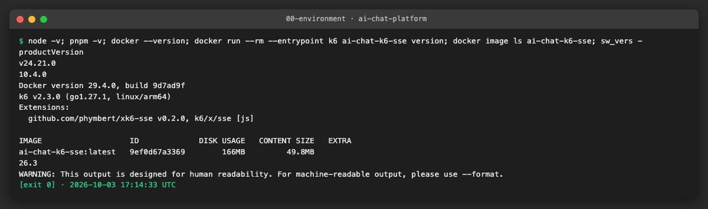
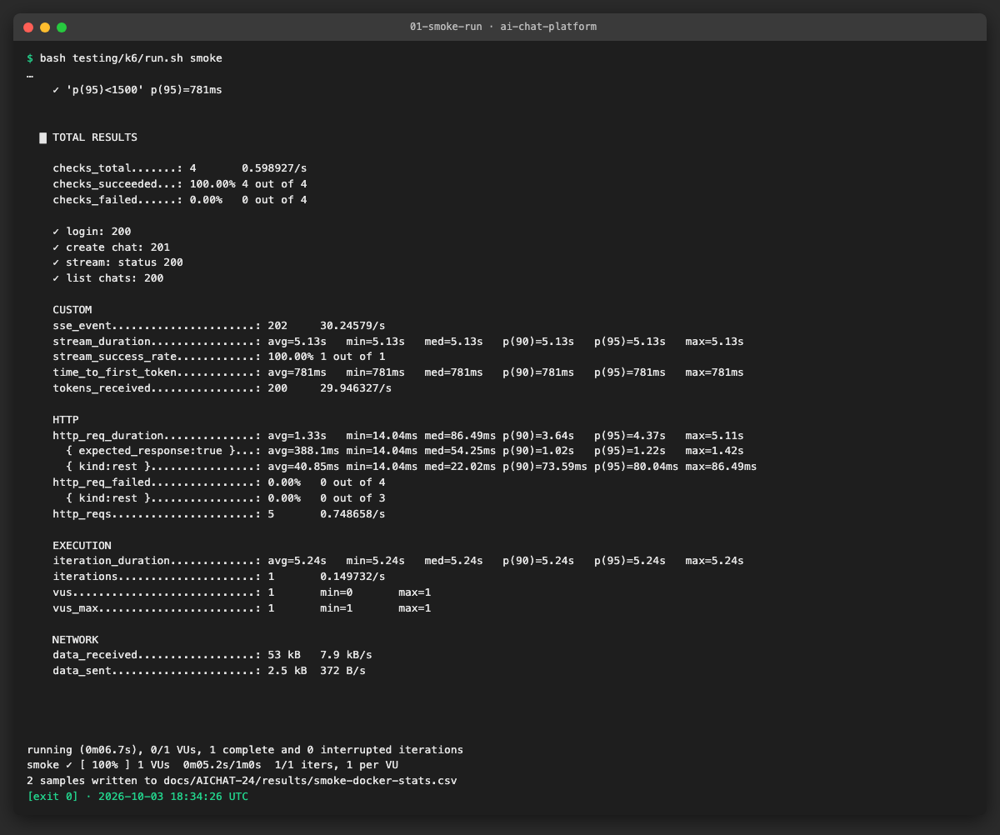
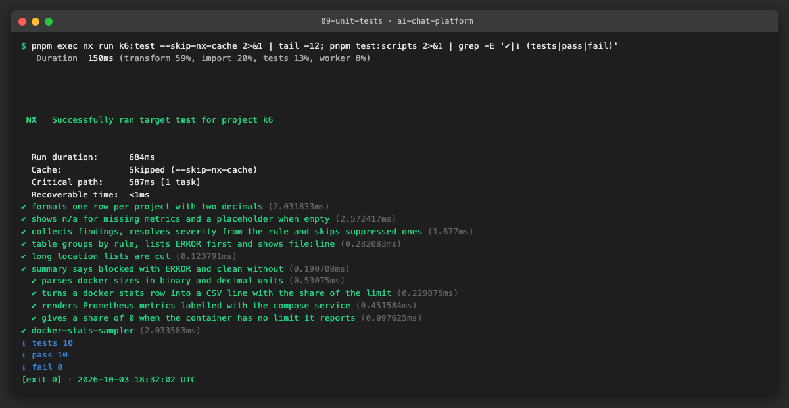
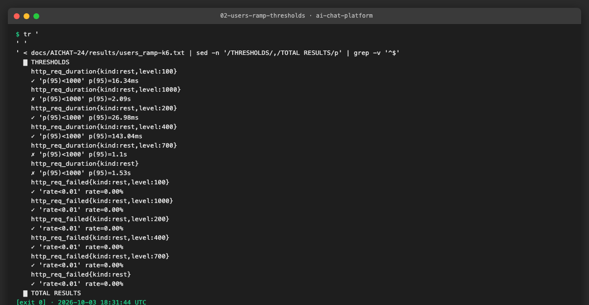
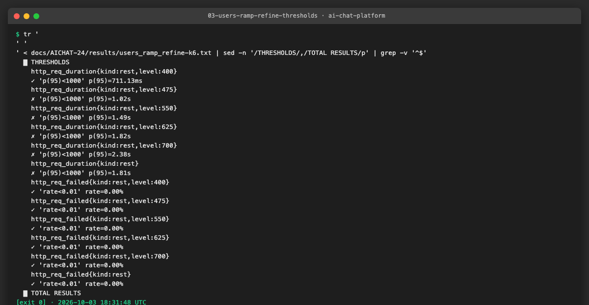
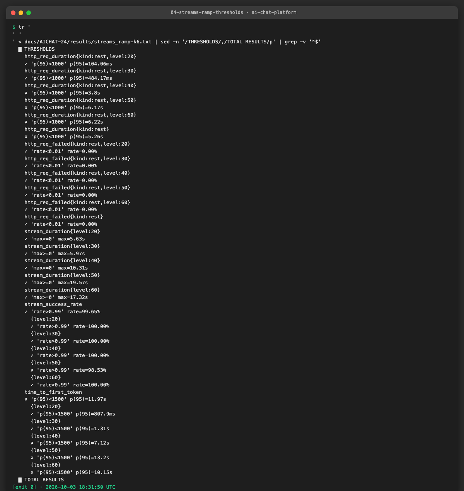
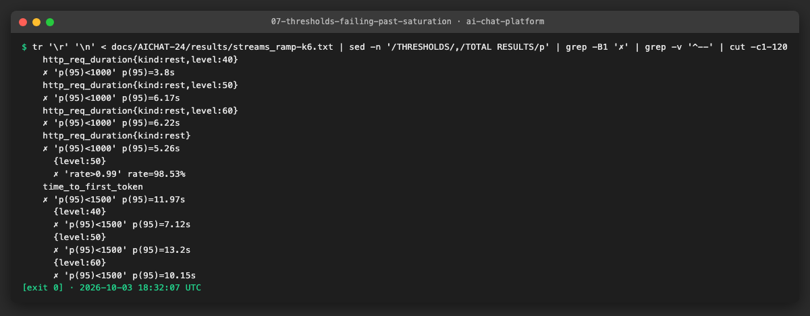
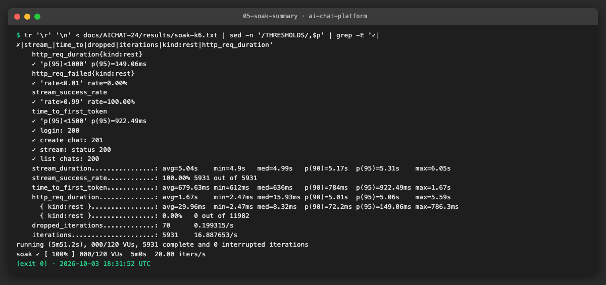
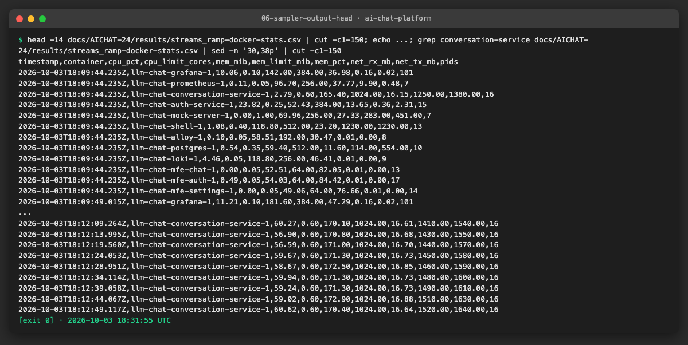
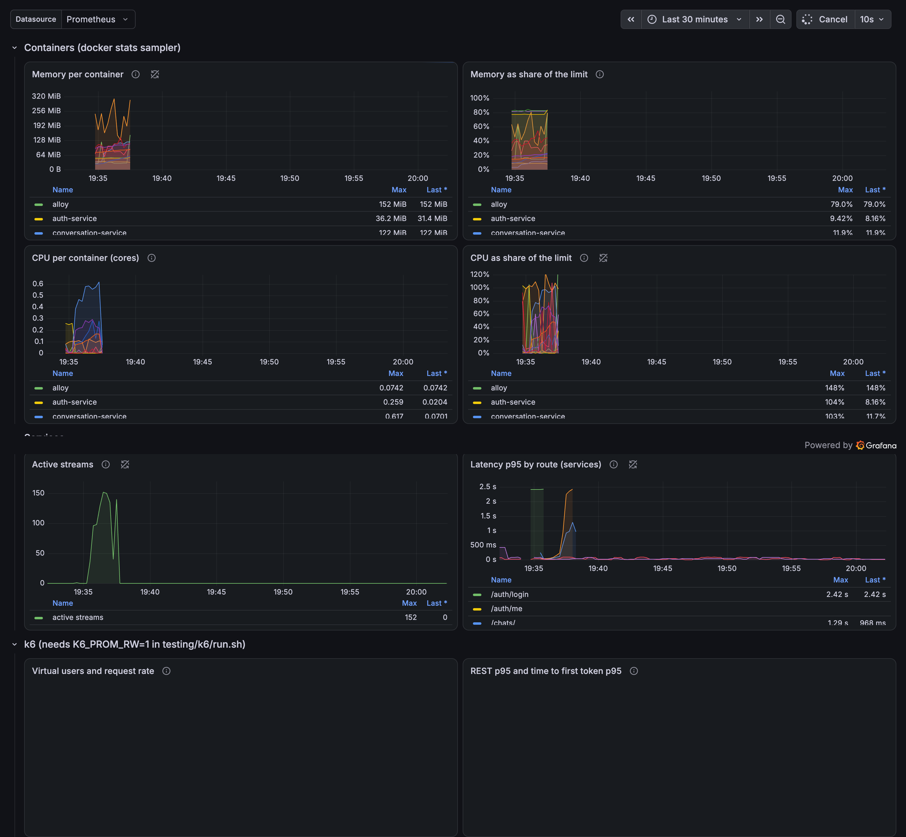

# AICHAT-24 · Load testing: work log

| Field | Value |
|---|---|
| Epic | [AICHAT-24](https://ipca-grupo11.atlassian.net/browse/AICHAT-24) |
| Analysis | [README.md](README.md) |
| Owner | Jean-Pierre Carvalho |
| Branch | `test/AICHAT-24-load-testing` |
| Started / finished | 2026-10-03 / 2026-10-03 |
| Pull requests | #… |
| Status | Done, pull request to open |

## 1. DoR review

Date: 2026-10-03

| DoR item | Status | Question asked | Decision | Decided by |
|---|---|---|---|---|
| Owner assigned | Met | — | Jean-Pierre Carvalho | — |
| Scope agreed | Met | Which scenarios, on which machine? | User and stream scenarios; no production run and no Azure VM (same as plan decision D11): the local compose stack with a resource-limited override that mimics `Standard_B2als_v2` (2 vCPU, 4 GB) | Team (owner delegated) |
| Tooling agreed | Met | Tools, and how do we measure time to first token? | k6 with `xk6-sse` built in Docker (TTFB approximation as fallback), the LLM mock from AICHAT-144, a `docker stats` sampler and Grafana panels | Team (owner delegated) |
| Target environment available | Met | Where does it run? | Locally (Docker compose, profile `llm`); not in CI because a load run takes minutes and needs the whole stack | Team (owner delegated) |
| k6 scenarios | Met | Existing script is broken (§4.1) | Rewritten in TypeScript against the real API flow | Team (owner delegated) |
| Mock LLM | Met | Does it exist? | Yes, delivered by AICHAT-144 | Team (owner delegated) |
| Run length | Met | How long are the runs? | Ramps of a few minutes; the soak scenario is defined for long runs but recorded with a 5-minute run | Team (owner delegated) |
| CPU credits | Met | B-series credits change results | Not applicable locally; the limits are fixed, recorded in the results | Team (owner delegated) |

Blockers: none

## 2. Environment

| Tool | Version | Install |
|---|---|---|
| macOS | 26.3 | n/a |
| Node | `node -v` → v24.21.0 | `nvm install` (reads `.nvmrc`) |
| pnpm | `pnpm -v` → 10.4.0 | `corepack enable` |
| Docker | `docker --version` → Docker version 29.4.0 | Docker Desktop or OrbStack |
| k6 / xk6-sse | `k6 version` → k6 v2.3.0, `xk6-sse` v0.2.0 | Docker image `ai-chat-k6-sse`, built from `testing/k6/Dockerfile` (`grafana/xk6` builds, `grafana/k6` runs) |



## 3. Steps

### Fix · deterministic tests in the mock server

The `stream-drop` test, the "uses the default model" tests and the sign-in in `conversation.router.spec.ts` failed now and then when several nx targets ran at once. The stream test sent its message 30 ms after opening the stream, which is not enough on a busy machine; the polling helpers gave up after a fixed number of tries; and the default 5 s test timeout is tight for the first request of a cold worker. The test now waits until the stream is open, polling uses a deadline, a failed sign-in reports its status instead of a `TypeError`, and the timeout is 30 s. `pnpm exec nx run mock-server:test --skip-nx-cache` was run three times in a row, 253 tests each, all green (commit `test(mock): make the timing-sensitive mock server tests deterministic`).

### US1 · k6 script that follows the real API flow ([AICHAT-78](https://ipca-grupo11.atlassian.net/browse/AICHAT-78))

**What and why.** The old `streaming-load.ts` could not pass against the real stack (analysis §4.1: wrong port, no body when creating a chat, a stream expected on the wrong route, no provider key). It was replaced by `load.ts` with `lib/api.ts`: sign in on auth-service, create a chat (`POST /api/chats {title, provider, model}`), send a message (`POST /api/chats/:id/messages` with `X-Llm-Api-Key`), read `GET /api/chats/:id/stream` until `done`. Time to first token is measured per event with the `xk6-sse` extension, so it is the real figure and not the time to first byte. The stack runs on the compose files with profile `llm` plus the new `compose.load.yaml`, which limits the containers to the CPU and memory of a `Standard_B2als_v2` (2 vCPU, 4 GB; the exact limits are in [RESULTS.md](RESULTS.md)). The smoke scenario is one user and one full flow and takes about 6 seconds.

**Files.**
- `testing/k6/load.ts` (new, replaces `streaming-load.ts` and its text-matching spec): entry point and scenario functions.
- `testing/k6/lib/api.ts` (new): API calls, stream reader, metrics.
- `testing/k6/lib/scenarios.ts`, `lib/scenarios.spec.ts` (new): scenarios, thresholds and levels, checked by Vitest.
- `testing/k6/Dockerfile`, `run.sh`, `README.md`, `types/xk6-sse.d.ts` (new or rewritten).
- `compose.load.yaml` (new), `scripts/mock-compose.sh` (`LOAD=1`), `package.json` (`pnpm load:up`).

**How to run.**

```sh
pnpm load:up && bash testing/k6/run.sh smoke
```

**How to repeat it manually.**

1. Free the ports 4001, 4002, 3300 and 9090, or set `AUTH_SERVICE_PORT`, `CONVERSATION_SERVICE_PORT`, `GRAFANA_PORT` and `PROMETHEUS_PORT`. Run `pnpm load:up` (the first build takes about ten minutes).
2. Run `bash testing/k6/run.sh seed` once to create the accounts, then `bash testing/k6/run.sh smoke`. The first run also builds the k6 image (two minutes).
3. Expected output: every check green, `stream_success_rate 100%`, `time_to_first_token` about 0.7 to 0.8 s (the mock adds 600 ms), exit code 0.

**Result.** The smoke scenario passes end to end against the compose stack and the mock: sign in, chat, message and a stream of 200 tokens read to `done`, time to first token 821 ms in the recorded run.





**Problems and fixes.**
- The shell (`vite preview`) answers only to `localhost` and returned 403 to the host name `shell`. `compose.load.yaml` adds `shell` to its allowed hosts.
- The shell proxy sends the head of a stream response only with the first event, and `xk6-sse` runs its callback only after the head. A stream opened first waited forever. The script now sends the message first and opens the stream right after (the mock needs 600 ms for the first token). The same property was measured with curl: head after 0 bytes through the shell, 15 ms directly on the service.
- auth-service limits requests to 300 per 15 minutes per address, and bcrypt on 0.25 core makes a sign-in cost about 0.12 s of CPU. A first version that signed every virtual user in ended with thousands of 429 answers. Now 40 accounts are created once (`seed`) and signed in once in `setup()`; the virtual users share them and each one has its own chat.
- Another project's containers use ports 4001, 4002, 3300 and 9090 on this machine; the stack ran on 14001, 14002, 13300 and 19090.

### US2 · Ramping user and stream scenarios ([AICHAT-96](https://ipca-grupo11.atlassian.net/browse/AICHAT-96))

**What and why.** To find where the stack saturates, `users_ramp` (browsing users, `ramping-vus`), `streams_ramp` (new streams per second, `ramping-arrival-rate`) and `soak` (`constant-arrival-rate`, `SOAK_DURATION` 30 minutes by default) were added. Each ramp is a staircase of levels, and requests carry a `level` tag, so k6 reports one p95 per level and the first failing level is the saturation point. Thresholds: REST p95 below 1000 ms, REST failures below 1 %, time to first token p95 below 1500 ms, streams done above 99 %, each also per level. Nothing aborts a run. The mock LLM was tuned to look like a hosted model: `TTFT_MS=600`, `TOKEN_INTERVAL_MS=20`, `TOKENS=200`.

**Files.**
- `testing/k6/lib/scenarios.ts` (scenarios and thresholds), `load.ts` (exports `browse` and `stream`).
- `docs/AICHAT-24/results/*-k6.txt` and `*-summary.json`: the recorded runs.

**How to run.**

```sh
K6_PROM_RW=1 bash testing/k6/run.sh users_ramp      # also streams_ramp
SOAK_DURATION=5m bash testing/k6/run.sh soak
```

**How to repeat it manually.** As US1, then the commands above. Each ramp takes about 6 minutes (5 minutes of load plus signing in). The levels can be changed with `USER_LEVELS` and `STREAM_LEVELS`.

**Result.** Browsing users saturate at about 400 (REST p95 143 to 711 ms; 1.02 s at 475). Streams saturate at about 30 new streams per second, about 160 open: time to first token p95 1.31 s there and 7.1 s at 40 per second. The soak at 20 streams per second for 5 minutes finished 5 931 of 5 931 streams, time to first token p95 922 ms.











**Problems and fixes.**
- The first ramps stopped too early (200 users, 16 streams per second: no threshold failed). The levels were raised until they failed; the first wider streams run is kept in `results/first-pass`.
- The level of a request was taken from the time since the start of the test, which includes the sign-in in `setup()`, so the first level was cut short. It now counts from the start of the scenario.
- Between the users runs the numbers at the same level differ (400 users: 143 ms and 711 ms) because chats pile up in the database from run to run and the first level starts from 0 users in 10 seconds. Both runs are recorded.

### US3 · Container memory and CPU during load runs ([AICHAT-114](https://ipca-grupo11.atlassian.net/browse/AICHAT-114))

**What and why.** `scripts/load/docker-stats-sampler.ts` runs `docker stats` every 5 seconds and writes one CSV row per container (CPU, CPU limit, memory, memory limit, share of the limit, network, processes). `run.sh` starts it with every run and the CSV is kept next to the k6 output. With `--serve 9105` it also serves the latest sample as Prometheus metrics, and Prometheus scrapes it (job `load-sampler`), which feeds the new Grafana dashboard "Load test (AICHAT-24)": memory per container, memory as share of the limit, CPU per container, CPU as share of the limit, active streams, latency p95 by route and a row with the k6 metrics (sent with `K6_PROM_RW=1`).

**Files.**
- `scripts/load/docker-stats-sampler.ts`, `docker-stats-sampler.test.ts` (new; the test runs with `pnpm test:scripts`).
- `observability/grafana/provisioning/dashboards/load-test.json` (new), `observability/prometheus.yml` (job `load-sampler`), `compose.load.yaml` (remote-write receiver and `host.docker.internal` for Prometheus).
- `docs/AICHAT-24/results/*-docker-stats.csv`.

**How to run.**

```sh
node scripts/load/docker-stats-sampler.ts --out docs/AICHAT-24/results/example.csv --interval 5 --duration 60 --serve 9105
```

**How to repeat it manually.**

1. Start the stack with `pnpm load:up`.
2. Run the sampler as above, or any `bash testing/k6/run.sh <scenario>`, which starts it itself.
3. Open Grafana (`http://127.0.0.1:3300`, user `admin`, password `admin`), dashboard "Load test (AICHAT-24)". Expected: one line per service and the CSV with a header and one row per container per sample.

**Result.** The CSV of every run is in `results/`; the Grafana panels show the same samples.





**Problems and fixes.**
- The first idea was cAdvisor, which Prometheus would scrape. On Docker Desktop and OrbStack it only reports the machine root, not the containers. It was dropped for the sampler, which also gives one source for the CSV and the panels.
- The k6 row of the dashboard was empty in the screenshot: Grafana runs on 0.10 core and had not drawn the last row; the k6 series are in Prometheus (`k6_vus`, `k6_http_req_duration_p95`, `k6_time_to_first_token_p95`).
- `docker stats` reports CPU as a share of one core, so the dashboard divides by the CPU limit read with `docker inspect`.

### US4 · Saturation point on the 4 GB VM ([AICHAT-128](https://ipca-grupo11.atlassian.net/browse/AICHAT-128))

**What and why.** [RESULTS.md](RESULTS.md) records users, streams, p95, memory, bottleneck and recommendations, with the exact container limits and the statement that the runs emulate the VM on a local machine (there is no production or Azure run).

**Files.**
- `docs/AICHAT-24/RESULTS.md` (new).

**How to run.** Read `docs/AICHAT-24/RESULTS.md`; section 8 lists the commands that reproduce it.

**How to repeat it manually.** Run the commands in section 8 of RESULTS.md and compare the per-level thresholds in the k6 output.

**Result.**

| Question | Answer |
|---|---|
| Browsing users | about 400 |
| Concurrent streams | about 160 (30 new streams per second) |
| p95 at the limit | REST 484 ms and time to first token 1.31 s (streams), REST 143 to 711 ms (users) |
| Memory | 1.1 to 1.3 GB of 3.6 GB; not the limit |
| Bottleneck | CPU of conversation-service (one Node process), the shell proxy next |

**Problems and fixes.** Limits are per container, so the figures are a floor for a VM that shares its two vCPUs. Besides speed, the runs found four problems (rate limit shared by all users behind the proxy, monitoring services over their limits, no limits in the Azure compose file, stream head held back by the proxy). They are in RESULTS.md sections 6 and 7 as recommendations; none was fixed in this epic.

## 4. How to run everything

```sh
pnpm load:up                                   # stack with the VM limits and the LLM mock
bash testing/k6/run.sh seed                    # once
bash testing/k6/run.sh smoke
K6_PROM_RW=1 bash testing/k6/run.sh users_ramp
K6_PROM_RW=1 bash testing/k6/run.sh streams_ramp
SOAK_DURATION=5m K6_PROM_RW=1 bash testing/k6/run.sh soak
pnpm mock:down
pnpm exec nx run k6:test && pnpm test:scripts  # unit tests of the scenarios and the sampler
```

## 5. Results

| Metric | Before | After |
|---|---|---|
| k6 script against the real API | broken (wrong port, body, route, key); text-only spec | smoke, `users_ramp`, `streams_ramp` and `soak` run end to end |
| Time to first token | time to first byte (approximation) | per SSE event with xk6-sse |
| Saturation point known | no | about 400 browsing users, about 160 open streams (30 new per second) |
| Memory and CPU per container recorded | no | CSV and Grafana panels for each run |
| Flaky mock server tests | 3 tests failed now and then | 3 runs in a row green |

## 6. DoD check

| DoD item | Met | Evidence |
|---|---|---|
| Code in the repository, small commits | ✅ | `git log` of the branch |
| Smoke scenario passes end to end against compose and the mock | ✅ | [smoke](evidence/01-smoke-run.png) |
| `users_ramp`, `streams_ramp` and `soak` with saturation thresholds | ✅ | [users](evidence/02-users-ramp-thresholds.png), [streams](evidence/04-streams-ramp-thresholds.png), [soak](evidence/05-soak-summary.png), [failing thresholds](evidence/07-thresholds-failing-past-saturation.png) |
| `docker stats` sampler, Grafana panels, CSV kept | ✅ | [sampler](evidence/06-sampler-output-head.png), [Grafana](evidence/08-grafana-load-test.png), `results/*.csv` |
| `RESULTS.md` with users, streams, p95, memory, bottleneck, recommendations | ✅ | [RESULTS.md](RESULTS.md) |
| Unit tests for what can run in Node | ✅ | [tests](evidence/09-unit-tests.png) |
| Lint, typecheck, test, build of affected projects | ✅ | section 7 |
| SAST and secret scan | ✅ | section 7 |
| CI | ➖ | Load runs are manual and are not in CI: a run needs the whole stack and takes minutes. The Vitest and node:test suites above run in the normal checks. |
| Documentation | ✅ | `testing/k6/README.md`, `RESULTS.md` |

## 7. Notes for the report

- **Found.** The platform saturates on the CPU of conversation-service, not on memory; the shell proxy is next. The sign-in limit (300 per 15 minutes per address, no `trust proxy`) would be shared by all users behind the proxy.
- **Not done.** No run on the real VM and no mixed scenario (users and streams together); the limits are per container, so the numbers are a floor. Soak recorded with 5 minutes, defined for 30.
- **Fixed on the way.** Flaky mock server tests; the k6 script rewritten; stack ports configurable by environment.
- **Lessons.** Measure with the extension that reads events, not time to first byte. Check for rate limits and password hashing before a load test that signs users in. A proxy that holds back response headers changes how a test client must be written.
