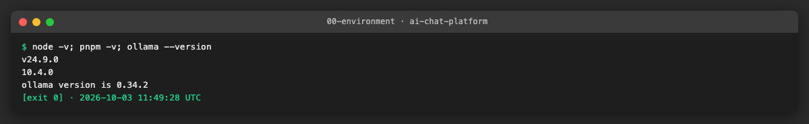
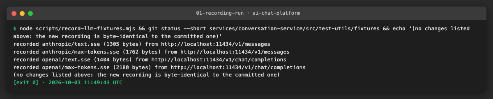
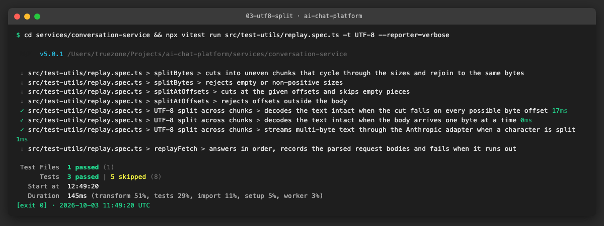
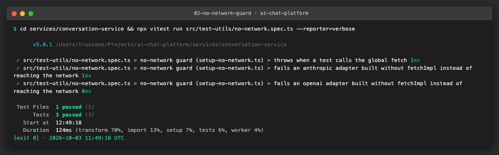
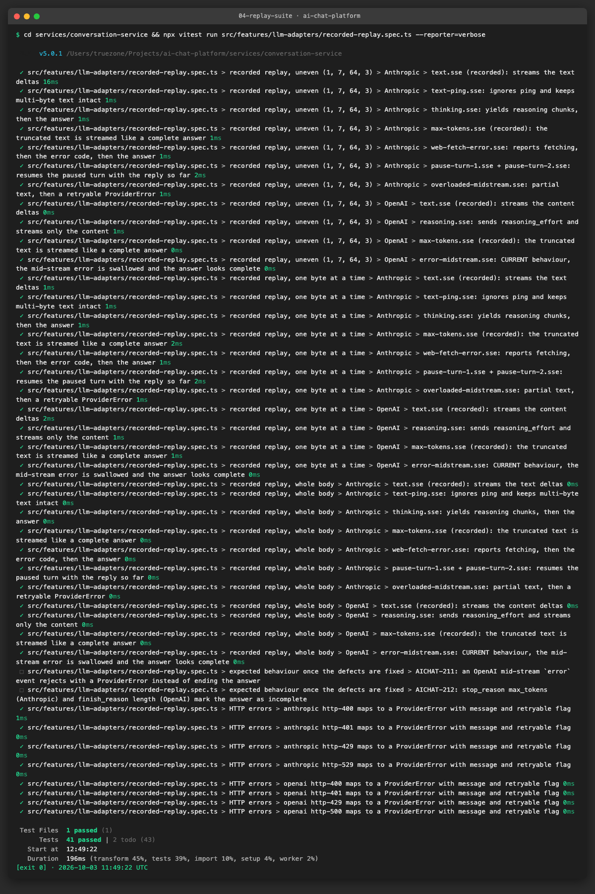
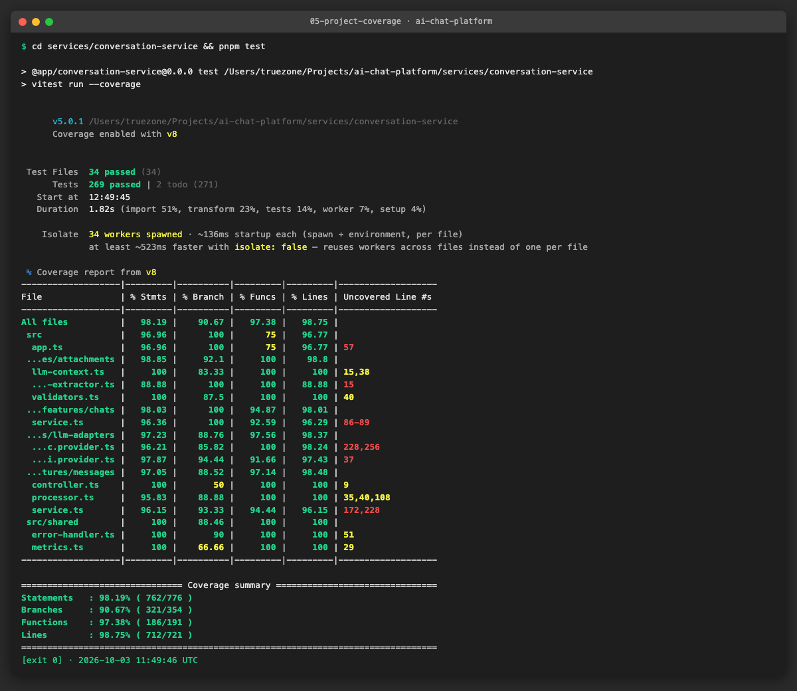
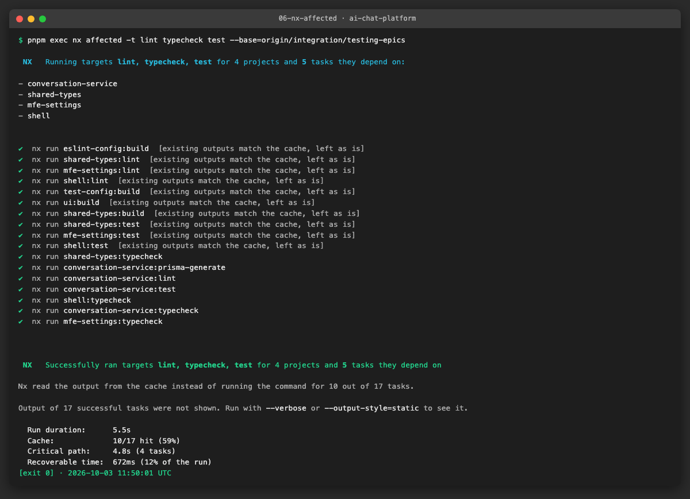

# AICHAT-25 · Provider adapter testing with recorded responses: work log

| Field | Value |
|---|---|
| Epic | [AICHAT-25](https://ipca-grupo11.atlassian.net/browse/AICHAT-25) |
| Analysis | [README.md](README.md) |
| Owner | Jean-Pierre Carvalho |
| Branch | `test/AICHAT-25-provider-adapter-testing-with-recorded-responses` |
| Started / finished | 2026-10-03 / 2026-10-03 |
| Pull requests | [#11](https://github.com/ipca-group11/ai-chat-platform/pull/11) |
| Status | In Review |

## 1. DoR review

Date: 2026-10-03

| DoR item | Status | Question asked | Decision | Decided by |
|---|---|---|---|---|
| Owner assigned | Met | — | Jean-Pierre Carvalho | — |
| Scope agreed | Met | Is the fixture set of README §5 (Anthropic and OpenAI) in scope? | Yes; replay helper in `test-utils`, a no-network setup file, runs in CI without keys | Owner |
| Tooling agreed | Met | How are the streams recorded without a paid API? (plan decision D5) | Recorded from a local Ollama model through its OpenAI- and Anthropic-compatible endpoints; cases Ollama cannot produce (thinking, `pause_turn`, provider errors) written by hand from the provider documentation and marked as hand-written | Owner |
| Target environment available | Met | Where does it run? | Recording: manually on a laptop with Ollama, never in CI. Replay: locally and in GitHub Actions | Owner |
| Defects found by the replay (AICHAT-117) | Met | Fix now or ticket? | Ticket only; tests assert the current behaviour and reference the ticket | Owner |

Blockers: none

## 2. Environment



| Tool | Version | Install |
|---|---|---|
| macOS | Darwin 25.3.0 | — |
| Node | `node -v` → v24.9.0 | project engines |
| pnpm | `pnpm -v` → 10.4.0 | `corepack enable` |
| Ollama | `ollama --version` → 0.34.2 (model `llama3.2:1b`) | `brew install ollama` |

## 3. Steps

### US1 · Script to record real provider streams ([AICHAT-46](https://ipca-grupo11.atlassian.net/browse/AICHAT-46))

**What and why.** We wrote `scripts/record-llm-fixtures.mjs`, which sends one small prompt per scenario and stores the raw response bytes as `.sse` fixtures, so the adapter tests replay real wire data instead of events we typed by hand. The plan has no paid API (D5), so the script targets a local Ollama by default: OpenAI-format streams through `/v1/chat/completions` and Anthropic-format streams through `/v1/messages`. Ollama 0.34.2 serves both. Base URLs, models and keys come from env vars (`OPENAI_BASE_URL`, `OPENAI_MODEL`, `OPENAI_API_KEY`, and the `ANTHROPIC_` equivalents), so the same script records from the real APIs later. It is manual only and never runs in CI. Before writing, it replaces ids (`id`, `request_id`, `msg_...`, `chatcmpl-...`), `created` timestamps, `system_fingerprint`, token counts that depend on the server cache, and any copy of the key with stable placeholders.

Recorded with Ollama: `anthropic/text.sse`, `anthropic/max-tokens.sse`, `openai/text.sse`, `openai/max-tokens.sse` (both truncation cases are producible with `max_tokens: 10`). Written by hand from the provider documentation, because a local model cannot produce them: Anthropic thinking and signature, `pause_turn` (two files), web fetch error, mid-stream `overloaded_error`, `text-ping.sse` (Ollama sends no `ping`), HTTP 400/401/429/529; OpenAI `reasoning.sse`, mid-stream `error`, HTTP 400/401/429/500. Each hand-written file has a `<file>.source.txt` sidecar that starts with "hand-written from <doc URL>".

**Files.**
- `scripts/record-llm-fixtures.mjs` (new): the recording script and its scrubber.
- `services/conversation-service/src/test-utils/fixtures/llm/{anthropic,openai}/*` (new): the `.sse` and `.json` fixtures and the `.source.txt` sidecars.
- `services/conversation-service/src/test-utils/fixtures/llm/README.md` (new): which fixtures are recorded and which are hand-written, and how to re-record.

**How to run.**

```sh
# needs Ollama running with the model: ollama pull llama3.2:1b
node scripts/record-llm-fixtures.mjs            # both providers
node scripts/record-llm-fixtures.mjs openai     # one provider
```

**How to repeat it manually.**

1. Start Ollama and pull the model: `ollama serve` and `ollama pull llama3.2:1b`.
2. From the repo root run `node scripts/record-llm-fixtures.mjs`.
3. Expected output: four `recorded <provider>/<file> (<n> bytes)` lines and no change in `git status` for the fixtures folder (a second run is byte-identical). To record from the real APIs set `OPENAI_BASE_URL=https://api.openai.com OPENAI_MODEL=gpt-4o OPENAI_API_KEY=...` (and the Anthropic variables), run the script, and review the diff before committing.

**Result.** The four recorded fixtures are written with placeholders, with accents in the text (`ça`, `enção`) so multi-byte characters are covered. A second run produces identical files.



**Problems and fixes.** The first two recordings differed because Ollama reports `input_tokens` and `cache_read_input_tokens` depending on its prompt cache. We added those counts to the scrubber and the recording became stable. Ollama sends no `ping` event, so the recorded Anthropic text has none; `text-ping.sse` covers it.

### US2 · Replay helper that splits fixtures at arbitrary byte offsets ([AICHAT-64](https://ipca-grupo11.atlassian.net/browse/AICHAT-64))

**What and why.** `replay.ts` turns a fixture into a real `Response` whose body arrives in uneven chunks (1, 7, 64, 3 bytes, repeated), because real networks cut mid-line and inside multi-byte characters and the old `mockStreamResponse` delivered one whole event per chunk. `replaySse(provider, name, options)` replays a `.sse` fixture (cycled sizes or explicit `splitAt` offsets), `replayHttpError(provider, status)` replays `http-<status>.json`, and `replayFetch(...responses)` returns a `fetch` that answers in order and records every request body, which the `pause_turn` continuation check needs.

**Files.**
- `services/conversation-service/src/test-utils/replay.ts` (new): the helpers.
- `services/conversation-service/src/test-utils/replay.spec.ts` (new): tests for the helpers, including the UTF-8 case.

**How to run.**

```sh
cd services/conversation-service && npx vitest run src/test-utils/replay.spec.ts
```

**How to repeat it manually.**

1. Run the command above.
2. Read the "UTF-8 split across chunks" tests: they cut `café 世界 😀` at every possible byte offset, one byte at a time, and through the Anthropic adapter.
3. Expected output: all tests pass, so a character split between two chunks is still decoded whole.

**Result.** The UTF-8 split case passes for every cut position.



**Problems and fixes.** None.

### US3 · Fail tests on any real network call ([AICHAT-82](https://ipca-grupo11.atlassian.net/browse/AICHAT-82))

**What and why.** An adapter built without `fetchImpl` falls back to the global `fetch`, so a forgotten mock would call a real provider from the test run. `setup-no-network.ts` is a Vitest setup file that replaces the global `fetch` with a function that throws "Network access is disabled in tests". The spec proves it for the global and for both adapters built without `fetchImpl`.

**Files.**
- `services/conversation-service/src/test-utils/setup-no-network.ts` (new): the stub.
- `services/conversation-service/src/test-utils/no-network.spec.ts` (new): proves it throws.
- `services/conversation-service/vitest.config.ts`: adds `setupFiles`.

**How to run.**

```sh
cd services/conversation-service && npx vitest run src/test-utils/no-network.spec.ts
```

**How to repeat it manually.**

1. Run the command above.
2. To see the guard fail a test, add `await fetch("https://example.com")` to any spec and run it.
3. Expected output: that test fails with "Network access is disabled in tests"; the guard spec passes.

**Result.** A real `fetch` call from a test throws, and the adapters surface it as a retryable `ProviderError` whose cause is the guard error.



**Problems and fixes.** The adapters wrap any `fetch` failure in a `ProviderError` ("Failed to reach ..."), so our first assertion on the raw message failed. The test now checks the `ProviderError` and its `cause`.

### US4 · Replay tests for text, thinking, pause_turn, max_tokens and errors ([AICHAT-99](https://ipca-grupo11.atlassian.net/browse/AICHAT-99))

**What and why.** `recorded-replay.spec.ts` replays every fixture of README §5 through the real `AnthropicProvider` and `OpenAiProvider` and asserts the exact chunk sequence. Each stream fixture runs with three chunk layouts (uneven, one byte at a time, whole body). It also checks the `pause_turn` continuation request body (the assistant turn echoes the text, the `server_tool_use` with its parsed input and the `web_fetch_tool_result`) and, table-driven, the `ProviderError` `{provider, statusCode, retryable, message}` for the eight HTTP error fixtures. Anthropic `text.sse`, `max-tokens.sse` and OpenAI `text.sse`, `max-tokens.sse` are recorded; the rest are hand-written (see US1).

**Files.**
- `services/conversation-service/src/features/llm-adapters/recorded-replay.spec.ts` (new): the replay tests.

**How to run.**

```sh
cd services/conversation-service && npx vitest run src/features/llm-adapters/recorded-replay.spec.ts
```

**How to repeat it manually.**

1. Run the command above (add `--reporter=verbose` for the list).
2. Change one character in a fixture, for example a delta text.
3. Expected output: the matching test fails with the exact expected and received chunk arrays.

**Result.** 41 replay tests pass and 2 are `todo` (US5). The whole project run keeps coverage above the thresholds.





**Problems and fixes.** None.

### US5 · Show truncated or failed answers as incomplete ([AICHAT-117](https://ipca-grupo11.atlassian.net/browse/AICHAT-117))

**What and why.** The replay makes two adapter defects visible. We did not change the adapters; we raised tickets and made the tests record today's behaviour. [AICHAT-211](https://ipca-grupo11.atlassian.net/browse/AICHAT-211): an OpenAI `data: {"error": ...}` after the 200 has no `choices`, so the adapter ends the stream normally and a failed answer looks complete. [AICHAT-212](https://ipca-grupo11.atlassian.net/browse/AICHAT-212): `stop_reason: max_tokens` (Anthropic) and `finish_reason: length` (OpenAI) are not surfaced, so a cut-off answer looks done. Each current-behaviour test has a comment with its ticket key, and an `it.todo` describes the expected behaviour. When a ticket is fixed, the matching test is rewritten to the new behaviour and the `todo` is filled in.

**Files.**
- `services/conversation-service/src/features/llm-adapters/recorded-replay.spec.ts`: tests tagged AICHAT-211 and AICHAT-212 and the two `it.todo`.
- `services/conversation-service/src/test-utils/fixtures/llm/README.md`: table linking the defects to their fixtures.

**How to run.**

```sh
cd services/conversation-service && npx vitest run src/features/llm-adapters/recorded-replay.spec.ts --reporter=verbose
```

**How to repeat it manually.**

1. Open the two tickets and the tests that mention them.
2. Run the command above.
3. Expected output: the max_tokens and mid-stream error tests pass on today's behaviour; the two `todo` entries are listed as pending.

**Result.** Both defects are pinned by tests and tracked in Jira; the behaviour change itself belongs to the tickets, outside this epic.


**Problems and fixes.** None.

## 4. How to run everything

```sh
# all checks added by this epic, from the repo root
pnpm exec nx affected -t lint typecheck test --base=origin/integration/testing-epics
# only the replay tests
cd services/conversation-service && npx vitest run src/test-utils src/features/llm-adapters/recorded-replay.spec.ts
# manual, needs Ollama: re-record the fixtures
node scripts/record-llm-fixtures.mjs
```



## 5. Results

| Metric | Before | After |
|---|---|---|
| conversation-service test files / tests | 31 / 217 | 34 / 269 (+2 todo) |
| Statements / branches / functions / lines | threshold 80% | 98.19 / 90.67 / 97.38 / 98.75 |
| Fixtures replayed through the adapters | 0 | 14 stream fixtures (3 chunk layouts each) and 8 HTTP error fixtures |
| Real network calls possible in a test | yes (global `fetch`) | no, the call throws |
| Defects tracked | 0 | 2 ([AICHAT-211](https://ipca-grupo11.atlassian.net/browse/AICHAT-211), [AICHAT-212](https://ipca-grupo11.atlassian.net/browse/AICHAT-212)) |

## 6. DoD check

| DoD item | Met | Evidence |
|---|---|---|
| Implemented as described in the stories | ✅ | [replay suite](evidence/04-replay-suite.png) |
| Tests pass locally | ✅ | [project run](evidence/05-project-coverage.png) |
| Coverage thresholds pass | ✅ | [project run](evidence/05-project-coverage.png) |
| Lint, typecheck and test on affected projects | ✅ | [nx affected](evidence/06-nx-affected.png) |
| Evidence captured | ✅ | [evidence folder](evidence/) |
| Documented (how to run, how to re-record) | ✅ | section 3 and the fixtures README |
| CI | ✅ `nx affected`, `sast` and `secret-scan` green on [#11](https://github.com/ipca-group11/ai-chat-platform/pull/11). The first run failed SAST on the placeholder key `"ollama"` in the recording script; we waived it as a false positive (AICHAT-27 `WAIVERS.md` W10) | [PR checks](https://github.com/ipca-group11/ai-chat-platform/pull/11/checks) |

## 7. Notes for the report

- What was found: OpenAI mid-stream errors are swallowed ([AICHAT-211](https://ipca-grupo11.atlassian.net/browse/AICHAT-211)); `max_tokens` / `length` truncation is not surfaced by either adapter ([AICHAT-212](https://ipca-grupo11.atlassian.net/browse/AICHAT-212)). Two more defects from the discovery (text attachments never reach the model; Anthropic `refusal` ignored) are not covered by this epic.
- What was fixed / waived: no adapter code was changed. Anthropic `ping` is not in the recorded fixtures because Ollama does not send it, so a hand-written fixture covers it. Thinking, signatures, `pause_turn`, web fetch errors and provider HTTP errors are hand-written from the provider documentation, not recorded.
- Lessons learned: a local model gives realistic wire data for free, but its token counts vary with the server cache, so the scrubber must normalise them for a stable recording. Cutting the stream at every byte offset is cheap and proves the UTF-8 handling of `readLines`.
