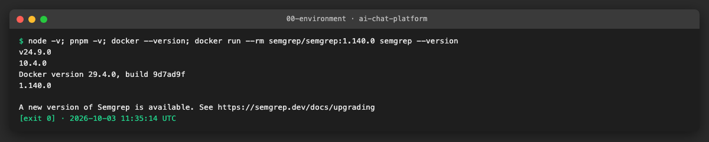
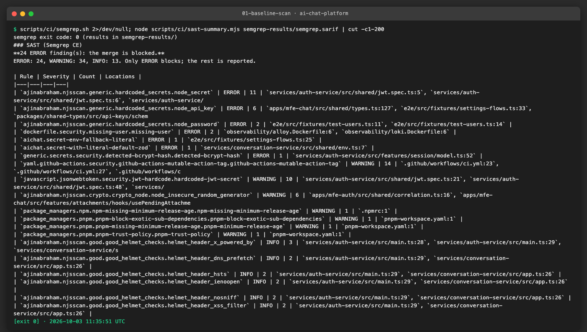
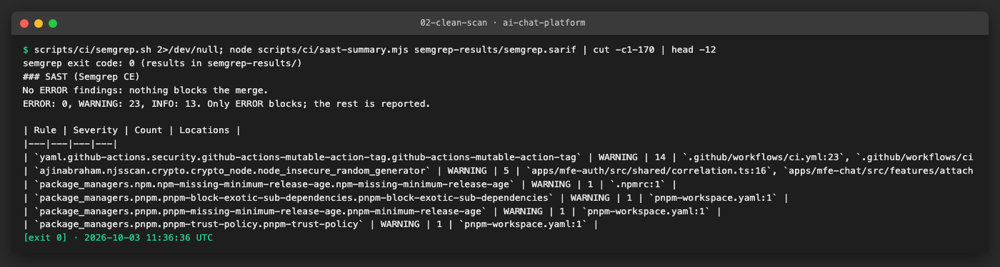
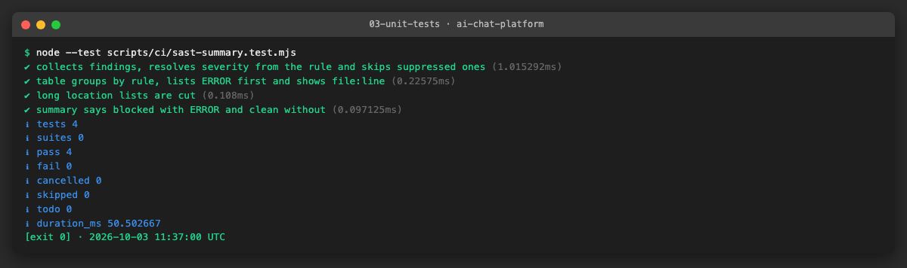
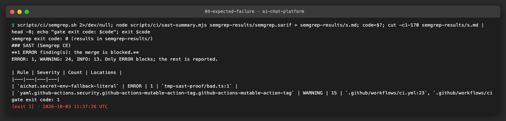
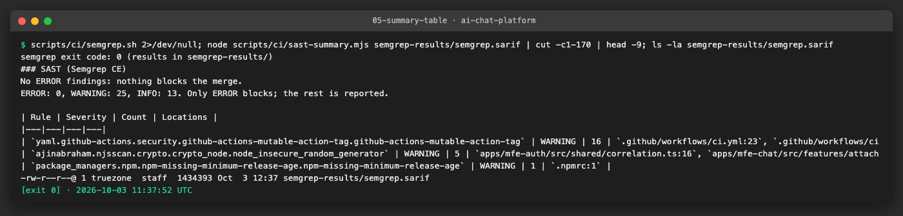

# AICHAT-27 · SAST: work log

| Field | Value |
|---|---|
| Epic | [AICHAT-27](https://ipca-grupo11.atlassian.net/browse/AICHAT-27) |
| Analysis | [README.md](README.md) |
| Owner | Jean-Pierre Carvalho |
| Branch | `test/AICHAT-27-sast` |
| Started / finished | 2026-10-03 / … |
| Pull requests | #… |
| Status | In Progress |

## 1. DoR review

Date: 2026-10-03

| DoR item | Status | Question asked | Decision | Decided by |
|---|---|---|---|---|
| Owner assigned | Met | — | Jean-Pierre Carvalho | — |
| Scope agreed | Met | Which code is scanned? | All TS/JS, Dockerfiles and GitHub Actions workflows; generated code (`dist`, coverage, Prisma client) excluded | Owner |
| Tooling agreed | Met | Semgrep CE or CodeQL? (plan decision D4) | Semgrep CE in GitHub Actions; CodeQL needs GitHub Advanced Security on a private repo. Results as a job summary and a SARIF artifact | Owner |
| Target environment available | Met | Where does it run? | Locally (Semgrep in Docker) and in GitHub Actions | Owner |
| Blocking level | Met | Which findings block the merge? | ERROR only; WARNINGs are listed in the summary and reviewed | Owner |
| JWT default secret (F1) | Met | Fix now or ticket? | Ticket as a High bug, waive in `WAIVERS.md`, fix later | Owner |
| Required check | Met | Change branch protection on `main`? | Required on `integration/testing-epics` now; the owner adds it to `main` after the final PR | Owner |

Blockers: none

## 2. Environment

| Tool | Version | Install |
|---|---|---|
| macOS (local) / Ubuntu (CI) | macOS 26.3 / `ubuntu-latest` | — |
| Node | `node -v` → v24.9.0 | `.nvmrc` |
| pnpm | `pnpm -v` → 10.4.0 | `corepack enable` |
| Docker | `docker --version` → 29.4.0 | OrbStack or Docker Desktop |
| Semgrep CE | `semgrep --version` → 1.140.0 (image `semgrep/semgrep:1.140.0`) | `docker pull semgrep/semgrep:1.140.0` |

## 3. Steps

### US1 · Choose the SAST tool and record the decision ([AICHAT-35](https://ipca-grupo11.atlassian.net/browse/AICHAT-35))

**What and why.** We compared Semgrep CE and CodeQL for a private repository. CodeQL needs GitHub Code Security (Advanced Security) on private repos, which we do not have. Semgrep CE is free, runs in about 15 seconds without a build and supports custom YAML rules. Its SARIF cannot go to the Security tab (that also needs GHAS), so we keep it as an artifact and write a job summary. The owner approved Semgrep CE on 2026-10-03.

**Files.**
- `docs/AICHAT-27/SAST.md` (new): the decision table, severity policy, scope, local run, waiver rules and the required-check note.
- `docs/AICHAT-27/evidence/00-environment.*`: tool versions.

**How to run.**

```sh
docker run --rm semgrep/semgrep:1.140.0 semgrep --version
```

**How to repeat it manually.**

1. Start Docker.
2. Run the command above.
3. Expected output: `1.140.0`.

**Result.** Decision recorded in `docs/AICHAT-27/SAST.md`; the image tag is pinned to `1.140.0`.



**Problems and fixes.** Docker was not running at first; we started OrbStack and pulled the pinned image.

### US2 · Semgrep configuration with rule packs and custom rules ([AICHAT-50](https://ipca-grupo11.atlassian.net/browse/AICHAT-50))

**What and why.** We wanted one configuration that runs the same way on a laptop and in CI. `scripts/ci/semgrep.sh` runs the pinned Docker image with our own rules (`.semgrep.yml`) and nine registry packs (TypeScript, React, Express, njsscan, JWT, secrets, GitHub Actions, Dockerfile, OWASP Top 10). `.semgrepignore` leaves out generated code. The two custom rules look for secrets that get a literal fallback: a zod `.default("...")` on a name like `*_SECRET`, and `process.env.X ?? "..."` / `|| "..."`. Both are ERROR.

**Files.**
- `.semgrep.yml` (new): the two custom rules.
- `.semgrepignore` (new): `node_modules`, `dist`, `build`, `coverage`, `.nx`, `.vite`, Prisma client (`services/*/src/generated/`), `@mf-types`, lock file, `docs/`.
- `scripts/ci/semgrep.sh` (new): runs Semgrep and writes `semgrep-results/semgrep.sarif`.
- `.gitignore`: ignores `semgrep-results/`.
- `docs/AICHAT-27/SAST.md`: local run documented.

**How to run.**

```sh
scripts/ci/semgrep.sh
```

**How to repeat it manually.**

1. Start Docker and run the command from the repo root.
2. Wait about 15 seconds (the first run pulls the image and the packs).
3. Expected output: `semgrep exit code: 0` and the file `semgrep-results/semgrep.sarif`. Then `node scripts/ci/sast-summary.mjs semgrep-results/semgrep.sarif` prints the table (the script is added in US5).

**Result.** The first run is our baseline: 24 ERROR, 34 WARNING and 13 INFO findings. Both custom rules fire: `aichat.secret-with-literal-default-zod` finds the JWT default in `services/conversation-service/src/shared/env.ts:7`, and `aichat.secret-env-fallback-literal` finds a fallback in an e2e fixture.



**Problems and fixes.**
- Registry rules cannot be listed inside `.semgrep.yml`, so the packs live in the shell script.
- The CLI does not print its findings as a table, so we read the SARIF with a small script (US5).
- Semgrep prints some parse warnings for shell snippets in workflow files. They are not errors and do not change the exit code.

### US3 · Triage existing SAST findings ([AICHAT-68](https://ipca-grupo11.atlassian.net/browse/AICHAT-68))

**What and why.** The baseline had 24 ERROR findings, which would block every PR. We went through each one. Nothing needed a code fix: 16 are fake secrets in tests, 4 are an HTTP header name, 1 is a dummy bcrypt hash, 2 are observability Dockerfiles and 1 is the real JWT default secret. The JWT default (F1, High) is not fixed in this epic by owner decision: it is waived, and the bug is ticketed as [AICHAT-210](https://ipca-grupo11.atlassian.net/browse/AICHAT-210). The 34 WARNING and 13 INFO items stay reported and are accepted with a reason.

**Files.**
- `docs/AICHAT-27/WAIVERS.md` (new): every waiver with ID, location, count and reason.
- `.semgrepignore`: test files, `e2e/src/fixtures/` and test setup folders.
- `nosemgrep` comments (reason on the line above) in `apps/mfe-chat/src/shared/types.ts`, `packages/shared-types/src/api-keys/schema.ts`, `packages/shared-types/src/chat/provider.ts`, `services/conversation-service/src/shared/contracts/http.ts`, `services/auth-service/src/features/session/model.ts`, `services/conversation-service/src/shared/env.ts`, `observability/alloy.Dockerfile`, `observability/loki.Dockerfile`. Comments only, no behaviour change.
- `docs/AICHAT-27/evidence/02-clean-scan.*`

**How to run.**

```sh
scripts/ci/semgrep.sh && node scripts/ci/sast-summary.mjs semgrep-results/semgrep.sarif
```

**How to repeat it manually.**

1. Run the command from the repo root with Docker running.
2. Compare the table with `WAIVERS.md`.
3. Expected output: `No ERROR findings`, 23 WARNING and 13 INFO, exit code 0.

**Result.** 0 ERROR after triage. F1 is waived as High (W5) pointing to AICHAT-210.



**Problems and fixes.**
- `nosemgrep` only matched the short rule id (the last part), not the full dotted id, so we use the short one.
- A `nosemgrep` comment must sit on the line directly above the finding, so the reason goes on its own line above it.
- SARIF keeps suppressed findings and marks them as suppressed, so our summary script skips those entries.

### US4 · SAST on every PR, high findings block the merge ([AICHAT-86](https://ipca-grupo11.atlassian.net/browse/AICHAT-86))

**What and why.** We added a `sast` job to `.github/workflows/security.yml`, next to `secret-scan` and with the same triggers (every pull request, and pushes to `main` and `integration/testing-epics`). It runs `scripts/ci/semgrep.sh`, then `scripts/ci/sast-summary.mjs`, which reads the SARIF, ignores findings suppressed with `nosemgrep` and exits 1 when an ERROR is left. WARNING and INFO never fail the job. We read the SARIF instead of using `semgrep --error` because the SARIF output is the only one that keeps WARNINGs for the summary and marks suppressed findings.

**Files.**
- `.github/workflows/security.yml`: new `sast` job (`sast (semgrep)`).
- `scripts/ci/sast-summary.mjs` (new): reads the SARIF, prints the table, sets the exit code.
- `scripts/ci/sast-summary.test.mjs` (new): `node --test` unit tests.
- `docs/AICHAT-27/evidence/03-unit-tests.*`, `04-expected-failure.*`

**How to run.**

```sh
node --test scripts/ci/sast-summary.test.mjs
scripts/ci/semgrep.sh && node scripts/ci/sast-summary.mjs semgrep-results/semgrep.sarif; echo $?
```

**How to repeat it manually.**

1. Create `tmp-sast-proof/bad.ts` with `export const apiToken = process.env.API_TOKEN ?? "super-secret-fallback";`.
2. Run the second command above.
3. Expected output: one ERROR (`aichat.secret-env-fallback-literal`, `tmp-sast-proof/bad.ts:1`) and exit code 1. Delete the file and the exit code goes back to 0.

**Result.** The unit tests pass, and the throw-away file made the gate fail (exit 1). We deleted the file afterwards. The GitHub run on a real PR is pending: "pending PR run".

Required check: the owner sets `sast (semgrep)` as a required status check on `integration/testing-epics` (Settings > Branches > branch protection > Require status checks). The same check is added to `main` after the final PR. We did not change any GitHub setting.





**Problems and fixes.** Calling `semgrep --error` hides suppressed-vs-open information and drops WARNINGs from the report when combined with `--severity ERROR`, so the gate lives in the Node script.

### US5 · Readable SAST results in the PR ([AICHAT-103](https://ipca-grupo11.atlassian.net/browse/AICHAT-103))

**What and why.** A red check with a long log is hard to read. The `sast` job now writes a Markdown table to the job summary (rule, severity, count, `file:line` locations, ERROR first) and uploads the SARIF as the artifact `semgrep-sarif` (14 days), also when the job fails. The table is built by `scripts/ci/sast-summary.mjs` from the SARIF. It has no dependencies, so it runs before any `pnpm install`.

**Files.**
- `.github/workflows/security.yml`: summary step (appends to `$GITHUB_STEP_SUMMARY`, then applies the gate) and `actions/upload-artifact@v4` step with `if: always()`.
- `scripts/ci/sast-summary.mjs` and `scripts/ci/sast-summary.test.mjs` (from US4): table formatting and its tests.
- `docs/AICHAT-27/evidence/05-summary-table.*`

**How to run.**

```sh
scripts/ci/semgrep.sh && node scripts/ci/sast-summary.mjs semgrep-results/semgrep.sarif
```

**How to repeat it manually.**

1. Open any PR and go to the Security workflow run, job `sast (semgrep)`.
2. Open the run Summary page and the Artifacts section.
3. Expected output: the table from the Result below, and the artifact `semgrep-sarif` containing `semgrep.sarif` and `summary.md`.

**Result.** Locally the command prints the table below (0 ERROR, 25 WARNING, 13 INFO). The same text goes to the job summary in CI: pending PR run.



**Problems and fixes.** Long location lists made the table unreadable, so each row shows the first three locations and "+N more". The full list is in the SARIF.

## 4. How to run everything

```sh
# all checks added by this epic, from the repo root (Docker running)
node --test scripts/ci/sast-summary.test.mjs
scripts/ci/semgrep.sh && node scripts/ci/sast-summary.mjs semgrep-results/semgrep.sarif
```

## 5. Results

| Metric | Before | After |
|---|---|---|
| SAST tool in CI | none | Semgrep CE 1.140.0, job `sast (semgrep)` |
| ERROR findings | 24 (baseline) | 0 (1 High waived: F1, AICHAT-210) |
| WARNING findings | 34 | 25 (reported, accepted in `WAIVERS.md`) |
| INFO findings | 13 | 13 (helmet checks, nothing to fix) |
| Unit tests for the summary script | 0 | 4 |
| Merge blocked on ERROR | no | yes (after the owner sets the required check) |

## 6. DoD check

| DoD item | Met | Evidence |
|---|---|---|
| Decision recorded (Semgrep CE vs CodeQL, licensing) | ✅ | [SAST.md](SAST.md), [00-environment](evidence/00-environment.png) |
| `.semgrep.yml` + `.semgrepignore`; local run documented | ✅ | [SAST.md](SAST.md), [01-baseline-scan](evidence/01-baseline-scan.png) |
| All baseline findings fixed or waived with reasons; JWT default secret ticketed as High | ✅ | [WAIVERS.md](WAIVERS.md) (W5, AICHAT-210), [02-clean-scan](evidence/02-clean-scan.png) |
| `security.yml` job; ERROR findings fail | ✅ locally; pending PR run on GitHub | [04-expected-failure](evidence/04-expected-failure.png) |
| Required check on `main` | Documented in [SAST.md](SAST.md); the owner sets it on `integration/testing-epics` now and on `main` after the final PR | pending PR run |
| Job summary table + SARIF artifact | ✅ locally; pending PR run on GitHub | [05-summary-table](evidence/05-summary-table.png) |
| Unit tests for the summary script | ✅ | [03-unit-tests](evidence/03-unit-tests.png) |

## 7. Notes for the report

- What was found: 24 ERROR, 34 WARNING and 13 INFO findings on the first scan. Only one ERROR was a real problem: the default `JWT_SECRET` in conversation-service (High). The 23 other ERRORs were fake test secrets, an HTTP header name, a dummy bcrypt hash and two Dockerfiles. The WARNINGs are mostly unpinned GitHub Actions and package manager hardening options.
- What was fixed / waived: nothing needed a code fix. Test code is excluded by path, four one-line false positives carry a `nosemgrep` comment with a reason, and everything is listed in `WAIVERS.md`. F1 is waived as High and ticketed as AICHAT-210.
- Lessons learned: `nosemgrep` matches the short rule id only and needs the comment right above the line; SARIF keeps suppressed findings, so the gate must skip them; the free engine plus a small script gave us a readable gate without GitHub Advanced Security. Semgrep's SARIF cannot go to the Security tab on a private repo, hence the artifact.
