# AICHAT-28 · DAST: work log

| Field | Value |
|---|---|
| Epic | [AICHAT-28](https://ipca-grupo11.atlassian.net/browse/AICHAT-28) |
| Analysis | [README.md](README.md) |
| Owner | Jean-Pierre Carvalho |
| Branch | `test/AICHAT-28-dast` |
| Started / finished | 2026-10-03 / 2026-10-03 |
| Pull requests | [#18](https://github.com/ipca-group11/ai-chat-platform/pull/18) |
| Status | Done, merged into `integration/testing-epics` |

## 1. DoR review

Date: 2026-10-03

| DoR item | Status | Question asked | Decision | Decided by |
|---|---|---|---|---|
| Owner assigned | Met | — | Jean-Pierre Carvalho | — |
| Scope agreed | Met | What is scanned, passive or active? | The local compose stack (shell on `:8000` plus the auth and conversation APIs) with the LLM mock; production is excluded. Passive baseline is the gate; the active API scan runs weekly and on demand only | Team (owner delegated) |
| Tooling agreed | Met | Which tool and configuration? | OWASP ZAP (`zaproxy/zap-stable`): `zap-baseline.py` with the AJAX spider (`-j`) for the React app, `testing/zap/rules.tsv` (High → FAIL, Medium → WARN, Low/Info → IGNORE, each IGNORE with a reason), `zap-api-scan.py` for the weekly API scan | Team (owner delegated) |
| Target environment available | Met | Where does the stack run? | Locally and on the CI runner with `pnpm mock:up llm` (same steps as `e2e.yml`, without Playwright) | Team (owner delegated) |
| CI trigger | Met | The full e2e suite was moved off pull requests because it is slow; how often does DAST run? | Own workflow `dast.yml`: pull requests to `main`, pushes to `integration/testing-epics` and `main`, `workflow_dispatch`; the API scan weekly (cron) and on demand. A High alert fails the job | Team (owner delegated) |
| Authentication | Met | How does ZAP see the pages behind sign-in? | A seeded test user signs in before the scan; its session cookie is injected with a ZAP replacer rule, so `/chats`, `/settings` and `/api/*` are crawled | Team (owner delegated) |
| OpenAPI spec | Met | AICHAT-121 depends on the AICHAT-12 spec, which does not exist yet | We write a small OpenAPI 3 file for the scan in `testing/zap/` from the Express routes; it is replaced by the AICHAT-12 spec when that lands | Team (owner delegated) |
| Security header findings | Met | Fix or ticket? | Ticket the Caddyfile header fixes to the deploy owner (Jira), no fix in this epic | Team (owner delegated) |
| Legacy `docker-compose.yml` | Met | It exposes Postgres and Grafana with default passwords | Ticket only (removal touches deploy docs owned by others) | Team (owner delegated) |
| Scan tool | OWASP ZAP `zaproxy/zap-stable:2.17.0` run with `docker run`, not the `zaproxy/action-baseline` action | We need our own exit-code handling (`FAIL_ACTION`) and the session cookie must reach ZAP as a `-z` option without passing through an action input. The image and the rules file are the ones the analysis names | Team (owner delegated) |
| Signed-in scan | The seeded user's `access_token` cookie only; the scan starts at `/api/chats` | ZAP splits `-z` on spaces, so a two-cookie header does not fit; the services only check the access token. Starting at the chats API puts `/api/chats` in the report, because its JSON answers raise no alert of their own | Team (owner delegated) |
| Token lifetime | `ACCESS_TOKEN_TTL_SECONDS=3600` for the DAST stack | The default is 15 minutes, shorter than a scan | Team (owner delegated) |
| Ports on the development machine | Stack on 14001, 14002, 13300 and 19090 | Another project uses 4001, 4002, 3300 and 9090 (same as AICHAT-24); CI uses the defaults | Team (owner delegated) |

Blockers: none

## 2. Environment

| Tool | Version | Install |
|---|---|---|
| macOS | 26.3 | n/a |
| Node | `node -v` → v24.21.0 | `nvm install` (reads `.nvmrc`) |
| pnpm | `pnpm -v` → 10.4.0 | `corepack enable` |
| Docker | `docker --version` → Docker version 29.4.0 | Docker Desktop or OrbStack |
| OWASP ZAP | `zap.sh -version` → 2.17.0 | Docker image `zaproxy/zap-stable:2.17.0`, pulled by `testing/zap/run.sh` |

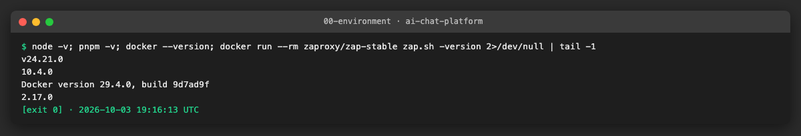

## 3. Steps

### US1 · ZAP rules file, severity policy and false positives ([AICHAT-52](https://ipca-grupo11.atlassian.net/browse/AICHAT-52))

**What and why.** `zap-baseline.py` decides by rule id: `FAIL` makes the scan exit 1, `WARN` is listed, `IGNORE` is left out of the summary and the exit code. We wrote `testing/zap/rules.tsv` with the policy of the DoR review: High risk is `FAIL`, Medium is `WARN`, Low and Informational are `IGNORE`. Every line has four tab-separated columns (id, action, name, reason), so each `IGNORE` carries its reason on the same line; the header of the file explains the policy and how to add a false positive. We built the id list from `zap-baseline.py -g` (the 70 passive rules of the image) and set each rule from its risk. Two false positives found in the first scan are documented in the file: Retire.js reads the Module Federation chunk `mf-entry-bootstrap-<hash>.js` as the Bootstrap library (10003, out of scope for that file only), and cookies without `Secure` on the local stack (10011, `COOKIE_SECURE=false` over plain HTTP). `testing/zap/run.sh` and `scripts/dast/zap-report.ts` run the scan and print the alert table (they are used by all stories).

**Files.**
- `testing/zap/rules.tsv` (new): 16 `FAIL`, 17 `WARN`, 47 `IGNORE`, 2 `OUTOFSCOPE` lines.
- `testing/zap/run.sh` (new): runs the pinned ZAP image against the stack and judges the exit code.
- `scripts/dast/zap-report.ts`, `zap-report.test.ts` (new): Markdown summary of the JSON report, expected-URL check.
- `.gitignore`: `zap-results/` (scratch output of `run.sh`).

**How to run.**

```sh
pnpm mock:up && AUTH=0 bash testing/zap/run.sh baseline
```

**How to repeat it manually.**

1. Start the stack with `pnpm mock:up` (if the ports 4001, 4002, 3300 or 9090 are busy, set `AUTH_SERVICE_PORT`, `CONVERSATION_SERVICE_PORT`, `GRAFANA_PORT` and `PROMETHEUS_PORT`).
2. Run `AUTH=0 bash testing/zap/run.sh baseline`. It pulls `zaproxy/zap-stable:2.17.0` on the first run and takes about four minutes. The reports are in `zap-results/baseline.{html,json,md}`.
3. Expected output: `FAIL-NEW: 0 ... WARN-NEW: 3 ... IGNORE: 5 ... PASS: 59`, the alert table, exit code 0. To see the gate fail, copy `rules.tsv`, change `10038` from `WARN` to `FAIL`, run with `ZAP_RULES=<that file>` and read `FAIL-NEW: 1` and exit code 1.

**Result.** The anonymous scan (81 URLs, AJAX spider) ends with no `FAIL`, 3 `WARN` (CSP not set, anti-clickjacking header missing, Google Fonts stylesheet without SRI) and 5 `IGNORE` (the Low header alerts). A rules file that sets the CSP rule to `FAIL` makes the same scan exit 1.

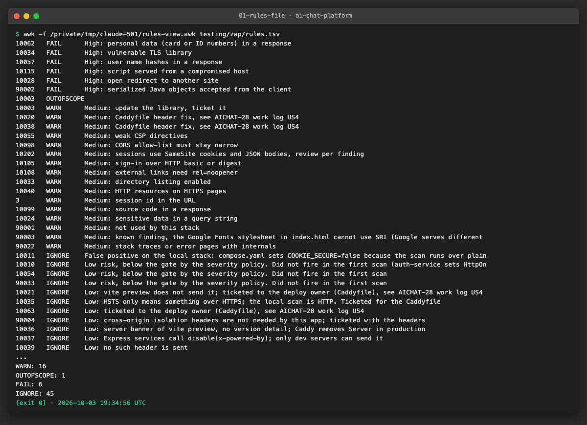

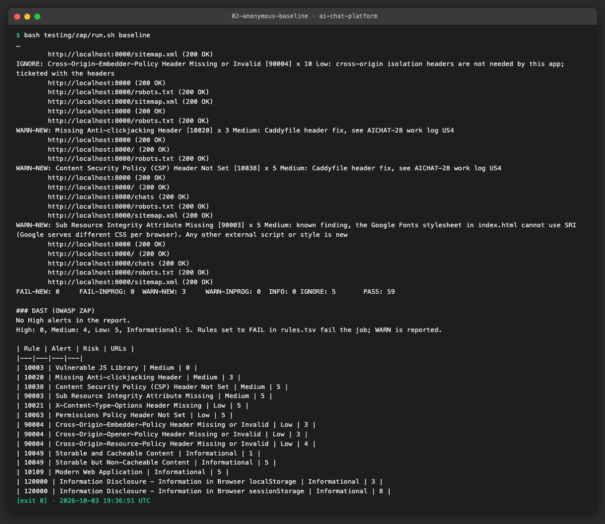

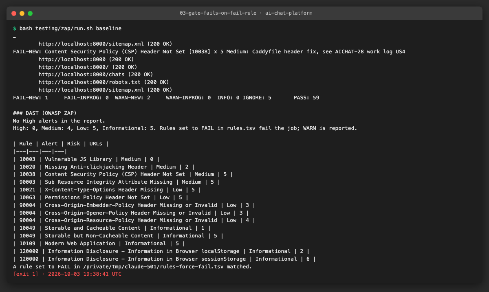

Reports: `results/us1-anonymous.{html,json,md}`, `results/us1-forced-fail.md`.

**Problems and fixes.**
- A line with fewer than three tab-separated columns makes `zap-baseline.py` stop with `ValueError`; a fourth column is accepted and is printed next to the alert. We use four columns everywhere and the header says "tabs, not spaces".
- The `10003` alert was a false positive on a file name, not a library. An `OUTOFSCOPE` line (URL regex) removes only that file, so a real vulnerable library elsewhere still warns.
- A rule that is `IGNORE` is still listed in the full HTML/JSON report; only the console summary and the exit code skip it. This is what lets the header triage (US4) use the Low alerts.
- Rules are per id, not per risk, so an id that ZAP raises at two risks gets one action. This came up again in US5 (40014).

### US2 · Authenticated ZAP scan of pages and APIs ([AICHAT-71](https://ipca-grupo11.atlassian.net/browse/AICHAT-71))

**What and why.** An anonymous scan only sees the login screen (`/chats` redirects to `/login`). `scripts/dast/zap-session.ts` registers the seeded user `dast-user@dast.example.com` (409 means it exists), signs in through the shell, creates three chats if the user has fewer, and prints the ZAP `-z` options for a replacer rule that sets `Cookie: access_token=...` on every request, also those of the AJAX spider's browser. `run.sh` passes them to ZAP (`AUTH=1` is the default). The cookie is only written to stdout; in GitHub Actions `run.sh` masks it with `::add-mask::` before anything can print it. `scripts/dast/zap-report.ts --expect` fails the run when `/chats`, `/settings` or `/api/chats` is missing from the report, so a session that silently stopped working is caught.

**Files.**
- `scripts/dast/zap-session.ts`, `zap-session.test.ts` (new): sign-in, seeding, replacer options.
- `testing/zap/run.sh`: `AUTH`, `ZAP_BASE_URL`, `ZAP_TARGET`, `ZAP_EXPECT`.
- `docs/AICHAT-28/results/us2-authenticated.{html,json,md}`: the recorded report.

**How to run.**

```sh
ACCESS_TOKEN_TTL_SECONDS=3600 pnpm mock:up && bash testing/zap/run.sh baseline
```

**How to repeat it manually.**

1. Start the stack with a one-hour access token (`ACCESS_TOKEN_TTL_SECONDS=3600 pnpm mock:up`).
2. Run `bash testing/zap/run.sh baseline`; the report is `zap-results/baseline.html`.
3. Expected output: `Expected URLs present: /chats, /settings, /api/chats` at the end and exit code 0. `node scripts/dast/zap-report.ts zap-results/baseline.json --urls` lists the URLs of the report.

**Result.** With the cookie injected the report lists `/chats`, `/settings` and `/api/chats` (85 URLs found by the spiders). The anonymous report lists `/login` and `/register` instead and has neither `/settings` nor `/api/chats`. Without the cookie `GET /api/chats` answers 401, with it 200.

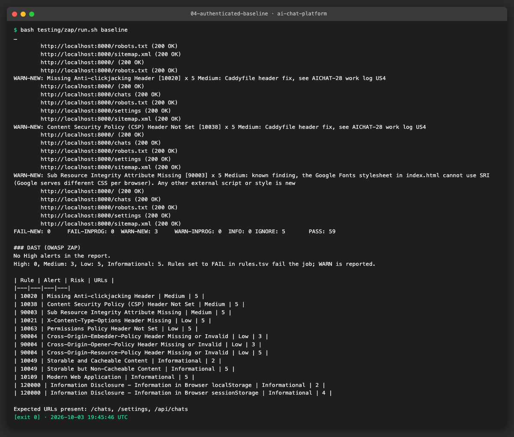

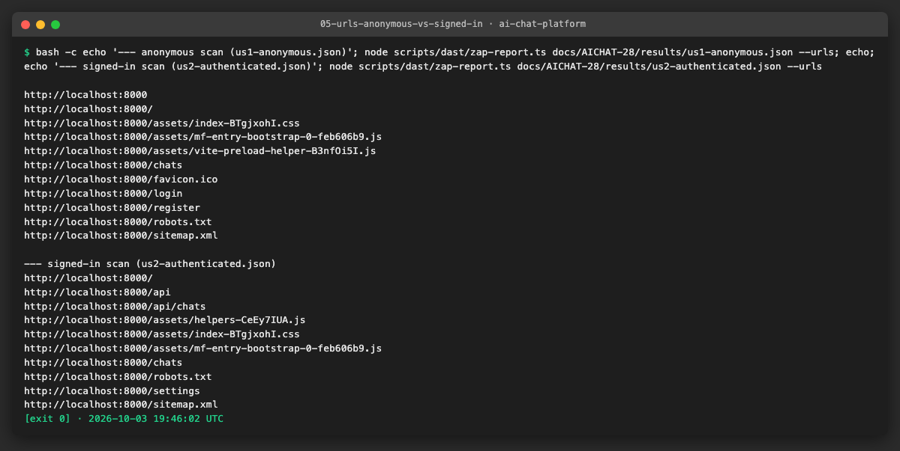

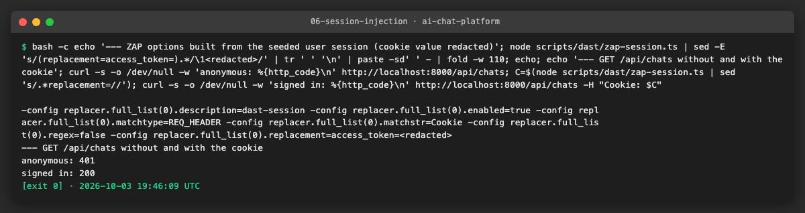

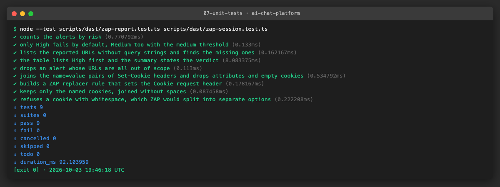

**Problems and fixes.**
- ZAP splits the `-z` string on spaces. The first version injected `access_token=...; refresh_token=...`, ZAP read the second cookie as a file name and stopped ("File not found 'refresh_token=...'"). We now send only the access token (`pickCookies`), and `buildReplacerOptions` throws on whitespace so it cannot come back. That first log held a live token of the throw-away account; it stayed in the ignored `zap-results/` folder and no committed file contains a cookie (`grep` for `access_token=` and `eyJ` over `docs/AICHAT-28` finds nothing).
- The JSON answers of the API are fully hardened by `helmet`, so they raise no passive alert and a scan that starts at `/` never lists `/api/chats`. The signed-in scan starts at `/api/chats` (`ZAP_TARGET`): ZAP then lists it (an Informational cacheability alert) and the spiders still reach the pages.
- `--network host` is needed so the browser of the AJAX spider reaches the micro frontends on `localhost:3001-3003`; with `host.docker.internal` the shell answered 403 (its allowed host is `localhost`), as in AICHAT-24. OrbStack and Linux runners both accept it.

### US3 · ZAP baseline in CI, High alerts fail the job ([AICHAT-90](https://ipca-grupo11.atlassian.net/browse/AICHAT-90))

**What and why.** `.github/workflows/dast.yml` is a new workflow with the triggers of the DoR review: pull requests to `main`, pushes to `integration/testing-epics` and `main`, and `workflow_dispatch`. The `baseline` job frees disk, starts the stack with `pnpm mock:up` (profile `llm`, as `e2e.yml`), waits for the shell and both APIs with a bounded `curl` loop (60 tries of 5 seconds each), then runs `bash testing/zap/run.sh baseline`. `FAIL_ACTION: "true"` makes exit code 1 of ZAP (a `FAIL` rule matched) fail the job; warnings pass; any other exit code is a scan error and fails. The HTML, JSON, Markdown and log are uploaded as the artifact `zap-baseline-report` (14 days) also when the job fails, the alert table goes to the job summary, and the stack is torn down in an `always()` step. Production is never a target.

**Required check.** Branch protection is not available on this private free-plan repository (HTTP 403). As in earlier epics, this is a team rule, written in the header of the workflow: do not merge into `main` while the check `dast / baseline` is red.

**Files.**
- `.github/workflows/dast.yml` (new).
- `e2e/src/ci/dast-workflow.spec.ts` (new): structural Vitest spec, like `e2e-workflow.spec.ts`.

**How to run.**

```sh
pnpm --filter e2e exec vitest run src/ci/dast-workflow.spec.ts   # the workflow is wired as agreed
bash testing/zap/run.sh baseline                                 # the job's scan, locally
```

**How to repeat it manually.**

1. In GitHub, open Actions, workflow `dast`, "Run workflow" on the branch (or open a pull request to `main`).
2. Open the run: job `baseline`, summary table, artifact `zap-baseline-report`.
3. Expected output: green job with the summary "No High alerts in the report". To see it fail, push a change that sets a rule that matches (for example `10038` to `FAIL` in `testing/zap/rules.tsv`) and read the red job and the line "ZAP exited with 1".

**Result.** The structural spec passes (it checks triggers, pinned image, `llm` stack and bounded wait, `FAIL_ACTION`, the three rule levels, the signed-in AJAX scan, cookie masking, artifacts on failure, teardown and the team rule). The exit-code logic was exercised locally with the same script: exit 0 with the real rules file, exit 1 with a rules file that forces `FAIL` (evidence 03 in US1).

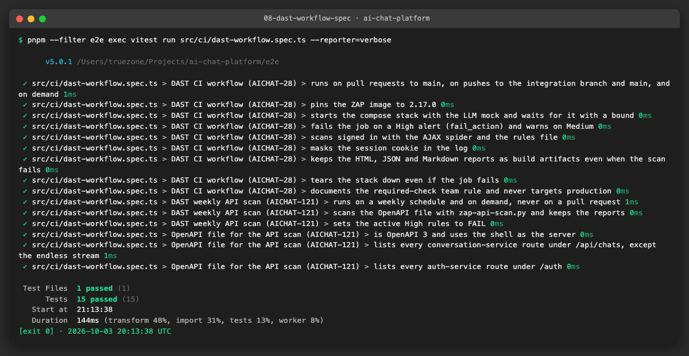

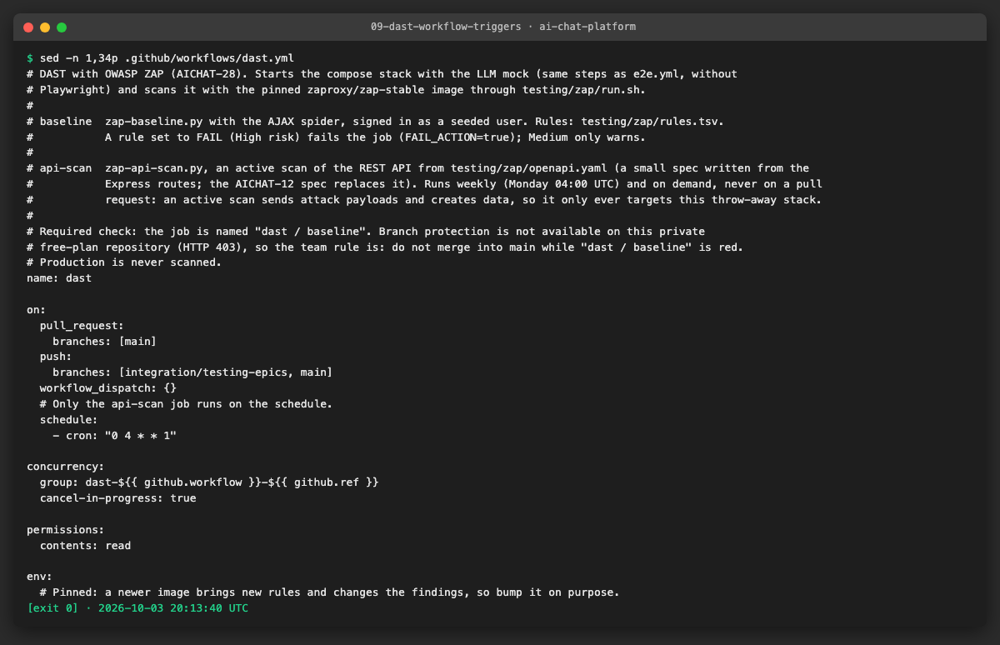

**Problems and fixes.**
- We use the pinned image with `docker run` instead of `zaproxy/action-baseline`: the action cannot take the cookie option safely and its failure rule is not ours to set. The job has the same pieces the action would give (rules file, `-j`, reports as artifacts, `fail_action` as `FAIL_ACTION`).
- The workflow itself could not run on GitHub from this machine (the branch is not pushed). The first run in Actions is the open check; the steps are the ones that ran locally, except the Linux-only parts (`chmod 777` of the results folder for the `zap` user of the image, `docker pull`).
- A scheduled run starts the whole workflow, so each job has an `if:` on the event (see US5).

### US4 · Ticket missing security headers ([AICHAT-106](https://ipca-grupo11.atlassian.net/browse/AICHAT-106))

**What and why.** We triaged the first signed-in baseline (US2) and two manual checks, and wrote the Caddyfile fix for the deploy owner as tickets, as agreed (no fix in this epic). The shell is a `vite preview` server and sends no security header at all; `helmet` only covers the two APIs. In production Caddy is the front door (`deploy/azure/Caddyfile`), so the headers belong there.

**Triage of the first run.**

| Alert (rule) | Risk | URLs | Proposed fix, in Caddyfile terms |
|---|---|---|---|
| Content Security Policy header not set (10038) | Medium | `/`, `/chats`, `/settings`, `/login`, `/robots.txt`, `/sitemap.xml` (every HTML answer) | In `{$DOMAIN}`, inside `handle { ... }` (so `/grafana` keeps its own headers): `header Content-Security-Policy "default-src 'self'; script-src 'self' https://{$DOMAIN}:3001 https://{$DOMAIN}:3002 https://{$DOMAIN}:3003; style-src 'self' 'unsafe-inline' https://fonts.googleapis.com; font-src 'self' https://fonts.gstatic.com; img-src 'self' data:; connect-src 'self' https://{$DOMAIN}:3001 https://{$DOMAIN}:3002 https://{$DOMAIN}:3003; frame-ancestors 'none'; base-uri 'self'; form-action 'self'; object-src 'none'"`. Start with `Content-Security-Policy-Report-Only` and check a browser session first (the micro frontends and Faro on `/collect` must keep working) |
| Missing anti-clickjacking header (10020) | Medium | `/`, `/chats`, `/settings` | `header X-Frame-Options "DENY"` (the CSP `frame-ancestors 'none'` covers it in new browsers) |
| X-Content-Type-Options header missing (10021) | Low | HTML, `/assets/*.js`, `/assets/*.css` | `header X-Content-Type-Options "nosniff"` in the site block and in the `(remote)` snippet |
| Permissions-Policy header not set (10063) | Low | every HTML and asset answer | `header Permissions-Policy "camera=(), microphone=(), geolocation=(), payment=()"` |
| Cross-Origin-Opener-Policy / Cross-Origin-Resource-Policy / Cross-Origin-Embedder-Policy missing (90004) | Low | `/`, `/assets/*` | `header Cross-Origin-Opener-Policy "same-origin"` and `header Cross-Origin-Resource-Policy "same-origin"` in the site block only; the `(remote)` snippet needs `cross-origin` because the shell loads the remotes from other ports. Skip COEP (it would block Google Fonts) |
| Strict-Transport-Security (not scanned: the local scan is HTTP; expected from the Caddyfile) | Low | production only | `header Strict-Transport-Security "max-age=31536000; includeSubDomains"` in the site block and `(remote)`; start with a short `max-age` |
| No Referrer-Policy (no ZAP rule; seen in the headers) | n/a | all | `header Referrer-Policy "strict-origin-when-cross-origin"` |
| Sub Resource Integrity attribute missing (90003) | Medium | `/` (the Google Fonts stylesheet in `index.html`) | Not a Caddyfile change: Google serves different CSS per browser, so SRI cannot be used. Self-host the two fonts; it also lets the CSP drop the two Google hosts. Kept as a known WARN in `rules.tsv` |
| `/api/metrics` readable without sign-in (manual `curl`, ZAP has no rule) | Medium | `/api/metrics` through the shell proxy (200, Prometheus text) | In `{$DOMAIN}` before the catch-all: `@metrics path /api/metrics*` and `respond @metrics 404`. Prometheus scrapes the service on the compose network and does not need the public path |
| CSP `style-src 'unsafe-inline'` (10055) | Medium | after the fix | Appears once the CSP above is set (the app uses inline styles); accepted as WARN, to be removed later |

**Proof that the proposal works.** We put a Caddy container (`caddy:2`) with the headers of the table in front of the local shell (`header_up Host localhost` as in the real Caddyfile, `/api/metrics*` answered 404) and ran the same anonymous baseline against it. Medium alerts went from 3 to 2 and Low from 5 to 1: CSP, anti-clickjacking, nosniff and Permissions-Policy alerts are gone; left are the Google Fonts SRI, the `unsafe-inline` style warning and COEP. This was a scratch test; the repository's Caddyfile is untouched.

**Files.**
- `docs/AICHAT-28/results/us4-with-proposed-headers.{html,json,md}`: the scan with the proposed headers.
- No code change (tickets only).

**How to run.** Read the table above; the first-run reports are `results/us2-authenticated.html` (signed in) and `results/us1-anonymous.html`.

**How to repeat it manually.**

1. Run `pnpm mock:up`, then `bash testing/zap/run.sh baseline` and open the HTML report; compare with the table.
2. Run `curl -s -D - -o /dev/null http://localhost:8000/` (no security headers) and `curl -s -o /dev/null -w '%{http_code}\n' http://localhost:8000/api/metrics` (200).
3. To test the proposal, run Caddy in front of the shell with the headers and scan it with `ZAP_BASE_URL=http://localhost:8081 AUTH=0 bash testing/zap/run.sh baseline`.

**Result.** Tickets to create (the coordinator creates them in Jira, assigned to the deploy owner):

| # | Summary | Description |
|---|---|---|
| 1 | Caddyfile: add security headers (CSP, X-Frame-Options, nosniff, Referrer-Policy, Permissions-Policy, COOP/CORP, HSTS) | The ZAP baseline (AICHAT-28) finds no security header on the shell and the remotes. Add the headers of the triage table in `deploy/azure/Caddyfile` (site block inside `handle`, and the `(remote)` snippet), CSP first as Report-Only, and rescan |
| 2 | Caddyfile: do not expose `/api/metrics` publicly | `GET /api/metrics` returns the Prometheus metrics of conversation-service without sign-in, through the shell proxy. Answer 404 for `/api/metrics*` in the Caddyfile (Prometheus scrapes inside the compose network) |
| 3 | Self-host the Inter and JetBrains Mono fonts | `apps/shell/index.html` loads Google Fonts, which cannot use SRI (ZAP 90003) and forces two external hosts into the CSP. Serve the fonts from the app |
| 4 | Remove or harden the legacy `docker-compose.yml` | It publishes Postgres on 5432 and Grafana with the default password `admin` on all interfaces and uses `:latest` images. `compose.yaml` is the hardened file; remove the old one and fix the docs that mention it |
| 5 | Return 400 for malformed JSON and multipart bodies | `POST /api/chats` with `{bad` answers 500 `INTERNAL_ERROR` (the body parser error is not mapped), before the sign-in check; ZAP also gets 500 on the attachment upload with a fuzzed multipart body. Map body-parser and multer errors to 400 in the error handlers of both services |

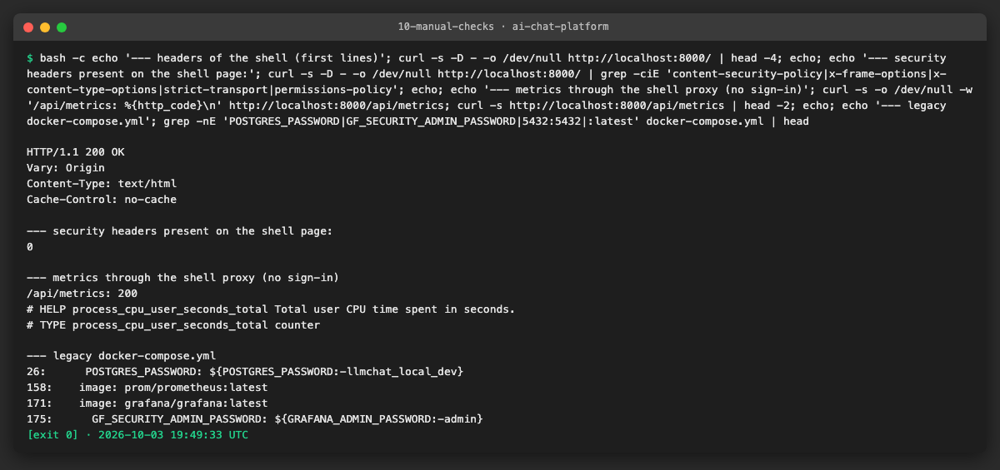

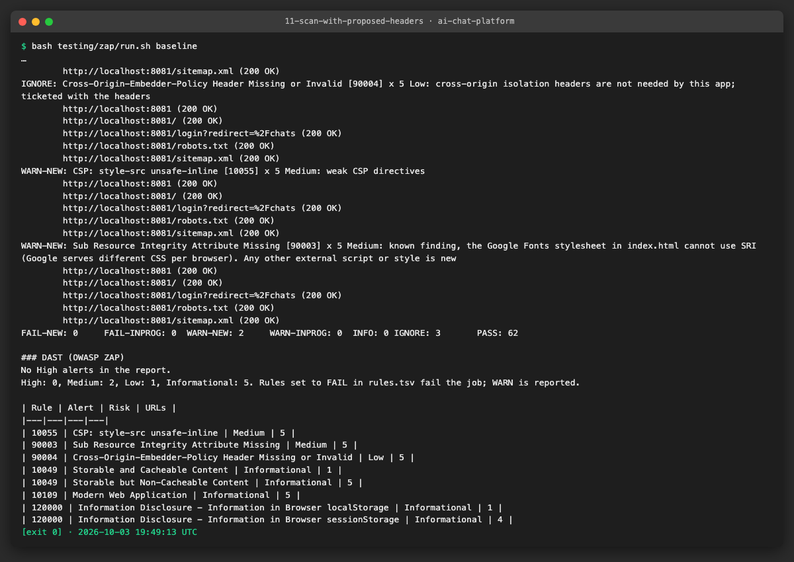

**Problems and fixes.** ZAP does not report the public `/api/metrics`; we found it by hand, as the analysis predicted. HSTS cannot show up in a local HTTP scan, so it comes from reading the Caddyfile and is not scored by the proof above.

### US5 · Weekly API scan from the OpenAPI spec ([AICHAT-121](https://ipca-grupo11.atlassian.net/browse/AICHAT-121))

**What and why.** AICHAT-12 (the OpenAPI spec) does not exist yet, so we wrote `testing/zap/openapi.yaml` by hand from the Express routes of auth-service (register, login, refresh, logout, me) and conversation-service (chats, members, messages, retry, stop, attachments), with the paths a browser sees through the shell (`/auth/*` and `/api/*`). The AICHAT-12 spec replaces it. The endless stream `GET /api/chats/{chatId}/stream` is left out: an active scan would wait for it. The `api-scan` job of `dast.yml` runs `zap-api-scan.py -f openapi` (an active scan, signed in with the same cookie) every Monday at 04:00 UTC and on demand; it never runs on pull requests. The active High rules (XSS, SQL injection, command injection, path traversal, XXE, CRLF, SSI, code injection) are `FAIL` in `rules.tsv`.

**Files.**
- `testing/zap/openapi.yaml` (new): 15 paths, 21 operations.
- `.github/workflows/dast.yml`: `schedule` trigger and the `api-scan` job; `baseline` is skipped on the schedule.
- `testing/zap/rules.tsv`: active rules, `40014` out of scope for `/api/`, `10106`, `100000`, `100001`.
- `e2e/src/ci/dast-workflow.spec.ts`: schedule, job, and a check that every route of both services is in the OpenAPI file.
- `docs/AICHAT-28/results/us5-api-scan*.{html,json,md}`.

**How to run.**

```sh
ACCESS_TOKEN_TTL_SECONDS=3600 pnpm mock:up && DAST_EMAIL=dast-api@dast.example.com bash testing/zap/run.sh api
```

**How to repeat it manually.**

1. Start a fresh stack (`ACCESS_TOKEN_TTL_SECONDS=3600 pnpm mock:up`). auth-service limits requests to 300 per 15 minutes per address and the scan uses them all, so start a new stack (or restart auth-service) before each run.
2. Run the command above (about ten minutes); or run the workflow `dast` by hand in Actions, job `api-scan`.
3. Expected output: `FAIL-NEW: 0`, a few `WARN`, exit code 0; the report lists `/api/chats/...` and `/auth/...`.

**Result.** The scan imports the 18 URLs of the spec, runs 119 rules and ends with no `FAIL`: 2 `WARN` (Format String Error on the attachment upload and server errors) and `PASS` for the injection rules. The URLs under `/api/chats` and `/auth` are in the report. The first run, before we scoped one rule, failed the gate (evidence 13).

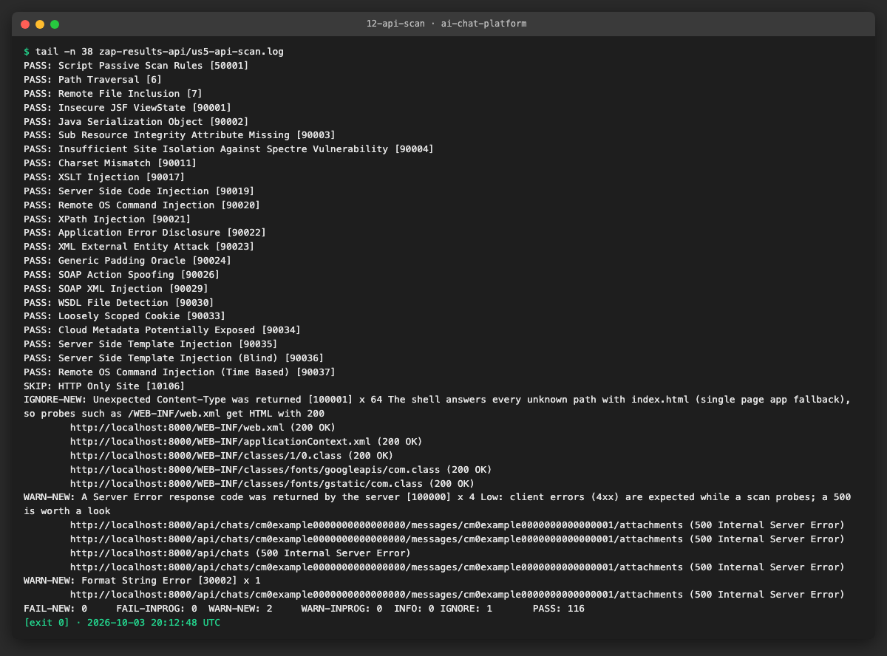

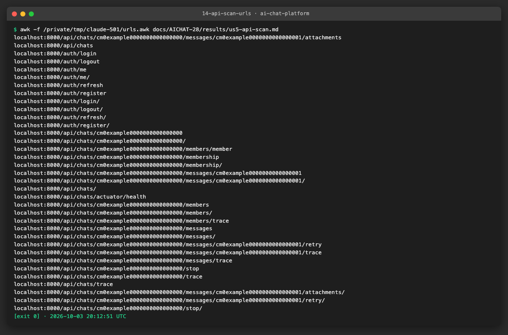

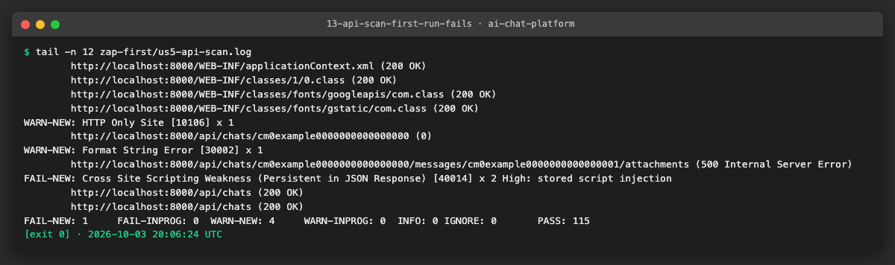

**Problems and fixes.**
- The first run failed on `40014`: ZAP raises "XSS weakness (persistent in JSON response)" at risk **Low** under the same rule id as persistent XSS in a page (High). The API only answers `application/json` with `X-Content-Type-Options: nosniff` and the UI shows titles as text, so we scoped `40014` out for `http://localhost:*/api/*` only (reason in the file). Pages stay in scope.
- The rate limit of auth-service (300 per 15 minutes) is used up by the scan; the next sign-in in the same quarter of an hour got 429. A scheduled run starts a fresh stack, so this only matters for local reruns.
- The second run used the wrong `-O` (the signed-in target `/api/chats` instead of the shell root), so the URLs had a doubled prefix (`/api/chats/api/chats/...`). `-O` now always takes `ZAP_BASE_URL`.
- Server errors: `POST /api/chats` and the attachment upload answer 500 to fuzzed input (ticket 5). Results vary a little between runs (the first run had two more `WARN`), so the first run is kept next to the final one.

## 4. How to run everything

```sh
ACCESS_TOKEN_TTL_SECONDS=3600 pnpm mock:up                    # stack with the LLM mock (set the *_PORT variables if 4001, 4002, 3300, 9090 are busy)
AUTH=0 bash testing/zap/run.sh baseline                       # anonymous baseline (US1)
bash testing/zap/run.sh baseline                              # signed-in baseline, the CI gate (US2, US3)
DAST_EMAIL=dast-api@dast.example.com bash testing/zap/run.sh api   # active API scan (US5); restart auth-service first if you ran it before
pnpm mock:down
pnpm test:scripts && pnpm --filter e2e exec vitest run src/ci  # unit tests of the helpers and the workflow specs
```

## 5. Results

| Metric | Before | After |
|---|---|---|
| Dynamic scanning | none | ZAP baseline on every pull request to `main`, API scan every week |
| Severity policy | none | `testing/zap/rules.tsv`: 16 FAIL, 17 WARN, 47 IGNORE with a reason each |
| Pages and API seen by the scan | login screen only | `/chats`, `/settings`, `/api/chats` in the report (85 URLs) |
| First run, signed in | n/a | 0 High, 3 Medium (CSP, clickjacking, SRI), 5 Low, 5 Informational |
| API scan | none | 18 imported operations, 0 FAIL, 2 WARN, 116 rules pass |
| Findings ticketed | n/a | 5 tickets (headers, public metrics, fonts, legacy compose, 500 on bad input) |

## 6. DoD check

| DoD item | Met | Evidence |
|---|---|---|
| `testing/zap/rules.tsv` with a reason for each IGNORE | ✅ | [rules](evidence/01-rules-file.png) |
| Authenticated scan: seeded user and cookie injection, report shows `/chats`, `/settings`, `/api/chats` | ✅ | [signed-in](evidence/04-authenticated-baseline.png), [URLs](evidence/05-urls-anonymous-vs-signed-in.png), [injection](evidence/06-session-injection.png) |
| CI job with `fail_action`, reports as artifacts | ✅ | [workflow spec](evidence/08-dast-workflow-spec.png), [failing gate](evidence/03-gate-fails-on-fail-rule.png) |
| Required check | ➖ | Not enforceable: branch protection is unavailable on this private free-plan repository (HTTP 403). Team rule in the header of `dast.yml`: no merge to `main` while `dast / baseline` is red |
| First-run triage, Caddyfile header fixes ticketed to the deploy owner | ✅ | table in US4, [proof with headers](evidence/11-scan-with-proposed-headers.png); the tickets are created by the coordinator |
| Weekly `zap-api-scan.py` job | ✅ | [API scan](evidence/12-api-scan.png); runs in Actions on the schedule, the first run there is still to come |
| Unit tests for the helper scripts | ✅ | [tests](evidence/07-unit-tests.png) |
| Lint, typecheck, test, build of affected projects | ✅ | section 7 |
| SAST and secret scan | ✅ | section 7 |
| Documentation | ✅ | header of `rules.tsv`, `run.sh` and `dast.yml`, this log |

## 7. Notes for the report

- **Checks before the pull request.** `pnpm exec nx affected -t lint typecheck test build --base=origin/integration/testing-epics`: 2 projects and 9 dependencies, all green. `pnpm test:scripts` and `pnpm typecheck:scripts`: green. `pnpm sast`: no ERROR finding after one fix (the first version of `zap-session.ts` had a literal fallback for the account password, which the rule `aichat.secret-env-fallback-literal` blocks; the script now requires `DAST_PASSWORD` and `run.sh` sets it for the throw-away stack). `gitleaks git --redact --log-opts=origin/integration/testing-epics..HEAD`: no leaks. No session cookie or token is in a committed file (`grep` for `access_token=` and `eyJ` over `docs/AICHAT-28`); the cookie goes to ZAP as an argument and is masked in CI.
- **Found.** The shell and the micro frontends send no security header (CSP, clickjacking, nosniff, Permissions-Policy, COOP/CORP); the APIs are fully covered by `helmet`. `/api/metrics` is public through the shell. Malformed JSON gives 500 instead of 400 in conversation-service. No High alert anywhere; the API scan found no injection. The scan needs a browser that reaches `localhost:3001-3003`, so it uses host networking.
- **Not done.** The workflow has not run on GitHub yet (the branch is not pushed), so the first Actions run can still show Linux-only differences. The required check is a team rule, not a branch protection. The Caddyfile fixes are tickets, not code. The OpenAPI file is hand-written and must be replaced by the AICHAT-12 spec. Production was not scanned.
- **Lessons.** Rules are per id, so an id with two risks needs a scope, not an `IGNORE`. A hardened API raises no alerts, so a report cannot be used to prove that the scan saw it: put the check in the run (`--expect`). ZAP options are split on spaces, so a cookie header with `; ` breaks the run. An active scan uses up a rate limit; start from a fresh stack.

