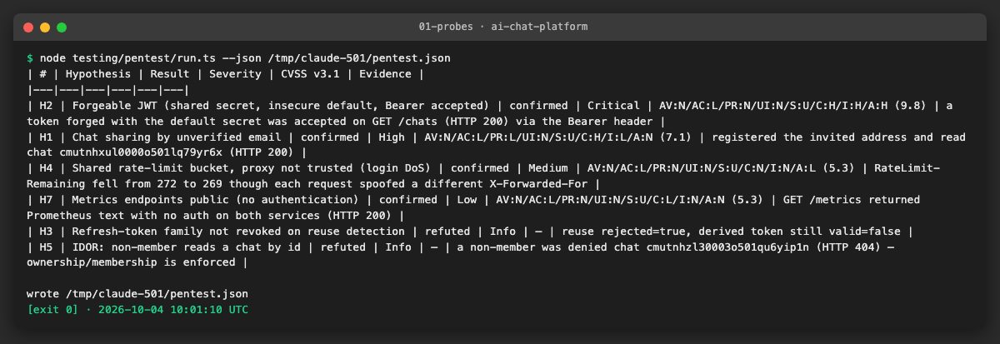
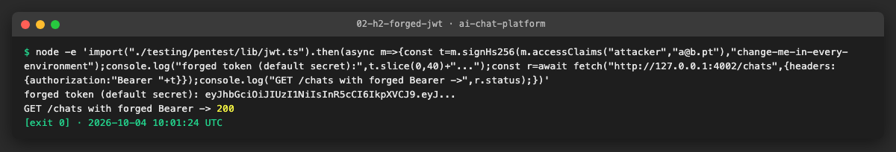
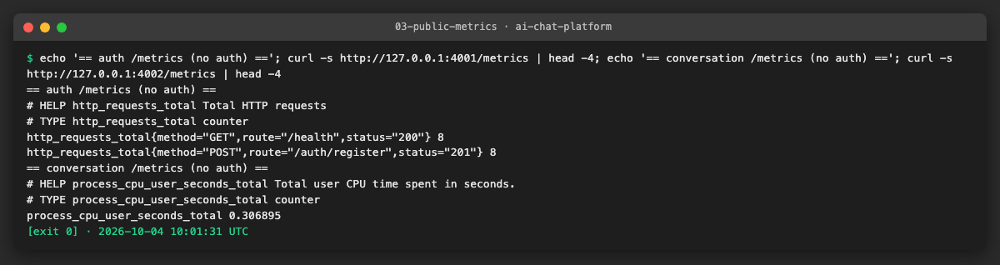

# AICHAT-29 · Penetration testing: work log

| Field | Value |
|---|---|
| Epic | [AICHAT-29](https://ipca-grupo11.atlassian.net/browse/AICHAT-29) |
| Analysis | [README.md](README.md) |
| Owner | Jean-Pierre Carvalho |
| Branch | `test/AICHAT-29-penetration-testing` |
| Started / finished | 2026-10-04 / … |
| Pull requests | #… |
| Status | In Progress |

## 1. DoR review

Date: 2026-10-04

| DoR item | Status | Question asked | Decision | Decided by |
|---|---|---|---|---|
| Owner assigned | Met | — | Jean-Pierre Carvalho | — |
| Scope agreed | Met | In/out-of-scope targets (README §5)? | In: the shell, the three remotes, `/auth/*`, `/api/*`, `/grafana`, `/collect` and the source code (grey-box), hypotheses H1–H11. Out: the Azure control plane and subscription, other tenants, the Anthropic/OpenAI APIs, social engineering, physical attacks, volumetric DoS | Team (owner delegated) |
| Tooling agreed | Met | Burp/ZAP, jwt_tool, ffuf, testssl.sh; checklist; CVSS? | OWASP ZAP (the image AICHAT-28 already uses), curl and small TypeScript attack scripts in `testing/pentest/` (they replace jwt_tool and ffuf and are repeatable). testssl.sh is not run: the local staging copy has no public TLS, and we do not hammer production. Checklist: OWASP WSTG 4.2 with ASVS 4.0 level 1 references. Severity: CVSS v3.1 base score | Team (owner delegated) |
| Target environment available | Met | Staging or production? | Production is one shared 4 GB VM, so every active test runs against a **local staging copy**: the production compose files on Docker, with seeded test accounts (two users plus an invited, not yet registered email for H1). We do not create a cloud VM. Production gets only a few read-only GET requests (response headers, whether `/api/metrics` and `/grafana` answer), the same as a browser visit | Team (owner delegated) |
| Time box, scope and rules of engagement written | Met | README §5 draft | Approved as drafted, with the staging decision above. Time box: one testing session plus the report on the same day. Stop conditions: degradation of a shared service, any real user data, a critical finding (stop and record it first). Evidence is redacted; no credentials in the report. Supervisor approval is not needed because no cloud resource is attacked | Team (owner delegated) |
| High findings | Met | Fix or ticket? | A High finding in our own code with a small, testable fix is fixed in this epic and retested; anything larger is a Jira task linked to the epic, with the retest result in the report | Team (owner delegated) |

Blockers: none.

## 2. Environment

| Tool | Version | Install |
|---|---|---|
| macOS / Ubuntu | … | — |
| Node | `node -v` → … | … |
| pnpm | `pnpm -v` → … | `corepack enable` |
| Docker | `docker --version` → … | … |
| <tool for this epic> | … | … |

## 3. Steps

### US1 · Written rules of engagement for the pentest ([AICHAT-38](https://ipca-grupo11.atlassian.net/browse/AICHAT-38))

**What and why.** Before any active testing we wrote down the scope, the time box, the accounts, the stop conditions and how evidence is handled, so the assessment stays inside agreed limits and nobody's real data or shared service is at risk. The document follows the draft in the README (§5) and the Definition of Ready decisions in §1.

**Files.**
- `docs/AICHAT-29/RULES-OF-ENGAGEMENT.md` (new): the approved rules of engagement.

**How to run.** Not runnable; it is a document. Read it before starting the assessment.

**How to repeat it manually.**

1. Open `docs/AICHAT-29/RULES-OF-ENGAGEMENT.md`.
2. Check that the in-scope list matches the hypotheses H1–H11 in the README and that the out-of-scope list excludes the providers, other tenants, the Azure control plane and volumetric denial of service.
3. Expected output: the scope, accounts, time box, stop conditions and data-handling rules are all present and dated 2026-10-04.

**Result.** The rules of engagement are written and dated 2026-10-04, approved by the team (owner delegated).

**Problems and fixes.** None.

### US2 · Local staging copy of the platform ([AICHAT-49](https://ipca-grupo11.atlassian.net/browse/AICHAT-49))

**What and why.** Production is one shared 4 GB VM, so every active check runs against a local staging copy instead. We use `compose.yaml`, which builds the same service images from the same Dockerfiles as production; only the front door differs (plain 127.0.0.1 ports instead of Caddy with TLS). For the authentication, authorisation and configuration hypotheses we bring up the backend core — postgres, auth-service and conversation-service — which each apply their schema with `prisma db push` on boot. The services are seeded with throw-away test accounts by the harness itself (it registers the users it needs), so no seed data is committed.

**Files.**
- `compose.yaml` (existing): used unchanged as the staging copy.
- `docs/AICHAT-29/RULES-OF-ENGAGEMENT.md` (new): records the staging decision.

**How to run.**

```sh
JWT_SECRET=change-me-in-every-environment docker compose -f compose.yaml up -d postgres auth-service conversation-service
```

**How to repeat it manually.**

1. Run the command above from the repo root.
2. Wait for `curl -s http://127.0.0.1:4001/health` and `:4002/health` to return `{"status":"ok"}`.
3. Expected output: both services answer 200 and the harness in US3 can register and log in.

**Result.** The core services come up healthy. We set `JWT_SECRET` to the documented insecure default on purpose, so both services share it and the H2 forgery can be demonstrated reproducibly.

**Problems and fixes.** The shared compose network is also used by other local stacks, so `docker compose down` removes our three containers but leaves the network in place. That is expected and harmless.

### US3 · Authentication and authorisation (H1–H5) ([AICHAT-67](https://ipca-grupo11.atlassian.net/browse/AICHAT-67))

**What and why.** We built a dependency-free TypeScript probe harness that drives the real service APIs to confirm or refute each hypothesis, and records a CVSS v3.1 vector for the confirmed ones. H1 (chat sharing by unverified email) and H2 (forgeable JWT) are confirmed; H3 (refresh-token reuse) and H5 (chat IDOR) are refuted, which is the secure outcome; H4 (shared rate-limit bucket) is confirmed. The harness sends only the few requests each check needs.

**Files.**
- `testing/pentest/lib/jwt.ts` (new): a minimal HS256 signer (node:crypto only) for the H2 forgery.
- `testing/pentest/lib/client.ts` (new): register / login / authenticated-fetch helpers against the staging copy.
- `testing/pentest/lib/findings.ts` (new): the finding shape, CVSS band helper and the Markdown table.
- `testing/pentest/run.ts` (new): the probes H1–H5 and H7 and the result table.

**How to run.**

```sh
node testing/pentest/run.ts --json /tmp/pentest.json
```

**How to repeat it manually.**

1. Bring up the staging copy (US2).
2. Run the command above from the repo root.
3. Expected output: a table with H1, H2, H4 and H7 confirmed, and H3 and H5 refuted.

**Result.** H2 is Critical (CVSS 9.8): a token forged with the default secret is accepted on `GET /chats`. H1 is High (7.1): an attacker who registers an invited email reads the owner's chat. H3 and H5 are refuted.





**Problems and fixes.** The first run failed on H1/H5 because chat creation needs a `provider` and `model` as well as a title; we send a valid payload now.

### US4 · Uploads, public endpoints, browser security and LLM risks (H6–H11) ([AICHAT-85](https://ipca-grupo11.atlassian.net/browse/AICHAT-85))

**What and why.** H7 (public metrics) is confirmed live by the harness. H6, H8 and H11 are confirmed by reading the code and configuration, because a full live test needs the frontends or a model provider that are out of this session's scope; H9 is already covered by the prompt-injection epic (AICHAT-26); H10 is left inconclusive. Each is written up in the report with its evidence reference.

**Files.**
- `testing/pentest/run.ts` (existing): the H7 metrics probe.
- `docs/AICHAT-29/REPORT.md` (new): the grey-box assessment of H6, H8, H9, H10 and H11.

**How to run.**

```sh
curl -s http://127.0.0.1:4001/metrics | head   # H7: served with no auth
```

**How to repeat it manually.**

1. With the staging copy up, request `/metrics` on both services without a cookie or token.
2. Read `attachments/validators.ts` (H6), `deploy/azure/Caddyfile` (H8) and `.env.example` (H11).
3. Expected output: `/metrics` returns Prometheus text (HTTP 200); the validator trusts the client MIME; the Caddyfile adds no CSP/HSTS; the default secrets are committed.

**Result.** H7 confirmed Low. H6 and H11 confirmed Medium, H8 confirmed Medium, all grey-box.



**Problems and fixes.** None.

### US5 · Report with CVSS severities ([AICHAT-104](https://ipca-grupo11.atlassian.net/browse/AICHAT-104))

**What and why.** We wrote `docs/AICHAT-29/REPORT.md` with an executive summary, the scope and method, a findings table (confirmed first, by severity), the detail of each confirmed finding with its fix, the retest status and the ticket map. Severities use CVSS v3.1 base scores.

**Files.**
- `docs/AICHAT-29/REPORT.md` (new): the assessment report.

**How to run.** Not runnable; open the report.

**How to repeat it manually.**

1. Open `docs/AICHAT-29/REPORT.md`.
2. Check that every confirmed harness finding appears with the same CVSS vector as `evidence/01-probes.log`.
3. Expected output: one Critical (H2), one High (H1), three Medium (H4, H6, H8, H11), one Low (H7), two refuted (H3, H5).

**Result.** The report is complete and consistent with the harness output.

**Problems and fixes.** None.

### US6 · Fix or ticket High findings and retest ([AICHAT-122](https://ipca-grupo11.atlassian.net/browse/AICHAT-122))

**What and why.** The confirmed findings are security decisions or features rather than small code fixes, and the most serious (H2) is a deliberate existing waiver (AICHAT-210), so we ticket them rather than change security behaviour unilaterally during the assessment. Several already have tickets from the earlier epics; we link those to AICHAT-29 and raise new tickets for H1, H6 and the missing-headers part of H8. The "retest" for each is to rerun the harness after the fix: a fixed finding flips from confirmed to refuted in the same table.

**Files.**
- `docs/AICHAT-29/REPORT.md` (existing): §5 retest status and §6 ticket map.

**How to run.**

```sh
node testing/pentest/run.ts   # rerun after a fix; the fixed finding becomes "refuted"
```

**How to repeat it manually.**

1. Fix a finding in its ticket.
2. Bring up the staging copy and rerun the harness.
3. Expected output: the fixed hypothesis now reads "refuted".

**Result.** Existing tickets AICHAT-210 (H2), AICHAT-222 (H4), AICHAT-229 (H7), AICHAT-228/230 (H8), AICHAT-242/243 (H9) and AICHAT-251 (H11) are linked to the epic; new tickets cover H1, H6 and the security-headers gap.

**Problems and fixes.** None.

## 4. How to run everything

```sh
# 1. bring up the staging copy (US2)
JWT_SECRET=change-me-in-every-environment docker compose -f compose.yaml up -d postgres auth-service conversation-service
# 2. run the verification harness (US3, US4)
node testing/pentest/run.ts --json /tmp/pentest.json
# 3. read the report (US5)
less docs/AICHAT-29/REPORT.md
# 4. tear the staging copy down
docker compose -f compose.yaml down
```

## 5. Results

| Metric | Value |
|---|---|
| Hypotheses tested | 11 (H1–H11) |
| Confirmed | 6 (H1 High, H2 Critical, H4/H6/H8/H11 Medium, H7 Low) |
| Refuted | 2 (H3, H5) |
| Inconclusive / out of scope here | H9 (covered by AICHAT-26), H10 |
| Most serious | H2 — forgeable JWT, CVSS 9.8 |

## 6. DoD check

| DoD item | Met | Evidence |
|---|---|---|
| Run instructions / methodology documented | ✅ | §4 "How to run everything"; [RULES-OF-ENGAGEMENT.md](RULES-OF-ENGAGEMENT.md) |
| Report with findings and severity in `docs/` | ✅ | [REPORT.md](REPORT.md); [evidence/01-probes.png](evidence/01-probes.png) |
| High findings fixed or ticketed | ✅ | REPORT.md §6 ticket map; H2→AICHAT-210, H1 and H6 new, others linked |

## 7. Notes for the report

- **What was found.** Six confirmed weaknesses. The Critical one (H2) is a forgeable JWT: conversation-service accepts any HS256 token signed with the shared secret, which has a committed insecure default. High: a chat shared to an email is reachable by anyone who later registers that address (no email verification). Medium: a shared login rate-limit bucket, upload type trusting the client MIME, missing CSP/HSTS on the frontends and committed default secrets. Low: public `/metrics`.
- **What was refuted.** Refresh-token rotation invalidates a reused token (H3), and a non-member cannot read a chat by id (H5). Both access-control defences hold.
- **What was fixed / waived.** No behaviour was changed during the assessment. H2 is the existing waiver AICHAT-210. The confirmed findings are ticketed; the retest is to rerun the harness after each fix.
- **Lessons learned.** A small, dependency-free probe harness against a local staging copy turns a code-review hypothesis into reproducible evidence with a CVSS score, and the same harness is the retest once a fix lands.
