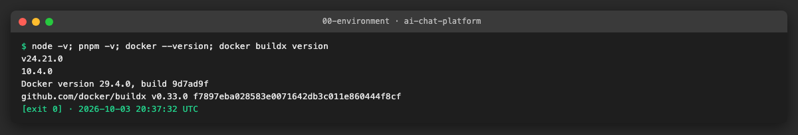
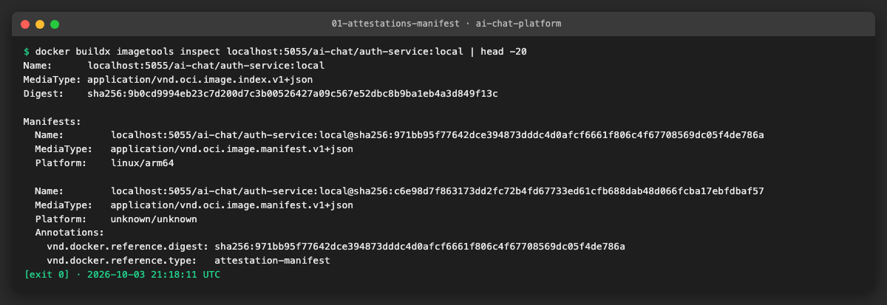
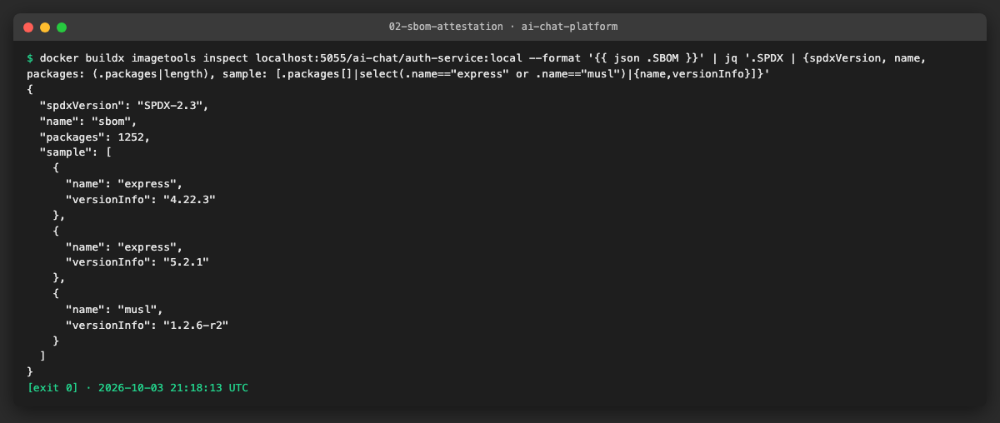
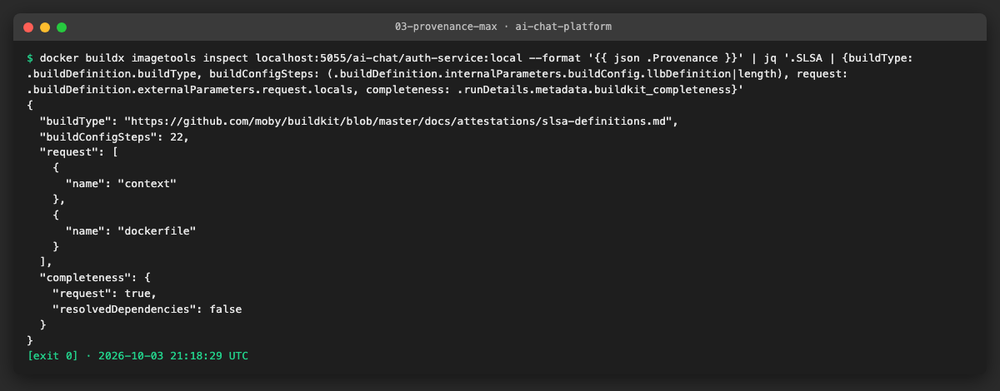
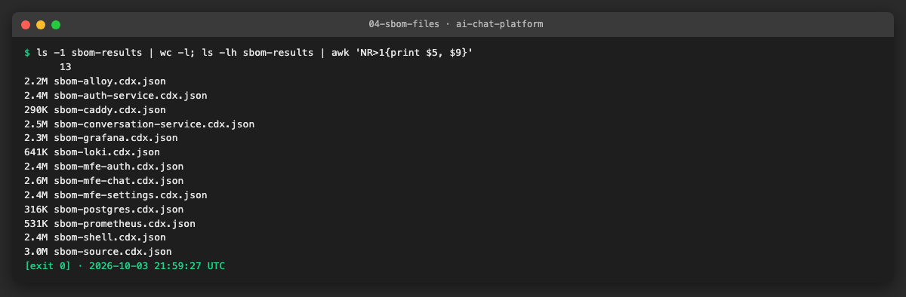
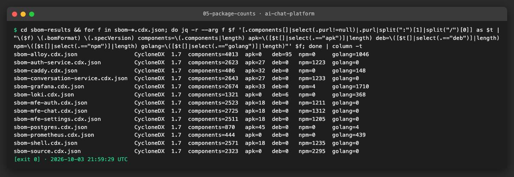
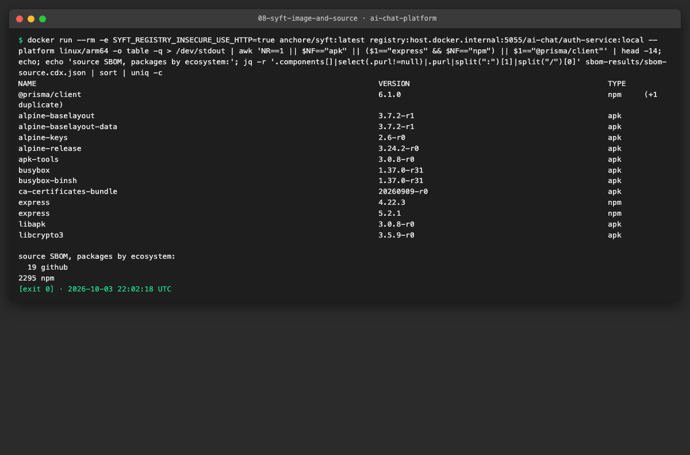
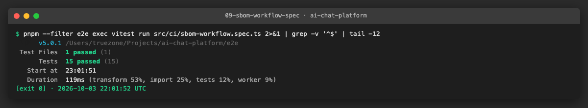
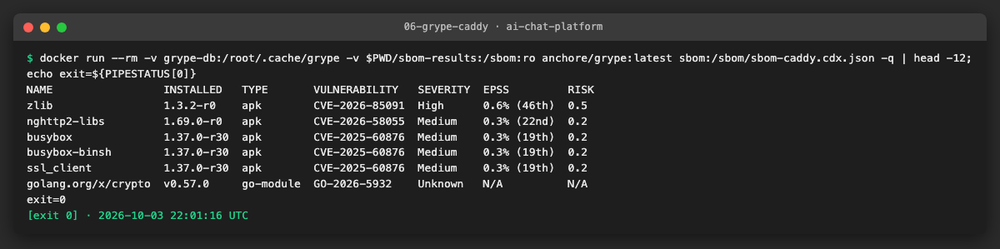
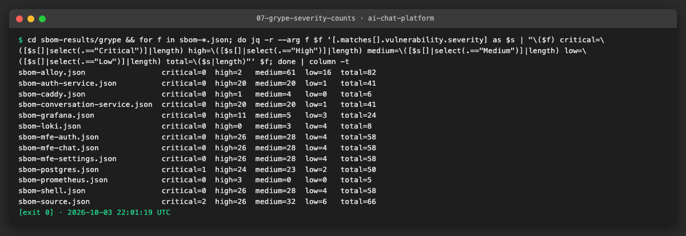

# AICHAT-30 · SBOM generation: work log

| Field | Value |
|---|---|
| Epic | [AICHAT-30](https://ipca-grupo11.atlassian.net/browse/AICHAT-30) |
| Analysis | [README.md](README.md) |
| Owner | Jean-Pierre Carvalho |
| Branch | `test/AICHAT-30-sbom-generation` |
| Started / finished | 2026-10-03 / 2026-10-03 |
| Pull requests | [#21](https://github.com/ipca-group11/ai-chat-platform/pull/21) |
| Status | Done, merged into `integration/testing-epics` |

## 1. DoR review

Date: 2026-10-03

| DoR item | Status | Question asked | Decision | Decided by |
|---|---|---|---|---|
| Owner assigned | Met | — | Jean-Pierre Carvalho | — |
| Scope agreed | Met | Which images? | The 10 images built in `deploy.yml` plus the third-party `postgres:16-alpine` and `caddy:2-alpine`, and a source SBOM of the pnpm workspace on pull requests | Team (owner delegated) |
| Tooling agreed | Met | Tool and format? | BuildKit attestations (`sbom: true`, `provenance: mode=max`) on every pushed image, and Syft (`anchore/sbom-action`) for downloadable CycloneDX JSON artifacts (`sbom-<name>.cdx.json`, 90 days); SPDX stays in the BuildKit attestation. Syft must list OS (apk) and npm packages | Team (owner delegated) |
| Target environment available | Met | Where can we prove it without deploying? | Locally with Docker buildx and a local `registry:2`, so `imagetools inspect` shows the attestations; the deploy workflow is not run against Azure by this epic | Team (owner delegated) |
| Image list from AICHAT-7 | Met | Is the list known? | Yes, from the `deploy.yml` build matrix (README §4); no wait on AICHAT-7 | Team (owner delegated) |
| Scan hand-off (AICHAT-6/7) | Met | Who gates? | The SBOM does not block anything by itself. We agree the interface (artifact name `sbom-<name>.cdx.json`, CycloneDX JSON) and add a Grype step that reads the artifacts and reports; the severity threshold that fails the build belongs to AICHAT-7 and is recorded in the hand-off note for that team | Team (owner delegated) |
| Where the third-party SBOMs run | Met | Same job as the build? | A separate job `sbom-third-party` with its own 2-entry matrix, so a pull of `postgres` or `caddy` does not depend on the build matrix | Team (owner delegated) |
| Does the scan block the deploy? | Met | Should `deploy` wait for Grype? | No. `scan-sbom` is a sibling job that reports in the job summary and never fails; `deploy` waits only for the 10 builds and the 2 SBOMs. The gate is AICHAT-7's | Team (owner delegated) |
| Source SBOM trigger | Met | Which events? | Every `pull_request` and push to `main` (the triggers of `ci.yml`), as its own job so it does not slow the Nx job | Team (owner delegated) |
| Local proof platform | Met | amd64 or native? | Native `linux/arm64` on the laptop (the workflow keeps `linux/amd64`), to keep the 10 builds in reasonable time | Team (owner delegated) |

Blockers: none

## 2. Environment

| Tool | Version | Install |
|---|---|---|
| macOS | 26.3 | n/a |
| Node | `node -v` → v24.21.0 | `nvm install` (reads `.nvmrc`) |
| pnpm | `pnpm -v` → 10.4.0 | `corepack enable` |
| Docker | `docker --version` → Docker version 29.4.0 | Docker Desktop or OrbStack |
| Docker Buildx | `docker buildx version` → v0.33.0 | comes with Docker |
| Syft | `syft version` → 1.54.0 | Docker image `anchore/syft:latest` |
| Grype | `grype version` → 0.120.0 | Docker image `anchore/grype:latest` |
| Local registry | `registry:2` on `localhost:5055` | `docker run -d --name sbom-registry -p 5055:5000 registry:2` |



## 3. Steps

The deploy workflow was never run: nothing in this epic touches GHCR or Azure. Every claim about images is proved locally with a throw-away registry; every claim about the workflow files is proved by a structural test.

### US1 · Agree SBOM format and storage ([AICHAT-41](https://ipca-grupo11.atlassian.net/browse/AICHAT-41))

**What and why.** The decision is in section 1 (rows "Tooling agreed" and "Scope agreed"): BuildKit attestations (SPDX SBOM and SLSA provenance) travel with every pushed image, and Syft writes CycloneDX JSON files that are kept as workflow artifacts for 90 days. CycloneDX is the format that Grype, Trivy and Dependency-Track read best, and it is what the downloadable files use; SPDX stays inside the attestation, where BuildKit puts it. Scope: the 10 built images, `postgres:16-alpine`, `caddy:2-alpine`, and the pnpm workspace on pull requests.

**Files.** None; this section points to section 1.

**How to run.** Nothing to run.

**How to repeat it manually.**

1. Open section 1 of this file.
2. Read the rows "Scope agreed", "Tooling agreed" and "Scan hand-off".

**Result.** The decision is recorded, with who took it (team, owner delegated). The artifact names and the interface for the scan are in [SBOM-INTERFACE.md](SBOM-INTERFACE.md).

**Problems and fixes.** None.

### US2 · SBOM and provenance attestation on every built image ([AICHAT-53](https://ipca-grupo11.atlassian.net/browse/AICHAT-53))

**What and why.** `docker/build-push-action` in `deploy.yml` now sets `sbom: true` and `provenance: mode=max`. BuildKit then pushes, next to each image, an attestation manifest with an SPDX SBOM and the SLSA provenance, so the inventory and the build recipe of an image can be read from the registry alone. `mode=max` adds the full build configuration (the Dockerfile steps and the arguments), not only the minimal fields.

**Files.**
- `.github/workflows/deploy.yml`: `sbom: true`, `provenance: mode=max` on the build step.
- `e2e/src/ci/sbom-workflow.spec.ts` (new): structural test (see US3).

**How to run.**

```sh
pnpm --filter e2e exec vitest run src/ci/sbom-workflow.spec.ts
```

**How to repeat it manually.**

1. Start a registry: `docker run -d --name sbom-registry -p 5055:5000 registry:2`, and a builder that reaches it: `docker buildx create --name sbomx --driver docker-container --driver-opt network=host --use`.
2. Build and push an image the way the workflow does: `docker buildx build --builder sbomx -f services/auth-service/Dockerfile --sbom=true --provenance=mode=max --push -t localhost:5055/ai-chat/auth-service:local .`
3. `docker buildx imagetools inspect localhost:5055/ai-chat/auth-service:local`: next to the image manifest there is a second one with `vnd.docker.reference.type: attestation-manifest`.
4. `docker buildx imagetools inspect localhost:5055/ai-chat/auth-service:local --format '{{ json .SBOM }}'` prints the SPDX document; `--format '{{ json .Provenance }}'` prints the provenance.

**Result.** All 10 images were built and pushed this way. For `auth-service` the index has the attestation manifest, the SBOM is SPDX-2.3 with 1252 packages (it lists `express` and the Alpine `musl`), and the provenance carries `buildConfig` with 22 build steps, which is what `mode=max` adds.







**Problems and fixes.** The first background build died with the shell that started it, so the registry stayed empty; the builds were started again as a tracked background job. The inspect output of recent Buildx has the provenance under `.SLSA.buildDefinition` (SLSA v1), not the older `.SLSA.metadata`; the evidence reads the v1 fields.

### US3 · Downloadable CycloneDX SBOM per image for every deploy ([AICHAT-70](https://ipca-grupo11.atlassian.net/browse/AICHAT-70))

**What and why.** The attestation is not easy to hand to someone, so each deploy run also uploads one CycloneDX JSON file per image, named `sbom-<name>.cdx.json`, kept 90 days. In the `build` job `anchore/sbom-action` (Syft) reads the image just pushed (`<prefix>/<name>:<sha>`), once per matrix entry, so there are 10 artifacts. A job `sbom-third-party` does the same for `postgres:16-alpine` and `caddy:2-alpine`, which we run but do not build: 12 artifacts per run. The `deploy` job now waits for both jobs.

**Files.**
- `.github/workflows/deploy.yml`: step "SBOM (CycloneDX)" in `build`, new job `sbom-third-party`, `needs: [build, sbom-third-party]` in `deploy`.
- `e2e/src/ci/sbom-workflow.spec.ts` (new): 15 tests on the attestation settings, artifact names, order of the steps, the two third-party images, the Grype step and the source SBOM.
- `docs/AICHAT-30/results/sbom-summary.md` (new): the counts below. The SBOM files (about 25 MB) are not committed; `sbom-results/` is ignored.

**How to run.**

```sh
pnpm --filter e2e exec vitest run src/ci/sbom-workflow.spec.ts
```

**How to repeat it manually.**

1. After the builds of US2, for each image: `docker run --rm -e SYFT_REGISTRY_INSECURE_USE_HTTP=true anchore/syft:latest registry:host.docker.internal:5055/ai-chat/<name>:local --platform linux/arm64 -o cyclonedx-json -q > sbom-results/sbom-<name>.cdx.json`.
2. For the two third-party images: `docker run --rm -v /var/run/docker.sock:/var/run/docker.sock anchore/syft:latest docker:postgres:16-alpine -o cyclonedx-json -q > sbom-results/sbom-postgres.cdx.json`, and the same for `caddy:2-alpine`.
3. Count the packages by ecosystem from the `purl` of each component (command in the screenshot below).
4. Expected: 12 files, `bomFormat` CycloneDX, apk or deb packages next to npm or Go modules.

**Result.** 12 image SBOMs plus the source SBOM, all CycloneDX 1.7. The Node images list both layers: Alpine OS packages (`apk`) and npm packages; the Go images (Prometheus, Grafana, Loki, Alloy, Caddy) list Go modules, and Loki and Alloy their Debian (`deb`) packages.

| Artifact | Components | apk | deb | npm | golang |
|---|---|---|---|---|---|
| `sbom-auth-service` | 2623 | 27 | 0 | 1223 | 0 |
| `sbom-conversation-service` | 2643 | 27 | 0 | 1233 | 0 |
| `sbom-mfe-auth` | 2523 | 18 | 0 | 1211 | 0 |
| `sbom-mfe-chat` | 2725 | 18 | 0 | 1312 | 0 |
| `sbom-mfe-settings` | 2511 | 18 | 0 | 1205 | 0 |
| `sbom-shell` | 2571 | 18 | 0 | 1235 | 0 |
| `sbom-prometheus` | 444 | 0 | 0 | 0 | 439 |
| `sbom-grafana` | 2674 | 33 | 0 | 4 | 1710 |
| `sbom-loki` | 1321 | 0 | 6 | 0 | 368 |
| `sbom-alloy` | 4013 | 0 | 95 | 0 | 1046 |
| `sbom-postgres` (third party) | 870 | 45 | 0 | 0 | 4 |
| `sbom-caddy` (third party) | 406 | 32 | 0 | 0 | 148 |

The full table, with the Grype counts, is in [results/sbom-summary.md](results/sbom-summary.md).









**Problems and fixes.** Syft in a container cannot reach `localhost:5055` of the laptop; it reads the registry as `host.docker.internal:5055` over plain HTTP (`SYFT_REGISTRY_INSECURE_USE_HTTP=true`). The Node images contain the full `node_modules` of the workspace (about 1200 npm packages even for the micro frontends); that is what is shipped today, and the SBOM shows it. The images were built for arm64 on the laptop, so a few numbers (platform-specific packages) can differ by a handful on the amd64 images of the workflow.

### US4 · Vulnerability scan of the SBOMs ([AICHAT-88](https://ipca-grupo11.atlassian.net/browse/AICHAT-88))

**What and why.** The scan step belongs to AICHAT-7 (João Delgado). We could not meet to agree the interface, so we wrote it down in [SBOM-INTERFACE.md](SBOM-INTERFACE.md): artifact names, format, where they are, and how to scan them with Grype or Trivy. To show the interface works, `deploy.yml` has a job `scan-sbom` that downloads the 12 artifacts (`pattern: sbom-*.cdx.json`) and runs Grype on each one, writing the table in the job summary. It reports and never fails (`|| true`): the severity threshold and the choice of tool belong to AICHAT-7, and `deploy` does not wait for it.

**Files.**
- `.github/workflows/deploy.yml`: job `scan-sbom`.
- `docs/AICHAT-30/SBOM-INTERFACE.md` (new): the hand-off note.
- `e2e/src/ci/sbom-workflow.spec.ts`: tests of the job and of the note (it must name all 13 artifacts).

**How to run.**

```sh
grype sbom:./sbom-caddy.cdx.json
```

**How to repeat it manually.**

1. Put the SBOMs of US3 in `sbom-results/`.
2. `docker run --rm -v grype-db:/root/.cache/grype -v $PWD/sbom-results:/sbom:ro anchore/grype:latest sbom:/sbom/sbom-caddy.cdx.json`
3. Expected: a table of packages, versions and CVEs; the exit code is 0 although there are findings, because no `--fail-on` is set. With `--fail-on high` it would be 1: that is the form AICHAT-7 can use as a gate.

**Result.** Grype read all 13 CycloneDX files without conversion. Counts of the day (details in [results/sbom-summary.md](results/sbom-summary.md)): `caddy` 1 High, 4 Medium; `postgres` 1 Critical, 24 High; Node services 20 High; micro frontends and shell 26 High; source SBOM 2 Critical, 26 High. None of this blocks anything yet.





**Problems and fixes.** The first run of Grype downloads its database (a few minutes); a named volume (`grype-db`) keeps it for the next runs. In Actions the `download-grype` action installs the binary and the job calls it by its path.

### US5 · Source SBOM of the pnpm workspace on PRs ([AICHAT-108](https://ipca-grupo11.atlassian.net/browse/AICHAT-108))

**What and why.** An image SBOM only exists after a deploy. The job `source-sbom` in `ci.yml` runs Syft on the checked-out repository (`path: .`) on every pull request and push to `main`, and uploads `sbom-source.cdx.json`. Syft reads `pnpm-lock.yaml`, so the SBOM lists the npm packages with the versions the lockfile resolves, before anything is built. It is a separate job, so it does not slow down the Nx job.

**Files.**
- `.github/workflows/ci.yml`: job `source-sbom`.
- `.gitignore`: `sbom-results/`.
- `e2e/src/ci/sbom-workflow.spec.ts`: tests of the job.

**How to run.**

```sh
git archive HEAD | tar -x -C /tmp/src && docker run --rm -v /tmp/src:/src:ro anchore/syft:latest dir:/src -o cyclonedx-json -q > sbom-results/sbom-source.cdx.json
```

**How to repeat it manually.**

1. Export a clean copy of the commit (as the runner has it, without `node_modules`): `git archive HEAD | tar -x -C /tmp/src`.
2. Run the command above.
3. Expected: a CycloneDX file with about 2300 npm components.

**Result.** 2323 components: 2295 npm packages from the lockfile and 19 GitHub Actions references (the workflows). Grype finds 2 Critical and 26 High in it (see US4).


**Problems and fixes.** Running Syft on the working directory with `node_modules` installed took more than five minutes and was stopped; the CI checkout has no `node_modules`, so the proof uses a clean `git archive`, the same input as the runner.

## 4. How to run everything

```sh
# the workflow tests
pnpm --filter e2e exec vitest run src/ci/sbom-workflow.spec.ts

# local proof of the images (needs Docker; builds the 10 images, takes close to an hour)
docker run -d --name sbom-registry -p 5055:5000 registry:2
docker buildx create --name sbomx --driver docker-container --driver-opt network=host --use
docker buildx build --builder sbomx -f services/auth-service/Dockerfile --sbom=true --provenance=mode=max --push -t localhost:5055/ai-chat/auth-service:local .
docker buildx imagetools inspect localhost:5055/ai-chat/auth-service:local --format '{{ json .SBOM }}'

# clean up
docker rm -f sbom-registry && docker buildx rm sbomx
```

## 5. Results

| Metric | Before | After |
|---|---|---|
| Attestations on pushed images | default minimal provenance only | SPDX SBOM and `mode=max` provenance on all 10 images |
| Downloadable SBOMs per deploy | 0 | 12 CycloneDX files (10 built, 2 third party), 90 days |
| Source SBOM on pull requests | none | `sbom-source.cdx.json`, 2323 components (2295 npm) |
| SBOM read by a scanner | no | Grype reads all 13 files; findings are reported, not blocking |
| Hand-off for AICHAT-7 | none | `SBOM-INTERFACE.md` with names, format, location and commands |
| Tests of the workflows | none for SBOM | 15 structural tests |

## 6. DoD check

| DoD item | Met | Evidence |
|---|---|---|
| Decision (CycloneDX + SPDX, artifacts + attestation) recorded | ✅ | section 1 |
| `sbom: true` and `provenance: mode=max` in `deploy.yml`; `imagetools inspect` shows them | ✅ | [manifest](evidence/01-attestations-manifest.png), [SBOM](evidence/02-sbom-attestation.png), [provenance](evidence/03-provenance-max.png) |
| 10 (+2 third-party) `sbom-*.cdx.json` artifacts per run | ✅ (workflow and local proof) | [files](evidence/04-sbom-files.png), [counts](evidence/05-package-counts.png), [workflow test](evidence/09-sbom-workflow-spec.png); the first run in Actions is still to come |
| Grype step consumes the artifacts; interface agreed with João Delgado | ◐ | [Grype](evidence/06-grype-caddy.png), [severities](evidence/07-grype-severity-counts.png), [SBOM-INTERFACE.md](SBOM-INTERFACE.md); written down, not agreed in person |
| `syft dir:.` in `ci.yml`, artifact uploaded | ✅ (workflow and local proof) | [source SBOM](evidence/08-syft-image-and-source.png) |
| Lint, typecheck, test, build of affected projects | ✅ | section 7 |
| SAST and secret scan | ✅ | section 7 |

## 7. Notes for the report

- **Checks before the pull request.** `pnpm exec nx affected -t lint typecheck test build --base=origin/integration/testing-epics`: green. It first failed on `workspace-config:test`, whose CI test required `ci.yml` to have a single job; it now lists `affected` and `source-sbom`. `pnpm sast`: no ERROR finding. `gitleaks git --redact --log-opts=origin/integration/testing-epics..HEAD`: no leaks. The SBOM JSON files are not in git (`sbom-results/` is ignored) and the local registry and builder were removed.
- **Found.** The runtime images carry the whole workspace `node_modules` (about 1200 npm packages in each micro frontend), which makes the SBOM, and the list of CVEs, much longer than the application needs. Postgres 16 and the source SBOM have one or two Critical findings each on the day of the scan; the Go images show findings in Go modules and the Alpine base.
- **Not done.** The workflows have not run on GitHub (the branch is not pushed), so the first Actions run can still show differences (for example the amd64 images, and how `download-grype` exposes the binary). The interface with João Delgado is a written note, not a talk. No signing of the SBOM or the images. No severity gate: AICHAT-7.
- **Lessons.** Syft in a container needs the registry address of the host and plain HTTP for a local registry. A scan of the source tree must run on a clean checkout, not on a tree with `node_modules`. `mode=max` provenance is recognisable by `buildConfig` in the SLSA v1 `internalParameters`.
