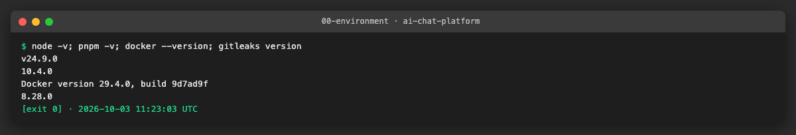
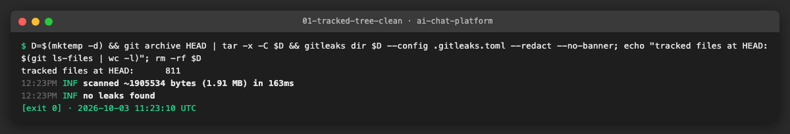
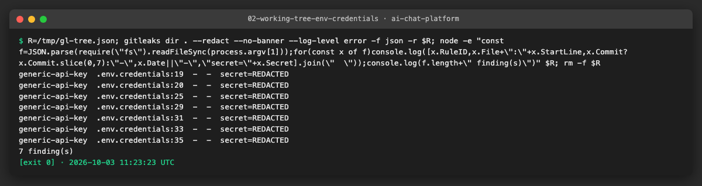
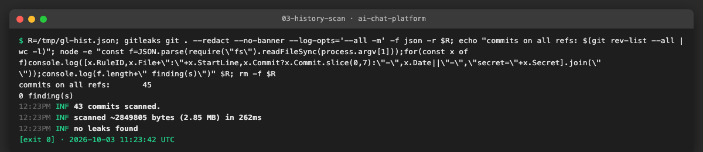
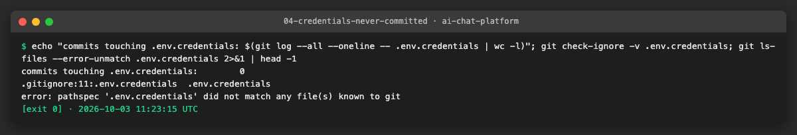
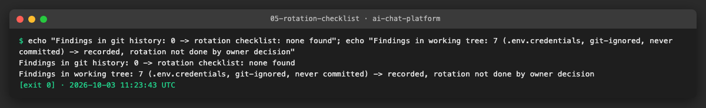

# AICHAT-31 · Secret scanning: work log

| Field | Value |
|---|---|
| Epic | [AICHAT-31](https://ipca-grupo11.atlassian.net/browse/AICHAT-31) |
| Analysis | [README.md](README.md) |
| Owner | Jean-Pierre Carvalho |
| Branch | `test/AICHAT-31-secret-scanning` |
| Started / finished | 2026-10-03 / … |
| Pull requests | #… |
| Status | In Progress |

## 1. DoR review

Date: 2026-10-03

| DoR item | Status | Question asked | Decision | Decided by |
|---|---|---|---|---|
| Owner assigned | Met | — | Jean-Pierre Carvalho | — |
| Scope agreed | Met | Are PR diffs, the full git history (once) and the working tree in scope? | Yes, all three | Owner |
| Tooling agreed | Met | Which scanner? (plan decision D4) | gitleaks CLI in GitHub Actions (no licence key needed) plus a local pre-commit hook | Owner |
| Target environment available | Met | Where does it run? | Locally (gitleaks installed with Homebrew) and in GitHub Actions | Owner |
| GitHub secret scanning | Met | Enable it on the private org repo? | Not licensed (needs GitHub Advanced Security); decision documented in AICHAT-109, gitleaks covers the gap | Owner |
| Handling of real findings | Met | Rotate, rewrite history, or record? | Record each finding (redacted, no secret values) in the evidence; no history rewrite | Owner |

Blockers: none

## 2. Environment

| Tool | Version | Install |
|---|---|---|
| macOS | Darwin 25.3.0 | — |
| Node | `node -v` → v24.9.0 | `.nvmrc` |
| pnpm | `pnpm -v` → 10.4.0 | `corepack enable` |
| Docker | `docker --version` → Docker version 29.4.0 | Docker Desktop |
| gitleaks | `gitleaks version` → 8.28.0 | `brew install gitleaks` |

## 3. Steps

### US1 · gitleaks config with a narrow allow-list ([AICHAT-44](https://ipca-grupo11.atlassian.net/browse/AICHAT-44))

**What and why.** We added `.gitleaks.toml`, which extends the built-in gitleaks rules (`[extend] useDefault = true`) and adds no rules of our own. The analysis expected fake keys in test files and dev defaults in `.env.example` and `compose.yaml` to need exceptions. We first scanned without any exception: the default rules report nothing in tracked files, so the allow-list is empty on purpose. The file documents the policy for later entries: test fixtures and example files only, one comment per entry, exact paths or exact regexes, never broad globs. A commented example shows the expected shape.

The working-tree scan (`gitleaks dir`) reports 7 findings, all in the local `.env.credentials`. That file is git-ignored and was never committed (see US2), so we record the findings and do not allow-list them. All output uses `--redact`, so no value appears in logs or images.

**Files.**
- `.gitleaks.toml` (new): extends the default rules, documents the allow-list policy, no active entries.
- `docs/AICHAT-31/evidence/` (new): logs and screenshots for this story.

**How to run.**

```sh
gitleaks dir . --config .gitleaks.toml --redact
```

**How to repeat it manually.**

1. Install gitleaks (`brew install gitleaks`) and run `gitleaks version`.
2. Export the tracked files and scan them: `D=$(mktemp -d) && git archive HEAD | tar -x -C $D && gitleaks dir $D --config .gitleaks.toml --redact`.
3. Expected output: `no leaks found`.
4. Scan the working tree: `gitleaks dir . --redact`. Expected output: 7 findings, all in `.env.credentials` (rule `generic-api-key`), exit code 1.

**Result.** The tracked tree at HEAD (811 files) is clean with the new config. The working tree shows only the 7 findings in the git-ignored `.env.credentials`, with the secret shown as `REDACTED`.







**Problems and fixes.** The test fixtures listed in the analysis did not trigger any default rule, so an allow-list for them would have been dead configuration. We left it empty and kept the policy and an example in comments, to keep the exceptions as narrow as possible.

### US2 · One-off full git history scan ([AICHAT-55](https://ipca-grupo11.atlassian.net/browse/AICHAT-55))

**What and why.** We scanned every commit reachable from any local or remote branch once, to know whether a secret was ever committed. The summary is in [HISTORY-SCAN.md](HISTORY-SCAN.md) and holds no secret values. We also checked that the git-ignored `.env.credentials` never entered the history.

**Files.**
- `docs/AICHAT-31/HISTORY-SCAN.md` (new): scope, result and triage table, without secret values.
- `docs/AICHAT-31/evidence/03-history-scan.*`, `04-credentials-never-committed.*` (new): logs and screenshots.

**How to run.**

```sh
gitleaks git . --config .gitleaks.toml --redact --log-opts='--all -m'
```

**How to repeat it manually.**

1. Run the command above from the repo root. Write any JSON report (`-f json -r <path>`) outside the repository.
2. Expected output: `43 commits scanned` and `no leaks found`.
3. Run `git log --all --oneline -- .env.credentials`. Expected output: nothing.

**Result.** 0 findings in the history, so there is nothing to triage. `.env.credentials` was never committed.





**Problems and fixes.** By default gitleaks scanned 39 commits because it skips merge commits and only follows the current branch. We added `--log-opts='--all -m'` to cover all branches and merge diffs (43 of 45 commits; the other 2 have no textual diff).

### US3 · Rotate every leaked secret ([AICHAT-73](https://ipca-grupo11.atlassian.net/browse/AICHAT-73))

**What and why.** For each real finding we need a rotation checklist. The history scan found nothing, so there is nothing to rotate for the history. The working tree has 7 findings in the git-ignored `.env.credentials`. By owner decision we record them and do not rotate them or rewrite history.

**Files.**
- `docs/AICHAT-31/evidence/05-rotation-checklist.*` (new): log and screenshot of the checklist outcome.

**How to run.**

```sh
gitleaks git . --config .gitleaks.toml --redact --log-opts='--all -m'
gitleaks dir . --redact
```

**How to repeat it manually.**

1. Run both commands and count the findings per scan.
2. For every finding in the history, rotate the secret, then record it in the table below.
3. Expected output: history 0 findings; working tree 7 findings in `.env.credentials`.

**Result.**

| Finding | Where | Rule | In history | Status |
|---|---|---|---|---|
| History scan | all refs | — | none found | none found, nothing to rotate |
| 7 findings | `.env.credentials` lines 19, 20, 25, 29, 31, 33, 35 | `generic-api-key` | no (git-ignored, never committed) | recorded, rotation not done by owner decision |



**Problems and fixes.** None. Rotation of the values in `.env.credentials` stays an open decision for the owner if the file is ever shared or committed by mistake.

## 4. How to run everything

```sh
# all checks added by this epic, from the repo root
```

## 5. Results

| Metric | Before | After |
|---|---|---|
| … | … | … |

## 6. DoD check

| DoD item | Met | Evidence |
|---|---|---|
| … | ✅ | [link](evidence/…) |

## 7. Notes for the report

- What was found
- What was fixed / waived
- Lessons learned
