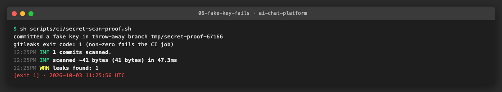
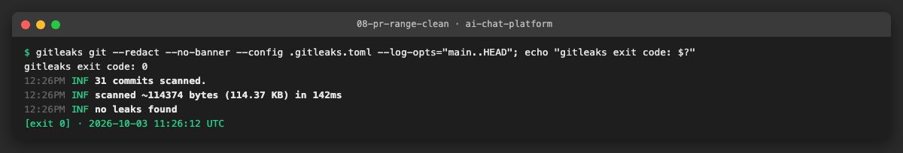
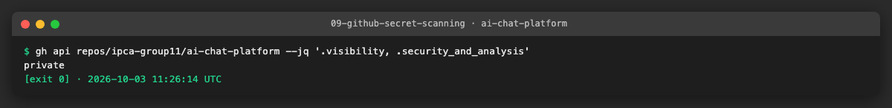
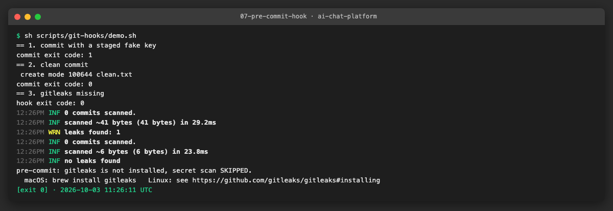

# AICHAT-31 · Secret scanning: work log

| Field | Value |
|---|---|
| Epic | [AICHAT-31](https://ipca-grupo11.atlassian.net/browse/AICHAT-31) |
| Analysis | [README.md](README.md) |
| Owner | Jean-Pierre Carvalho |
| Branch | `test/AICHAT-31-secret-scanning` |
| Started / finished | 2026-10-03 / … |
| Pull requests | #… |
| Status | In Progress |

## 1. DoR review

Date: 2026-10-03

| DoR item | Status | Question asked | Decision | Decided by |
|---|---|---|---|---|
| Owner assigned | Met | — | Jean-Pierre Carvalho | — |
| Scope agreed | Met | Are PR diffs, the full git history (once) and the working tree in scope? | Yes, all three | Owner |
| Tooling agreed | Met | Which scanner? (plan decision D4) | gitleaks CLI in GitHub Actions (no licence key needed) plus a local pre-commit hook | Owner |
| Target environment available | Met | Where does it run? | Locally (gitleaks installed with Homebrew) and in GitHub Actions | Owner |
| GitHub secret scanning | Met | Enable it on the private org repo? | Not licensed (needs GitHub Advanced Security); decision documented in AICHAT-109, gitleaks covers the gap | Owner |
| Handling of real findings | Met | Rotate, rewrite history, or record? | Record each finding (redacted, no secret values) in the evidence; no history rewrite | Owner |

Blockers: none

## 2. Environment

| Tool | Version | Install |
|---|---|---|
| macOS | Darwin 25.3.0 | — |
| Node | `node -v` → v24.9.0 | `.nvmrc` |
| pnpm | `pnpm -v` → 10.4.0 | `corepack enable` |
| Docker | `docker --version` → Docker version 29.4.0 | Docker Desktop |
| gitleaks | `gitleaks version` → 8.28.0 | `brew install gitleaks` |

## 3. Steps

### US1 · gitleaks config with a narrow allow-list ([AICHAT-44](https://ipca-grupo11.atlassian.net/browse/AICHAT-44))

**What and why.** We added `.gitleaks.toml`, which extends the built-in gitleaks rules (`[extend] useDefault = true`) and adds no rules of our own. The analysis expected fake keys in test files and dev defaults in `.env.example` and `compose.yaml` to need exceptions. We first scanned without any exception: the default rules report nothing in tracked files, so the allow-list is empty on purpose, and the owner accepted that an empty allow-list (policy plus a commented example) meets the story. The file documents the policy for later entries: test fixtures and example files only, one comment per entry, exact paths or exact regexes, never broad globs. A commented example shows the expected shape.

The working-tree scan (`gitleaks dir`) reports 7 findings, all in the local `.env.credentials`. That file is git-ignored and was never committed (see US2), so we record the findings and do not allow-list them. All output uses `--redact`, so no value appears in logs or images.

**Files.**
- `.gitleaks.toml` (new): extends the default rules, documents the allow-list policy, no active entries.
- `docs/AICHAT-31/evidence/` (new): logs and screenshots for this story.

**How to run.**

```sh
gitleaks dir . --config .gitleaks.toml --redact
```

**How to repeat it manually.**

1. Install gitleaks (`brew install gitleaks`) and run `gitleaks version`.
2. Export the tracked files and scan them: `D=$(mktemp -d) && git archive HEAD | tar -x -C $D && gitleaks dir $D --config .gitleaks.toml --redact`.
3. Expected output: `no leaks found`.
4. Scan the working tree: `gitleaks dir . --redact`. Expected output: 7 findings, all in `.env.credentials` (rule `generic-api-key`), exit code 1.

**Result.** The tracked tree at HEAD (811 files) is clean with the new config. The working tree shows only the 7 findings in the git-ignored `.env.credentials`, with the secret shown as `REDACTED`.


**Problems and fixes.** The test fixtures listed in the analysis did not trigger any default rule, so an allow-list for them would have been dead configuration. We left it empty and kept the policy and an example in comments, to keep the exceptions as narrow as possible.

### US2 · One-off full git history scan ([AICHAT-55](https://ipca-grupo11.atlassian.net/browse/AICHAT-55))

**What and why.** We scanned every commit reachable from any local or remote branch once, to know whether a secret was ever committed. The summary is in [HISTORY-SCAN.md](HISTORY-SCAN.md) and holds no secret values. We also checked that the git-ignored `.env.credentials` never entered the history.

**Files.**
- `docs/AICHAT-31/HISTORY-SCAN.md` (new): scope, result and triage table, without secret values.
- `docs/AICHAT-31/evidence/03-history-scan.*`, `04-credentials-never-committed.*` (new): logs and screenshots.

**How to run.**

```sh
gitleaks git . --config .gitleaks.toml --redact --log-opts='--all -m'
```

**How to repeat it manually.**

1. Run the command above from the repo root. Write any JSON report (`-f json -r <path>`) outside the repository.
2. Expected output: `43 commits scanned` and `no leaks found`.
3. Run `git log --all --oneline -- .env.credentials`. Expected output: nothing.

**Result.** 0 findings in the history, so there is nothing to triage. `.env.credentials` was never committed.


**Problems and fixes.** By default gitleaks scanned 39 commits because it skips merge commits and only follows the current branch. We added `--log-opts='--all -m'` to cover all branches and merge diffs (43 of 45 commits; the other 2 have no textual diff).

### US3 · Rotate every leaked secret ([AICHAT-73](https://ipca-grupo11.atlassian.net/browse/AICHAT-73))

**What and why.** For each real finding we need a rotation checklist. The history scan found nothing, so there is nothing to rotate for the history. The working tree has 7 findings in the git-ignored `.env.credentials`. By owner decision we record them and do not rotate them or rewrite history.

**Files.**
- `docs/AICHAT-31/evidence/05-rotation-checklist.*` (new): log and screenshot of the checklist outcome.

**How to run.**

```sh
gitleaks git . --config .gitleaks.toml --redact --log-opts='--all -m'
gitleaks dir . --redact
```

**How to repeat it manually.**

1. Run both commands and count the findings per scan.
2. For every finding in the history, rotate the secret, then record it in the table below.
3. Expected output: history 0 findings; working tree 7 findings in `.env.credentials`.

**Result.**

| Finding | Where | Rule | In history | Status |
|---|---|---|---|---|
| History scan | all refs | — | none found | none found, nothing to rotate |
| 7 findings | `.env.credentials` lines 19, 20, 25, 29, 31, 33, 35 | `generic-api-key` | no (git-ignored, never committed) | recorded, rotation not done by owner decision |


**Problems and fixes.** None. Rotation of the values in `.env.credentials` stays an open decision for the owner if the file is ever shared or committed by mistake.

### US4 · Secret scan on every PR ([AICHAT-91](https://ipca-grupo11.atlassian.net/browse/AICHAT-91))

**What and why.** We added the workflow `.github/workflows/security.yml` with a `secret-scan` job. It runs on every pull request and on pushes to `main` and `integration/testing-epics`. It downloads the gitleaks 8.28.0 release tarball, checks its SHA-256 against the value from the release's checksums file, and runs `gitleaks git --redact --config .gitleaks.toml` over the commit range of the change (PR base..head; for a push, before..after). The checkout uses `fetch-depth: 0` so the range exists. A non-zero exit fails the job, so a leaked key blocks the merge once the check is required on `main`. The job writes a short summary with the range and the result.

**Files.**
- `.github/workflows/security.yml` (new): the `secret-scan` job.
- `scripts/ci/secret-scan-proof.sh` (new): local proof that a fake key makes the scan fail.

**How to run.**

```sh
sh scripts/ci/secret-scan-proof.sh
```

**How to repeat it manually.**

1. Create a throw-away worktree and branch from `HEAD`.
2. Commit a file with a realistic AWS-style key (`AKIA` plus 16 random characters, built at run time, not one of the documented AWS example keys).
3. Run `gitleaks git --redact --config .gitleaks.toml --log-opts="HEAD~1..HEAD"`. Expected output: `leaks found: 1` and exit code 1.
4. Remove the worktree and the branch (the script does this).

**Result.** The fake key is detected and the command exits with 1, so the job would fail. The real range of this branch (`main..HEAD`, 31 commits) is clean and exits with 0.





PR: #<to fill> (the proof on a real failing pull request is done by us later, together with making the check required on `main`).

**Problems and fixes.** AWS documents example keys that gitleaks may allow-list, so the proof generates a random key on each run. We cannot run the GitHub workflow locally, so the workflow itself is checked only by this local proof until the PR run.

### US5 · Decide on GitHub secret scanning ([AICHAT-109](https://ipca-grupo11.atlassian.net/browse/AICHAT-109))

**What and why.** GitHub secret scanning on a private organisation repository needs GitHub Advanced Security (Secret Protection), which is a paid add-on. The repository `ipca-group11/ai-chat-platform` is private and the API returns no `security_and_analysis` settings, so the feature is not available to us.

**Decision (owner).** We do not enable it, because we have no licence and the project has no budget for it. The gap is covered by:
- gitleaks in CI on every pull request and on pushes to `main` and `integration/testing-epics` (US4);
- a local pre-commit hook that blocks staged secrets (US6);
- the one-off history scan (US2), which found nothing.

What we lose: GitHub's partner-pattern alerts and push protection on the server side. We revisit the decision if the repository becomes public or a licence becomes available.

**Files.**
- `docs/AICHAT-31/evidence/09-github-secret-scanning.*` (new): API output.

**How to run.**

```sh
gh api repos/ipca-group11/ai-chat-platform --jq '.visibility, .security_and_analysis'
```

**How to repeat it manually.**

1. Log in with `gh auth login` with an account that can read the repository.
2. Run the command above.
3. Expected output: `private`, then an empty line (no `security_and_analysis` object).

**Result.** The repository is private and no secret scanning settings are returned. The decision is documented here.



**Problems and fixes.** None.

### US6 · Pre-commit hook that blocks secrets ([AICHAT-124](https://ipca-grupo11.atlassian.net/browse/AICHAT-124))

**What and why.** The repository had no hook manager (no husky, lefthook or simple-git-hooks), so we added a small POSIX `sh` hook in a versioned folder instead of a new dependency. It runs `gitleaks git --pre-commit --staged --redact` with our config and blocks the commit when a secret is staged. If gitleaks is not installed, the hook prints a clear message and lets the commit through, so nobody is locked out; the CI job is the hard gate.

**Files.**
- `scripts/git-hooks/pre-commit` (new): the hook.
- `scripts/git-hooks/install.sh` (new): sets `core.hooksPath` to `scripts/git-hooks`.
- `scripts/git-hooks/demo.sh` (new): throw-away demonstration used as evidence.
- `package.json`: script `hooks:install`.

**How to run.**

```sh
pnpm hooks:install
```

**How to repeat it manually.**

1. Install gitleaks (`brew install gitleaks` on macOS; see the gitleaks README for Linux).
2. Run `pnpm hooks:install` (it runs `git config core.hooksPath scripts/git-hooks`).
3. Stage a file with a fake key and run `git commit`. Expected output: `leaks found: 1` and the commit is refused.
4. Commit a clean file. Expected output: the commit succeeds.
5. Emergency bypass (never for a real secret): `git commit --no-verify`. To remove the hook: `git config --unset core.hooksPath`.

**Result.** The staged fake key is blocked (exit 1), a clean commit passes (exit 0), and without gitleaks the hook prints a skip message (exit 0). The hook is plain `sh` and uses only `git`, `command -v` and gitleaks, so it runs the same on macOS and Linux. We tested it on macOS.



**Problems and fixes.** `core.hooksPath` is shared by all worktrees of a clone, so the demo passes it with `git -c` instead of changing the config. We did not run the hook on Linux; it uses no macOS-only tools.

## 4. How to run everything

```sh
gitleaks dir . --config .gitleaks.toml --redact          # working tree (expect the 7 findings in .env.credentials)
gitleaks git . --config .gitleaks.toml --redact --log-opts='--all -m'   # full history
sh scripts/ci/secret-scan-proof.sh                        # a committed fake key must fail (exit 1)
pnpm hooks:install                                        # enable the local pre-commit hook
sh scripts/git-hooks/demo.sh                              # hook blocks a key, passes a clean commit
```

## 5. Results

| Metric | Before | After |
|---|---|---|
| Secret scanning in CI | none | `secret-scan` job on every PR and on pushes to `main` and `integration/testing-epics` |
| Findings in git history | not scanned | 0 (43 of 45 commits scanned) |
| Findings in the tracked tree | not scanned | 0 |
| Findings in the working tree | not scanned | 7, all in the git-ignored `.env.credentials` |
| Allow-list entries | none | 0 (policy and example documented) |
| Local protection | none | pre-commit hook (`pnpm hooks:install`) |

## 6. DoD check

| DoD item | Met | Evidence |
|---|---|---|
| `.gitleaks.toml` with commented, narrow allow-list; tree scan clean | ✅ | [01](evidence/01-tracked-tree-clean.log), [02](evidence/02-working-tree-env-credentials.log) |
| History scanned and triaged, summary without values | ✅ | [HISTORY-SCAN.md](HISTORY-SCAN.md), [03](evidence/03-history-scan.log) |
| Rotation checklist per finding or "none found" | ✅ | [05](evidence/05-rotation-checklist.log) |
| CI job added; a fake key fails | Partly: local proof done, pending PR run | [06](evidence/06-fake-key-fails.log) |
| Check required on `main` | Pending PR run (repository setting, done by us) | — |
| GitHub secret scanning decision documented | ✅ | [09](evidence/09-github-secret-scanning.log) |
| Pre-commit hook documented, works on macOS/Linux | ✅ (tested on macOS) | [07](evidence/07-pre-commit-hook.log) |

## 7. Notes for the report

- What was found: no secret in the git history or in tracked files. The only findings are 7 values in the local, git-ignored `.env.credentials`, recorded and not rotated by owner decision.
- What was fixed / waived: no history rewrite and no rotation (owner decision). GitHub secret scanning is waived because it is not licensed; gitleaks in CI and the pre-commit hook cover the gap.
- Lessons learned: scan with `--log-opts='--all -m'`, otherwise gitleaks skips other branches and merge commits. The default rules did not flag our test fixtures, so a narrow, empty allow-list is enough. Always use `--redact` and read the logs before committing them.
