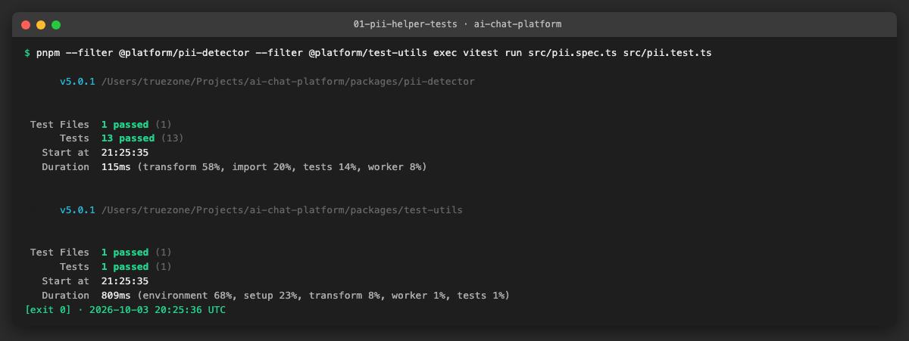
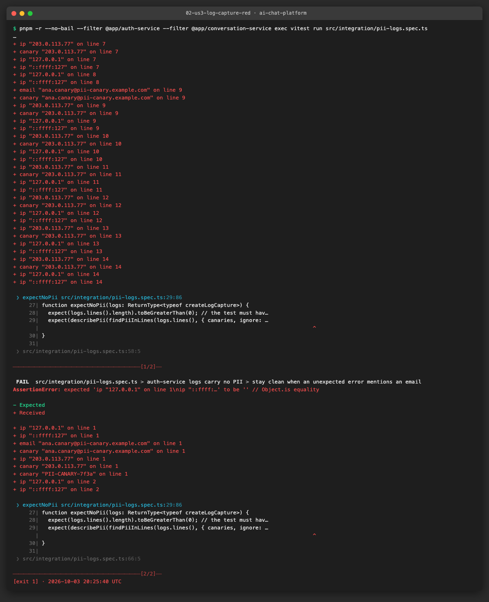
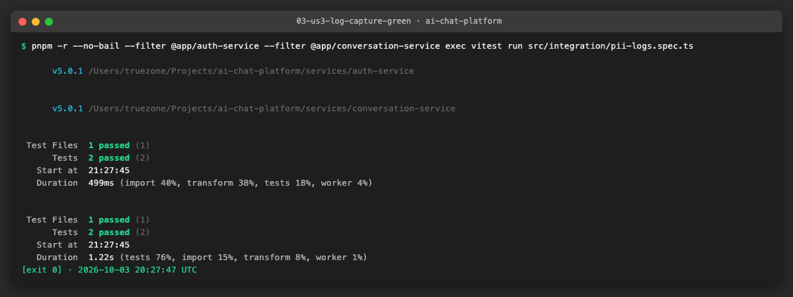
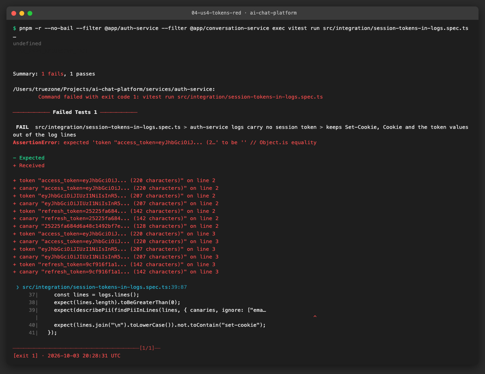
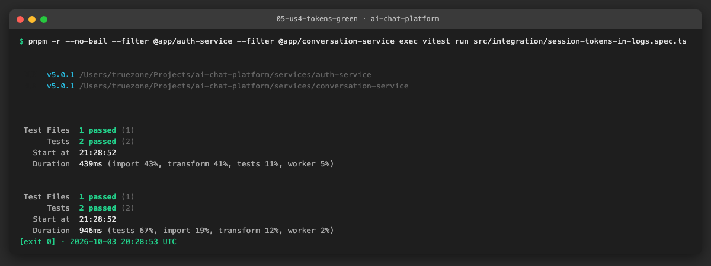
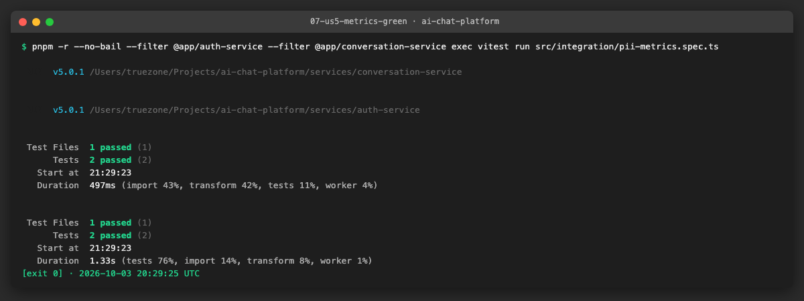
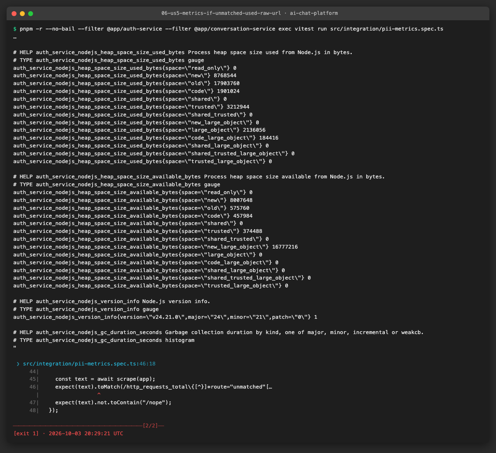
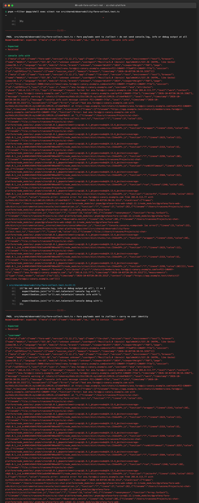
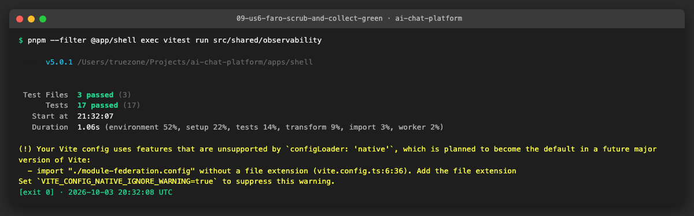

# AICHAT-32 · PII masking testing: work log

| Field | Value |
|---|---|
| Epic | [AICHAT-32](https://ipca-grupo11.atlassian.net/browse/AICHAT-32) |
| Analysis | [README.md](README.md) |
| Owner | Jean-Pierre Carvalho |
| Branch | `test/AICHAT-32-pii-masking-testing` |
| Started / finished | 2026-10-03 / 2026-10-03 |
| Pull requests | [#19](https://github.com/ipca-group11/ai-chat-platform/pull/19) |
| Status | Done, merged into `integration/testing-epics` |

## 1. DoR review

Date: 2026-10-03

| DoR item | Status | Question asked | Decision | Decided by |
|---|---|---|---|---|
| Owner assigned | Met | — | Jean-Pierre Carvalho | — |
| Scope agreed | Met | Which outputs and which data? | Service logs (auth-service, conversation-service), `/metrics` of both services and Faro browser telemetry × email, IP address, message content, tokens/cookies/API keys | Team (owner delegated) |
| Tooling agreed | Met | How do we capture each output? | pino destination stream captured in Vitest + supertest; `/metrics` scraped after traffic; a shared PII detector helper in `@platform/test-utils`; Faro checked with a unit-tested `beforeSend` scrubber and a Vitest capture of the transport payload. No Playwright, because the e2e suite is disabled (owner decision 2026-10-03) | Team (owner delegated) |
| Target environment available | Met | Where do tests run? | In-process in Vitest, so they run in the normal CI `nx affected` test job; no stack needed | Team (owner delegated) |
| PII fields listed | Met | README §4.1 | Email, IP address, message content (also reasoning, extracted text, attachment names), session tokens, cookies, `Set-Cookie`, the LLM API key | Team (owner delegated) |
| Masking rule defined | Met | README §5 proposal | Approved with one change: emails and IPs are **dropped** (not hashed), since we need no correlation and a hash is still personal data under GDPR; message content never logged (lengths/ids only); tokens, cookies, API keys → `[REDACTED]`; query strings dropped from logged URLs | Team (owner delegated) |
| Fixes | Met | Tests first, then fix or ticket? | Tests are written first (red), then we fix the services and the shell in this epic so the acceptance criterion "pass after fixes" is met. Anything outside our code (Caddy access logs, Grafana) is ticketed | Team (owner delegated) |

Decisions taken during the work (all "Team (owner delegated)"):

| Topic | Decision | Why |
|---|---|---|
| Faro check | The Playwright capture of `**/collect` (README §6 step 5) is replaced by a Vitest test that runs the shell's real `initFaro` with the real Faro SDK and a recording `fetch`, and checks every `/collect` body with the PII detector | The owner disabled the Playwright e2e suite; the test sends the same payloads the browser would |
| Where the detector lives | The code is in its own package `@platform/pii-detector` and `@platform/test-utils/pii` re-exports it | `test-utils` depends on `mock-server`, which imports `conversation-service`, so a service could not depend on `test-utils` without a task-graph cycle (`nx` refuses to run it). A leaf package has no cycle |
| Dropped vs. redacted | Emails, IP addresses, message content, reasoning, extracted text and attachment names are removed from the log line (the field is gone); tokens, cookies, `Set-Cookie`, API keys and passwords are replaced by `[REDACTED]`. Inside free text (an error message, a URL path) an email, an address or a JWT becomes `[REDACTED]` | The first group is not needed for any debugging; the second group is kept as a marker so we can see the field existed |
| Logged request | A request is logged as id, method and path (no query string, no headers, no remote address); a response as its status code. Errors are logged as type, scrubbed message and scrubbed stack, without their other properties | The default serializers wrote all headers (client address, cookies, `Set-Cookie`); error objects carry the request body (body-parser), the file name (multer) or values (Prisma) |
| Faro console | Only `console.warn` and `console.error` are captured; `log`, `info`, `debug` and `trace` are not. The Faro user meta (id, email, username) is not sent | `captureConsole` sent whatever the app printed; message content must not leave the browser |
| Residual risk | Free text inside a third-party error message (for example a database error that echoes a value) is scrubbed for emails, addresses and tokens only. Our own code never passes message content to a logger | A scrubber cannot know what is "content" in an arbitrary string |
| Outside our code | Caddy access logs (client address) and the Faro collector's own request logs are not changed here; they are listed as tickets in the report | Not code of this repository's services or shell |

Blockers: none

## 2. Environment

| Tool | Version | Install |
|---|---|---|
| macOS | 26.3 | n/a |
| Node | `node -v` → v24.21.0 | `nvm install` (reads `.nvmrc`) |
| pnpm | `pnpm -v` → 10.4.0 | `corepack enable` |
| Docker | `docker --version` → Docker version 29.4.0 | not needed: every test runs in-process |
| Vitest, supertest, pino, Faro Web SDK | 5.0.1, 7.x, 10.3, 2.12.1 | `pnpm install` |

## 3. Steps

### US1 · Agree PII fields and masking rule ([AICHAT-58](https://ipca-grupo11.atlassian.net/browse/AICHAT-58))

**What and why.** The fields we protect and the rule we apply are agreed in section 1: the DoR table (scope, PII fields, masking rule) and the table of decisions taken during the work. The rule in one line: emails and IP addresses are dropped, message content is never logged, tokens, cookies and API keys become `[REDACTED]`, query strings are cut from logged URLs. Nothing else was done for this story; the tests of US3 to US6 are the proof that the rule is applied.

**Result.** See section 1.

### US2 · Reusable PII detector test helper ([AICHAT-75](https://ipca-grupo11.atlassian.net/browse/AICHAT-75))

**What and why.** The telemetry tests of the epic need the same question answered four times: "does this text contain an email, an IP address, a session token or a value we planted?". `findPii(text, { canaries })` returns every match with its kind (`email`, `ip`, `token`, `canary`) and position; it also looks at the percent-decoded text, so `ana%40...` in a URL is found. `findPiiInLines` adds the line number, `describePii` writes one readable line per match (a long value is cut, so a failing test does not print a token into the CI log) and `createLogCapture` is a destination for pino that keeps the lines. The placeholder `[REDACTED]` and a cleared cookie (`refresh_token=;`) never match. The code is in `packages/pii-detector` and `@platform/test-utils/pii` re-exports it (reason in section 1).

**Files.**
- `packages/pii-detector/src/pii.ts`, `pii.spec.ts` (new): the detector and 13 unit tests (100% lines).
- `packages/pii-detector/{package.json,project.json,tsconfig.json,vitest.config.ts,eslint.config.ts}` (new): the package.
- `packages/test-utils/src/pii.ts`, `pii.test.ts` (new): the `@platform/test-utils/pii` re-export and its test; `packages/test-utils/README.md`: the usage table.

**How to run.**

```sh
pnpm --filter @platform/pii-detector --filter @platform/test-utils exec vitest run
```

**How to repeat it manually.**

1. Run the command above from the repo root.
2. Expected output: 13 tests pass in `pii-detector` and 1 in `test-utils` (the re-export).
3. To use it in a test: `import { createLogCapture, describePii, findPiiInLines } from "@platform/pii-detector"`, build the logger with `createLogCapture()` as destination, drive the app, then `expect(describePii(findPiiInLines(logs.lines(), { canaries }))).toBe("")`.

**Result.** The helper finds each kind, ignores version numbers, timestamps and the redaction placeholder, and has no DOM dependency, so services can use it.



**Problems and fixes.**
- First place was `packages/test-utils`. The conversation service cannot depend on it: `test-utils` -> `mock-server` -> `conversation-service` closes a cycle and `nx` stops with "the task graph has a circular dependency". We moved the code to a leaf package and kept the re-export.
- A pattern for IPv6 also matches `a::b`, which is a valid address. We accepted that false positive and used `Foo::bar` (not hex) in the test.

### US3 · No email, IP or message content in service logs ([AICHAT-94](https://ipca-grupo11.atlassian.net/browse/AICHAT-94))

**What and why.** Both services run the real `createApp` with a logger that writes to memory, and the test calls every route with fake PII planted in the path, the query string, the body, the file name and the headers (`X-Forwarded-For`, cookies, the LLM key), on success and on 4xx and 5xx (malformed JSON, a failing database whose error message contains an email and an address). It then runs the detector over all log lines. A seam was needed first: `createApp({ logger })` in auth-service and a `logger` option in the conversation-service test app.

What leaked before the fix:
- **auth-service**: the pino-http request line had `remoteAddress` (`127.0.0.1` and `::ffff:127.0.0.1`), all request headers (so `X-Forwarded-For` with the client address), the URL with its query string (an email in `?email=` and in the path), and the unhandled-error log had the database error message with the email and the address.
- **conversation-service**: a rejected upload logged the multer error with a `filename` property, which is the attachment name, and the unexpected-error log carried the email and address from the error message.

The fix: `shared/pii-scrub.ts` (same file in both services) scrubs a URL (no query string, no fragment, no email or address in the path) and an error (type, scrubbed message, scrubbed stack, nothing else); the logger drops email, address, content, reasoning, extracted-text and file-name fields at any depth and applies the serializers; auth-service logs a request as id, method and path.

**Files.**
- `services/auth-service/src/integration/pii-logs.spec.ts`, `services/conversation-service/src/integration/pii-logs.spec.ts` (new): the log-capture tests.
- `services/*/src/shared/pii-scrub.ts`, `pii-scrub.spec.ts` (new): the scrubbers and their tests.
- `services/*/src/shared/logger.ts`, `logger.spec.ts`: the masking, the serializers and their tests.
- `services/auth-service/src/main.ts`, `shared/error-middleware.ts`: the logger is an app dependency and the error log uses the request logger.
- `services/conversation-service/src/test-utils/build-test-app.ts`, `services/auth-service/src/test-utils/build-test-app.ts`: the `logger` option.

**How to run.**

```sh
pnpm --filter @app/auth-service --filter @app/conversation-service exec vitest run src/integration/pii-logs.spec.ts
```

**How to repeat it manually.**

1. Run the command above. It must pass (4 tests).
2. To see it fail, check out the commit `490a58f` (the tests without the fix) and run it again.
3. Expected output at that commit: the test names the leak, for example `ip "203.0.113.77" on line 1`, `email "ana.canary@pii-canary.e..." on line 3`, `canary "PII-CANARY-7f3a"` (the file name).

**Result.** Red before the fix, green after it, for both services.





**Problems and fixes.**
- The existing logger tests used the key `req` for a made-up object, so a `req` serializer in the logger options broke them. The request serializer is passed to `pino-http` only.
- `pino-http` brings its own `err` serializer; ours has to be passed to it too, or the error line keeps the default.
- A scrubber cannot remove message content from a free-text error message. The tests plant emails and addresses there; the residual risk is in section 1.
- The auth test skips the `token` kind: tokens are the next story and are checked there.

### US4 · No session tokens in logs ([AICHAT-112](https://ipca-grupo11.atlassian.net/browse/AICHAT-112))

**What and why.** The auth test logs in, refreshes, calls `/auth/me` with a cookie and an `Authorization` header, and logs out; it then looks in every log line for the exact cookie pairs and token values the service issued (read from the `Set-Cookie` of the responses), for anything token-shaped, and for the text `set-cookie`. The conversation test sends a cookie, an `Authorization` header and the per-request `X-Llm-Api-Key` on success, 400, 404, 401 and 500 and does the same. Before the fix pino-http logged the response headers, so the access token (a JWT) and the refresh token of `/auth/login` and `/auth/refresh` were in the log. The fix: auth-service logs a response as its status code, and both services also redact `res.headers["set-cookie"]` (and `x-llm-api-key` in auth-service) if a response is ever logged by another code path. The conversation service did not leak before: it has no request logging and its error log does not carry headers; the test keeps it that way, and its logger test shows the redaction paths work.

**Files.**
- `services/auth-service/src/integration/session-tokens-in-logs.spec.ts`, `services/conversation-service/src/integration/session-tokens-in-logs.spec.ts` (new).
- `services/auth-service/src/shared/logger.ts`, `main.ts`, `logger.spec.ts`; `services/conversation-service/src/shared/logger.ts`, `logger.spec.ts`.

**How to run.**

```sh
pnpm --filter @app/auth-service --filter @app/conversation-service exec vitest run src/integration/session-tokens-in-logs.spec.ts
```

**How to repeat it manually.**

1. Run the command above. It must pass (4 tests).
2. To see it fail, check out commit `cd64fd2` and run it again.
3. Expected output at that commit: auth-service fails with `token "access_token=eyJhbGciOiJIUzI1NiIsInR5..."` and `refresh_token=...` on the log lines of login and refresh; conversation-service passes.

**Result.**





**Problems and fixes.**
- The first version of the detector printed the whole token in the failure message. We cut long values in `describePii` before the evidence was taken, so no token is in the evidence or the CI log.

### US5 · No PII in /metrics ([AICHAT-127](https://ipca-grupo11.atlassian.net/browse/AICHAT-127))

**What and why.** For each service the test sends traffic with fake PII in paths, query strings, bodies and headers (matched routes including `DELETE /chats/:id/members/:email`, and unmatched URLs that contain an email and an address), scrapes `/metrics` and runs the detector over the whole scrape. A second test checks that a request nobody handles is counted as `route="unmatched"` and that the raw path never appears. The metrics were clean already (labels are `method`, route template and `status`, and 404s share the literal `unmatched`), so these are regression tests. To show that they can fail, we changed the fallback label to the raw URL for one run, saw both tests fail in both services, and put it back.

**Files.**
- `services/auth-service/src/integration/pii-metrics.spec.ts`, `services/conversation-service/src/integration/pii-metrics.spec.ts` (new).

**How to run.**

```sh
pnpm --filter @app/auth-service --filter @app/conversation-service exec vitest run src/integration/pii-metrics.spec.ts
```

**How to repeat it manually.**

1. Run the command above. It must pass (4 tests).
2. To see it fail: in `services/auth-service/src/shared/http-metrics.ts` and `services/conversation-service/src/shared/metrics.ts` change `template ?? "unmatched"` to `template ?? req.originalUrl`, run again, then `git checkout` both files.
3. Expected output with the change: 4 failures that name the email, the address and the canary found in the scrape.

**Result.**





**Problems and fixes.** None. Note for the dashboard owners: `/metrics` is public through the shell (found in AICHAT-28); the content is clean, but exposing it is a separate ticket.

### US6 · Scrub PII from Faro browser telemetry ([AICHAT-136](https://ipca-grupo11.atlassian.net/browse/AICHAT-136))

**What and why.** Two tests. `faro-scrub.test.ts` is the unit test of the `beforeSend` scrubber. `faro-collect.test.ts` replaces the planned Playwright capture (section 1): it opens a page URL with an email and a canary in the query string and fragment, starts the shell's real `initFaro` with the real SDK and a recording `fetch`, sets a user (id, email, username), pushes a warning, an error, an event and a measurement that carry an email, an address, a JWT and URLs with query strings, calls `console.error`, `warn`, `log`, `info` and `debug` with PII, waits for the batches to reach `/collect`, and runs the detector over every body. Before the fix the payloads carried the page URL with the email, the log and error messages, the event attributes and the user identity, and the console `info` text. The fix: `faro-scrub.ts` is the `beforeSend` hook (every string scrubbed, URLs lose query and fragment, sensitive keys replaced, user meta dropped) and `initFaro` captures only `warn` and `error` from the console.

**Files.**
- `apps/shell/src/shared/observability/faro-scrub.ts`, `faro-scrub.test.ts` (new): scrubber and unit tests.
- `apps/shell/src/shared/observability/faro-collect.test.ts` (new): the capture of what is sent to `/collect`.
- `apps/shell/src/shared/observability/faro.ts`, `faro.test.ts`: `beforeSend` and the console levels.

**How to run.**

```sh
pnpm --filter @app/shell exec vitest run src/shared/observability
```

**How to repeat it manually.**

1. Run the command above. It must pass (17 tests).
2. To see it fail, check out commit `f4b36c0` (the capture test without the fix) and run it again.
3. Expected output at that commit: 3 failures, `email ...`, `ip "203.0.113.77"`, `token "eyJhbGciOiJIUzI1NiJ9.eyJ..."` and `canary "PII-CANARY-7f3a"` in the captured bodies, the `console info` text in a body, and a `"user"` meta.

**Result.**





**Problems and fixes.**
- `getWebInstrumentations` has no option for console levels; they are set with `consoleInstrumentation.disabledLevels` in the Faro config.
- By default Faro already skips `log`, `debug` and `trace`, but not `info`; we disabled `info` too.
- Faro batches items, so the test waits (with a timeout) until markers of every item are in the recorded bodies before it asserts.
- Free text in a `console.error` message is scrubbed for emails, addresses and tokens only (section 1).

## 4. How to run everything

```sh
export PATH=$HOME/.nvm/versions/node/v24.21.0/bin:$PATH
pnpm --filter @platform/pii-detector --filter @platform/test-utils exec vitest run                # US2
pnpm --filter @app/auth-service --filter @app/conversation-service exec vitest run src/integration  # US3, US4, US5
pnpm --filter @app/shell exec vitest run src/shared/observability                                 # US6
pnpm exec nx affected -t lint typecheck test build --base=origin/integration/testing-epics        # everything affected
```

## 5. Results

| Metric | Before | After |
|---|---|---|
| PII tests on telemetry | none | 40 (detector 13+1, logs 4, tokens 4, metrics 4, Faro 3 capture + 11 scrubber and wiring) |
| auth-service log line | client address, all request headers, URL with query, `Set-Cookie` with both tokens, error message with email | id, method, path, status code; errors as type and scrubbed message |
| conversation-service log line | attachment name of a rejected upload, email and address in error messages | scrubbed error, no file name |
| `/metrics` | clean | clean, now guarded by a test; unmatched route test in both services |
| Faro `/collect` payload | page URL with query, console `info`, user identity, raw messages | scrubbed; only `warn` and `error` from the console; no user meta |
| Playwright e2e used | n/a | no (disabled by the owner) |

## 6. DoD check

| DoD item | Met | Evidence |
|---|---|---|
| PII fields and masking rule agreed | ✅ | section 1 |
| Reusable detector with unit tests | ✅ | [tests](evidence/01-pii-helper-tests.png) |
| Log-capture tests for both services across all routes, passing after fixes | ✅ | [red](evidence/02-us3-log-capture-red.png), [green](evidence/03-us3-log-capture-green.png) |
| `Set-Cookie`, cookies and API key redacted in auth and conversation logs | ✅ | [red](evidence/04-us4-tokens-red.png), [green](evidence/05-us4-tokens-green.png) |
| `/metrics` scrape after traffic and unmatched-route test | ✅ | [green](evidence/07-us5-metrics-green.png), [fails when the label leaks](evidence/06-us5-metrics-if-unmatched-used-raw-url.png) |
| `beforeSend` scrubber unit-tested and `/collect` capture shows no PII | ✅ | [red](evidence/08-us6-faro-collect-red.png), [green](evidence/09-us6-faro-scrub-and-collect-green.png). The capture is a Vitest test, not Playwright (section 1) |
| Lint, typecheck, test, build of affected projects | ✅ | section 7 |
| SAST and secret scan | ✅ | section 7 |

## 7. Notes for the report

- **Checks before the pull request.** `pnpm exec nx affected -t lint typecheck test build --base=origin/integration/testing-epics`: 18 projects and 2 dependencies, all green (unit-test guard: 254 source files, 0 problems; coverage thresholds pass). `pnpm sast`: no ERROR finding after one fix (the rule `node_api_key` read the constant name `API_KEY` in the Faro scrubber as a hard-coded key; it is now `PROVIDER_KEY`). `gitleaks git --redact --log-opts=origin/integration/testing-epics..HEAD`: the first run reported 3 fake token fixtures in test files (the `generic-api-key` rule); they now build the value from parts and the three fingerprints of the earlier commits are in `.gitleaksignore`, then no leaks.
- **Found.** auth-service wrote the client address, every request header, the query string and, worst, the `Set-Cookie` header with the access and refresh tokens of every login and refresh into its logs. Both services could write emails, addresses or an attachment name through error objects. The shell sent page URLs with their query strings, console output and the user identity to Faro unfiltered. The metrics were already clean.
- **Fixed.** Scrubbed request, response and error logging in both services; `beforeSend` scrubber and console levels in the shell; tests that keep it so.
- **Not done (tickets for the coordinator).** Caddy access logs record the client address and the full URL with query string (deploy owner). The Faro collector (Alloy `faro.receiver`) and Loki see the client address of the HTTP request that carries the payload; check the receiver configuration (deploy owner). `/metrics` is public through the shell (already ticketed in AICHAT-28). Free text inside third-party error messages is scrubbed for emails, addresses and tokens only. The Faro capture test replaces the Playwright one; if e2e comes back, a real-browser capture of `/collect` is worth adding.
- **Lessons.** Planting a unique value and searching for it finds leaks that no field list would: the attachment name came out of a library error object. Default serializers are the usual leak, so a logged request or response should be a short allow-list, not a deny-list. A shared test helper must not depend on a package that depends on the code under test.

## 8. Follow-up: client address in the Faro pipeline ([AICHAT-233](https://ipca-grupo11.atlassian.net/browse/AICHAT-233))

**Question.** Does Alloy's `faro.receiver` or Loki keep the client address of the browser that posts to `/collect`?

**Finding: no.** In Alloy v1.20.1 (`internal/component/faro/receiver`) the logs exporter builds each Loki line only from the decoded Faro payload (`kind`, message, app, session, page URL, browser); it never reads `RemoteAddr` or a request header, and the receiver's HTTP server only records metrics, not a request log. Request headers (where `X-Forwarded-For` would be) reach the pipeline only with `include_metadata = true`, and then only as context metadata for trace exporters. `observability/alloy.alloy` promotes only `kind` and `app_name` to labels and adds no extra labels or structured metadata. Loki only sees Alloy as its client.

**Checked locally.** Alloy (`grafana/alloy:v1.20.1`) and Loki (`grafana/loki:3.7.8`) ran with the repository's `alloy.alloy` and `loki.yml`; a Faro payload was posted straight to the receiver with `X-Forwarded-For: 203.0.113.77` and `X-Real-Ip: 203.0.113.77`. The stored streams had the labels `app_name`, `kind`, `service_name` (and Loki's `detected_level`), the lines held only payload fields, and neither the Loki answer nor the Alloy and Loki container logs contained the address.

**Hardening anyway.** So that a later config change cannot start storing it:
- `deploy/azure/Caddyfile` removes `X-Forwarded-For`, `X-Real-Ip` and `Forwarded` before proxying `/collect`, so Alloy never receives the address in production.
- `observability/alloy.alloy` sets `include_metadata = false` explicitly, with a comment.
- `packages/workspace-config/src/alloy-faro.test.ts` fails if `include_metadata` is turned on, a label other than `kind`/`app_name`, `extra_log_labels` or structured metadata is added, or Caddy stops stripping the headers.

A regex stage that masks addresses in the lines was not added: Faro's browser version (for example `137.0.0.0`) has the shape of an IPv4 address and would be masked too.
