# AICHAT-33 · GDPR retention and deletion testing: work log

| Field | Value |
|---|---|
| Epic | [AICHAT-33](https://ipca-grupo11.atlassian.net/browse/AICHAT-33) |
| Analysis | [README.md](README.md) |
| Owner | Jean-Pierre Carvalho |
| Branch | `test/AICHAT-33-gdpr-retention-and-deletion-testing` |
| Started / finished | 2026-10-04 / 2026-10-04 |
| Pull requests | not opened yet |
| Status | Done on the branch, pull request not opened yet |

## 1. DoR review

Date: 2026-10-04

| DoR item | Status | Question asked | Decision | Decided by |
|---|---|---|---|---|
| Owner assigned | Met | — | Jean-Pierre Carvalho | — |
| Scope agreed | Met | Which stories? | All seven stories: retention decision (US1), account deletion endpoint `DELETE /auth/me` (US2, the feature is built in this epic), file cleanup on chat/message delete (US3), Testcontainers setup (US4), erasure test (US5), retention job boundary tests (US6), Loki retention config test (US7) | Team (owner delegated) |
| Tooling agreed | Met | Test database? | Testcontainers with the official `postgres` image (native arm64/amd64, no emulation), schema applied with `prisma db push` (no migrations exist yet; switch to `migrate deploy` when they are added). DB tests run in a separate `test-db` Nx target so the unit `test` target stays fast; CI runs `test-db` on GitHub runners, which have Docker | Team (owner delegated) |
| Target environment available | Met | Where does it run? | Local Docker and the GitHub Actions runner. No shared or production database is touched | Team (owner delegated) |
| Retention periods defined | Met | README §5 proposal | Approved as proposed: inactive accounts 24 months, expired/revoked refresh tokens 7 days after expiry, chats/messages/attachments until the user deletes them or the account, orphaned upload files within 24 h, Loki 7 days, Prometheus 15 days (no PII) | Team (owner delegated) |
| Shared chats | Met | What happens to a deleted user's data in shared chats? | Chats the user owns are deleted for everyone (with all messages and files). In chats owned by others, the user's membership row and the messages and attachments they wrote are deleted; assistant replies stay. Erasure wins over conversation context | Team (owner delegated) |
| Cross-service deletion | Met | Retry or outbox? | auth-service calls an internal conversation-service erasure endpoint (service token) first and deletes the `User` row only after it succeeds. Every step is idempotent, so a failure leaves the account in place and the user (or a retry) can repeat the request; the test covers this partial failure | Team (owner delegated) |
| Telemetry erasure | Met | How are log lines erased? | Minimisation (AICHAT-32) plus the 7-day Loki retention is the documented erasure mechanism; US7 guards the retention value | Team (owner delegated) |

Decisions taken during the work (all "Team (owner delegated)"):

| Topic | Decision | Why |
|---|---|---|
| Password to delete | `DELETE /auth/me` takes `{ "password" }` in the body and checks it again before anything is erased | A stolen session cookie must not be enough to erase an account (README §6 step 2 asks for the same) |
| CSRF | The repository has no CSRF token. The route relies on `SameSite=Lax` cookies (never sent on a cross-site DELETE), the JSON body with the password, and a check that an `Origin` header, when present, is one of `CORS_ORIGIN` (otherwise 403) | The same cookies protect the other routes; the extra origin check costs nothing |
| Rate limits | The app-wide limit (300 per 15 min) applies as for every route, plus 10 per hour for this route | Deleting an account is rare and expensive |
| Internal endpoint | `POST /internal/erasures` (body `{ userId, email }`) with `Authorization: Bearer <INTERNAL_SERVICE_TOKEN>`, compared in constant time. The token is an optional env value of at least 32 characters with no default; without it conversation-service does not mount the route and auth-service answers 503 and deletes nothing | A half deletion is worse than none; no literal secret in the code. Compose has a local-only default, like `JWT_SECRET` |
| Failure answer | If conversation-service fails, `DELETE /auth/me` answers 502 `ACCOUNT_DELETION_FAILED` and the user stays | The user can repeat the request; no outbox or queue is needed because both steps are idempotent |
| "Inactive" account | A new column `User.lastActiveAt` (default now, set on every sign-in and refresh). Accounts with `lastActiveAt` older than 24 calendar months are deleted by the retention job, with the same erasure as `DELETE /auth/me`, and skipped when erasure is not configured | The schema had no activity date, and refresh tokens are deleted after 14 days, so nothing else shows how long an account has been idle. Existing rows get "now" on `db push`, which is the most protective start (nothing is deleted at once) |
| Files after the database | Files are removed after the database delete succeeded. A file that cannot be removed does not fail the request: the row is gone, and the orphan sweep (24 h) removes the file | Never lose files while the rows still exist |
| `/api/internal` | The shell proxies `/api/*` to conversation-service, so `/api/internal/erasures` is reachable from the browser. It answers 401 without the service token | Defence is the token; blocking the path in the proxy is ticketed |
| Web client | No "Delete account" button in this epic (see US2) | The settings page only has the API-key list; see the ticket list |

Blockers: none. The deletion endpoint did not exist (README §4.2); we built it as US2 in this epic.

## 2. Environment

| Tool | Version | Install |
|---|---|---|
| macOS | 26.3 (arm64) | n/a |
| Node | `node -v` → v24.21.0 | `nvm install` (reads `.nvmrc`) |
| pnpm | `pnpm -v` → 10.4.0 | `corepack enable` |
| Docker (OrbStack) | `docker --version` → Docker version 29.4.0, server linux/arm64 | needed only for the `test-db` targets |
| Testcontainers, `@testcontainers/postgresql` | 12.2.0 | `pnpm install` |
| Postgres image | `postgres:16-alpine`, the version of `compose.yaml` | pulled by Testcontainers (native arm64, no emulation) |
| Prisma, Vitest | 6.1.0, 5.0.1 | `pnpm install` |

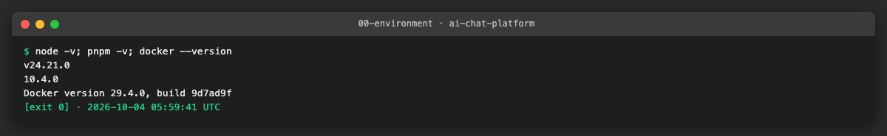

## 3. Steps

### US1 · Agree retention periods and shared-chat deletion rules ([AICHAT-61](https://ipca-grupo11.atlassian.net/browse/AICHAT-61))

**What and why.** The retention table and the rule for shared chats are agreed in section 1 (DoR table and decisions). `docs/AICHAT-33/RETENTION.md` writes them down for the team, names the code that enforces each row, and has a short ADR for the cross-service account deletion (call conversation-service first, delete the user row second, every step idempotent, 502 and retry on failure). It also explains how to run the checks.

**Files.**
- `docs/AICHAT-33/RETENTION.md` (new): retention table, shared-chat rule, ADR, how to run.

**How to run.**

```sh
cat docs/AICHAT-33/RETENTION.md
```

**How to repeat it manually.**

1. Open `docs/AICHAT-33/RETENTION.md`.
2. Expected: the table has 6 rows (account 24 months, refresh tokens 7 days after expiry, chats until deleted, orphaned files 24 h, Loki 7 days, Prometheus 15 days); the shared-chat section says owned chats go for everyone and the user's own rows go from other people's chats.

**Result.** Documentation only; the tests of the later stories check every row.

**Problems and fixes.** None.

### US4 · Testcontainers Postgres setup for DB-backed tests ([AICHAT-116](https://ipca-grupo11.atlassian.net/browse/AICHAT-116))

**What and why.** DB-backed tests need a real Postgres. `packages/test-config/test-utils/postgres-global-setup.ts` is a Vitest `globalSetup`: it starts `postgres:16-alpine` with Testcontainers, runs `prisma db push` for the schema of the service it runs in (no migrations exist yet), exposes `DATABASE_URL` and stops the container at the end. Each of auth-service and conversation-service has a `vitest.db.config.ts` (only `*.db.spec.ts`) and a `test-db` Nx target. The unit `test` target skips `*.db.spec.ts`, so it still needs no Docker. CI has a new `test-db` job that pulls the same image and runs the target for both services.

**Files.**
- `packages/test-config/test-utils/postgres-global-setup.ts` (new), `package.json` (export, dev dependencies), `vitest.config.ts`, `tsconfig.json`.
- `services/{auth,conversation}-service/vitest.db.config.ts`, `src/test-db/setup-env.ts`, `src/test-db/smoke.db.spec.ts` (new); `project.json` (`test-db` target), `package.json` (script), `vitest.config.ts` (excludes `*.db.spec.ts`).
- `.github/workflows/ci.yml`: job `test-db`. `packages/workspace-config/src/ci.test.ts`: checks the job, the image version and that `test` stays free of the DB config.

**How to run.**

```sh
pnpm exec nx run-many -t test-db -p auth-service,conversation-service --parallel=1
```

**How to repeat it manually.**

1. Start Docker (OrbStack or Docker Desktop).
2. Run the command above from the repo root.
3. Expected output: both projects pass; the log shows `Your database is now in sync with your Prisma schema` once per service.

**Result.** The smoke test of each service creates rows and checks the foreign-key cascade in a real database.


**Problems and fixes.**
- All test files of a service share one database, so the smoke tests count rows by id instead of counting the whole table, and `fileParallelism` is off.
- The setup file lives in `test-utils/` because the repository's unit-test guard treats other `.ts` files in a package as source that needs its own test.

### US3 · Remove uploaded files when a chat or message is deleted ([AICHAT-97](https://ipca-grupo11.atlassian.net/browse/AICHAT-97))

**What and why.** Before this story the files stayed on disk after a chat or message delete (`AttachmentStorage` had only `save` and `read`). `AttachmentStorage.delete(storagePath)` removes a file, treats a missing file as success and refuses a path outside the upload directory. `ChatsService.remove` and `MessagesService.cancelQueued` collect the file paths of the rows, delete the rows and only then remove the files, so a failed database delete loses nothing. A file that cannot be removed is logged and does not fail the request (the 24 h sweep of US6 takes it later).

**Files.**
- `services/conversation-service/src/integration/file-cleanup.spec.ts` (new): the red test, written first.
- `src/features/attachments/storage.ts`, `file-cleanup.ts` (new), `file-cleanup.spec.ts`, `storage.spec.ts`: delete and the cleanup helper.
- `src/features/chats/service.ts`, `src/features/messages/service.ts`, `src/app.ts`: use the cleanup after the database delete.
- `src/test-utils/fake-storage.ts`: `delete`, `has`, `count`.

**How to run.**

```sh
cd services/conversation-service && pnpm exec vitest run src/integration/file-cleanup.spec.ts src/features/attachments
```

**How to repeat it manually.**

1. Upload a file to a message in a chat, then `DELETE /chats/:id`.
2. Expected: `ls $UPLOAD_DIR` no longer shows the file. With the fix removed (revert the commit "remove uploaded files when a chat or message is deleted"), the file stays and the tests fail as in the first screenshot.

**Result.** Red first: 3 of 4 tests failed (files still stored; `storage.delete` missing). After the fix all pass, including "keeps the files when the database delete fails" and "deletes the chat even when a file is already gone".

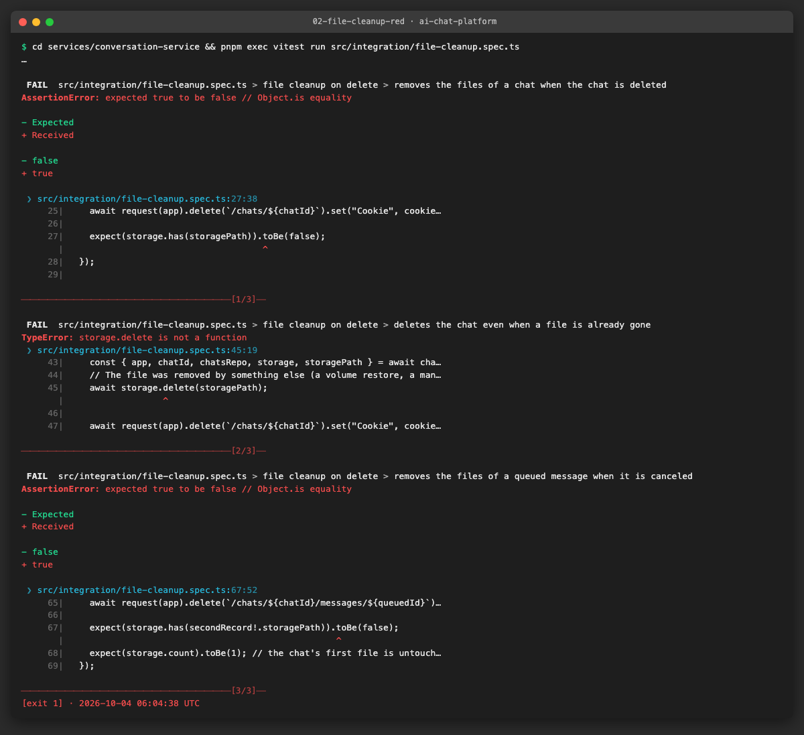

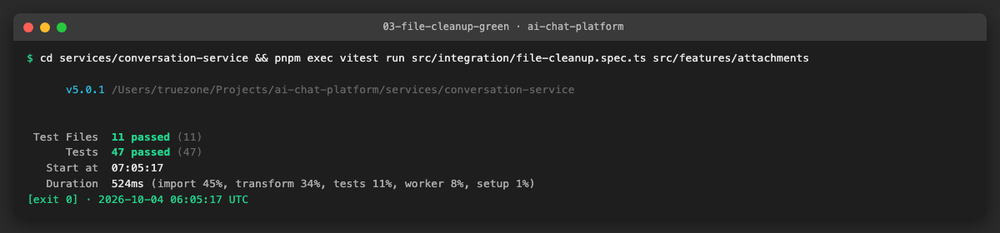

**Problems and fixes.** The first version imported the cleanup type from a file inside the `attachments` feature; the feature-boundary lint rule asked for the public barrel, so the imports go through `features/attachments`.

### US2 · Account deletion endpoint, all user data ([AICHAT-79](https://ipca-grupo11.atlassian.net/browse/AICHAT-79))

**What and why.** `DELETE /auth/me` (auth-service) deletes the signed-in user and everything they own. The user sends the password again. auth-service calls `POST /internal/erasures` of conversation-service with the service token. That call deletes, in one transaction, the chats the user owns (members, messages and attachments cascade), the user's memberships by email, their messages and attachments in other users' chats, and then removes the files. Only after it succeeds is the `User` row deleted (refresh tokens cascade) and the cookies cleared. Failure answers 502 and keeps the account; a repeat succeeds. Without the token or the conversation-service URL the route answers 503 and deletes nothing. Decisions (password, origin check, rate limit, 502, token) are in section 1. `testing/zap/openapi.yaml` notes that the route is left out of the DAST scan because the scan would delete its own account.

**Files.**
- auth-service: `src/features/account/{api,model,index}.ts`, `api.spec.ts`, `model.spec.ts`; `src/integration/account-deletion.spec.ts`; `src/shared/erasure-client.ts`, `erasure-client.spec.ts`; `src/shared/env.ts`, `contracts/auth.ts`; `src/main.ts`; `.env.example`.
- conversation-service: `src/features/erasure/{repository,service,schema,routes,service-token,index}.ts` and specs; `src/integration/erasure.spec.ts`; `src/app.ts`; `src/shared/env.ts`; `.env.example`.
- `compose.yaml`, `docker-compose.yml`, `.env.example`: `INTERNAL_SERVICE_TOKEN`, `CONVERSATION_SERVICE_URL`. `testing/zap/openapi.yaml`: note. `packages/workspace-config/unit-test-exempt.json`: two barrel files.

**How to run.**

```sh
cd services/auth-service && pnpm exec vitest run src/integration/account-deletion.spec.ts src/features/account
cd ../conversation-service && pnpm exec vitest run src/integration/erasure.spec.ts src/features/erasure
```

**How to repeat it manually.**

1. Start the stack with `docker compose up` (the compose files set the token), register and sign in, create a chat with a file.
2. `curl -i -X DELETE http://localhost:8000/auth/me -H 'content-type: application/json' -b cookies.txt -d '{"password":"..."}'`
3. Expected: `204`, cookies cleared; signing in again answers 401; the chat and its file are gone. Stop conversation-service first and the call answers `502` and the account still signs in.

**Result.** 14 unit and integration tests in auth-service and 28 in conversation-service pass: order (erase first, user row second), 502 and retry, repeat after deletion (204), wrong password (401), missing password (400), foreign origin (403), rate limit (429), no configuration (503), service token checks (401 for a missing, wrong, longer or shorter token or another scheme).

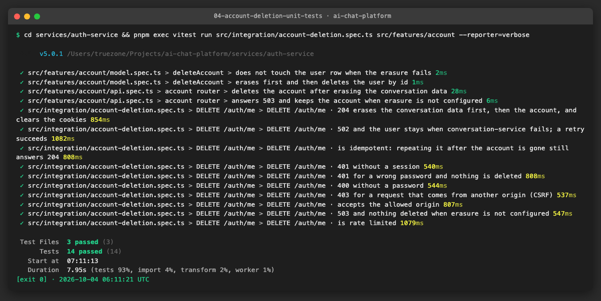

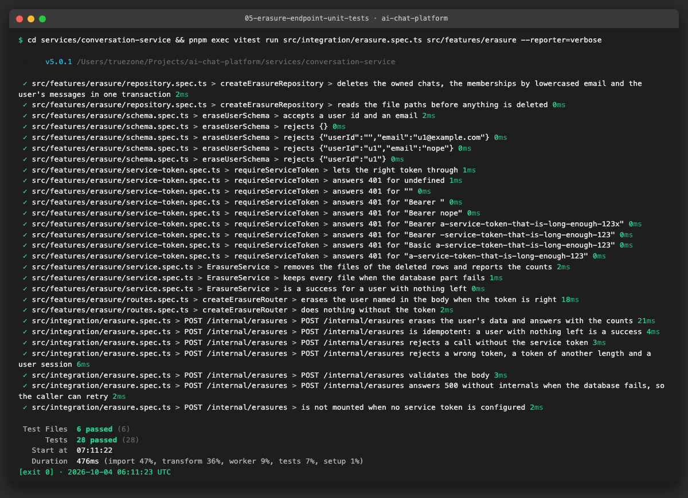

**Problems and fixes.**
- The fake Prisma of auth-service had no `deleteMany`; it now also removes the user's refresh tokens, like the cascade of the schema.
- Web client: the settings page (`apps/mfe-settings`) only has the API-key list (local storage), with no account section and no call to auth-service that a delete button could follow, and the mock server and MSW handlers would need the new route too. No button was added; it is a ticket (see section 7).

### US5 · Test that account deletion erases all user data ([AICHAT-130](https://ipca-grupo11.atlassian.net/browse/AICHAT-130))

**What and why.** Two `test-db` suites prove the erasure on a real Postgres with real files. `account-deletion.db.spec.ts` (auth-service) runs auth-service and conversation-service for real: conversation-service listens on a local port, with its schema in the same container (schema `conversation`, like compose) and a temporary upload directory; the two talk through the product's own erasure client. Ana and Ben share chats in both directions, each with a message and a file in each chat, plus an assistant reply. After `DELETE /auth/me` for Ana: her `User` and refresh tokens are gone; the chat she owned is gone with its messages, members, attachment rows and files (including Ben's); in Ben's chat her membership, message, attachment row and file are gone while Ben's chat, message, reply and file stay; no row in either database references her id or email. Partial failures: conversation-service unreachable (502, user and chats intact, retry succeeds), conversation-service refusing the call (same), and the user row delete failing after the erasure (502, retry finishes). Also: repeat after deletion (204) and wrong password (nothing deleted). `erasure.db.spec.ts` (conversation-service) checks the same SQL-level facts for the endpoint alone, the email case, a missing file and a user without data.

**Files.**
- `services/auth-service/src/test-db/account-deletion.db.spec.ts` (new).
- `services/conversation-service/src/test-db/erasure.db.spec.ts` (new).

**How to run.**

```sh
pnpm exec nx run-many -t test-db -p auth-service,conversation-service --parallel=1
```

**How to repeat it manually.**

1. Start Docker, run the command above.
2. Expected: 7 tests in auth-service (6 + smoke) and 8 in conversation-service (7 + smoke) pass.
3. To see that the test can fail: in `services/conversation-service/src/features/erasure/repository.ts` replace the membership delete with `{ count: 0 }`; the first test fails on the membership check. (Done once during the work, then reverted.)

**Result.** All pass.

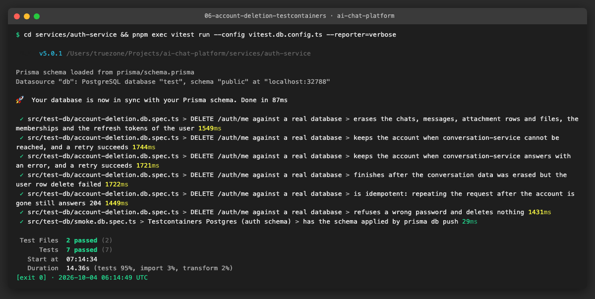

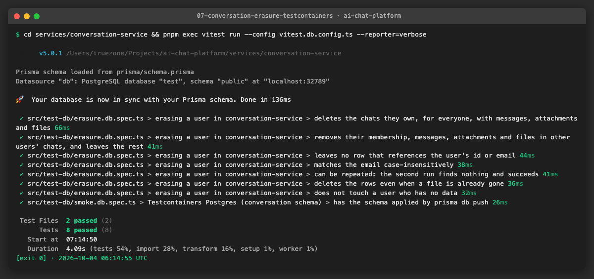

**Problems and fixes.** The auth-service test imports conversation-service source on purpose (a cross-service test); the Nx module-boundary rule is disabled on those three import lines with a reason. `nx affected` will not see that dependency, so CI runs `test-db` for both services on every pull request.

### US6 · Retention job and boundary tests ([AICHAT-137](https://ipca-grupo11.atlassian.net/browse/AICHAT-137))

**What and why.** Each service has `runRetention(now, deps)`, a function with no timers that takes the time as a parameter, and an interval scheduler (`RETENTION_INTERVAL_MINUTES`, default 360, `0` = off; runs once at start; runs never overlap; failures are logged and the next run still happens). auth-service deletes refresh tokens whose `expiresAt` is more than 7 days ago and accounts whose `lastActiveAt` is older than 24 calendar months (erasing their chats first, skipped when erasure is not configured, retried next run when it fails). conversation-service removes files in the upload directory that no attachment row references and that are older than 24 hours. The limits are strict: exactly at the limit is kept. `User.lastActiveAt` is new (see section 1).

**Files.**
- `services/auth-service/src/features/retention/{run,schedule,index}.ts`, specs; `prisma/schema.prisma` (`lastActiveAt`); `src/features/session/model.ts` (sets it); `src/main.ts`; `src/shared/env.ts`.
- `services/conversation-service/src/features/retention/{run,schedule,index}.ts`, specs; `src/features/attachments/storage.ts` (`list`), `service.ts` (`findReferencedPaths`); `src/server.ts`; `src/shared/env.ts`.
- `services/auth-service/src/test-db/retention.db.spec.ts`, `services/conversation-service/src/test-db/retention.db.spec.ts` (new): boundary and idempotency tests on Postgres.

**How to run.**

```sh
pnpm exec nx run-many -t test-db -p auth-service,conversation-service --parallel=1
pnpm exec nx run-many -t test -p auth-service,conversation-service
```

**How to repeat it manually.**

1. Run the first command.
2. Expected: 14 retention tests in auth-service and 7 in conversation-service pass. They seed rows 1 second before, exactly at and 1 second after each limit (7 days, 24 months, 24 hours), run `runRetention` with a fixed `now`, and check what is left. They also run with an earlier clock (nothing deleted), with a failed erasure (account kept, deleted by the next run), without an erasure client (accounts kept) and twice in a row (the second run deletes nothing).

**Result.** All pass.

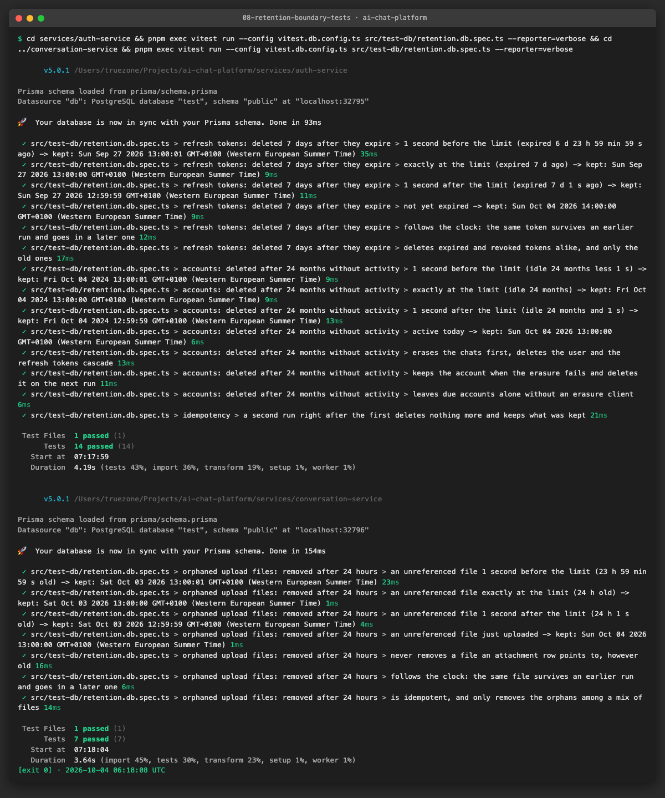

**Problems and fixes.**
- The existing session tests called `issueTokens` for a user the fake did not store; they now seed the user, because `issueTokens` records the activity.
- Logs of a failed account deletion carry the error only, not the user id (AICHAT-32).

### US7 · Config test for telemetry retention ([AICHAT-140](https://ipca-grupo11.atlassian.net/browse/AICHAT-140))

**What and why.** `packages/workspace-config/src/loki-retention.test.ts` fails if `observability/loki.yml` loses `limits_config.retention_period`, if it is above 7 days (168 h; any Loki duration format: `168h`, `7d`, `1w`, `1d12h`), if it is zero (Loki reads that as "keep forever"), or if `compactor.retention_enabled` is not true (without it the period does nothing). `LOKI_CONFIG_PATH` points the test at a copy, which is how the failure evidence was made.

**Files.**
- `packages/workspace-config/src/loki-retention.ts`, `loki-retention.test.ts` (new).

**How to run.**

```sh
pnpm exec nx test workspace-config
# or only this test
cd packages/workspace-config && pnpm exec vitest run src/loki-retention.test.ts
```

**How to repeat it manually.**

1. Run the second command: 24 tests pass.
2. Copy `observability/loki.yml` to a temp folder, change `retention_period: 168h` to `336h`, and run `LOKI_CONFIG_PATH=/absolute/path/loki.yml pnpm exec vitest run src/loki-retention.test.ts`. Expected: 1 test fails with "above the 7 days (168 h)". Delete the `retention_period` line instead: it fails with "is missing".

**Result.** Green on the real file; red on a copy with `336h` and on a copy without the line.

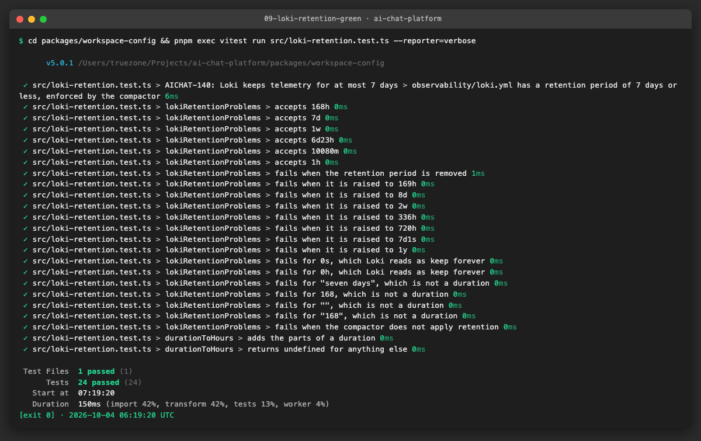

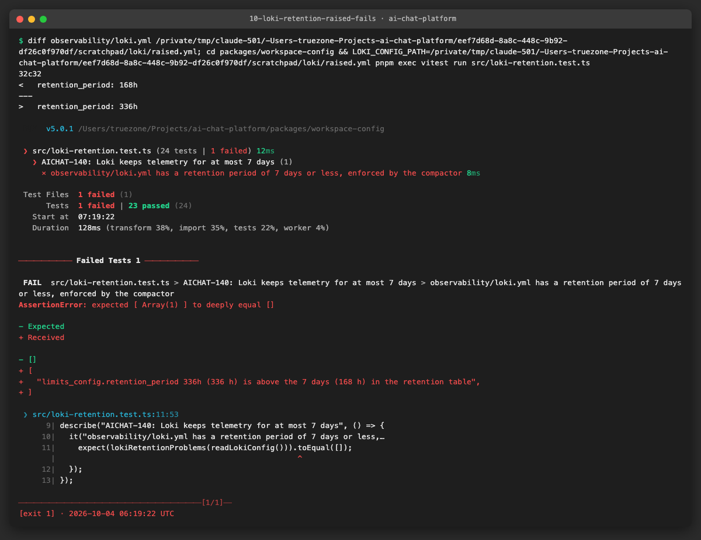

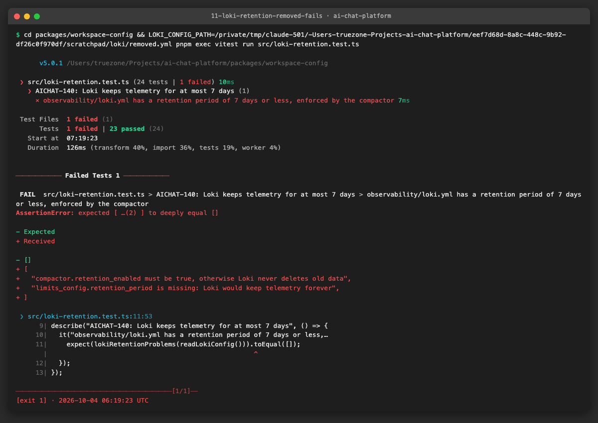

**Problems and fixes.** None.

## 4. How to run everything

```sh
export PATH=$HOME/.nvm/versions/node/v24.21.0/bin:$PATH
NX_DAEMON=false pnpm exec nx affected -t lint typecheck test build size --base=origin/integration/testing-epics --parallel=3
pnpm exec nx run-many -t test-db -p auth-service,conversation-service --parallel=1   # Docker required
pnpm sast
gitleaks git --redact --config .gitleaks.toml --log-opts=origin/integration/testing-epics..HEAD
```

## 5. Results

| Metric | Before | After |
|---|---|---|
| Uploaded files after a chat or message delete | stay on disk | removed after the database delete (3 red tests, green after the fix) |
| Account deletion | no endpoint | `DELETE /auth/me` plus `POST /internal/erasures`, proved on Postgres for a shared chat and for 3 partial failures |
| Retention jobs | none | auth-service (tokens 7 d after expiry, accounts idle 24 months) and conversation-service (orphaned files 24 h), 21 boundary tests on Postgres |
| Loki retention guard | none | fails when removed, zero, not a duration or above 168 h |
| Unit tests (auth-service / conversation-service) | 163 / 489 | 178 / 530 |
| `test-db` tests (auth-service / conversation-service) | 0 / 0 | 15 / 21 |

Gates, run on the final code:

| Gate | Result | Evidence |
|---|---|---|
| `NX_DAEMON=false pnpm exec nx affected -t lint typecheck test build size --base=origin/integration/testing-epics --parallel=3` (no cache) | passed, 19 projects | [12](evidence/12-gate-nx-affected.log) |
| `nx run-many -t test-db -p auth-service,conversation-service --parallel=1` | passed (3 files, 15 tests; 3 files, 21 tests) | [13](evidence/13-gate-test-db.log) |
| `pnpm sast` | exit 0, 0 ERROR (60 WARNING and 14 INFO as before, none new in code of this epic; the workflow warnings are the mutable action tags the other jobs have too) | [14](evidence/14-gate-sast.log) |
| `gitleaks git --redact --config .gitleaks.toml --log-opts=origin/integration/testing-epics..HEAD` | no leaks found | [15](evidence/15-gate-gitleaks.log) |

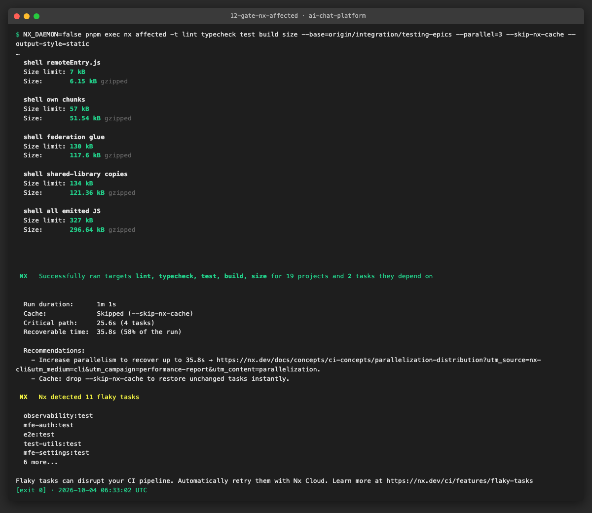

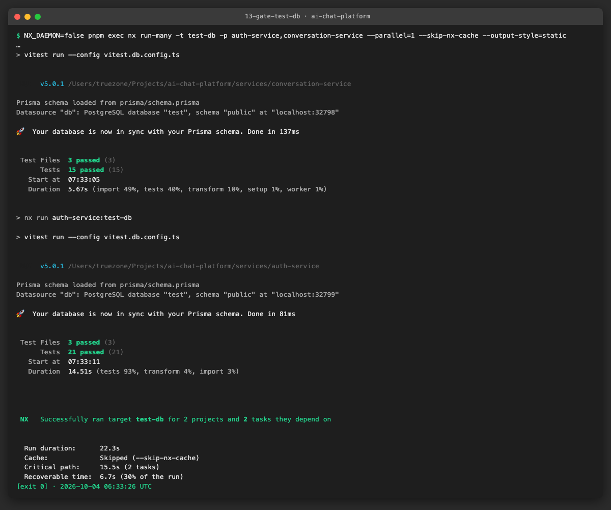

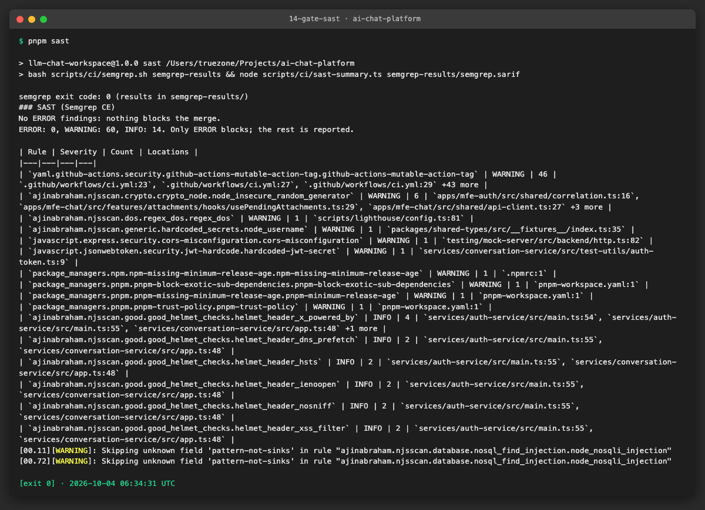

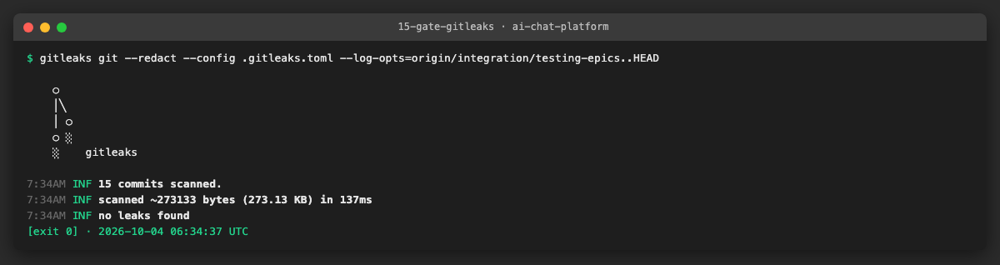


## 6. DoD check

| DoD item | Met | Evidence |
|---|---|---|
| Runs in CI, passes on `main`, failure blocks the merge | ✅ on the branch (job `test-db` plus `nx affected`); "passes on main" is checked after the merge | [ci.yml](../../.github/workflows/ci.yml), [12](evidence/12-gate-nx-affected.log), [13](evidence/13-gate-test-db.log) |
| Run instructions documented | ✅ | [RETENTION.md](RETENTION.md), sections 3 and 4 of this log |
| Deleting a user removes chats, messages, files and telemetry (checked with Testcontainers) | ✅ chats, messages, attachment rows, files, memberships and refresh tokens are checked on Postgres; telemetry is covered by minimisation plus the 7-day Loki limit, guarded by the config test | [06](evidence/06-account-deletion-testcontainers.log), [07](evidence/07-conversation-erasure-testcontainers.log), [09](evidence/09-loki-retention-green.log) |
| Retention job tested | ✅ | [08](evidence/08-retention-boundary-tests.log) |


## 7. Notes for the report

- **What was found.**
  - Uploaded files were never deleted when a chat or message was deleted, and nothing could delete an account. Both were privacy defects, not only missing tests.
  - The schema had no activity date, so "inactive for 24 months" could not be decided. We added `User.lastActiveAt`.
  - Under CPU load (several projects testing at once) the auth-service tests that register and log in with bcrypt at the real cost can pass the 5 s default timeout. We seeded the new tests with a cheap hash and raised the unit timeout to 20 s; the `nx affected` run is stable again.
- **What was fixed or waived.**
  - Fixed: file cleanup, account deletion, the retention jobs (US3, US2, US6).
  - Waived: no "Delete account" button in the web client (ticket below); `/api/internal/erasures` is reachable through the shell proxy and relies on the service token (ticket below).
  - `prisma db push` is used by the tests because no migrations exist; switch the global setup to `migrate deploy` when migrations are added (see "Database migration testing").
  - After the account is deleted, an access token that is still valid (up to 15 minutes) lets the owner of that token call conversation-service, which would create new data for a user id that no longer exists. Refresh fails, so it ends in minutes; a token deny-list is out of scope.
- **Lessons learned.**
  - Collect the file paths before deleting rows and remove the files after the delete: a failed delete loses nothing, and a failed file removal is repaired by the orphan sweep.
  - Making each step idempotent removes the need for an outbox: the retry is the user repeating the request.
  - A cross-service test on one Postgres (one schema per service, like compose) found nothing the unit tests had missed, but it is the only proof that the two halves agree on the request format and the token.
- **Docker.** Only Testcontainers started by the tests ran (`postgres:16-alpine`, `testcontainers/ryuk`); each run removed its containers. The two images stay in the local image cache.
- **Tickets to create.**
  1. *Web client: Delete account in settings.* Add a section to `apps/mfe-settings` with a confirm dialog and a password field that calls `DELETE /auth/me`, clears the client state and goes to sign-in; add the route to the mock server and the MSW handlers.
  2. *Block `/api/internal/*` at the shell proxy and the Caddy file.* The internal erasure route should not be reachable from the browser at all.
  3. *Telemetry erasure on request.* Loki and Faro have no user id; document or build a delete-by-correlation-id procedure if a user asks for their logs before 7 days.
  4. *Database migration testing.* Switch `postgres-global-setup.ts` and the compose start-up from `prisma db push` to `migrate deploy` once migrations exist; add `lastActiveAt` to the first migration.
  5. *Rotate `INTERNAL_SERVICE_TOKEN` per environment.* Put it in the deployment secrets (Azure) and the env checklist; the compose default is for local use only.
  6. *Stabilise the auth-service tests under load.* The unit tests that hash with bcrypt at the real cost should use a low cost in tests (an env value), so the 20 s timeout is not needed.

