# AICHAT-8 · Remote failure and fallback testing: work log

| Field | Value |
|---|---|
| Epic | [AICHAT-8](https://ipca-grupo11.atlassian.net/browse/AICHAT-8) |
| Analysis | [README.md](README.md) |
| Owner | João Vieira |
| Branch | `test/AICHAT-8-remote-failure-fallback` (built on `test/AICHAT-13-concurrency`, PR #35 not merged yet) |
| Started / finished | 2026-10-13 / 2026-10-13 |
| Pull requests | #37 (base `test/AICHAT-13-concurrency`, #35) |
| Status | Review |

## 1. DoR review

Date: 2026-10-13

| DoR item | Status | Question asked | Decision | Decided by |
|---|---|---|---|---|
| Owner assigned | Met | — | João Vieira | — |
| Scope and tooling agreed | Met | Playwright `page.route` matching only one remote's origin, with abort, HTTP 500 and delay modes, all specs in `e2e/src/tests/remote-failure.spec.ts`? | Agreed as written | João Vieira |
| Target environment available | Met | Local compose stack and the `e2e.yml` CI job? | Both. Locally `pnpm mock:up` (shell on `:8000`, remotes on `:3001`, `:3002`, `:3003`); `e2e.yml` runs on every pull request | João Vieira |
| Error boundary / fallback UI exists for each remote | Met | — | Yes: every route mounts its remote through `createRemoteRoute` (`Suspense` skeleton `remote-loading-<scope>` + `RemoteErrorBoundary` → `RemoteFallback` `remote-fallback-<scope>` with Retry) | — |

Decisions:

| Topic | Decision |
|---|---|
| Remote that never answers | **Add a 15 s load timeout** in the shell. After 15 s the load fails with `RemoteLoadError`, so the fallback with Retry appears instead of an endless skeleton |
| Unit test of the URL matcher | **Browserless Playwright test** in `e2e/src/tests/support/`, the same pattern as `drop-proxy.spec.ts` (AICHAT-9). The `e2e` project has no Vitest; adding it for one file is not worth a new dependency. This replaces "Vitest" in the AICHAT-161 criterion |
| One slow or hung remote holds up the whole shell (found in US3) | **Fix it, test-first**: `shareStrategy: 'loaded-first'` in the shell's federation config, on top of the 15 s timeout. Decided by João Vieira on 2026-10-13, after the DoR |
| Retry cannot recover a remote that failed to load (found in US4) | **Full fix**: Retry registers the remote again with a new entry URL and loads it through the runtime API; new direct shell dependency `@module-federation/runtime` pinned to 2.9.0. Decided by João Vieira on 2026-10-13 |
| Old US-9 block in `e2e/src/tests/shell.spec.ts` | **Nothing to replace**: commit `5eb6221` already deleted the file |

Found during the review (changes the plan, not the scope):

- The unit test for Retry asked for by AICHAT-164 already exists: `createRemoteRoute.test.tsx` →
  "keeps failing visibly if the retry fails too, and recovers when a later retry works" checks that the loader runs 3 times.
  AICHAT-164 only adds the E2E part.
- `e2e.yml` runs on `pull_request` and on pushes to `main`, so a failing spec in the suite already fails the check.

Blockers: none.

## 2. Environment

| Tool | Version | Install |
|---|---|---|
| macOS | 27.0 | — |
| Node | v26.8.2 locally (CI uses the version in `e2e.yml`) | nvm / Homebrew |
| pnpm | 10.4.0 (pinned in `package.json`) | `pnpm install --frozen-lockfile` |
| Docker | 29.7.2 | Docker Desktop |
| Playwright | 1.63.0 | workspace dev dependency |

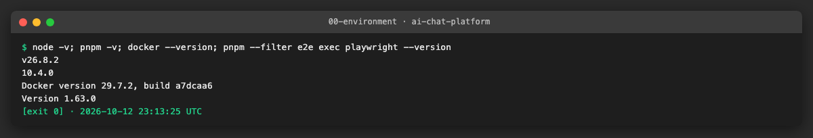

## 3. Steps

### US1 · Playwright helper to block or delay a single remote ([AICHAT-161](https://ipca-grupo11.atlassian.net/browse/AICHAT-161))

**What and why.** Every other story needs to break one remote and only that one. We first looked at what the browser
requests: the shell fetches the `remoteEntry.js` of **all three** remotes on every page (the Module Federation runtime
reads them to agree on the shared libraries: React, the router, `@app/ui`), then the chunks of the page being opened.
A pattern such as `/remoteEntry/` therefore blocks every remote at once. Each remote is served from its own origin
(`localhost:3001`, `:3002`, `:3003` in `compose.yaml`), so the helper matches the **origin**.

A first manual check, with one remote aborted at a time, already showed the expected isolation: only the page that
mounts the broken remote shows its fallback, the other two work.

| Remote aborted | `/chats` | `/settings` | `/login` |
|---|---|---|---|
| `mfeAuth` | works | works | `remote-fallback-auth` |
| `mfeChat` | `remote-fallback-chat` | works | works |
| `mfeSettings` | works | `remote-fallback-settings` | works |

`failRemote(page, remote, mode, files)`:

| Argument | Values |
|---|---|
| `remote` | `mfeAuth`, `mfeChat`, `mfeSettings`. The table `remotes` also gives the scope name used in the test ids (`auth`, `chat`, `settings`) and a page that mounts the remote |
| `mode` | `abort` (network error), `http-500`, `{ delayMs }`, `hang` (no answer until `restore()`) |
| `files` | `all` (default) or `chunks`: `remoteEntry.js` still loads, only the chunks fail (used by US5) |

It returns `restore()`, which removes the route and lets any held request through (used by US4).

The origins come from `VITE_MFE_AUTH_URL`, `VITE_MFE_CHAT_URL` and `VITE_MFE_SETTINGS_URL`, the variables the shell is
built with; the defaults are the `compose.yaml` ports.

**Files.**
- `e2e/src/tests/support/remote-faults.ts` (new): `remotes`, `matchesRemote`, `failRemote`.
- `e2e/src/tests/support/remote-faults.spec.ts` (new): unit tests of `matchesRemote`, no browser.

**How to run.**

```sh
cd e2e && pnpm exec playwright test src/tests/support/remote-faults.spec.ts --reporter=list
```

**How to repeat it manually.**

1. In `matchesRemote`, add `if (/remoteEntry|mfe-chat/i.test(String(url))) return true;` as the first line (the old
   US-9 pattern).
2. Run the command above: all 6 tests fail, each naming a file of another remote (or of the shell) that would have
   been blocked.
3. Remove the line: 6 passed.

**Result.** With the old pattern every case fails; with the origin match all pass.

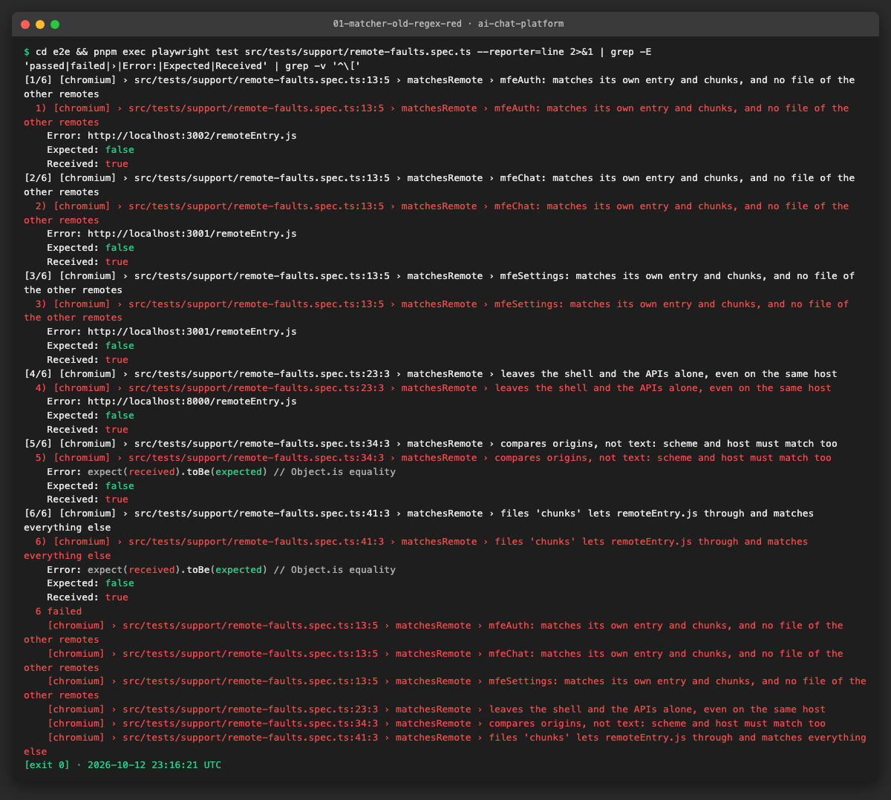

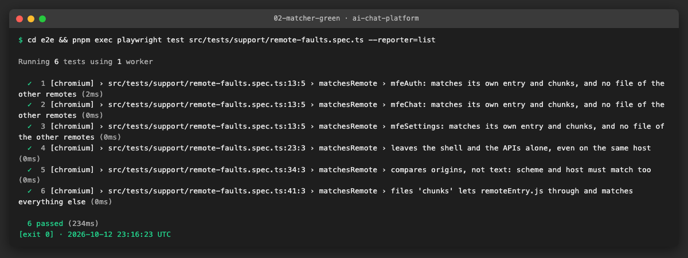

**Problems and fixes.**
- The `e2e` project has no Vitest. As agreed in the DoR, the matcher test is a browserless Playwright test, like
  `drop-proxy.spec.ts`; it runs in the same job as the rest of the suite.
- The shell's own defaults in `module-federation.config.ts` are the dev ports `5001`–`5003`; the stack the suite runs
  against publishes `3001`–`3003`, so the helper defaults to those.

### US2 · Each remote blocked in turn shows its scoped fallback ([AICHAT-162](https://ipca-grupo11.atlassian.net/browse/AICHAT-162))

**What and why.** The promise of the micro-frontend design: when one remote is down, only its part of the page fails.
One parameterised test runs for each remote (`mfeAuth`, `mfeChat`, `mfeSettings`) and each failure (`abort`, `http-500`),
6 cases. Each case signs in, breaks the remote, and then, **with the fault still active**:

1. opens **every page** that mounts the remote (`/login` and `/register` for `mfeAuth`; `/chats` and `/chats/:id`, with
   a chat created through the API, for `mfeChat`; `/settings` for `mfeSettings`): `remote-fallback-<scope>` is visible, has the `alert` role and a Retry button, the remote's
   own content is absent, and the NavBar (`navigation "Main"`) is still there;
2. opens the two other pages, by clicking the NavBar links (client-side navigation, no reload) or, for `/login`, which
   has no link once signed in, with `page.goto`: each one renders its content and no fallback appears anywhere.

`test.step` names each phase, so a failure says which page broke (for example "mfeAuth still works while mfeChat is
down").

**Files.**
- `e2e/src/tests/remote-failure.spec.ts` (new): describe block `AICHAT-162`.
- `e2e/src/tests/support/remote-faults.ts`: `ready`, the test id each remote renders once it has loaded
  (`sign-in`, `new-chat`, `settings-heading`).

**How to run.**

```sh
cd e2e && pnpm exec playwright test src/tests/remote-failure.spec.ts -g AICHAT-162 --reporter=list
```

**How to repeat it manually.**

1. Start the stack (`pnpm mock:up`), open http://localhost:8000 and sign in.
2. DevTools → Network → right-click any request to `localhost:3002` → **Block request domain**.
3. Reload `/chats`: the alert "This section couldn't load" appears under the NavBar.
4. Click **Settings**: the settings page works. Open `/login`: the sign-in form works.
5. Remove the block (Network request blocking panel) and repeat with `localhost:3001` and `localhost:3003`.

**Result.** 6 passed, together with the 6 matcher tests.

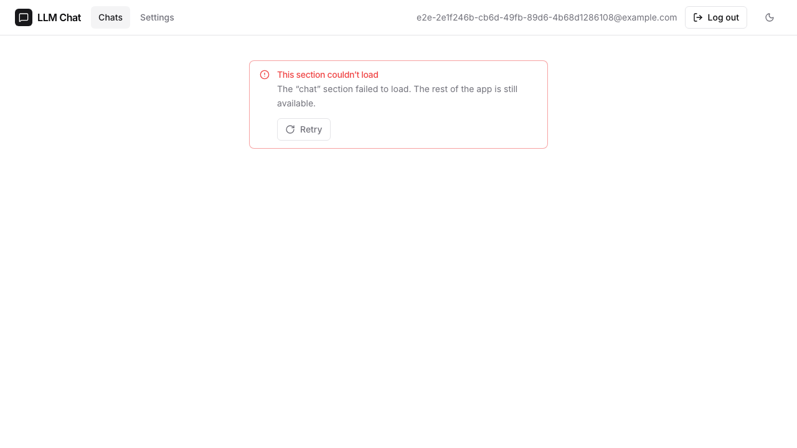

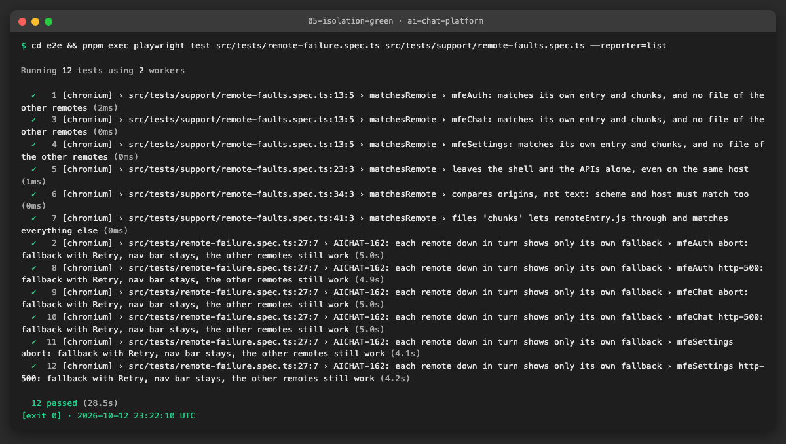

To check that the test can fail, we broke the helper in two ways:

| Change | What the test reports |
|---|---|
| The fault spreads to all three remote origins (the shell itself still loads) | the fallback step passes, then **"mfeAuth still works while mfeChat is down"** fails: `sign-in` not found |
| Back to the old US-9 pattern `/remoteEntry\|mfe-chat/i` | the first step fails on a **blank page**: the pattern also matches `http://localhost:8000/remoteEntry.js`, the shell's own entry (the shell is a federation container too), so the whole app stops |

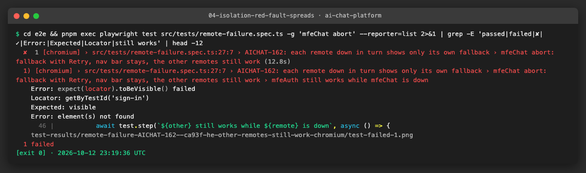

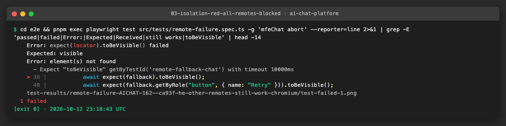

**Problems and fixes.**
- The second row is a finding about the deleted US-9 test: its pattern broke the shell, not only the chat remote, so it
  could not have proved isolation.
- With all three remotes down (and the shell up), the shell still shows its NavBar and the page's fallback: the runtime
  tolerates a failed `remoteEntry.js` and only the route that needs it fails.
- Found later, in US5: the first version read the new chat's id as `id`, but the API answers `{ chat: { id } }`, so the
  `/chats/:id` case opened `/chats/undefined` (which shows the same fallback). A shared `createChat` helper now checks
  the 201 and reads `chat.id`.

### US3 · Slow remote shows the loading skeleton, then the content ([AICHAT-163](https://ipca-grupo11.atlassian.net/browse/AICHAT-163))

**What and why.** On a slow network the user must see a loading state, never a blank or frozen page; a remote that
never answers must end in the fallback with Retry (DoR decision: a 15 s timeout).

Before writing the test we timed what the browser shows with `mfeChat` slowed down (1 s per file) or never answering:

| Case | First 4 s | Then |
|---|---|---|
| `mfeChat` slow, open `/chats` | blank page | skeleton at 4.2 s, chat at 7.2 s |
| `mfeChat` slow, open **`/settings`** | blank page | settings at 4.2 s, although settings does not use the chat remote |
| `mfeChat` never answers, `/settings` or `/chats` | blank page | **blank forever**, no NavBar |

**Defect: one slow remote delays the whole shell, one hung remote blanks it.** The startup code emitted by
`@module-federation/vite` 1.22.1 runs before `main.tsx` renders and does:

```js
await Promise.all(await initRes.initializeSharing('default', { strategy: 'version-first', ... }))
```

With the default share strategy, `version-first`, the runtime downloads the `remoteEntry.js` of **every** remote at
startup to pick the highest version of each shared library, and waits for all of them. A failed entry throws and is
caught (that is why abort and HTTP 500 in US2 were harmless); an entry that never answers is awaited forever. The
timeout in `loadRemote` could not help, because React never got to render.

**Fix.**
1. `apps/shell/module-federation.config.ts`: `shareStrategy: 'loaded-first'`. The shell uses the shared libraries it
   already has and fetches a remote's entry only when one of its routes is opened. Every app is built from this
   monorepo with the same versions, so comparing versions across remotes gained nothing.
2. `apps/shell/src/features/remote-loader/model/loadRemote.ts`: `REMOTE_LOAD_TIMEOUT_MS = 15_000`. `Promise.race`
   between the import and a timer that rejects; the timer is cleared in `finally`, so a remote that loads leaves no timer
   behind. The rejection becomes a `RemoteLoadError` ("no answer after 15000 ms"), so the existing error boundary shows
   the fallback.

**Tests** (each one for the three remotes):

| Test | Checks |
|---|---|
| slow (500 ms per file) | the skeleton `remote-loading-<scope>` and the NavBar are visible together, then the content, no fallback |
| never answers: the other pages | the two other remotes' pages render while this one hangs |
| never answers: its own page | skeleton, then the fallback after the 15 s timeout, skeleton gone |
| unit, `loadRemote.test.ts` | still pending 1 ms before 15 s, rejects at 15 s; a loader that answers in time resolves and leaves no timer (fake timers) |
| unit, `moduleFederationConfig.test.ts` | the host uses `shareStrategy: 'loaded-first'` |

**Files.**
- `apps/shell/module-federation.config.ts`, `apps/shell/src/app/moduleFederationConfig.test.ts`
- `apps/shell/src/features/remote-loader/model/loadRemote.ts`, `loadRemote.test.ts`
- `e2e/src/tests/remote-failure.spec.ts`: describe block `AICHAT-163`.

**How to run.**

```sh
cd apps/shell && pnpm exec vitest run src/app/moduleFederationConfig.test.ts src/features/remote-loader
cd e2e && pnpm exec playwright test src/tests/remote-failure.spec.ts -g AICHAT-163 --reporter=list
```

The E2E tests need a shell image built from this branch (`pnpm mock:up` rebuilds it).

**How to repeat it manually.**

1. With the stack up, sign in at http://localhost:8000.
2. DevTools → Network → throttling **Slow 3G**, open `/settings`: the skeleton appears under the NavBar, then the page.
3. To make a remote hang: `docker pause llm-chat-mfe-chat-1`. Docker's port proxy still accepts the connection, but
   nothing answers (`curl --max-time 4 http://localhost:3002/remoteEntry.js` gives up after 4 s).
4. Reload `/settings`: it opens at once. Open `/chats`: skeleton, then after 15 s "This section couldn't load". On the
   old shell both pages stayed blank.
5. `docker unpause llm-chat-mfe-chat-1` and click **Retry**.

**Result.** Test-first: the 6 "never answers" cases failed on the old shell (blank page), the 3 slow cases passed (the
page appeared, only late). The 4 new unit tests failed before the change. After the change and a rebuild of the shell
image all pass.

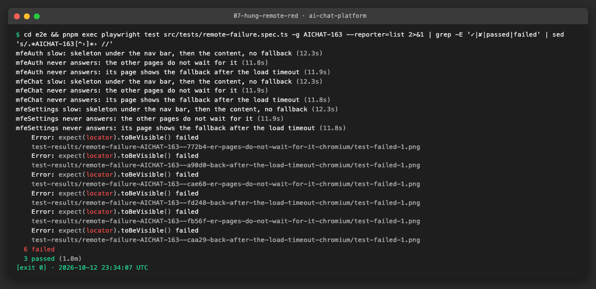


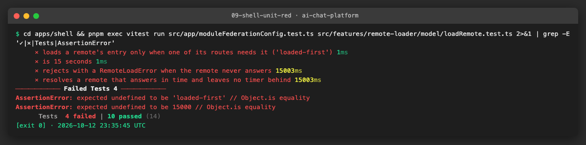

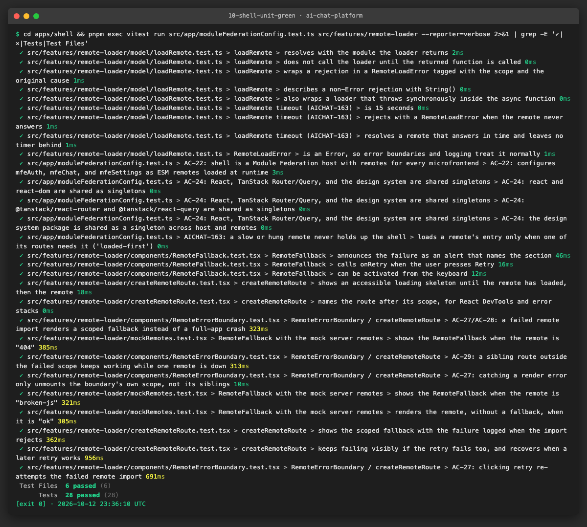

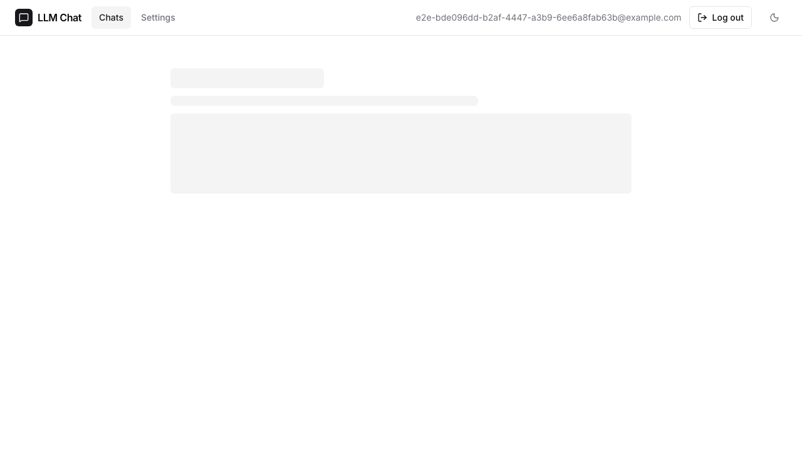

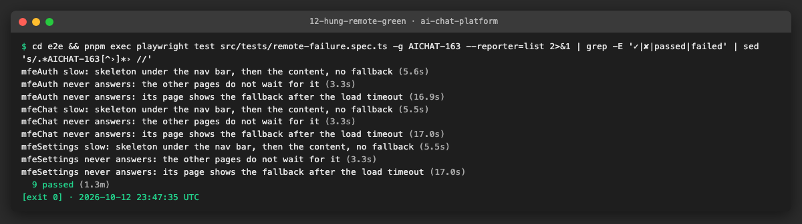

**Problems and fixes.**
- The first slow test used 1.5 s per file. A remote loads a chain of about six files, so loading took ~10 s, close to the
  15 s timeout: on a slower CI runner the test could have turned into a timeout. 500 ms per file still shows the
  skeleton for several seconds and loads in ~3 s.
- To check that `loaded-first` breaks nothing else, we ran the login, registration, chat management and API key specs
  against the new shell: 50 passed, 1 skipped. The 2 failures (and 24 in a first run) were the auth-service rate limit
  (300 requests per 15 minutes, `429` in its log); both passed after `docker restart llm-chat-auth-service-1`. CI turns
  the limit off with `AUTH_RATE_LIMIT_MAX=0`.

### US4 · Retry recovers a remote once it is back online ([AICHAT-164](https://ipca-grupo11.atlassian.net/browse/AICHAT-164))

**What and why.** After a temporary outage, the Retry button of the fallback must load the remote again **without a
page reload**. The unit test of `createRemoteRoute` already checked that Retry calls the loader again, but it mocks the
loader; only a test against the real federation runtime can tell whether the remote is really fetched again.

The E2E test, for each remote: break it (`abort`), open its page, set a marker in `window` (a reload would clear it),
then:

1. **Retry while still down**: a new request must reach the remote's origin, the fallback comes back, the NavBar stays;
2. **Retry once it is back** (`restore()`): the remote renders, the fallback is gone, the URL is the same and the marker
   is still there.

A fourth case covers **Retry after the 15 s timeout** of US3.

**Defect: Retry never recovered a remote that had failed.** The first run failed for all three remotes: Retry sent **no
request at all** and failed again with the same `RUNTIME-008` error, so only a full page reload helped. (Retry after the
timeout worked, because that request was only held, not failed.) We found three caches, each enough to stop a retry:

| Cache | Where | Effect |
|---|---|---|
| The module emitted for `import('mfeChat/routes')` | code emitted by `@module-federation/vite` (1.22.1, still the same in 1.23.5): `__mfRemotePending ??= …` | the first load promise is kept, rejection included, for the life of the page |
| `globalLoading` | `@module-federation/runtime-core` 2.9.0, `utils/load.js` | one loading promise per remote name + entry URL, not removed when it rejects |
| The browser's module map | HTML specification | a module URL whose fetch failed is never fetched again in the same page: `import(url)` fails at once |

We checked each layer in the browser: importing the same `remoteEntry.js` URL again failed with no network request,
while `remoteEntry.js?retry=1` loaded, and the runtime then returned the module.

**Fix.** The first load keeps the static `import('mfeChat/routes')`. Every Retry goes through
`reloadRemote(id, attempt)` (`apps/shell/src/features/remote-loader/model/reloadRemote.ts`):

1. find the remote in the runtime instance (`getInstance()` of `@module-federation/runtime`);
2. register it again with the entry URL `remoteEntry.js?retry=<attempt>` (`registerRemotes(…, { force: true })`): a key
   the runtime and the browser have not seen;
3. `loadRemote(id)`, which does not go through the emitted module.

`createRemoteRoute(scope, loader, retryLoader)` uses `retryLoader(attempt)` for every load after the first; the five
route files pass `(attempt) => reloadRemote('<remote>/routes', attempt)`. The shell now depends directly on
`@module-federation/runtime`, pinned to **2.9.0**, the same copy `@module-federation/vite` uses, so both share one runtime
instance. Only three lines change in `pnpm-lock.yaml`.

**Files.**
- `apps/shell/src/features/remote-loader/model/reloadRemote.ts` and `reloadRemote.test.ts` (new)
- `apps/shell/src/features/remote-loader/createRemoteRoute.tsx`, `createRemoteRoute.test.tsx`, `index.ts`
- `apps/shell/src/routes/{login,register,chats,chats.$chatId,settings}.tsx`
- `apps/shell/package.json`, `pnpm-lock.yaml`
- `e2e/src/tests/remote-failure.spec.ts`: describe block `AICHAT-164`.

**How to run.**

```sh
cd apps/shell && pnpm exec vitest run src/features/remote-loader
cd e2e && pnpm exec playwright test src/tests/remote-failure.spec.ts -g AICHAT-164 --reporter=list
```

**How to repeat it manually.**

1. Sign in at http://localhost:8000, DevTools → Network → right-click a request to `localhost:3002` → **Block request
   domain**, reload `/chats`: the fallback appears.
2. Click **Retry**: the Network panel shows a new blocked request (`remoteEntry.js?retry=1`) and the fallback comes back.
3. Remove the block and click **Retry** again: the chat list appears, the page was not reloaded (the Network panel was
   not cleared).
4. On the old shell, step 2 showed no request at all and step 3 kept the fallback until a reload.

**Result.** Test-first: 3 of 4 cases failed before the change (no request after Retry); all pass after it, together with
the rest of the epic's suite (25 tests).

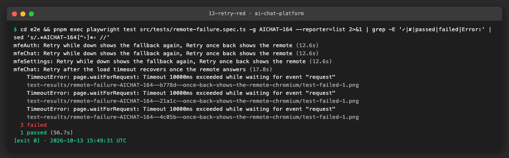

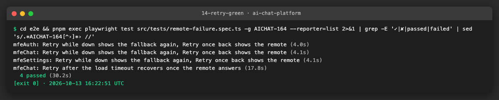

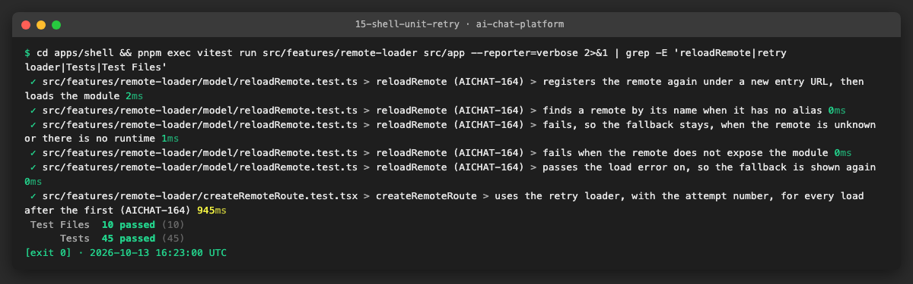

**Problems and fixes.**
- Our first attempt was a runtime plugin that removed the failed key from `globalLoading`. It changed nothing: the
  emitted module and the browser's module map still kept the failure. A new entry URL per attempt avoids all three
  caches at once, so the plugin was dropped.
- The local `pnpm install` rewrote the lockfile (it removed the `libc` fields that Linux CI uses to pick native
  packages). We kept only the three lines that add the dependency and checked them with `pnpm install --frozen-lockfile`
  and the Docker build.
- Newer `@module-federation/vite` releases (up to 1.23.5) generate the same `??=` cache, so upgrading would not have
  fixed it. Worth reporting upstream.

### US5 · Remote chunk failure after remoteEntry has loaded ([AICHAT-165](https://ipca-grupo11.atlassian.net/browse/AICHAT-165))

**What and why.** Two partial failures that the other stories do not cover:

1. **Chunks fail, entry loads**: as after a redeploy, when the `remoteEntry.js` the browser gets points to chunk names
   that no longer exist. `failRemote(page, remote, "abort", "chunks")` lets `remoteEntry.js` through and aborts every
   other file of the remote.
2. **Mid-session outage**: the remote was already loaded, then its server goes down while the user keeps navigating.

**Behaviour recorded** (checked first in the browser, then asserted):

| Case | Result |
|---|---|
| Chunks fail, entry 200 | scoped fallback, NavBar kept, console `[remote-loader] remote "<scope>" failed: RemoteLoadError …`, **no uncaught error** (`pageerror`) |
| `mfeChat` down after `/chats` loaded | opening a chat, another chat, Settings and back to Chats all keep working, with **no request** to `localhost:3002`: the remote's code is already in memory |
| Same, after a reload | the remote is needed again: fallback; once it is back, Retry shows the chats (US4 fix) |

**Tests** (`AICHAT-165` block):

| Test | Checks |
|---|---|
| chunks fail, for each remote | `remoteEntry.js` answered 200; fallback and NavBar visible; a console error contains `[remote-loader] remote "<scope>" failed:`; no `pageerror` |
| mid-session, `mfeChat` | two chats created through the API; after the fault: both chats open (URL and `message-input`), Settings and Chats render, no fallback, **0 requests** to the remote; then reload → fallback → `restore()` → Retry → chat list |

**Files.**
- `e2e/src/tests/remote-failure.spec.ts`: describe block `AICHAT-165`, `createChat` helper.

**How to run.**

```sh
cd e2e && pnpm exec playwright test src/tests/remote-failure.spec.ts -g AICHAT-165 --reporter=list
```

**How to repeat it manually.**

1. Sign in at http://localhost:8000, open `/chats` and wait until the list shows.
2. `docker stop llm-chat-mfe-chat-1`.
3. Open a chat, go to Settings and back to Chats: everything still works (Network panel: no request to `localhost:3002`).
4. Reload: "This section couldn't load". `docker start llm-chat-mfe-chat-1`, wait a few seconds, click **Retry**.
5. Chunk failure: DevTools → Network → **Block request URL** `localhost:3002/assets/*`, reload `/chats`: the fallback
   appears and the Console shows `[remote-loader] remote "chat" failed`.

**Result.** 4 passed. No defect in this story: the error boundary already catches a chunk failure, and a loaded remote
does not need its server again until the page reloads.

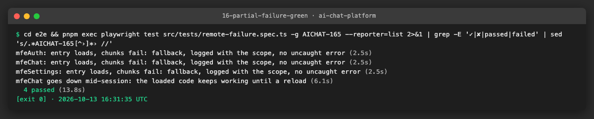

**Problems and fixes.**
- The mid-session test first failed with `chat-item-undefined`: the API answers `{ chat: { id } }`. The same mistake had
  made the `/chats/:id` case of US2 open `/chats/undefined` without failing; both now use `createChat`, which checks the
  status and reads `chat.id`.
- The local auth-service limit (300 requests per 15 minutes) kept failing sign-ins after many runs. For the remaining
  runs we started it like CI does: `AUTH_RATE_LIMIT_MAX=0`.

### US6 · Remote failure suite as a merge gate in the e2e workflow ([AICHAT-166](https://ipca-grupo11.atlassian.net/browse/AICHAT-166))

**What and why.** The tests only protect the fallback if they run on every change.

- **Where the tests live:** all browser tests are in `e2e/src/tests/remote-failure.spec.ts` (describe blocks
  `AICHAT-162` to `AICHAT-165`); the helper and its test are in `e2e/src/tests/support/`. The old US-9 block had already
  been deleted (commit `5eb6221`), so there was nothing to replace.
- **CI:** `e2e.yml` runs `nx run e2e:e2e` (`playwright test --project=chromium`, every file under `src/tests`) on each
  pull request and push to `main`, against a stack built from the branch. The new files are picked up with no workflow
  change; a failing test fails the job. The shell unit tests run in `ci.yml` (`nx affected`).
- **Blocking the merge:** making the check required needs branch protection, which this private repository cannot use
  (GitHub answers HTTP 403). As for AICHAT-12 and AICHAT-13, "the `e2e` check must be green before merging" is a team rule.
- **Run instructions:** new `e2e/README.md` (how to run the suite, the `failRemote` helper, the rate limit) and a section
  in `TESTING.md`.

**Files.**
- `e2e/README.md` (new), `TESTING.md`.

**How to run.**

```sh
AUTH_RATE_LIMIT_MAX=0 pnpm mock:up
CI=true BASE_URL=http://localhost:8000 ANTHROPIC_API_KEY=mock-key-not-a-secret pnpm exec nx run e2e:e2e
```

**How to repeat it manually.** Open a pull request: the `e2e` check runs `remote-failure.spec.ts` with the rest of the
suite. To see it fail, undo one of the shell fixes (for example remove `shareStrategy: 'loaded-first'`): the AICHAT-163
cases fail and so does the job.

**Result.** The whole suite, run as in CI (`CI=true`, 2 workers, 1 retry): **104 passed, 1 skipped, 9 failed**. The 9
failures are all in `attach-file.spec.ts` (an attachment never reaches "uploaded"). To check that they do not come from
this epic, we built the shell from the base branch `test/AICHAT-13-concurrency` and ran that spec again: **the same 9
fail**. They are outside this epic and left for the owner of that spec.

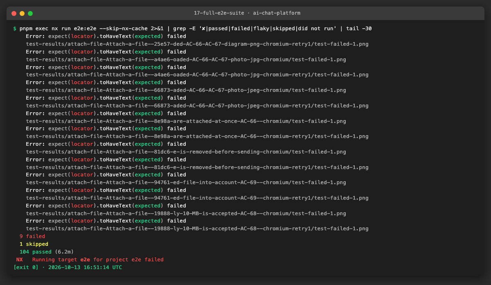

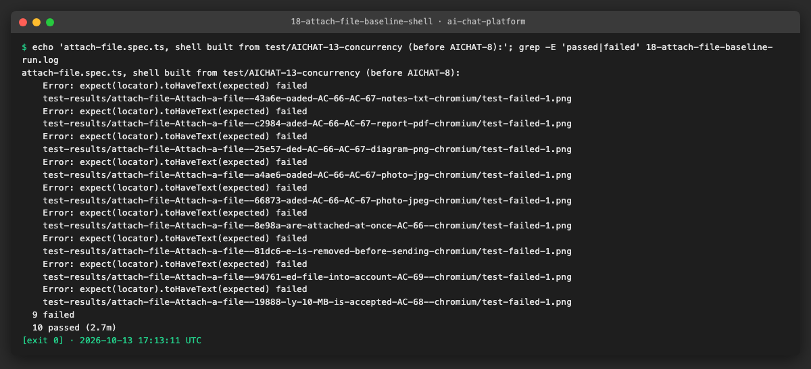

**Problems and fixes.**
- The suite needs `AUTH_RATE_LIMIT_MAX=0` locally, as in CI; otherwise sign-ins fail with `429` after a few runs.
- A helper spec used only to take screenshots was left in `src/tests` and ran with the full suite, overwriting one image;
  it was removed and the image restored.

## 4. How to run everything

```sh
# shell: load timeout, share strategy, Retry through the runtime (no Docker)
cd apps/shell && pnpm exec vitest run src/app/moduleFederationConfig.test.ts src/features/remote-loader
# failRemote URL matcher (no Docker)
cd e2e && pnpm exec playwright test src/tests/support/remote-faults.spec.ts
# browser, against the stack built from this branch (Docker)
AUTH_RATE_LIMIT_MAX=0 pnpm mock:up
cd e2e && pnpm exec playwright test src/tests/remote-failure.spec.ts --reporter=list
```

## 5. Results

| Metric | Before | After |
|---|---|---|
| Remotes tested when down | 1 (chat, and the pattern also broke the shell) | 3, abort and HTTP 500, every page of each |
| Slow / hung remote | not tested; a hung remote blanked the whole app | skeleton, then content; hung remote: fallback after 15 s, other pages unaffected |
| Retry after a failed load | never recovered (no request; only a reload helped) | recovers without a reload |
| Partial failure (chunks) and mid-session outage | not tested | tested and recorded |
| AICHAT-8 tests | 0 E2E, 0 helper | 23 E2E (parameterised) + 6 helper tests; 10 new shell unit tests |
| Defects found / fixed | — | 2 / 2 (plus a test pattern that broke the shell, and a test reading the wrong field) |

Gates on the branch: `nx affected -t lint typecheck test build` passes for every project this epic touches. The
failures left are the ones recorded in AICHAT-13: the workspace guards `source-files.test.ts` (the same ten files
without a unit test, none from this epic) and `coverage-guard.test.ts` (`e2e` project not found), and `pnpm sast`'s one
ERROR, the fixed test password in `e2e/src/tests/support/auth.ts`; SAST reports nothing in the files this epic changed.
The secret scan runs in CI (`security.yml`).

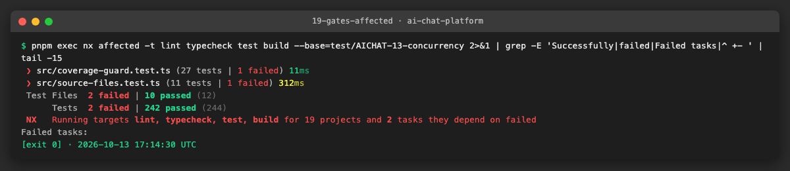

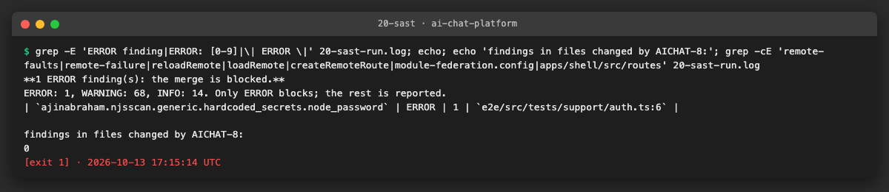

## 6. DoD check

| DoD item | Met | Evidence |
|---|---|---|
| Tests run in CI and pass on `main` | ✅ run in `e2e.yml` and `ci.yml`; green on the branch, `main` after merge | [full suite](evidence/17-full-e2e-suite.png), [suite](evidence/12-hung-remote-green.png) |
| Failure blocks the merge | ✅ a failing test fails the `e2e` job; "required check" is a team rule (branch protection unavailable, HTTP 403), as for AICHAT-12 and AICHAT-13 | [red runs](evidence/07-hung-remote-red.png), [Retry red](evidence/13-retry-red.png) |
| Run instructions added | ✅ `e2e/README.md`, `TESTING.md`, §4 above | — |
| Playwright blocks and delays each of the 3 remotes in turn | ✅ abort, HTTP 500, delay and hang for `mfeAuth`, `mfeChat`, `mfeSettings` | [isolation](evidence/05-isolation-green.png), [slow and hung](evidence/12-hung-remote-green.png) |
| Fallback shown and the other routes still work | ✅ checked with the fault still active, by NavBar navigation | [fallback](evidence/06-chat-fallback.png), [fault spreads → red](evidence/04-isolation-red-fault-spreads.png) |

## 7. Notes for the report

- **What was found.** (1) One hung remote left the whole app blank and one slow remote delayed every page: the default
  Module Federation share strategy, `version-first`, waits for every remote's entry before the first render. (2) Retry
  never recovered a remote that had failed: three caches kept the failure (the module `@module-federation/vite` emits for
  each remote import, the runtime's `globalLoading`, and the browser's module map). (3) The deleted US-9 test blocked
  the shell's own `remoteEntry.js`, so it could not have proved isolation.
- **What was fixed.** `shareStrategy: 'loaded-first'`; a 15 s load timeout; Retry registers the remote again with a new
  entry URL and loads it through `@module-federation/runtime` (pinned to the plugin's 2.9.0). All test-first, red →
  green.
- **What we learned.**
  - Abort and HTTP 500 alone would have hidden the worst defect: a remote that **hangs** behaves very differently from
    one that **fails**.
  - A unit test with a mocked loader passed while the real Retry never worked. Only the E2E test against the real
    runtime showed it.
  - Measuring first (a short probe of what the browser requests and shows) shaped every test: it found the eager
    `remoteEntry.js` loads before any assertion was written.
  - Test data must be checked too: one test read the wrong field and silently opened `/chats/undefined`.
- **Open items.** The 9 `attach-file.spec.ts` failures exist without this epic's changes. The `??=` cache in
  `@module-federation/vite` (up to 1.23.5) is worth reporting upstream.
