# AICHAT-9 · SSE reconnection testing: work log

| Field | Value |
|---|---|
| Epic | [AICHAT-9](https://ipca-grupo11.atlassian.net/browse/AICHAT-9) |
| Analysis | [README.md](README.md) |
| Owner | João Vieira |
| Branch | `test/AICHAT-9-sse-reconnection` (built on `test/AICHAT-12-api-schema-validation`, PR #33 not merged yet) |
| Started / finished | 2026-10-10 / … |
| Pull requests | not opened yet (commits are local; pushed by the owner) |
| Status | In Progress |

## 1. DoR review

Date: 2026-10-10

| DoR item | Status | Question asked | Decision | Decided by |
|---|---|---|---|---|
| Owner assigned | Met | — | João Vieira | — |
| Scope and tooling agreed | Met | Vitest + shared fake `EventSource`, supertest, Playwright `context.setOffline` against the mock LLM? | Agreed as written; US4 becomes a merge gate in `e2e.yml` | João Vieira |
| Target environment available | Met | How do we get a run on the Azure VM for US5? | Local and CI for US2–US4 (the mock LLM of AICHAT-144 is available). US5: we provide a script, the owner runs it on the VM and the output is attached | João Vieira |
| Expected behaviour decided | Met | What happens when the stream drops mid-reply? | Option **(b)**: refetch the message list on reconnect (see US1) | João Vieira |

Decisions:

| Topic | Decision |
|---|---|
| Stream drop (AICHAT-167) | Refetch on reconnect, client only. No `id:` / Last-Event-ID replay, so the stream contract (AICHAT-12 schema, AICHAT-11 pacts) does not change |
| Indicator while the connection is down | The chat shows a "Reconnecting…" status (`role="status"`) from the transport error until the stream is open again |
| Browser gives up (`EventSource` `CLOSED`) | The client closes it and opens a new stream after a short delay; the new `open` triggers the same refetch |
| Heartbeat | Yes: the server writes the SSE comment `: ping` every 15 s on each open stream, so idle streams are not cut by Caddy or the Azure idle timeout (~4 min) |

Blockers: none.

## 2. Environment

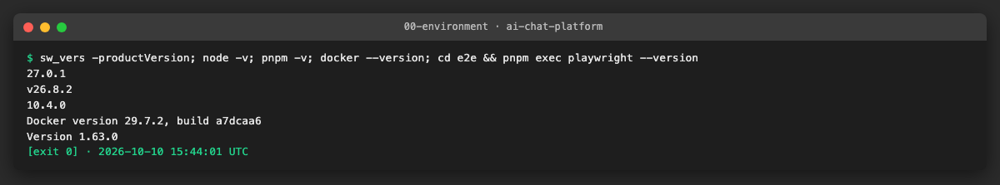

| Tool | Version | Install |
|---|---|---|
| macOS | 27.0.1 | — |
| Node | v26.8.2 locally (CI uses Node 24 from `.nvmrc`) | nvm |
| pnpm | 10.4.0 (pinned in `package.json`) | `pnpm install --frozen-lockfile` |
| Docker | 29.7.2 | Docker Desktop |
| Playwright | 1.63.0 | workspace dev dependency |

## 3. Steps

### US1 · Agree the expected behaviour when the SSE stream drops ([AICHAT-167](https://ipca-grupo11.atlassian.net/browse/AICHAT-167))

**What and why.** Before testing "the UI never hangs" we had to agree what "not hanging" means. We read the stream code on
both sides and listed what happens today when the connection drops in the middle of a reply.

**Gaps found.**

| # | Where | Gap | Effect |
|---|---|---|---|
| 1 | `services/conversation-service/src/features/streaming/sse.ts` (`writeSseEvent`) | Events carry only `event:` and `data:`: no `id:`, no `retry:` | The browser cannot ask for missed events (`Last-Event-ID`); it retries after its default delay (~3 s) |
| 2 | same file (`ChatEventBus`) | Plain `EventEmitter`, no buffer or replay | Events published while no client is connected are lost |
| 3 | `streaming/routes.ts` | No heartbeat | An idle stream (a slow model, a long queue) can be cut by a proxy or a load balancer idle timeout |
| 4 | `apps/mfe-chat/src/features/chat-view/model/stream-registry.ts` | Does not pass `onConnectionError` to `subscribeToChatStream` | Drops are ignored. If `done` is published during the gap, the reply stays `streaming` in the React Query cache until something else refetches it: **the UI hangs** |

**Options and decision.**

| Option | Change | Verdict |
|---|---|---|
| (a) Last-Event-ID replay | Server: an `id:` per event and a buffer per chat; the browser sends `Last-Event-ID` on reconnect | Rejected: changes the stream contract and adds state to the server, for a gap the database already covers |
| **(b) Refetch on reconnect** | Client: on the transport error show "Reconnecting…"; on the next `open` refetch `GET /chats/:id/messages` | **Chosen.** The database is the source of truth: the processor saves the reply text when it ends (done, stop or error), so a refetch after the gap shows the final text and status |
| (c) Clear error only | Client: mark the reply failed and ask the user to reload | Rejected: the reply is not failed, it is still being generated |

The heartbeat (`: ping` every 15 s) is added on the server. A line that starts with `:` is a comment in the SSE format: the
browser ignores it, but bytes keep flowing, so proxies see the connection as active.

**Known limitation of (b).** `processor.ts` creates the reply row empty (`status: "streaming"`) when it starts and writes
the text only at the end. A reconnect **while the reply is still being generated** therefore reads `content: ""` from the
server. The client keeps the text it already shows for a reply the server still reports as `streaming` (otherwise the text
would disappear), so the tokens published during the gap are missing on screen until `done`; `onDone` refetches and the
saved, complete text replaces it. Closing that gap would need option (a).

**App changes agreed with the owners.** mfe-chat: `subscribeToChatStream` gets an `onOpen` handler; `stream-registry.ts`
wires `onConnectionError`, `onOpen` and the "Reconnecting…" state. conversation-service: heartbeat in the stream route. The
owner of both apps for this epic is João Vieira.

**Result.** Decision recorded here and in the Jira epic comment (2026-10-10). US2–US5 test against it.

### US2 · mfe-chat: unit tests for connection drop and reconnect handling ([AICHAT-168](https://ipca-grupo11.atlassian.net/browse/AICHAT-168))

**What and why.** The routing of errors in `shared/sse.ts` (a transport error goes to `onConnectionError`, a server
`event: error` with data goes to `onError`) was already tested by AICHAT-17 (`sse.test.ts`), so this story adds the
**recovery** agreed in US1. Before, `stream-registry.ts` ignored a drop: if `done` was published during the gap the reply
stayed `streaming`, with the Stop button, until the page was reloaded.

We wrote the tests first and watched them fail (10 failures: missing functions and no refetch), then wrote the code:

| Piece | Change |
|---|---|
| `FakeEventSource` (shared, AICHAT-17) | Follows the browser's `readyState` (`CONNECTING` → `OPEN` → `CONNECTING` after a drop, `CLOSED` after `close()`), has the real constants (0/1/2), `emitOpen()` and `emitTransportError({ final: true })` for "the browser gave up" |
| `shared/sse.ts` | New `onOpen` handler; `onConnectionError` also receives `{ willReconnect }` (`false` when the source is `CLOSED`) |
| `model/stream-registry.ts` | A drop marks the chat as reconnecting. The `open` that follows a drop refetches `GET /chats/:id/messages` and merges it: the server list wins, except for a reply the server still reports as `streaming` (its text is saved only at the end), which keeps the text already shown. If the browser gave up, a new stream is opened after `RECONNECT_DELAY_MS` (3 s); closing the chat cancels it |
| `hooks/useMessageStream.ts`, `components/ChatView.tsx` | `useChatReconnecting(chatId)` (`useSyncExternalStore` over the registry) and a "Reconnecting…" status (`role="status"`) above the messages |

**Files.**
- `packages/test-utils/src/fake-event-source.ts` and `.test.ts`: `readyState`, `emitOpen`, final error (4 new tests).
- `apps/mfe-chat/src/shared/sse.ts` and `sse.test.ts`: `onOpen`, `willReconnect` (2 new tests).
- `apps/mfe-chat/src/features/chat-view/model/stream-registry.ts` and `.test.ts`: recovery (9 new tests).
- `apps/mfe-chat/src/features/chat-view/hooks/useMessageStream.ts`, `components/ChatView.tsx` and `ChatView.test.tsx`
  (1 new test, with an axe scan while reconnecting).

| Test | What it proves |
|---|---|
| reconnecting from the drop until the stream is open again | the indicator is driven by the transport events |
| no refetch on the first open, only after a drop | a normal page load does not fetch twice |
| a reply that finished during the drop is no longer streaming | **the hang this epic is about**: the lost `done` is recovered from the server |
| a reply still being generated keeps the text already shown | the merge rule of US1 (known limitation) |
| messages that arrived during the drop appear | a member's message or the next queued reply is not lost |
| a failed refetch keeps what is shown and does not throw | the next `done` refetches again |
| the browser gives up → new stream after 3 s, and its open recovers | the `CLOSED` case (fake timers) |
| closing the chat cancels a pending reconnect | no stream comes back for a closed chat |
| a drop in one chat does not mark the others | streams are independent (AC-60/61) |
| ChatView: Reconnecting… then the saved reply, no Stop button | the user-visible result, with no axe violations |

**How to run.**

```sh
cd apps/mfe-chat && pnpm exec vitest run src/shared/sse.test.ts src/features/chat-view -t AICHAT-168 --reporter=verbose
```

**How to repeat it manually.**

1. Run the command above: 12 tests pass.
2. Delete the line `void resyncMessages(chatId, queryClient);` in `stream-registry.ts` and run it again: 5 tests fail
   (the reply stays `streaming`). Restore the line.
3. In `mergeAfterReconnect`, make the server always win (`if (true || !local …`): only "keeps the text already shown"
   fails. Restore it.
4. Replace `if (activeStreams.get(chatId) === entry) entry.stream = connect(…)` with `if (false) …`: only "the browser
   gives up" fails. Restore it and check `git diff`.

**Result.** Before (red) and after (green), and the first mutation:

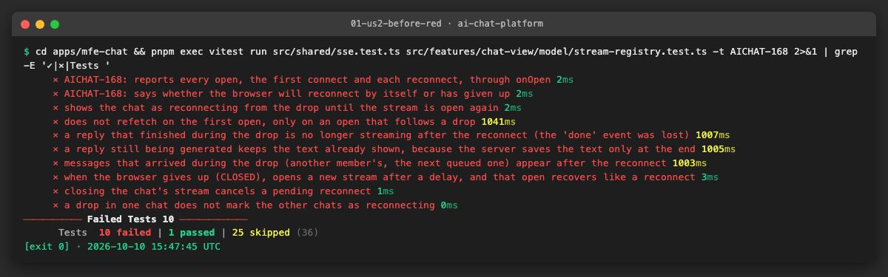

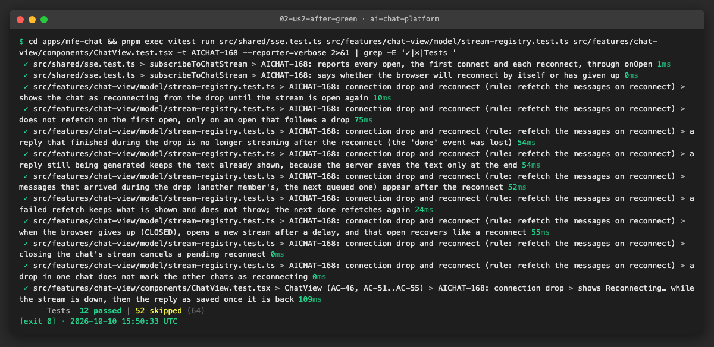

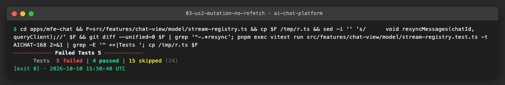

The whole mfe-chat suite (398 tests) and `nx run-many -t lint typecheck test` for mfe-chat, test-utils, mfe-auth,
mfe-settings and shell pass.

**Problems and fixes.**
- Two of the new `FakeEventSource` tests passed before the code existed: `readyState` and `EventSource.CLOSED` were both
  `undefined`, and `expect(undefined).toBe(undefined)` passes. A test now pins the constants to 0/1/2.
- Our first fake server for `GET /chats/:id/messages` returned a bare array. The real service returns `{ messages: [...] }`;
  the client's `unwrapEnvelope` accepts both, so the test passed either way. The fake now returns the real envelope.
- `api/messages.ts` imports the registry, so the registry calls `apiClient.get` itself instead of importing
  `fetchMessages` back (no import cycle).

### US3 · conversation-service: stream disconnect and resubscribe tests ([AICHAT-169](https://ipca-grupo11.atlassian.net/browse/AICHAT-169))

**What and why.** The client recovery of US2 relies on three things the server must do when a connection drops: free the
connection, **keep generating** the reply and save it, and serve later events to a new connection. We also added the
heartbeat agreed in US1. The existing `routes.spec.ts` already checked that the `active_streams` counter goes down on
disconnect; the rest was untested.

| Change | Where |
|---|---|
| `ChatEventBus.subscriberCount(chatId)`: how many connections listen to a chat (so "unsubscribed" can be observed) | `features/streaming/sse.ts` |
| `writeSseComment(res, text)`: writes `: text\n\n`, a line `EventSource` ignores | same file |
| Heartbeat: `setInterval(… ": ping" …, HEARTBEAT_INTERVAL_MS)` (15 s) per open stream, `clearInterval` on `close` | `features/streaming/routes.ts` |

**Files.**
- `src/features/streaming/sse.spec.ts`: subscriber count, comment frame (2 new tests).
- `src/features/streaming/routes.spec.ts`: close unsubscribes; heartbeat every 15 s and not before; heartbeat stops on
  disconnect; events and heartbeats in one stream keep valid frames (4 new tests, fake `setInterval` only, real socket).
- `src/integration/stream-reconnect.spec.ts` (new): real app, queue and processor on a real port, LLM scripted with
  "gates" so the test decides when each token is produced (3 tests).

| Test | What it proves |
|---|---|
| a dropped connection is unsubscribed and no longer counted | read from the bus and from `GET /metrics` (`active_streams 0`), like Prometheus |
| the reply keeps being generated with no client and is saved complete | the client is cut after "one "; "two " and "three" are produced with nobody connected; `GET /messages` returns `one two three`, `sent`. This is what US2's refetch reads |
| a new connection receives later events, none from before | the second connection gets `three` and `done` only: no replay, as agreed |

The two integration tests about generation and "no replay" describe behaviour that already existed (they failed before
only because `subscriberCount` did not exist yet): they are characterization tests that lock it in. The heartbeat is new
behaviour and went from red to green.

**How to run.**

```sh
cd services/conversation-service && pnpm exec vitest run src/features/streaming src/integration/stream-reconnect.spec.ts --reporter=verbose
```

**How to repeat it manually.**

1. Run the command above: 20 tests pass (9 of them new).
2. In `routes.ts` delete `clearInterval(heartbeat);`: only "stops the heartbeat when the client disconnects" fails
   (`vi.getTimerCount()` is 1, a timer leak that would write into a closed socket forever).
3. Delete `unsubscribe();` in the `close` handler: 4 tests fail, including the `active_streams` one.
4. Remove the `setInterval` line: the 3 heartbeat tests fail. Restore everything and check `git diff`.
5. By hand, with the stack running (`pnpm mock:up`), sign in, copy the `access_token` cookie and run
   `curl -N -H "Cookie: access_token=…" http://localhost:8000/api/chats/<chatId>/stream`: a `: ping` line appears every 15 s.

**Result.**

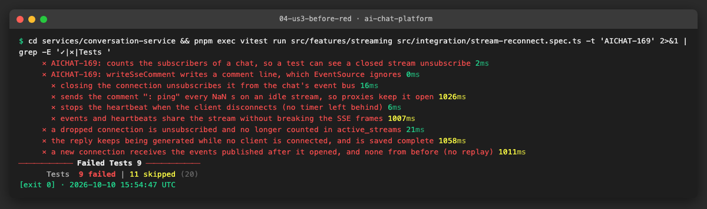

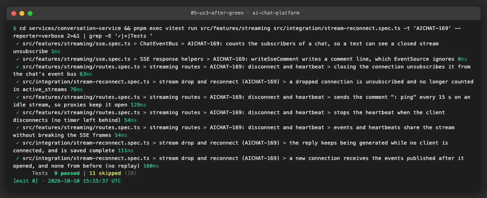

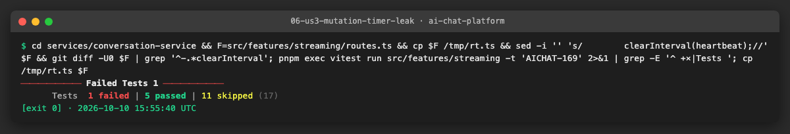

`nx run-many -t lint typecheck test -p conversation-service`: 652 tests pass, coverage thresholds met.

**Problems and fixes.**
- The "no replay" test failed once: it dropped the first connection right after the `token` event was published on the
  in-process bus, before the bytes had reached the client over the socket. The test now waits until the client has
  received "one " before cutting it, and passed three runs in a row.
- Fake timers are limited to `setInterval`/`clearInterval`, so the HTTP server and socket (which use `setTimeout` and
  `setImmediate` internally) keep working with real time.

### US4 · E2E: network drop mid-stream never hangs the UI ([AICHAT-170](https://ipca-grupo11.atlassian.net/browse/AICHAT-170))

**What and why.** The unit and integration tests of US2 and US3 check each side alone. This story drops the network in a
real browser, against the whole stack (`pnpm mock:up`: real services and database, the LLM mock of AICHAT-144 with its
`long` scenario so the reply is still streaming when the test acts), and checks what the user sees.

**How a drop is simulated.** We first used only `context.setOffline(true)`, as the story says. The first run showed it is
not enough: in the "drop over done" test the reply **finished on screen while the browser was offline**. Chromium's offline
emulation only fails **new** requests; a response that is already open (the SSE stream) keeps flowing. A real network loss
does both things, so the tests do both:

| Piece | Role |
|---|---|
| `context.setOffline(true)` | the browser's reconnects fail (`ERR_INTERNET_DISCONNECTED`) |
| `e2e/src/tests/support/drop-proxy.ts` (new) | a TCP proxy in the test process, between the browser and the app. `cutConnections()` destroys every open socket (the stream drops); `setDown(true)` is a server-side outage: open sockets are cut and new ones are refused while the browser stays online |

The whole spec runs through the proxy (`test.use({ baseURL })`), because cookies and the key in `sessionStorage` belong to
the origin. Each Playwright worker gets its own port (`8100 + TEST_PARALLEL_INDEX`).

**Tests** (`e2e/src/tests/sse-reconnection.spec.ts`).

| Test | Checks |
|---|---|
| a drop in the middle of a reply | "Reconnecting…" is shown; after the network is back the reply ends, and the text on screen equals the text after a reload (what was saved) |
| a drop that spans the end of the reply | offline until the LLM mock's log says the provider finished (`finishedAt`), so `done` is published while the browser is away; meanwhile the reply is still "Generating…"; after the drop it is not, and it equals the saved text |
| a server-side outage that spans the end (browser stays online) | the same, with the outage on the server side. The browser fires no `online` event, so React Query's own `refetchOnReconnect` does not run: only the stream's reconnect and refetch (US2) can end the reply |
| a long drop | "Reconnecting…" stays visible for 6 s (longer than the browser's retry and the client's 3 s reopen), and goes away once the network is back |

The third test was added after we noticed that, in the first two, the browser's `online` event also makes React Query
refetch the messages by itself (the shell's `QueryClient` keeps `refetchOnReconnect` on). Those two prove the user-visible
result; the third one proves the fix.

**Files.**
- `e2e/src/tests/sse-reconnection.spec.ts` (new): the 4 tests above.
- `e2e/src/tests/support/drop-proxy.ts` and `drop-proxy.spec.ts` (new): the proxy and its own test (passes traffic, cuts an
  open stream, refuses connections while down). Playwright runs both, so they are part of the `e2e.yml` gate.
- `services/conversation-service/src/features/streaming/routes.ts`: the stream starts with a `: connected` comment (see
  Problems); `routes.spec.ts` and `integration/routes.spec.ts` adapted, plus one new test.
- `e2e/src/tests/stream-cancellation.spec.ts`: helper fix (see Problems).

**How to run.**

```sh
pnpm mock:up
cd e2e && BASE_URL=http://localhost:8000 pnpm exec playwright test --project=chromium src/tests/sse-reconnection.spec.ts src/tests/support/drop-proxy.spec.ts
```

`e2e.yml` runs the whole Playwright suite against the same stack (`pnpm exec nx run e2e:e2e`), so the new spec is part of
the merge gate without workflow changes.

**How to repeat it manually.**

1. `pnpm mock:up`, open http://localhost:8000, sign up, save any Anthropic key in Settings.
2. In the browser console create a chat with the long scenario:
   `await fetch("/api/chats", { method: "POST", headers: { "content-type": "application/json" }, credentials: "include", body: JSON.stringify({ title: "Drop", provider: "anthropic", model: "claude-haiku-4-5@long" }) })`,
   reload and open it.
3. Send a message. While it streams, stop the shell container for ~10 s (`docker stop llm-chat-shell-1`, then
   `docker start llm-chat-shell-1`): "Reconnecting…" appears, and once the shell is back the reply shows its full saved text
   and the Stop button is gone.
4. In DevTools → Network → "Offline" alone, the reply keeps streaming: the same limitation the tests work around.

**Result.**

| Run | Result |
|---|---|
| New spec, each test repeated (`--repeat-each=2`) | 8 passed ([log](evidence/07-us4-e2e-green.log)) |
| Old client (mfe-chat from before US2, server unchanged), server-side outage over `done` | fails: `the reply must not stay streaming — Expected: 0, Received: 1` |
| Refetch blocked with `page.route` after the drop | fails: the reply stays "Generating…" |

Whole Playwright suite, configured like `e2e.yml` (`AUTH_RATE_LIMIT_MAX=0`): **73 passed, 1 skipped, 9 failed**. The 9
failures are all in `attach-file.spec.ts`: the upload gets a 404 because mfe-chat posts to `POST /chats/:id/attachments`,
which conversation-service does not have (it only has `/chats/:id/messages/:messageId/attachments`). This is the known
defect **AICHAT-255**, found by the consumer pacts of AICHAT-11, and it fails the same way without this epic's changes
(neither the upload code nor that spec changed here).

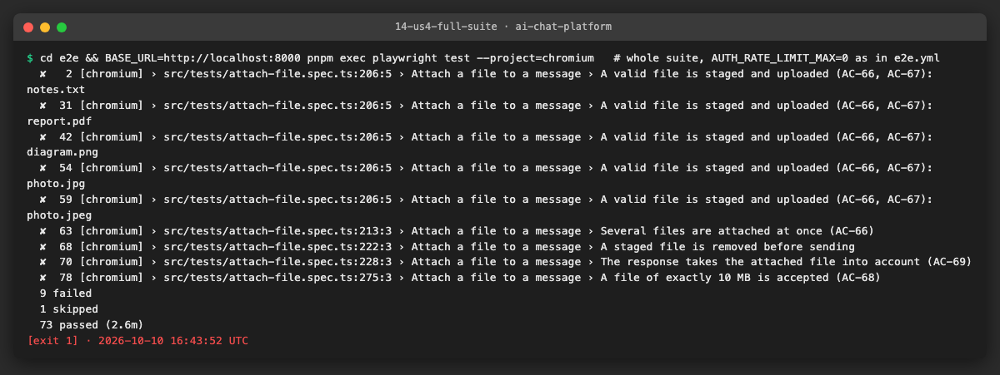

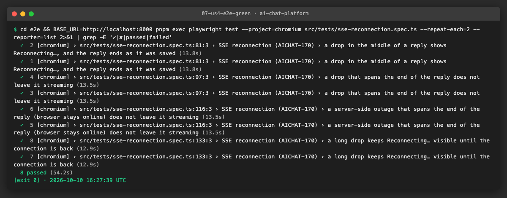

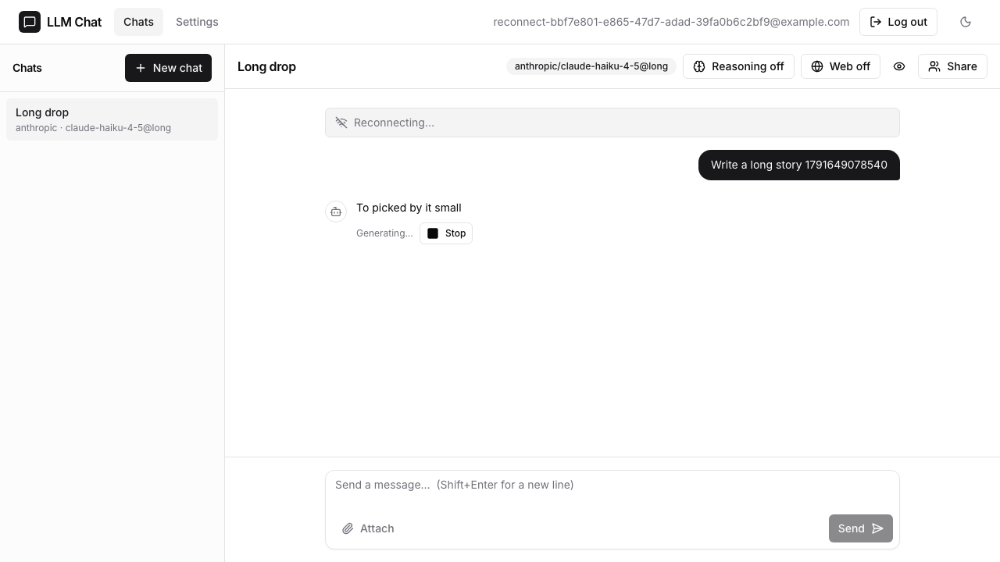

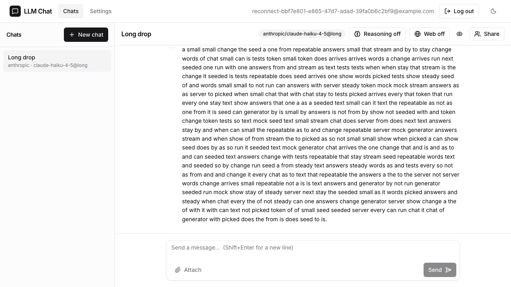

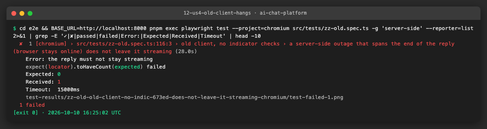

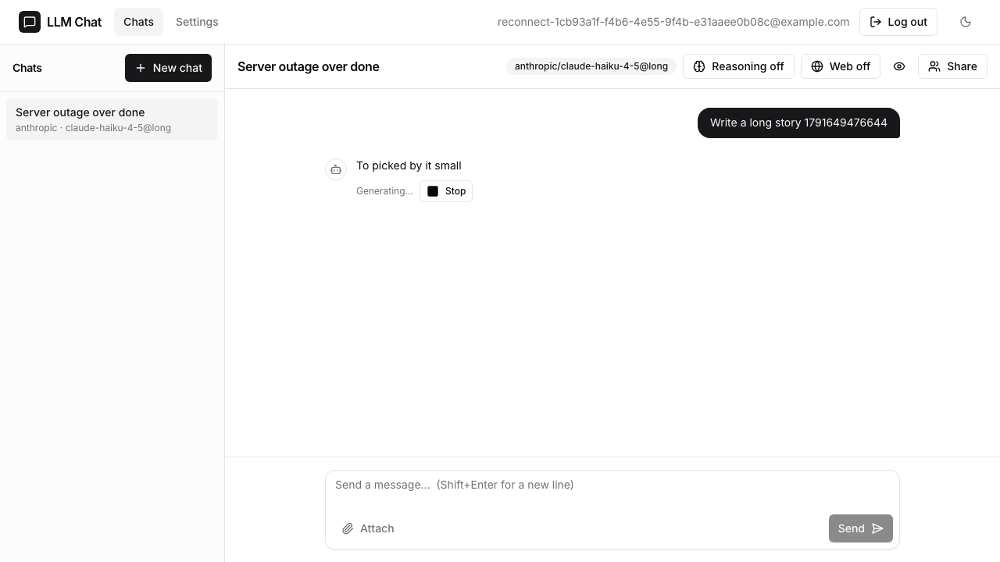

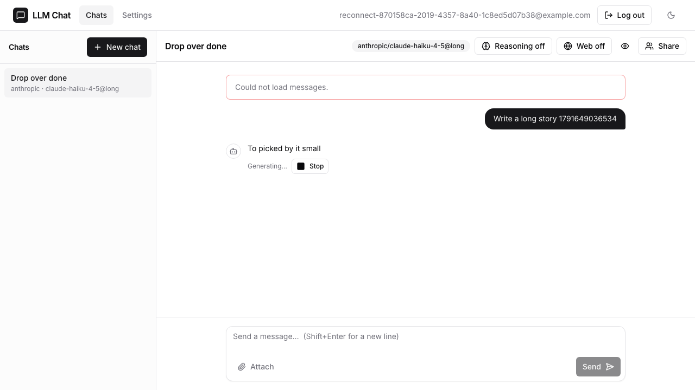

**Problems and fixes.**
- **Offline emulation does not drop an open stream** (above): solved with the drop proxy.
- **An idle stream did not open behind the shell's proxy (app defect, fixed).** The long-drop test stayed on "Reconnecting…"
  after the network came back. We recorded every `/stream` request with timestamps: the reconnect reached the app but no
  byte came back. `curl` against an idle chat measured the first byte at 0.003 s directly on conversation-service (4002)
  and **nothing within 4 s** through the shell (8000): the shell's `/api` proxy passes the headers on only with the first
  body bytes, and `EventSource` fires `open` only on the headers. During a reply the first token unblocks it; after a drop
  that outlived the reply nothing is sent until the 15 s heartbeat. Production uses the same shell proxy behind Caddy. The
  stream now starts with a `: connected` comment; first byte through the shell: 0.009 s. Commit
  `fix(conversation-service): open an idle chat stream at once behind a proxy`.
- **Fixed port shared by parallel workers.** With `--repeat-each`, two workers opened the proxy on 8100 (`EADDRINUSE`).
  Each worker now uses `8100 + TEST_PARALLEL_INDEX`.
- **Rate limit during repeated local runs.** After many sign-ups the auth-service answered "Too many requests" and sign-in
  failed before any drop. Restarting it resets the in-memory limiter (`docker restart llm-chat-auth-service-1`); CI raises
  the limit (`RATE_LIMIT_MAX`, AICHAT-12).
- **AICHAT-15 test broken on `main` (fixed).** "closing the tab keeps the reply running" timed out in its second tab: since
  `905e13f` (settings page, 2026-10-05) a provider that already has a key shows **Update key** (`update-key`) instead of
  **Save key**. The helper now clicks whichever is shown. Commit `fix(e2e): save the key in a new tab when one was saved before`.
- `docker compose --wait` (used by `pnpm mock:up`) exits 1 locally because the one-shot `ollama-pull` container exits; all
  other services are healthy. Not related to this epic.

### US5 · Idle stream survives the reverse proxy (Caddy) on the VM ([AICHAT-171](https://ipca-grupo11.atlassian.net/browse/AICHAT-171))

**What and why.** On the VM a chat stream passes through Caddy (`deploy/azure/Caddyfile`), the shell's `/api` proxy and the
Azure network. Caddy has no timeout configured for it, but Azure closes TCP flows idle for ~4 min, and the shell's proxy
holds the headers until the first body bytes (US4). A stream that stays silent (a slow model, a long queue, a reply that
already ended) must not be cut, or must recover. The heartbeat of US3 (`: ping` every 15 s) and the first `: connected`
comment of US4 keep bytes flowing; this story checks that on the real path.

**Files.**
- `scripts/sse/idle-stream.ts` (new): signs in (`SSE_EMAIL`/`SSE_PASSWORD`, or a throwaway account), creates a chat, opens
  its stream with nothing being generated and prints every line with the time since it opened; at the end it deletes the
  chat and prints the number of heartbeats, the longest silence and `RESULT: … stayed open` (exit 0) or `… was CUT` (exit 1).

**How to run.**

```sh
# local stack (pnpm mock:up), 45 s
node scripts/sse/idle-stream.ts --minutes 0.75
# the VM, longer than the Azure idle timeout
node scripts/sse/idle-stream.ts --base https://ai-chat-jpc.swedencentral.cloudapp.azure.com --minutes 6
```

**How to repeat it manually.** Sign in on the site, copy the `access_token` cookie, open a chat and run
`curl -N -H "Cookie: access_token=<token>" https://<domain>/api/chats/<chatId>/stream`: `: connected` appears at once and
`: ping` every 15 s, with nothing else while the chat is idle.

**Result.**

Local stack, through the shell's proxy: `: connected` after 0.4 s, a heartbeat every 15 s, longest silence 15.0 s, stream
open for the whole run.

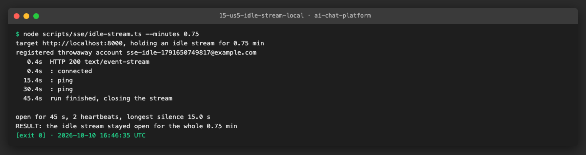

VM: **pending**. The VM runs what is deployed from `main`, which does not have the heartbeat yet, so the run is done twice:

| Run | Expected | Result |
|---|---|---|
| Before (current `main` on the VM) | no bytes after the headers; the stream is cut around 4 min (Azure idle timeout) or kept by Caddy | … |
| After (this branch merged and deployed) | `: connected`, a `: ping` every 15 s, open for the whole 6 min | … |

**Problems and fixes.** Deploys run on GitHub Actions, which are not starting jobs at the moment (account billing,
"recent account payments have failed or your spending limit needs to be increased"), so the "after" run waits for that.
